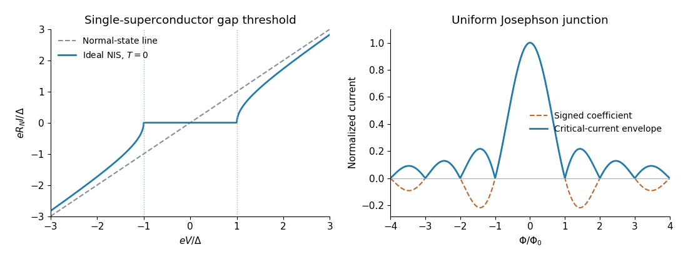

<h1 id="6/b/solution">Solution</h1>

↑ **Parent:** [B](../b.md)

Use a normal-metal--insulator--superconductor junction with a weak tunnelling barrier. For a nearly constant normal-metal [density of states](../../../../density-of-states.md), the differential conductance probes the thermally broadened superconducting quasiparticle [density of states](../../../../density-of-states.md). At sufficiently low temperature, the ideal [BCS theory](../../../../bcs-theory.md) result is

$$
N_s(E)/N_0=\operatorname{Re}\frac{|E|}{\sqrt{E^2-\Delta^2}},\qquad R_N\frac{dI}{dV}=N_s(eV)/N_0.
$$

There is very little single-electron tunnelling for $|eV|<\Delta$, while a sharp onset occurs at $|eV|=\Delta$. The gap can therefore be obtained from the two symmetric onset voltages, $\Delta=e|V_{\mathrm{onset}}|$. For this one-superconductor junction the threshold is $\Delta/e$, not $2\Delta/e$.

Integrating at zero temperature gives the useful current sketch

$$
\boxed{I(V)=\frac{\operatorname{sgn}V}{eR_N}\sqrt{(eV)^2-\Delta^2}\,\Theta(|eV|-\Delta).}
$$

The curve is odd, nearly flat inside the gap, and approaches the normal-state line $V/R_N$ at large $|V|$. The ideal gap-edge singularity is in the slope, not in the current itself. At finite temperature below the transition the onset rounds and thermally activated subgap current appears. Measuring several temperatures distinguishes this rounding from the closing of $\Delta(T)$.

**[Figure 3](#6/b/image-gap-threshold-in-nis-tunnelling-and-the-josephson-interference-envelope). Gap threshold in NIS tunnelling and the Josephson interference envelope**. Original ideal-model plots. Left: the zero-temperature single-electron current into a fully gapped superconductor, with the normal-state line for comparison. Right: the signed sinc coefficient at a fixed phase and its nonnegative critical-current envelope. Finite temperature, nonuniform junction current density and self-field effects are omitted.

## ↑ Ancestors (12)

1. [B](../b.md)
2. [6](../../6.md)
3. [2019](../../../2019-split.md)
4. [Past exam of the condensed matter physics major option course of the University of Oxford](../../../split.md)
5. [Condensed matter physics major option course of the University of Oxford](../../../../condensed-matter-physics-major-option-course-of-the-university-of-oxford.md)
6. [Year 4 of the physics course of the University of Oxford](../../../../year-4-of-the-physics-course-of-the-university-of-oxford.md)
7. [Physics course of the University of Oxford](../../../../physics-course-of-the-university-of-oxford.md)
8. [Undergraduate course of the University of Oxford](../../../../undergraduate-course-of-the-university-of-oxford.md)
9. [Course of the University of Oxford](../../../../course-of-the-university-of-oxford.md)
10. [University of Oxford](../../../../university-of-oxford-split.md)
11. [List of universities](../../../../list-of-universities.md)
12. [Codex Wiki](../../../../split.md)
