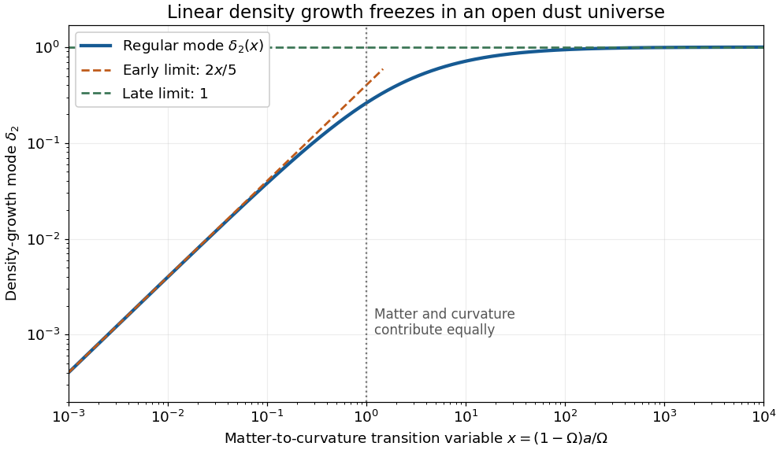

# 2025

↑ **Parent:** [Past exam of the cosmology course of the University of Oxford](../past-exam-of-the-cosmology-course-of-the-university-of-oxford.md)

Source PDF: [Official corrected paper, A15276H1, Trinity Term 2025](https://mmathphys.physics.ox.ac.uk/sites/g/files/vzsiac2991/files/mmathphys/documents/media/a15276h1_correction.pdf). Solutions to all three questions follow; the examination required two. Numbered headings identify the source parts without reproducing their statements. We normalize the [scale factor](../cosmology.md#scale-factor-cosmology) to $a_0=1$ and set the [speed of light](../special-relativity.md#speed-of-light) to $c=1$ except where it is restored explicitly.

**Table of contents**

- [1](#1)
  - [a](#1/a)
    - [Solution](#1/a/solution)
  - [b](#1/b)
    - [Solution](#1/b/solution)
  - [c](#1/c)
    - [Solution](#1/c/solution)
  - [d](#1/d)
    - [Solution](#1/d/solution)
  - [e](#1/e)
    - [Solution](#1/e/solution)
- [2](#2)
  - [a](#2/a)
    - [Solution](#2/a/solution)
  - [b](#2/b)
    - [Solution](#2/b/solution)
  - [c](#2/c)
    - [Solution](#2/c/solution)
  - [d](#2/d)
    - [Solution](#2/d/solution)
- [3](#3)
  - [a](#3/a)
    - [Solution](#3/a/solution)
  - [b](#3/b)
    - [Solution](#3/b/solution)
  - [c](#3/c)
    - [Solution](#3/c/solution)
  - [d](#3/d)
    - [Solution](#3/d/solution)

## 1

↑ **Parent:** [2025](2025.md)

<h3 id="1/a">a</h3>

↑ **Parent:** [1](#1)

<h4 id="1/a/solution">Solution</h4>

↑ **Parent:** [A](#1/a)

The [cosmological principle](../cosmology.md#cosmological-principle) permits a [Friedmann-Lemaître-Robertson-Walker metric](../cosmology.md#friedmann-lemaitre-robertson-walker-metric). The [Friedmann equation](../cosmology.md#friedmann-equations), with vanishing [cosmological constant](../cosmology.md#cosmological-constant), is

$$
H^2=\frac{8\pi G}{3}\bar\rho_m-\frac{k}{a^2}.
$$

For separately conserved [pressureless matter](../cosmology.md#pressureless-matter), the [cosmological continuity equation](../cosmology.md#cosmological-continuity-equation) gives $\bar\rho_m=\bar\rho_{m0}a^{-3}$: its rest [energy](../energy.md) is conserved while its physical [volume](../geometry-and-topology.md#volume) grows as $a^3$. Define the present [critical density](../cosmology.md#critical-density) and [matter density parameter](../cosmology.md#matter-density-parameter) by

$$
\rho_{\mathrm{crit},0}=\frac{3H_0^2}{8\pi G},\qquad \Omega=\frac{\bar\rho_{m0}}{\rho_{\mathrm{crit},0}}.
$$

Evaluating the [Friedmann equation](../cosmology.md#friedmann-equations) today gives $-k=H_0^2(1-\Omega)>0$. Thus the model has negative [spatial curvature of an FLRW universe](../cosmology.md#spatial-curvature-of-an-flrw-universe); the second contribution to $H^2$ represents that [spatial curvature of an FLRW universe](../cosmology.md#spatial-curvature-of-an-flrw-universe), rather than another material fluid. Taking the expanding branch gives

$$
\boxed{H(a)=H_0\sqrt{\Omega a^{-3}+(1-\Omega)a^{-2}}.}
$$

Here $0<\Omega<1$. At early times, $a\ll\Omega/(1-\Omega)$, [matter domination](../linear-cosmological-density-perturbation.md#matter-domination) gives $\dot a\simeq H_0\sqrt\Omega\,a^{-1/2}$, hence, measuring [cosmic time](../cosmology.md#cosmic-time) from the [Big Bang](../cosmology.md#big-bang),

$$
\boxed{a(t)\simeq\left(\frac32H_0\sqrt\Omega\,t\right)^{2/3}.}
$$

At late times the $a^{-2}$ term dominates the [Friedmann equation](../cosmology.md#friedmann-equations). This [curvature-dominated universe](../cosmology.md#curvature-dominated-universe) has $\dot a\to H_0\sqrt{1-\Omega}$ and therefore

$$
\boxed{a(t)\sim H_0\sqrt{1-\Omega}\,t.}
$$

The late expansion approaches the coasting [Milne model](../cosmology.md#milne-model). The early limit belongs to this idealized matter-only model; including [radiation in cosmology](../cosmology.md#radiation-in-cosmology) would alter the sufficiently early evolution.

<h3 id="1/b">b</h3>

↑ **Parent:** [1](#1)

<h4 id="1/b/solution">Solution</h4>

↑ **Parent:** [B](#1/b)

Introduce the positive [dimensionless quantity](../physics.md#dimensionless-quantity) $x=(1-\Omega)a/\Omega$ and the time scale $A=\Omega/[H_0(1-\Omega)^{3/2}]$. The [Friedmann equation](../cosmology.md#friedmann-equations) gives the separable relation

$$
dt=\frac{da}{aH(a)}=A\sqrt{\frac{x}{1+x}}\,dx.
$$

For $x=(\cosh\theta-1)/2=\sinh^2(\theta/2)$, $\theta\geq0$, the [hyperbolic function](../calculus.md#hyperbolic-function) identities give

$$
\sqrt{\frac{x}{1+x}}\,dx
=\tanh\frac\theta2\,\frac{\sinh\theta}{2}\,d\theta
=\frac{\cosh\theta-1}{2}\,d\theta.
$$

Choose the [constant of integration](../integral.md#constant-of-integration) so that $t=0$ at $a=0$. The resulting [parametric equation](../geometry-and-topology.md#parametric-equation) for the [open matter-dominated Friedmann solution](../cosmology.md#open-matter-dominated-friedmann-solution) is

$$
\boxed{t=\frac{\Omega}{2H_0(1-\Omega)^{3/2}}(\sinh\theta-\theta),\qquad a=\frac{\Omega}{2(1-\Omega)}(\cosh\theta-1).}
$$

For $\theta\ll1$, the [Taylor series](../calculus.md#taylor-series) give

$$
t=\frac{\Omega\theta^3}{12H_0(1-\Omega)^{3/2}}[1+O(\theta^2)],\qquad a=\frac{\Omega\theta^2}{4(1-\Omega)}[1+O(\theta^2)].
$$

Eliminating $\theta$ yields $a^{3/2}\simeq(3/2)H_0\sqrt\Omega\,t$, exactly the early [matter-dominated universe](../linear-cosmological-density-perturbation.md#matter-domination) result. For $\theta\gg1$, $\sinh\theta\sim\cosh\theta\sim e^\theta/2$, whereas $\theta/e^\theta\to0$. The [ratio](../arithmetic.md#ratio) of the two parametric expressions tends to $a/t=H_0\sqrt{1-\Omega}$, recovering the [curvature-dominated universe](../cosmology.md#curvature-dominated-universe) result including its coefficient.

<h3 id="1/c">c</h3>

↑ **Parent:** [1](#1)

<h4 id="1/c/solution">Solution</h4>

↑ **Parent:** [C](#1/c)

The [matter density parameter](../cosmology.md#matter-density-parameter) at general [scale factor](../cosmology.md#scale-factor-cosmology) is

$$
\Omega_m(a)=\frac{\Omega a^{-3}}{\Omega a^{-3}+(1-\Omega)a^{-2}}=\frac1{1+x}.
$$

The reference to the definition of $x$ in the printed part points to the wrong equation number: the needed definition is the substitution in part (b). Write $B=(1-\Omega)/\Omega$, so $x=Ba$, $d/da=B\,d/dx$, and

$$
H=\frac{H_0(1-\Omega)^{3/2}}{\Omega}\,x^{-3/2}(1+x)^{1/2}.
$$

Expanding the [matter growth equation as a function of scale factor](../linear-cosmological-density-perturbation.md#matter-growth-equation-as-a-function-of-scale-factor) first gives

$$
\frac{d^2\delta}{da^2}+\left(\frac3a+\frac{d\ln H}{da}\right)\frac{d\delta}{da}-\frac{3\Omega_m(a)}{2a^2}\delta=0.
$$

Using $d\ln H/dx=-3/(2x)+1/[2(1+x)]$ and dividing by $B^2$, we obtain

$$
\boxed{\delta''+\frac12\left(\frac3x+\frac1{1+x}\right)\delta'-\frac{3\delta}{2x^2(1+x)}=0,}
$$

where these primes denote [derivatives](../calculus.md#derivative) with respect to $x$. For the proposed [linear cosmological density perturbation](../linear-cosmological-density-perturbation.md) $\delta_1=(1+x)^{1/2}x^{-3/2}$,

$$
\frac{\delta_1'}{\delta_1}=-\frac{2x+3}{2x(1+x)},\qquad
\frac{\delta_1''}{\delta_1}=\frac{8x^2+24x+15}{4x^2(1+x)^2}.
$$

The left side of the [differential equation](../differential-equation.md), divided by $\delta_1$, has numerator

$$
(8x^2+24x+15)-(4x+3)(2x+3)-6(1+x)=0
$$

over the common denominator $4x^2(1+x)^2$. This proves the result directly. Also $\delta_1'/\delta_1<0$ for every $x>0$, so it is a **decaying mode**:

$$
\boxed{\delta_1\sim x^{-3/2}\quad(x\to0),\qquad \delta_1\sim x^{-1}\quad(x\to\infty).}
$$

It is proportional to the [Hubble parameter](../cosmology.md#hubble-parameter), an instance of the [Hubble parameter as a solution of the dust growth equation](../linear-cosmological-density-perturbation.md#hubble-parameter-as-a-solution-of-the-dust-growth-equation).

<h3 id="1/d">d</h3>

↑ **Parent:** [1](#1)

<h4 id="1/d/solution">Solution</h4>

↑ **Parent:** [D](#1/d)

To construct the regular [open dust linear growth mode](../linear-cosmological-density-perturbation.md#open-dust-linear-growth-mode), use [reduction of order](../linear-ordinary-differential-equation.md#reduction-of-order), writing $\delta=\delta_1u$ and denoting the coefficient of $\delta'$ by $p(x)$. Since $\delta_1$ solves the [homogeneous linear differential equation](../differential-equation.md#homogeneous-linear-differential-equation), its terms cancel and leave

$$
u''+\left(2\frac{\delta_1'}{\delta_1}+p\right)u'=0,\qquad p=\frac3{2x}+\frac1{2(1+x)}.
$$

The [integrating factor](../linear-ordinary-differential-equation.md#integrating-factor) for this first-order equation in $u'$ is $\delta_1^2e^{\int p\,dx}$, so

$$
u'=C\frac{e^{-\int p\,dx}}{\delta_1^2}
=C\frac{x^{-3/2}(1+x)^{-1/2}}{(1+x)x^{-3}}
=C\left(\frac{x}{1+x}\right)^{3/2}.
$$

Choose $C=1$ and the lower [integration](../integral.md) endpoint zero. This selects the mode regular at early times without adding a multiple of $\delta_1$:

$$
\boxed{\delta_2(x)=\sqrt{\frac{1+x}{x^3}}\int_0^x\left(\frac{y}{1+y}\right)^{3/2}\,dy.}
$$

Its [Wronskian](../linear-ordinary-differential-equation.md#wronskian) with $\delta_1$ is $\delta_1\delta_2'-\delta_1'\delta_2=x^{-3/2}(1+x)^{-1/2}>0$, proving [linear independence](../vector-space.md#linear-independence).

No explicit [antiderivative](../integral.md#antiderivative) is needed for the limits. For $x\ll1$, the integrand is $y^{3/2}[1+O(y)]$, whence its [integral](../integral.md) is $(2/5)x^{5/2}[1+O(x)]$. For $x\gg1$, the integrand tends to one, so its [integral](../integral.md) divided by $x$ tends to one, while $x\delta_1\to1$. Consequently

$$
\boxed{\delta_2\sim\frac25x\quad(x\to0),\qquad \delta_2\to1\quad(x\to\infty).}
$$

Early [matter domination](../linear-cosmological-density-perturbation.md#matter-domination) permits [gravitational instability](../astrophysical-fluid-dynamics.md#gravitational-instability) to amplify the [density contrast](../linear-cosmological-density-perturbation.md#density-contrast) in proportion to the [scale factor](../cosmology.md#scale-factor-cosmology). Later, the [matter density parameter](../cosmology.md#matter-density-parameter) tends to zero and [Hubble friction](../cosmology.md#hubble-friction) suppresses further amplification. Indeed, for $a\propto t$, neglecting the matter source in the [linear matter perturbation growth equation](../linear-cosmological-density-perturbation.md#linear-matter-perturbation-growth-equation) gives $\ddot\delta+2\dot\delta/t\simeq0$, whose modes are a constant and $t^{-1}$. These agree with the late limits of the two exact modes.

**[Figure 1](#1/d/image-linear-density-growth-saturates-when-spatial-curvature-dominates). Linear density growth saturates when spatial curvature dominates**. The regular mode tends to $2x/5$ during [matter domination](../linear-cosmological-density-perturbation.md#matter-domination) and to one during [curvature-dominated universe](../cosmology.md#curvature-dominated-universe). Here $x=1$ marks equal contributions of matter and [spatial curvature of an FLRW universe](../cosmology.md#spatial-curvature-of-an-flrw-universe) to the [Friedmann equation](../cosmology.md#friedmann-equations). The normalization is the one in part (d).

<h3 id="1/e">e</h3>

↑ **Parent:** [1](#1)

<h4 id="1/e/solution">Solution</h4>

↑ **Parent:** [E](#1/e)

In the [integral](../integral.md) from part (d), set $y=\sinh^2u$. Its upper endpoint is $u_x=\operatorname{arsinh}\sqrt x$, equal to $\theta/2$ in part (b). The [hyperbolic function](../calculus.md#hyperbolic-function) identity

$$
\left(\frac{y}{1+y}\right)^{3/2}dy
=2\frac{\sinh^4u}{\cosh^2u}\,du
=2(\cosh^2u-2+\operatorname{sech}^2u)\,du
$$

gives the [antiderivative](../integral.md#antiderivative)

$$
I(x)=\left[\frac12\sinh(2u)-3u+2\tanh u\right]_0^{u_x}
=\sqrt{x(1+x)}+2\sqrt{\frac{x}{1+x}}-3\operatorname{arsinh}\sqrt x.
$$

Multiplication by $\delta_1$ therefore yields

$$
\boxed{\delta_2(x)=1+\frac3x-3\sqrt{\frac{1+x}{x^3}}\operatorname{arsinh}\sqrt x
=1+\frac3x-3\sqrt{\frac{1+x}{x^3}}\ln(\sqrt x+\sqrt{1+x}).}
$$

At small $x$, cancellation between the terms leaves the [Taylor series](../calculus.md#taylor-series) $\delta_2=2x/5-8x^2/35+16x^3/105+O(x^4)$. At large $x$, $\operatorname{arsinh}\sqrt x=\tfrac12\ln(4x)+O(x^{-1})$, so the correction to one is $[3-\tfrac32\ln(4x)]/x+O(\ln x/x^2)$. Both checks agree with part (d); the [integral](../integral.md) or the small-$x$ [Taylor series](../calculus.md#taylor-series) is preferable to subtracting large nearly equal terms in a numerical evaluation near zero.

## 2

↑ **Parent:** [2025](2025.md)

<h3 id="2/a">a</h3>

↑ **Parent:** [2](#2)

<h4 id="2/a/solution">Solution</h4>

↑ **Parent:** [A](#2/a)

The [Helmholtz decomposition](../multivariable-calculus.md#helmholtz-decomposition) separates the [peculiar velocity](../cosmology.md#peculiar-velocity) into a [gradient field](../multivariable-calculus.md#gradient-field) and a [transverse vector field](../electromagnetism.md#transverse-vector-field):

$$
\mathbf v=\nabla V+\mathbf v_\perp,\qquad \nabla\cdot\mathbf v_\perp=0.
$$

With decaying or periodic spatial boundary conditions this is equivalently the [Fourier transform](../fourier-transform.md) projection, for $k\ne0$,

$$
v_{\perp i}(\mathbf k)=\left(\delta_{ij}-\frac{k_ik_j}{k^2}\right)v_j(\mathbf k).
$$

The [transverse projection operator](../inner-product.md#transverse-projection-operator) annihilates a [gradient](../multivariable-calculus.md#gradient), because $(\delta_{ij}-k_ik_j/k^2)k_j=0$. Both forces in the linear [cosmological Euler equation](../linear-cosmological-perturbation-theory.md#cosmological-euler-equation) are [gradients](../multivariable-calculus.md#gradient), with spatially homogeneous coefficients. Applying the [transverse projection operator](../inner-product.md#transverse-projection-operator) therefore gives

$$
\dot{\mathbf v}_\perp+H\mathbf v_\perp=0.
$$

Since $H=\dot a/a$, this is $d(a\mathbf v_\perp)/dt=0$, and hence

$$
\boxed{\mathbf v_\perp(\mathbf x,t)=\frac{a(t_i)}{a(t)}\mathbf v_\perp(\mathbf x,t_i).}
$$

At this order the scalar pressure and gravitational forces cannot generate [vorticity](../vorticity.md); an initially vanishing [transverse vector field](../electromagnetism.md#transverse-vector-field) remains zero. Its nonzero initial value is damped by [cosmic expansion](../cosmology.md#expansion-of-the-universe).

<h3 id="2/b">b</h3>

↑ **Parent:** [2](#2)

<h4 id="2/b/solution">Solution</h4>

↑ **Parent:** [B](#2/b)

Use the source's $+---$ [metric signature](../topological-manifold.md#metric-signature) and $x^0=\eta$, with [conformal time](../cosmology.md#conformal-time) [derivatives](../calculus.md#derivative) denoted by primes. For this [vector cosmological perturbation](../linear-cosmological-perturbation-theory.md#vector-cosmological-perturbation), the [metric tensor](../general-relativity.md#metric-tensor) and [inverse metric](../general-relativity.md#inverse-metric) through first order are

$$
g_{00}=a^2,\quad g_{0i}=0,\quad g_{ij}=-a^2(\delta_{ij}-J_{ij}),\qquad
g^{00}=a^{-2},\quad g^{0i}=0,\quad g^{ij}=-a^{-2}(\delta_{ij}+J_{ij}).
$$

Spatial indices on perturbations are raised with the background [Kronecker delta](../multilinear-algebra.md#kronecker-delta). The [Christoffel symbol](../riemannian-geometry.md#christoffel-symbol) formula is

$$
\Gamma^\alpha_{\beta\gamma}=\frac12g^{\alpha\sigma}(\partial_\beta g_{\sigma\gamma}+\partial_\gamma g_{\sigma\beta}-\partial_\sigma g_{\beta\gamma}).
$$

Because $a=a(\eta)$ only, it gives

$$
\boxed{\Gamma^0_{00}=\frac12a^{-2}(2aa')=\mathcal H,\qquad \Gamma^0_{0i}=\frac12a^{-2}\partial_i(a^2)=0.}
$$

For the other requested [Christoffel symbols](../riemannian-geometry.md#christoffel-symbol), only the time [derivative](../calculus.md#derivative) of the spatial [metric tensor](../general-relativity.md#metric-tensor) contributes:

$$
\Gamma^0_{ij}=-\frac12a^{-2}\partial_\eta g_{ij}
=\frac12a^{-2}\left[2aa'(\delta_{ij}-J_{ij})-a^2J'_{ij}\right].
$$

Thus

$$
\boxed{\Gamma^0_{ij}=\mathcal H(\delta_{ij}-J_{ij})-\frac12J'_{ij}.}
$$

Finally contract the first upper and first lower spatial indices, summing over $i$:

$$
\gamma^i_{ij}=\frac12(\partial_iJ_{ij}+\partial_jJ_{ii}-\partial_iJ_{ij})=\frac12\partial_jJ_{ii}.
$$

Since $J_{ii}=2\partial_iF_i=0$ by the [transverse vector field](../electromagnetism.md#transverse-vector-field) condition on $\mathbf F$,

$$
\boxed{\gamma^i_{ij}=0.}
$$

The useful [Christoffel symbol](../riemannian-geometry.md#christoffel-symbol) traces are consequently $\Gamma^\mu_{\mu0}=4\mathcal H$ and $\Gamma^\mu_{\mu j}=0$ to first order: the first uses $J'_{ii}=0$ and the second uses the contraction just proved.

<h3 id="2/c">c</h3>

↑ **Parent:** [2](#2)

<h4 id="2/c/solution">Solution</h4>

↑ **Parent:** [C](#2/c)

Define the [momentum density](../stress-energy-tensor.md#momentum-density) $q_i=(\bar\rho+\bar P)v_{\perp i}$, lowering its spatial label with $\delta_{ij}$, so the mixed [stress-energy tensor](../stress-energy-tensor.md) obeys $T^i{}_0=q_i$ and $T^0{}_i=-q_i$. All products of $J_{ij}$ or its [derivatives](../calculus.md#derivative) with $q_i$ are second order and must be dropped in [linear cosmological perturbation theory](../linear-cosmological-perturbation-theory.md).

For $\nu=0$, the three terms in [stress-energy conservation](../stress-energy-tensor.md#stress-energy-conservation) are

$$
\partial_\mu T^\mu{}_0=\bar\rho'+\partial_iq_i,\qquad
\Gamma^\mu_{\mu\sigma}T^\sigma{}_0=4\mathcal H\bar\rho,\qquad
\Gamma^\sigma_{\mu0}T^\mu{}_\sigma=\mathcal H\bar\rho-3\mathcal H\bar P.
$$

Here the trace $J'_{ii}$ vanishes, $\Gamma^i_{00}=\Gamma^0_{i0}=0$, and $\partial_iq_i=(\bar\rho+\bar P)\partial_iv_\perp^i=0$. Thus

$$
\boxed{\bar\rho'+3\mathcal H(\bar\rho+\bar P)=0.}
$$

For $\nu=i$, spatial [pressure](../pressure.md) gradients vanish because this is a purely [vector cosmological perturbation](../linear-cosmological-perturbation-theory.md#vector-cosmological-perturbation). The first two terms are

$$
\partial_\mu T^\mu{}_i=-q_i',\qquad
\Gamma^\mu_{\mu\sigma}T^\sigma{}_i=-4\mathcal Hq_i.
$$

In the remaining contraction, the two background-connection times [momentum density](../stress-energy-tensor.md#momentum-density) terms cancel:

$$
\Gamma^0_{ji}T^j{}_0+\Gamma^j_{0i}T^0{}_j=\mathcal Hq_i-\mathcal Hq_i=0.
$$

The other terms are $\Gamma^0_{0i}\bar\rho=0$ and $-\bar P\Gamma^j_{ji}=0$. Consequently

$$
\boxed{[(\bar\rho+\bar P)v_{\perp i}]'+4\mathcal H(\bar\rho+\bar P)v_{\perp i}=0.}
$$

Expanding this [conservation law](../mathematical-physics.md#conservation-law) and using the background [cosmological continuity equation](../cosmology.md#cosmological-continuity-equation) gives the equivalent [peculiar velocity](../cosmology.md#peculiar-velocity) equation, when $\bar\rho+\bar P\ne0$,

$$
\boxed{v_{\perp i}'+\left(\mathcal H+\frac{\bar P'}{\bar\rho+\bar P}\right)v_{\perp i}=0.}
$$

<h3 id="2/d">d</h3>

↑ **Parent:** [2](#2)

<h4 id="2/d/solution">Solution</h4>

↑ **Parent:** [D](#2/d)

The $\nu=0$ result is the background [cosmological perfect-fluid continuity equation](../cosmology.md#cosmological-perfect-fluid-continuity-equation). For a comoving region of physical [volume](../geometry-and-topology.md#volume) proportional to $a^3$, it is precisely

$$
d(\bar\rho a^3)=-\bar P\,d(a^3),
$$

expressing local [conservation of energy](../mathematical-physics.md#conservation-of-energy) including the [pressure-volume work](../energy.md#pressure-volume-work) done during [cosmic expansion](../cosmology.md#expansion-of-the-universe). A [transverse vector field](../electromagnetism.md#transverse-vector-field) has no velocity [divergence](../multivariable-calculus.md#divergence), and the vector spatial [metric tensor](../general-relativity.md#metric-tensor) has no trace perturbation, so neither produces a first-order compression or density change.

The spatial result is [vector-fluid momentum dilution](../linear-cosmological-perturbation-theory.md#vector-fluid-momentum-dilution) and integrates immediately:

$$
(a^4q_i)'=0,\qquad
\boxed{q_i(\eta)=q_i(\eta_i)\left(\frac{a_i}{a}\right)^4.}
$$

Thus, for any specified background [perfect fluid](../general-relativity.md#perfect-fluid),

$$
\boxed{v_{\perp i}(\eta)=v_{\perp i}(\eta_i)\left(\frac{a_i}{a}\right)^4\frac{\bar\rho_i+\bar P_i}{\bar\rho+\bar P}.}
$$

A statement about $\mathbf q$ alone does not fix the velocity scaling independently of the [equation of state](../pressure.md#equation-of-state). For constant [equation-of-state parameter](../cosmology.md#equation-of-state-parameter) $w\ne-1$, the [cosmological continuity equation](../cosmology.md#cosmological-continuity-equation) gives $\bar\rho\propto a^{-3(1+w)}$ and hence

$$
\boxed{\mathbf v_\perp\propto a^{3w-1}.}
$$

For [pressureless matter](../cosmology.md#pressureless-matter), $w=0$ and $\mathbf v_\perp\propto a^{-1}$, exactly as in the Newtonian calculation in part (a). For [radiation in cosmology](../cosmology.md#radiation-in-cosmology), $w=1/3$ and the vector [peculiar velocity](../cosmology.md#peculiar-velocity) remains constant, although its [momentum density](../stress-energy-tensor.md#momentum-density) still falls as $a^{-4}$. More generally, for a barotropic [perfect fluid](../general-relativity.md#perfect-fluid) with [cosmological adiabatic sound speed](../linear-cosmological-density-perturbation.md#cosmological-adiabatic-sound-speed) $c_a^2=\bar P'/\bar\rho'$, the equivalent equation is $\mathbf v_\perp'+\mathcal H(1-3c_a^2)\mathbf v_\perp=0$. The Newtonian damping law describes nonrelativistic inertia; it need not apply to a relativistic [perfect fluid](../general-relativity.md#perfect-fluid). A pure [cosmological constant](../cosmology.md#cosmological-constant) has $\bar\rho+\bar P=0$ and supplies no such fluid velocity degree of freedom.

## 3

↑ **Parent:** [2025](2025.md)

<h3 id="3/a">a</h3>

↑ **Parent:** [3](#3)

<h4 id="3/a/solution">Solution</h4>

↑ **Parent:** [A](#3/a)

The [cosmic microwave background](../cosmic-microwave-background.md) consists of relic [photons](../quantum-mechanics.md#photon) from the early hot, nearly thermal [photon-baryon fluid](../cosmic-microwave-background-anisotropy.md#photon-baryon-fluid). Before [cosmological recombination](../cosmology.md#recombination-cosmology), abundant free [electrons](../physics.md#electron) repeatedly scatter [photons](../quantum-mechanics.md#photon) by [Thomson scattering](../cosmic-microwave-background-anisotropy.md#thomson-scattering). Their [mean free path](../ideal-gas.md#mean-free-path) $\lambda_\gamma=(n_e\sigma_T)^{-1}$ is short and their [Thomson scattering](../cosmic-microwave-background-anisotropy.md#thomson-scattering) rate $n_e\sigma_Tc$ is much greater than the [Hubble parameter](../cosmology.md#hubble-parameter). An earlier [photon](../quantum-mechanics.md#photon) therefore cannot stream directly to us: subsequent scattering repeatedly changes its direction.

As [cosmic expansion](../cosmology.md#expansion-of-the-universe) cools the plasma to about $T\simeq3000\,\mathrm K$, [electrons](../physics.md#electron) and [protons](../physics.md#proton) combine into neutral [hydrogen](../chemical-substance.md#hydrogen). The free-electron abundance drops rapidly, the scattering [optical depth](../astrophysics.md#optical-depth) to the observer becomes of order one, and [photon decoupling](../cosmology.md#photon-decoupling) occurs. Since the [cosmic microwave background](../cosmic-microwave-background.md) [temperature](../temperature.md) scales as $T=T_0(1+z)$, with $T_0\simeq2.725\,\mathrm K$, this occurs at $z\simeq1100$. The small [baryon-to-photon ratio](../cosmology.md#baryon-to-photon-ratio) delays neutralization to well below $13.6\,\mathrm{eV}/k_B$: the high-energy tail contains enough [photons](../quantum-mechanics.md#photon) to ionize [hydrogen](../chemical-substance.md#hydrogen) until the [temperature](../temperature.md) is much lower than the [Hydrogen binding energy](../cosmology.md#hydrogen-binding-energy) expressed as a [temperature](../temperature.md). The observed [cosmic microwave background](../cosmic-microwave-background.md) is primarily this pre-existing radiation undergoing its last scattering; its nearly [blackbody spectrum](../statistical-physics.md#blackbody-spectrum) is then preserved by [cosmological redshift](../cosmology.md#cosmological-redshift).

For the requested estimate take a flat [matter-dominated universe](../linear-cosmological-density-perturbation.md#matter-domination), $a(t)=(t/t_0)^{2/3}$. Restore $c$ in distances. The [comoving particle horizon](../cosmology.md#comoving-particle-horizon) at [cosmological recombination](../cosmology.md#recombination-cosmology) and the [comoving radial distance](../cosmology.md#comoving-radial-distance) to the [Cosmic microwave background last-scattering surface](../cosmic-microwave-background.md#cosmic-microwave-background-last-scattering-surface) are

$$
r_{\mathrm{hor},*}=c\int_0^{t_*}\frac{dt}{a(t)}=3ct_0\sqrt{a_*},\qquad
\chi_*=c\int_{t_*}^{t_0}\frac{dt}{a(t)}=3ct_0(1-\sqrt{a_*}).
$$

The proper [particle horizon](../cosmology.md#particle-horizon) is $a_*r_{\mathrm{hor},*}=3ct_*$ and the [angular diameter distance](../cosmology.md#angular-diameter-distance) is $D_A=a_*\chi_*$. Therefore the [angular particle-horizon size in a power-law universe](../cosmology.md#angular-particle-horizon-size-in-a-power-law-universe), taking one horizon radius as the transverse length, is

$$
\boxed{\theta_{\mathrm{hor}}\simeq\frac{r_{\mathrm{hor},*}}{\chi_*}=\frac1{\sqrt{1+z_*}-1}\simeq0.0311\,\mathrm{rad}\simeq1.78^\circ.}
$$

The angular diameter of a patch of that radius is about $3.56^\circ$. The factor of two is a radius-versus-diameter convention; either gives a horizon scale of only a few degrees. This is a [particle horizon](../cosmology.md#particle-horizon), rather than the smaller [sound horizon](../cosmic-microwave-background-anisotropy.md#sound-horizon). Including early [radiation in cosmology](../cosmology.md#radiation-in-cosmology) changes the numerical estimate but preserves its order of magnitude.

The [horizon problem](../cosmology.md#horizon-problem) is that the [cosmic microwave background](../cosmic-microwave-background.md) has almost the same [temperature](../temperature.md) across the whole sky, including pairs of regions whose past light cones do not overlap in this noninflating model. Local thermal equilibration cannot explain that observation within this history. A sufficiently long period of [cosmic inflation](../cosmic-inflation.md) makes the [comoving Hubble radius](../cosmology.md#comoving-hubble-radius) decrease: a region once small enough to share a causal past can expand to encompass our entire observed [Cosmic microwave background last-scattering surface](../cosmic-microwave-background.md#cosmic-microwave-background-last-scattering-surface). After [reheating](../cosmic-inflation.md#reheating), it can be homogeneous across many later [particle horizon](../cosmology.md#particle-horizon) patches. The matter-only estimate integrates from a decelerating [Big Bang](../cosmology.md#big-bang); extending the earlier history by [cosmic inflation](../cosmic-inflation.md) changes that causal conclusion.

<h3 id="3/b">b</h3>

↑ **Parent:** [3](#3)

<h4 id="3/b/solution">Solution</h4>

↑ **Parent:** [B](#3/b)

The four contributions have distinct physical origins. The intrinsic [photon temperature perturbation](../cosmic-microwave-background-anisotropy.md#photon-temperature-perturbation) is $\delta_\gamma/4$: a local [blackbody radiation](../statistical-physics.md#black-body-radiation) [energy density](../statistical-physics.md#energy-density) satisfies $\rho_\gamma\propto T^4$, so its first-order fractional perturbation is four times the fractional [temperature](../temperature.md) perturbation. The endpoint [cosmological Newtonian potential](../linear-cosmological-perturbation-theory.md#cosmological-newtonian-potential) term $\psi_*$ is the [gravitational redshift](../general-relativity.md#gravitational-redshift) between the emitting plasma and the observer; escaping a negative potential well lowers the measured [photon](../quantum-mechanics.md#photon) [energy](../energy.md). Together with the intrinsic contribution it produces the ordinary [Sachs-Wolfe effect](../cosmic-microwave-background-anisotropy.md#sachs-wolfe-effect). The term $-\hat{\mathbf n}\cdot\mathbf v_*$ is the [Doppler CMB anisotropy](../cosmic-microwave-background-anisotropy.md#doppler-cmb-anisotropy), caused by the plasma's line-of-sight [peculiar velocity](../cosmology.md#peculiar-velocity) at last scattering, with the source's direction convention.

Finally, $2\int d\chi\,\psi'$ is the [Integrated Sachs-Wolfe effect](../cosmic-microwave-background-anisotropy.md#integrated-sachs-wolfe-effect). A [photon](../quantum-mechanics.md#photon) passing through a static potential well gains [energy](../energy.md) on entry and loses it on exit, with no net shift. When the potential evolves while the [photon](../quantum-mechanics.md#photon) crosses, the two shifts fail to cancel. The factor two is the sum of the temporal and spatial scalar-potential contributions when [anisotropic stress](../stress-energy-tensor.md#anisotropic-stress) is negligible, so the two potentials are equal. The prime is a [partial derivative](../multivariable-calculus.md#partial-derivative) at fixed [comoving coordinate](../cosmology.md#comoving-coordinate); it is not the total [derivative](../calculus.md#derivative) along the light ray.

For a low-[cosmological redshift](../cosmology.md#cosmological-redshift) galaxy sample, the intrinsic, endpoint-potential and last-scattering [Doppler CMB anisotropy](../cosmic-microwave-background-anisotropy.md#doppler-cmb-anisotropy) terms are localized near $z\simeq1100$, whereas the [galaxy density contrast](../large-scale-structure-of-the-universe.md#galaxy-density-contrast) is measured much nearer us. In the [Limber approximation](../linear-cosmological-perturbation-theory.md#limber-approximation) their radial kernels have no overlap, so their leading cross correlations vanish. The late [Integrated Sachs-Wolfe effect](../cosmic-microwave-background-anisotropy.md#integrated-sachs-wolfe-effect) samples the same nearby evolving potentials as the [galaxies](../galaxy.md), giving the desired [late-time CMB-matter cross correlation](../cosmic-microwave-background-anisotropy.md#late-time-cmb-matter-cross-correlation). The early [Integrated Sachs-Wolfe effect](../cosmic-microwave-background-anisotropy.md#integrated-sachs-wolfe-effect) near [matter-radiation equality](../cosmology.md#matter-radiation-equality) is likewise radially separated.

This is the leading linear, separated-kernel description intended here. The primary [Cosmic microwave background anisotropy](../cosmic-microwave-background-anisotropy.md) and late [density contrast](../linear-cosmological-density-perturbation.md#density-contrast) share primordial initial conditions, so their exact large-angle correlation need not be identically zero outside the [Limber approximation](../linear-cosmological-perturbation-theory.md#limber-approximation). Additional secondary effects, such as the [Sunyaev-Zeldovich effect](../cosmic-microwave-background.md#sunyaev-zeldovich-effect), can also correlate with [galaxies](../galaxy.md) in real maps; they are absent from the stipulated linear expression.

<h3 id="3/c">c</h3>

↑ **Parent:** [3](#3)

<h4 id="3/c/solution">Solution</h4>

↑ **Parent:** [C](#3/c)

Let $p(z)$ be the normalized galaxy [probability density](../wave-function.md#probability-density) per unit [cosmological redshift](../cosmology.md#cosmological-redshift), $\int p(z)\,dz=1$, and let $b_g$ be its linear [galaxy bias](../large-scale-structure-of-the-universe.md#galaxy-bias). In a spatially flat background with $c=1$, $d\chi=dz/H(z)$. Thus the projected [galaxy density contrast](../large-scale-structure-of-the-universe.md#galaxy-density-contrast) is

$$
\delta_g(\hat{\mathbf n})=\int dz\,p(z)b_g\delta(\chi(z)\hat{\mathbf n},z)
=\int d\chi\,H(z)p(z)b_g\delta(\chi\hat{\mathbf n},z),
$$

so its radial kernel is $q_g=Hbp$. The [cosmological Poisson equation](../linear-cosmological-perturbation-theory.md#cosmological-poisson-equation) in [Fourier transform](../fourier-transform.md) variables gives

$$
-k^2\psi(\mathbf k,a)=4\pi Ga^2\bar\rho_m\delta(\mathbf k,a)
=\frac32H_0^2\Omega_m a^{-1}\delta(\mathbf k,a).
$$

Here $\Omega_m$ denotes today's [matter density parameter](../cosmology.md#matter-density-parameter), not its time-dependent value. For a growing [linear cosmological density perturbation](../linear-cosmological-density-perturbation.md), write $\delta(\mathbf k,a)=D(a)\delta_{\rm ini}(\mathbf k)$, where $D$ is the [linear growth factor](../linear-cosmological-density-perturbation.md#linear-growth-factor), and define the [logarithmic linear growth rate](../linear-cosmological-density-perturbation.md#logarithmic-linear-growth-rate) $f=d\ln D/d\ln a$. At fixed [comoving coordinate](../cosmology.md#comoving-coordinate),

$$
\left(\frac\delta a\right)'=\mathcal H(f-1)\frac\delta a=H(f-1)\delta.
$$

Consequently

$$
\boxed{\psi'(\mathbf k,z)=\frac{3H_0^2\Omega_m}{2k^2}H(z)[1-f(z)]\delta(\mathbf k,z).}
$$

In particular, $f=1$ during [matter domination](../linear-cosmological-density-perturbation.md#matter-domination) makes the linear potential constant and eliminates this [Integrated Sachs-Wolfe effect](../cosmic-microwave-background-anisotropy.md#integrated-sachs-wolfe-effect).

To use the supplied [Limber approximation](../linear-cosmological-perturbation-theory.md#limber-approximation) without hiding its scale dependence in a radial kernel, take $U=\delta$, $V=\psi'$, $q_g=Hbp$, and $q_T=2$. The corresponding three-dimensional [cross-power spectrum](../electrical-engineering.md#cross-spectrum) is

$$
P_{\delta\psi'}(k,z)=\frac{3H_0^2\Omega_m}{2k^2}H(z)[1-f(z)]P(k,z),
$$

where $P$ is the [matter power spectrum](../linear-cosmological-density-perturbation.md#matter-power-spectrum). Substitution gives

$$
C_\ell^{gT}=3H_0^2\Omega_m\int\frac{d\chi}{\chi^2}\,\frac{H^2(z)[1-f(z)]b_gp(z)}{k^2}P(k,z)\bigg|_{k=(\ell+1/2)/\chi}.
$$

The [Limber approximation](../linear-cosmological-perturbation-theory.md#limber-approximation) relation $k\chi=\ell+1/2$ cancels $\chi^{-2}k^{-2}$, yielding

$$
\boxed{C_\ell^{\delta_g\,\delta T/T}=\frac{3H_0^2\Omega_m}{(\ell+1/2)^2}\int d\chi\,H^2(z)[1-f(z)]b_gp(z)P\left(\frac{\ell+1/2}{\chi},z\right),\qquad z=z(\chi).}
$$

Both powers of $H$ are necessary: one converts the redshift selection to a distance kernel, and the other differentiates the potential in [conformal time](../cosmology.md#conformal-time). The factor two in the [Integrated Sachs-Wolfe effect](../cosmic-microwave-background-anisotropy.md#integrated-sachs-wolfe-effect) cancels the factor $1/2$ from the [cosmological Poisson equation](../linear-cosmological-perturbation-theory.md#cosmological-poisson-equation). For positive [galaxy bias](../large-scale-structure-of-the-universe.md#galaxy-bias) and $f<1$, the predicted correlation is positive: an overdense region whose negative potential becomes shallower gives a positive integrated [temperature](../temperature.md) shift. The result assumes linear, scale-independent growth and the Newtonian [cosmological Poisson equation](../linear-cosmological-perturbation-theory.md#cosmological-poisson-equation); the [Limber approximation](../linear-cosmological-perturbation-theory.md#limber-approximation) becomes less accurate at the very lowest angular multipoles.

<h3 id="3/d">d</h3>

↑ **Parent:** [3](#3)

<h4 id="3/d/solution">Solution</h4>

↑ **Parent:** [D](#3/d)

The $z\simeq0.3$ sample is expected to show the stronger late [Integrated Sachs-Wolfe effect](../cosmic-microwave-background-anisotropy.md#integrated-sachs-wolfe-effect) correlation, for comparable [galaxy bias](../large-scale-structure-of-the-universe.md#galaxy-bias) and selection quality. In the stated flat [Lambda-CDM model](../cosmology.md#lambda-cdm-model), neglecting [radiation in cosmology](../cosmology.md#radiation-in-cosmology),

$$
\Omega_m(z)=\frac{0.3(1+z)^3}{0.3(1+z)^3+0.7},\qquad
\Omega_m(0.3)\simeq0.485,\qquad \Omega_m(4)\simeq0.982.
$$

At $z\simeq4$ the universe is nearly [matter-dominated universe](../linear-cosmological-density-perturbation.md#matter-domination), $D\propto a$ and $f\simeq1$, so the [cosmological Newtonian potential](../linear-cosmological-perturbation-theory.md#cosmological-newtonian-potential) $\psi\propto D/a$ is nearly constant. A [photon](../quantum-mechanics.md#photon) then receives little net [Integrated Sachs-Wolfe effect](../cosmic-microwave-background-anisotropy.md#integrated-sachs-wolfe-effect) shift. At $z\simeq0.3$, [dark energy](../cosmology.md#dark-energy) has substantially suppressed the [linear growth factor](../linear-cosmological-density-perturbation.md#linear-growth-factor) relative to $a$, so $f<1$ and the potentials decay appreciably.

For a quantitative indication, the approximation $f\simeq\Omega_m(z)^{0.55}$ gives $1-f\simeq0.328$ at $z=0.3$ and $1-f\simeq0.0101$ at $z=4$. Thus fractional potential evolution, $d\ln|\psi|/d\ln a=f-1$, is much larger for the nearby sample. The high-[cosmological redshift](../cosmology.md#cosmological-redshift) [matter power spectrum](../linear-cosmological-density-perturbation.md#matter-power-spectrum) also has a smaller growth amplitude. The entire correlation still depends on $H$, [galaxy bias](../large-scale-structure-of-the-universe.md#galaxy-bias), $p(z)$, and the [matter power spectrum](../linear-cosmological-density-perturbation.md#matter-power-spectrum) at the sampled wavenumber; redshift alone does not fix a universal numerical ratio or guarantee an ordering at every multipole. The robust expectation is

$$
\boxed{\text{the low-redshift sample is the better tracer of the late integrated Sachs-Wolfe signal.}}
$$

## ↑ Ancestors (9)

1. [Past exam of the cosmology course of the University of Oxford](../past-exam-of-the-cosmology-course-of-the-university-of-oxford.md)
2. [Cosmology course of the University of Oxford](../university-of-oxford.md#cosmology-course-of-the-university-of-oxford)
3. [Year 4 of the mathematical and theoretical physics course of the University of Oxford](../university-of-oxford.md#year-4-of-the-mathematical-and-theoretical-physics-course-of-the-university-of-oxford)
4. [Mathematical and theoretical physics course of the University of Oxford](../university-of-oxford.md#mathematical-and-theoretical-physics-course-of-the-university-of-oxford)
5. [Undergraduate course of the University of Oxford](../university-of-oxford.md#undergraduate-course-of-the-university-of-oxford)
6. [Course of the University of Oxford](../university-of-oxford.md#course-of-the-university-of-oxford)
7. [University of Oxford](../university-of-oxford.md)
8. [List of universities](../README.md#list-of-universities)
9. [Codex Wiki](../README.md)
