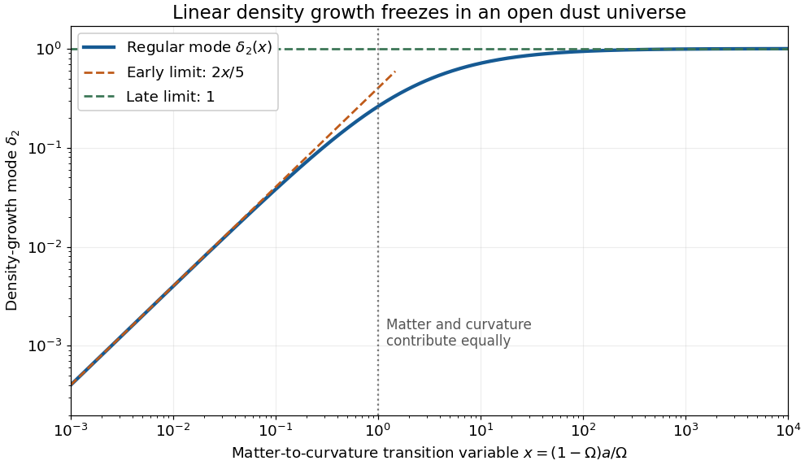

<h1 id="1/d/solution">Solution</h1>

↑ **Parent:** [D](../d.md)

To construct the regular [open dust linear growth mode](../../../../open-dust-linear-growth-mode.md), use [reduction of order](../../../../reduction-of-order.md), writing $\delta=\delta_1u$ and denoting the coefficient of $\delta'$ by $p(x)$. Since $\delta_1$ solves the [homogeneous linear differential equation](../../../../homogeneous-linear-differential-equation.md), its terms cancel and leave

$$
u''+\left(2\frac{\delta_1'}{\delta_1}+p\right)u'=0,\qquad p=\frac3{2x}+\frac1{2(1+x)}.
$$

The [integrating factor](../../../../integrating-factor.md) for this first-order equation in $u'$ is $\delta_1^2e^{\int p\,dx}$, so

$$
u'=C\frac{e^{-\int p\,dx}}{\delta_1^2}
=C\frac{x^{-3/2}(1+x)^{-1/2}}{(1+x)x^{-3}}
=C\left(\frac{x}{1+x}\right)^{3/2}.
$$

Choose $C=1$ and the lower [integration](../../../../integral-split.md) endpoint zero. This selects the mode regular at early times without adding a multiple of $\delta_1$:

$$
\boxed{\delta_2(x)=\sqrt{\frac{1+x}{x^3}}\int_0^x\left(\frac{y}{1+y}\right)^{3/2}\,dy.}
$$

Its [Wronskian](../../../../wronskian.md) with $\delta_1$ is $\delta_1\delta_2'-\delta_1'\delta_2=x^{-3/2}(1+x)^{-1/2}>0$, proving [linear independence](../../../../linear-independence.md).

No explicit [antiderivative](../../../../antiderivative.md) is needed for the limits. For $x\ll1$, the integrand is $y^{3/2}[1+O(y)]$, whence its [integral](../../../../integral-split.md) is $(2/5)x^{5/2}[1+O(x)]$. For $x\gg1$, the integrand tends to one, so its [integral](../../../../integral-split.md) divided by $x$ tends to one, while $x\delta_1\to1$. Consequently

$$
\boxed{\delta_2\sim\frac25x\quad(x\to0),\qquad \delta_2\to1\quad(x\to\infty).}
$$

Early [matter domination](../../../../matter-domination.md) permits [gravitational instability](../../../../gravitational-instability.md) to amplify the [density contrast](../../../../density-contrast.md) in proportion to the [scale factor](../../../../scale-factor-cosmology.md). Later, the [matter density parameter](../../../../matter-density-parameter.md) tends to zero and [Hubble friction](../../../../hubble-friction.md) suppresses further amplification. Indeed, for $a\propto t$, neglecting the matter source in the [linear matter perturbation growth equation](../../../../linear-matter-perturbation-growth-equation.md) gives $\ddot\delta+2\dot\delta/t\simeq0$, whose modes are a constant and $t^{-1}$. These agree with the late limits of the two exact modes.

**[Figure 1](#1/d/image-linear-density-growth-saturates-when-spatial-curvature-dominates). Linear density growth saturates when spatial curvature dominates**. The regular mode tends to $2x/5$ during [matter domination](../../../../matter-domination.md) and to one during [curvature-dominated universe](../../../../curvature-dominated-universe.md). Here $x=1$ marks equal contributions of matter and [spatial curvature of an FLRW universe](../../../../spatial-curvature-of-an-flrw-universe.md) to the [Friedmann equation](../../../../friedmann-equations.md). The normalization is the one in part (d).

## ↑ Ancestors (12)

1. [D](../d.md)
2. [1](../../1.md)
3. [2025](../../../2025-split.md)
4. [Past exam of the cosmology course of the University of Oxford](../../../split.md)
5. [Cosmology course of the University of Oxford](../../../../cosmology-course-of-the-university-of-oxford.md)
6. [Year 4 of the mathematical and theoretical physics course of the University of Oxford](../../../../year-4-of-the-mathematical-and-theoretical-physics-course-of-the-university-of-oxford.md)
7. [Mathematical and theoretical physics course of the University of Oxford](../../../../mathematical-and-theoretical-physics-course-of-the-university-of-oxford.md)
8. [Undergraduate course of the University of Oxford](../../../../undergraduate-course-of-the-university-of-oxford.md)
9. [Course of the University of Oxford](../../../../course-of-the-university-of-oxford.md)
10. [University of Oxford](../../../../university-of-oxford-split.md)
11. [List of universities](../../../../list-of-universities.md)
12. [Codex Wiki](../../../../split.md)
