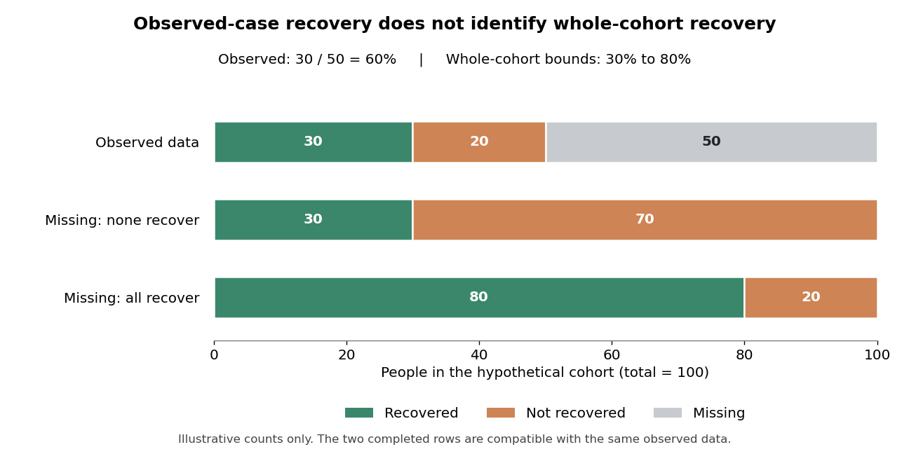

# 2022

↑ **Parent:** [Past exam of the developing new and effective psychological treatments for anxiety disorders and psychosis course of the University of Oxford](../past-exam-of-the-developing-new-and-effective-psychological-treatments-for-anxiety-disorders-and-psychosis-course-of-the-university-of-oxford.md)

Developing new and effective [psychological treatments](../psychology.md#psychotherapy) for [anxiety disorders](../psychiatry.md#anxiety-disorder) and [psychosis](../psychology.md#psychosis), Trinity Term 2022, 23 May at 09:30 BST. This undergraduate Part II advanced option has a three-hour writing period; the cover identifies the Second Public Examination without printing a Part number. All six essay options are treated below using evidence available by 23 May 2022.

Course: [Developing new and effective psychological treatments for anxiety disorders and psychosis course of the University of Oxford](../university-of-oxford.md#developing-new-and-effective-psychological-treatments-for-anxiety-disorders-and-psychosis-course-of-the-university-of-oxford). Public source: [Oxford-supplied archive, a10985w1.pdf](https://www.whatdotheyknow.com/request/experimental_psychology_past_exa/response/2757831/attach/3/New%20Compressed%20zipped%20Folder.zip?cookie_passthrough=1).[Cover and all six options on page 2, A10985W1](../psychology-bibliography.md#developing-new-and-effective-psychological-treatments-for-anxiety-disorders-and-psychosis-2022-by-university-of-oxford)

**Table of contents**

- [1](#1)
  - [Solution](#1/solution)
- [2](#2)
  - [Solution](#2/solution)
- [3](#3)
  - [Solution](#3/solution)
- [4](#4)
  - [Solution](#4/solution)
- [5](#5)
  - [Solution](#5/solution)
- [6](#6)
  - [Solution](#6/solution)

## 1

↑ **Parent:** [2022](2022.md)

<h3 id="1/solution">Solution</h3>

↑ **Parent:** [1](#1)

A [safety behavior](../animal-behaviour.md#safety-behavior) is an action intended to prevent a feared consequence or conceal signs of [distress](../psychology.md#distress). Its immediate purpose can be understandable even when its longer-term effect maintains a problem. The useful unit of analysis is the action's function in a particular situation: carrying water, seeking reassurance or avoiding eye contact is not inherently pathological. A [formulation](../psychology.md#clinical-formulation) must distinguish an anxiety-maintaining precaution from protection against genuine danger, ordinary support and a necessary accessibility adjustment.

One maintenance route is failed disconfirmation. A person predicts that ordinary bodily [arousal](../physiology.md#physiological-arousal) will lead to collapse, completes an activity while gripping a support and then attributes survival to the grip. The feared catastrophe has not happened, but the episode is interpreted as evidence that the precaution was necessary. Immediate relief can negatively reinforce the precaution, increasing its future use. This explains why repeated encounters with a feared situation need not correct the threat [belief](../psychology.md#belief) when the person regards each successful encounter as a narrowly avoided disaster.

[Safety behaviors](../animal-behaviour.md#safety-behavior) can also change the evidence available. In a conversation, monitoring one's voice and rehearsing every sentence may divert [attention](../psychology.md#attention) from what another person says. Minimal replies can make the interaction less reciprocal; bodily monitoring can make ordinary sensations seem unusually salient. The person then treats this altered experience as confirmation of the original concern. These are testable possibilities, not a claim that every unsuccessful social encounter originates in the patient's [cognition](../psychology.md#cognition). Bullying, exclusion and discrimination can be real.

[Paul Salkovskis](../psychologist.md#paul-salkovskis) and colleagues experimentally compared brief situational [exposure](../psychology.md#exposure-therapy) with safety-seeking behaviors maintained or dropped in patients with [panic disorder](../psychiatry.md#panic-disorder) and [agoraphobia](../psychiatry.md#agoraphobia). A subsequent behavioral test showed greater reductions in catastrophic [beliefs](../psychology.md#belief) and [anxiety](../psychology.md#anxiety) after the reduction condition. This supports a maintaining role, beyond the simple association between severe [anxiety](../psychology.md#anxiety) and frequent precautions. However, the manipulation also involved its therapeutic explanation, so the study does not perfectly isolate motor behavior from changed expectations about the task.[Behaviour Research and Therapy 37, 559–574; brief exposure manipulation and repeated behavioural test](../psychology-bibliography.md#an-experimental-investigation-of-the-role-of-safety-seeking-behaviours-in-the-maintenance-of-panic-disorder-with-agoraphobia-by-paul-salkovskis-and-others)

[Freda McManus](../psychologist.md#freda-mcmanus) and colleagues obtained complementary social-anxiety evidence. Interviews found greater reported use in highly socially anxious participants, while both high- and low-anxiety groups regarded their strategies as helpful. Their experimental study manipulated [safety behaviors](../animal-behaviour.md#safety-behavior) together with [self-focused attention](../psychology.md#self-focused-attention) and found detrimental effects. The combination strengthens the case that perceived helpfulness can differ from observed consequences, but leaves the separate contributions of [attention](../psychology.md#attention) and behavior incompletely identified.[Journal of Behavior Therapy and Experimental Psychiatry 39, 147–161; interview and combined safety-behavior/self-focus manipulation](../psychology-bibliography.md#why-social-anxiety-persists-by-freda-mcmanus-and-others)

The account extends beyond conventional [anxiety](../psychology.md#anxiety) [diagnoses](../psychology.md#clinical-diagnosis). [Daniel Freeman](../psychologist.md#daniel-freeman) and colleagues [randomised](../causal-inference.md#randomization) thirty patients with [persecutory delusions](../psychology.md#persecutory-delusion) to virtual-reality [exposure](../psychology.md#exposure-therapy) or threat testing that included dropping [safety behaviors](../animal-behaviour.md#safety-behavior). A head-mounted social environment allowed graded encounters with computer-generated people; the latter condition produced greater reductions in conviction and [distress](../psychology.md#distress) in a real-world assessment. This is a useful causal and translational experiment, but its small sample, brief intervention and combined instructions limit conclusions about durable treatment effects or any single ingredient.[British Journal of Psychiatry 209, 62–67; 30 participants, graded social environments, safety reduction versus exposure and real-world assessment](../psychology-bibliography.md#virtual-reality-in-the-treatment-of-persecutory-delusions-randomised-controlled-experimental-study-testing-how-to-reduce-delusional-conviction-by-daniel-freeman-and-others)

Different clinical presentations can share the functional cycle without sharing an identical disorder. A checking ritual can prevent [learning](../animal-behaviour.md#learning) that uncertainty is tolerable; repeated reassurance can make confidence depend on another person's answer; social withdrawal can restrict opportunities to evaluate [beliefs](../psychology.md#belief) about others. These examples identify hypotheses for assessment rather than establish one universal cause of [anxiety](../psychology.md#anxiety), obsessive-compulsive problems or [psychosis](../psychology.md#psychosis). The onset of a difficulty can involve other processes even when a [safety behavior](../animal-behaviour.md#safety-behavior) subsequently helps maintain it.

The strongest version of the theory—that any [safety behavior](../animal-behaviour.md#safety-behavior) necessarily prevents useful [learning](../animal-behaviour.md#learning)—is not established. [Stanley Rachman](../psychologist.md#stanley-rachman) and colleagues compared [exposure](../psychology.md#exposure-therapy) with response prevention against [exposure](../psychology.md#exposure-therapy) followed by use of a hygienic wipe in eighty undergraduates with [contamination fears](../psychology.md#contamination-fear). Both conditions showed sustained reductions across two sessions separated by two weeks. The analogue sample and short follow-up limit clinical generalisation, but the findings demonstrate why immediate elimination cannot be justified by definition alone.[Journal of Behavior Therapy and Experimental Psychiatry 42, 397–404; 80 undergraduates, exposure with or without hygienic wipes, two-session analogue](../psychology-bibliography.md#reducing-contamination-by-exposure-plus-safety-behaviour-by-stanley-rachman-and-others)

An [inhibitory learning](../animal-behaviour.md#inhibitory-learning) interpretation makes the key question more precise: what does the person learn, and to what do they attribute safety? A precaution could block a decisive test, become a safety signal, or make initial participation feasible while leaving the relevant prediction open to testing. [Michelle G. Craske](../psychologist.md#michelle-g-craske) and colleagues' framework emphasises alternative [learning](../animal-behaviour.md#learning) and its retrieval across contexts rather than equating [exposure](../psychology.md#exposure-therapy) success with immediate calm. Its theoretical coherence does not establish the optimal [safety behavior](../animal-behaviour.md#safety-behavior) policy for every patient or intervention.[Behaviour Research and Therapy 58, 10–23; inhibitory-learning framework and illustrative strategies, not a component trial](../psychology-bibliography.md#maximizing-exposure-therapy-an-inhibitory-learning-approach-by-michelle-g-craske-and-others)

Measurement should therefore distinguish the behavior, the feared outcome and the person's explanation. [Self-report](../psychology.md#self-report) inventories can indicate frequency but may group together actions with different functions. Observation during an agreed task, ratings of the predicted catastrophe and a review of why it did or did not occur give more specific information. An experiment should verify that the intended behavior actually changed, while monitoring whether a different precaution replaced it. Apparent nonresponse after an unsuccessful manipulation is not a clean falsification of the mechanism.

A stronger research design would [randomise](../causal-inference.md#randomization) the use or reduction of an individually identified precaution while matching [exposure](../psychology.md#exposure-therapy) opportunities, therapist [attention](../psychology.md#attention) and explanatory credibility. Where feasible, vary the explanation separately from the action, and assess both immediate expectations and later approach without the precaution in a new setting. Record [acceptability](../probability-and-statistics.md#treatment-acceptability) and [dropout](../causal-inference.md#study-attrition) as well as [fear](../psychology.md#fear): an effective [learning](../animal-behaviour.md#learning) procedure that few people can engage with may have limited service value. Prespecify the feared mechanism and outcome so improvement is not retrospectively assigned to whichever explanation fits.

[Safety behaviors](../animal-behaviour.md#safety-behavior) consequently offer a productive transdiagnostic account of persistence and a route to testable treatment innovations. The evidence is strongest for specified actions and maintaining processes under controlled conditions. It supports assessing function and testing predictions collaboratively, while retaining necessary protections and acknowledging that helpful participation, short-term relief and durable threat [learning](../animal-behaviour.md#learning) need not move together.

## 2

↑ **Parent:** [2022](2022.md)

<h3 id="2/solution">Solution</h3>

↑ **Parent:** [2](#2)

[Routine outcome monitoring](../psychology.md#routine-outcome-monitoring) has made the results of [IAPT](../psychology.md#improving-access-to-psychological-therapies) services unusually visible and has created opportunities to improve care. Its benefits should be separated into three claims: measurement is more complete, the resulting information supports clinical and organisational decisions, and acting on that information improves patient outcomes. The first two do not automatically prove the third. A service can record a [recovery](../probability-and-statistics.md#clinical-recovery) accurately without the act of recording being its cause.

The historical [IAPT](../psychology.md#improving-access-to-psychological-therapies) programme expanded [psychological treatment](../psychology.md#psychotherapy) for [depression](../psychology.md#depression) and [anxiety](../psychology.md#anxiety), using evidence-based interventions and [stepped care](../psychology.md#stepped-care) where appropriate. Repeated measures allow a trajectory to be examined instead of relying on a clinician's general impression at discharge. [Depression](../psychology.md#depression), general [anxiety](../psychology.md#anxiety) and disorder-relevant [symptoms](../psychology.md#symptom) can be monitored alongside functioning and the person's own goals. A [symptom](../psychology.md#symptom) questionnaire is a useful indicator, but a cutoff-based service definition of [recovery](../probability-and-statistics.md#clinical-recovery) is not identical to a [blinded](../design-of-experiments.md#blinding) diagnostic interview or to complete restoration of everyday life.

[David M. Clark](../psychologist.md#david-m-clark) and colleagues' evaluation of the Doncaster and Newham demonstration sites showed that session-by-session collection could achieve unusually complete before-and-after information in routine care. Reported [recovery](../probability-and-statistics.md#clinical-recovery) was about 55–56% among patients seen at least twice, and a follow-up examined maintenance beyond the last session. These prospective service cohorts demonstrated feasibility and informed implementation, but were not [randomised](../causal-inference.md#randomization) tests of monitoring itself. Their denominator also excluded people who never progressed beyond an initial contact.[Behaviour Research and Therapy 47, 910–920; Doncaster and Newham prospective service cohorts, sessional monitoring and ten-month follow-up](../psychology-bibliography.md#improving-access-to-psychological-therapy-initial-evaluation-of-two-uk-demonstration-sites-by-david-m-clark-and-others)

Completeness matters because selective follow-up can substantially distort apparent success. Consider a purely hypothetical cohort of one hundred baseline cases: fifty have an endpoint recorded and thirty of those meet the chosen [recovery](../probability-and-statistics.md#clinical-recovery) criterion. The observed-case [recovery](../probability-and-statistics.md#clinical-recovery) rate is 60%. If none of the fifty missing cases recovered, the whole-cohort rate is 30%; if all recovered, it is 80%. The [missing-outcome bounds for a binary endpoint](../probability-and-statistics.md#missing-outcome-bounds-for-a-binary-endpoint) are sharp: both extremes fit exactly the observed data. Without assumptions or additional measurements, the observations alone cannot identify where within those bounds the cohort lies. This example is not an estimate of any [IAPT](../psychology.md#improving-access-to-psychological-therapies) service.

**[Figure 1](#2/image-hypothetical-missing-outcomes-and-sharp-bounds-on-whole-cohort-recovery). Hypothetical missing outcomes and sharp bounds on whole-cohort recovery**.

Sessional collection reduces dependence on a separate final questionnaire: a last available observation often exists even when a planned final appointment is missed. It does not make all missingness harmless. A last attended session can occur earlier for someone who disengages, and is not automatically equivalent to a common long-term endpoint. Outcomes should therefore be reported with clear eligibility, timing, completion and [missing data](../probability-and-statistics.md#missing-data) definitions. Monitoring treated patients very thoroughly still does not describe those who were referred but never entered treatment.

[David M. Clark](../psychologist.md#david-m-clark) and colleagues' 2018 analysis reported approximately 98% before-and-after [symptom](../psychology.md#symptom) coverage among treated [IAPT](../psychology.md#improving-access-to-psychological-therapies) patients. It related public service outcomes to organisational characteristics and examined whether those characteristics also predicted changes between years. Waiting, missed appointments and the organisation of treatment were associated with outcomes; deprivation remained relevant. This made variation actionable and generated specific implementation hypotheses. Nevertheless, service-level associations and longitudinal prediction remain vulnerable to [case mix](../causal-inference.md#case-mix), selection and unmeasured organisational differences.[Lancet 391, 679–686; 98% outcome coverage among treated patients, organisational predictors and between-year analyses](../psychology-bibliography.md#transparency-about-the-outcomes-of-mental-health-services-iapt-approach-an-analysis-of-public-data-by-david-m-clark-and-others)

At the individual level, a visible trajectory can identify deterioration or lack of progress earlier than an end-of-treatment assessment. This provides a reason to review the [formulation](../psychology.md#clinical-formulation), barriers, intervention [fidelity](../psychology.md#treatment-fidelity) or level of care. It can make supervision concrete: a supervisor and therapist can examine which patients are not improving and whether the active treatment has actually been delivered. A score should initiate inquiry rather than automatically trigger a uniform decision, since transient [distress](../psychology.md#distress), measurement error and contextual crises can change a session's result.

There is experimental evidence for an additional feedback system. [Jaime Delgadillo](../psychologist.md#jaime-delgadillo) and colleagues [randomised](../causal-inference.md#randomization) therapists to automated [outcome feedback](../psychology.md#outcome-feedback) or usual [psychological treatment](../psychology.md#psychotherapy) across eight NHS trusts. Seventy-seven therapists participated and 2233 patients were included. The system flagged people who were not on track and prompted supervisory review. Among those classified as not on track, feedback was associated with modestly better [depression](../psychology.md#depression) and [anxiety](../psychology.md#anxiety) outcomes, with [effect sizes](../statistical-inference.md#effect-size) around 0.23 and 0.19 respectively. The trial tested feedback and its linked clinical response within services already collecting measures, not questionnaire collection versus no monitoring.[Lancet Psychiatry 5, 564–572; 77 participating therapists, 2233 patients, cluster allocation and not-on-track outcomes](../psychology-bibliography.md#feedback-informed-treatment-versus-usual-psychological-treatment-for-depression-and-anxiety-a-multisite-open-label-cluster-randomised-controlled-trial-by-jaime-delgadillo-and-others)

This distinction is central to interpreting the benefits. Data make a problem detectable; feedback makes it salient; a feasible clinical action must then address it. An alert that repeatedly identifies nonresponse without available treatment alternatives may add burden without improvement. Cluster allocation appropriately recognises that therapists change their practice across patients, while open-label delivery and quasi-random patient allocation to available therapists still qualify the causal interpretation. The modest subgroup effects should not be presented as proof that monitoring transforms every case.

At service level, routinely available outcomes support accountability, training evaluation and investigation of [inequalities](../arithmetic.md#inequality-mathematics). Comparisons can identify where referral pathways, waiting times or treatment delivery need examination. However, unadjusted league tables can penalise services treating more complex or disadvantaged populations. Risk adjustment should be transparent and should not erase the very [inequalities](../arithmetic.md#inequality-mathematics) that require [attention](../psychology.md#attention). Process measures, [symptom](../psychology.md#symptom) outcomes, functioning and reach together give a fuller picture than one [recovery](../probability-and-statistics.md#clinical-recovery) percentage.

Targets can also create incentives to select easier cases, change denominators or emphasise crossing a threshold over a person's priorities. A [reliable change index](../psychology.md#reliable-change-index) scales change by expected measurement error. [Reliable improvement](../psychology.md#reliable-improvement) distinguishes such a change from a small numerical movement, while [reliable recovery](../psychology.md#reliable-recovery) additionally considers [caseness](../psychology.md#clinical-caseness); neither removes the need to monitor deterioration and residual disability. Questionnaire accessibility, language and the validity of comparing groups require [attention](../psychology.md#attention). Patients should understand why information is collected and how it contributes to care.

By May 2022, the clearest benefits were high outcome coverage, a transparent basis for improving implementation and a modest experimentally supported benefit from targeted feedback. Routine data had narrowed the gap between trial evidence and what services actually achieved. Further progress required responding intelligently to trajectories, preserving inclusive denominators and testing organisational changes, rather than treating measurement or a rising aggregate [recovery](../probability-and-statistics.md#clinical-recovery) figure as self-validating evidence of effectiveness.

## 3

↑ **Parent:** [2022](2022.md)

<h3 id="3/solution">Solution</h3>

↑ **Parent:** [3](#3)

[Anxiety disorders](../psychiatry.md#anxiety-disorder) centrally involve [cognition](../psychology.md#cognition), but describing them solely as disorders of [cognition](../psychology.md#cognition) is too strong unless the term is defined so broadly that it loses explanatory value. [Threat appraisal](../psychology.md#threat-appraisal), [attention](../psychology.md#attention), interpretation and [memory](../neuroscience.md#memory-in-animals) can contribute to excessive [fear](../psychology.md#fear) and [avoidance](../animal-behaviour.md#avoidance-behavior). Bodily [arousal](../physiology.md#physiological-arousal), [learning](../animal-behaviour.md#learning) history, action and the environment also matter. A useful account specifies how these processes interact and asks whether changing a proposed cognitive process changes [anxiety](../psychology.md#anxiety), rather than simply observing that anxious people report anxious thoughts.

[David M. Clark](../psychologist.md#david-m-clark)'s cognitive model of panic illustrates the explanatory gain. Ordinary sensations such as a racing heart can be interpreted as evidence of imminent catastrophe. [Fear](../psychology.md#fear) increases [arousal](../physiology.md#physiological-arousal), which provides further sensations for threatening interpretation. The account distinguishes the bodily input from its meaning and explains why similar sensations need not produce the same [fear](../psychology.md#fear) in different circumstances. It also predicts that precautions and [avoidance](../animal-behaviour.md#avoidance-behavior) can prevent disconfirmation. The 1986 paper supplied a mechanistic model, not by itself proof that every panic episode requires a consciously articulated catastrophic thought.[Behaviour Research and Therapy 24, 461–470; catastrophic interpretation model, not a new clinical trial](../psychology-bibliography.md#a-cognitive-approach-to-panic-by-david-m-clark)

The distinction between [cognition](../psychology.md#cognition) and explicit verbal reasoning matters. A person may orient rapidly toward threat, experience an image or respond to a bodily sensation before they can describe a proposition. Absence of a reported sentence does not establish absence of [information processing](../psychology.md#information-processing). Equally, a theory should not rescue itself from every negative finding by postulating an inaccessible [belief](../psychology.md#belief). It must specify observable predictions and measures that can fail, including what would count as successful alteration of the proposed process.

Cross-sectional evidence is insufficient to establish direction. A threat interpretation could increase [anxiety](../psychology.md#anxiety), [anxiety](../psychology.md#anxiety) could bias the interpretation, or a third factor could influence both. Questionnaires can also partly measure the same evaluative content on both sides of the association. Longitudinal prediction improves temporal ordering but leaves [confounding](../causal-inference.md#confounding) possible. Experiments that manipulate interpretation or [attention](../psychology.md#attention) therefore offer a stronger test, especially when changes in the intended process are verified separately from changes in [symptoms](../psychology.md#symptom).

[Andrew Mathews](../psychology.md#andrew-mathews) and [Bundy Mackintosh](../psychology.md#bundy-mackintosh) reported five experiments inducing relatively threatening or benign interpretations of ambiguous material. Interpretative bias could be changed, but parallel effects on state [anxiety](../psychology.md#anxiety) depended on active processing of personally relevant meanings. This supports a causal contribution under specified conditions and shows that a changed task response need not automatically mean changed emotional experience. These experiments do not establish that an interpretation-training task is a complete treatment for a diagnosed [anxiety disorder](../psychiatry.md#anxiety-disorder).[Journal of Abnormal Psychology 109, 602–615; five experiments, ambiguity training, active meaning generation and state anxiety](../psychology-bibliography.md#induced-emotional-interpretation-bias-and-anxiety-by-andrew-mathews-and-bundy-mackintosh)

[Colin MacLeod](../psychologist.md#colin-macleod) and colleagues manipulated selective [attention](../psychology.md#attention) using a modified dot-probe procedure. The location of a subsequent probe was used to train [attention](../psychology.md#attention) in different directions relative to emotional material, followed by a standardised stress task. Differences in emotional vulnerability support a contribution from [attention](../psychology.md#attention) rather than association alone. Transfer from a laboratory induction to enduring clinical change, however, remains an additional question. [Learning](../animal-behaviour.md#learning) a task contingency, altered expectancies and the reliability of the process measure all require consideration.[Journal of Abnormal Psychology 111, 107–123; modified dot-probe training and responses to a standardised stress task](../psychology-bibliography.md#selective-attention-and-emotional-vulnerability-assessing-the-causal-basis-of-their-association-through-the-experimental-manipulation-of-attentional-bias-by-colin-macleod-and-others)

Clinical treatment comparisons provide complementary evidence. [David M. Clark](../psychologist.md#david-m-clark) and colleagues compared [cognitive therapy](../psychology.md#cognitive-therapy), applied relaxation and imipramine in [panic disorder](../psychiatry.md#panic-disorder), with self-exposure homework shared across conditions. The findings supported [cognitive therapy](../psychology.md#cognitive-therapy) as a useful treatment. They do not make the comparison a pure test of thought change against an absence of [learning](../animal-behaviour.md#learning) or behavior: treatment packages differ in multiple ways, and a pharmacological treatment can also alter the sensations and experiences from which [beliefs](../psychology.md#belief) are formed.[British Journal of Psychiatry 164, 759–769; treatment comparison, common self-exposure homework and follow-up](../psychology-bibliography.md#a-comparison-of-cognitive-therapy-applied-relaxation-and-imipramine-in-the-treatment-of-panic-disorder-by-david-m-clark-and-others)

[Safety behavior](../animal-behaviour.md#safety-behavior) research further shows why a sharp cognition-versus-behavior division can mislead. [Paul Salkovskis](../psychologist.md#paul-salkovskis) and colleagues found that changing precautions during [exposure](../psychology.md#exposure-therapy) altered catastrophic [beliefs](../psychology.md#belief) and [anxiety](../psychology.md#anxiety). The behavior may control which evidence is encountered and how success is explained. Conversely, a different explanation may make abandoning the behavior possible. These reciprocal effects favour a specified feedback system over treating observable action and [mental representation](../animal-behaviour.md#mental-representation) as competing, self-contained causes.[Behaviour Research and Therapy 37, 559–574; brief exposure manipulation and repeated behavioural test](../psychology-bibliography.md#an-experimental-investigation-of-the-role-of-safety-seeking-behaviours-in-the-maintenance-of-panic-disorder-with-agoraphobia-by-paul-salkovskis-and-others)

[Learning](../animal-behaviour.md#learning) accounts also need not exclude [cognition](../psychology.md#cognition). An [inhibitory learning](../animal-behaviour.md#inhibitory-learning) approach proposes that [exposure](../psychology.md#exposure-therapy) establishes alternative expectations rather than necessarily erasing the original threat association. Context-dependent retrieval can explain [return of fear](../animal-behaviour.md#return-of-fear) after apparently successful practice. [Michelle G. Craske](../psychologist.md#michelle-g-craske) and colleagues developed a translational framework around this distinction. It offers a way to connect expectation, experience and later retrieval, while its clinical implementation requires direct evaluation rather than assuming that a [learning](../animal-behaviour.md#learning) rationale proves a particular protocol optimal.[Behaviour Research and Therapy 58, 10–23; inhibitory-learning framework and illustrative strategies, not a component trial](../psychology-bibliography.md#maximizing-exposure-therapy-an-inhibitory-learning-approach-by-michelle-g-craske-and-others)

The broader phrase '[anxiety disorders](../psychiatry.md#anxiety-disorder)' also conceals heterogeneity. The feared consequence in social [anxiety](../psychology.md#anxiety) differs from the interpretation of bodily sensations in panic or persistent [worry](../psychology.md#worry) about many possible outcomes. A common [information processing](../psychology.md#information-processing) principle can coexist with disorder-relevant mechanisms. Actual danger and social adversity must be assessed: an expectation is not distorted simply because it concerns something distressing. Genetic, developmental and physiological influences can affect sensitivity to threat without fixing the meaning or outcome of every encounter.

Strong evidence for a particular cognitive mechanism would combine an experimental manipulation, a successful process check, subsequent change in [fear](../psychology.md#fear) and transfer to relevant everyday behavior. A [factorial design](../design-of-experiments.md#factorial-design) could vary interpretation and a maintaining precaution separately, with matched contact and [exposure](../psychology.md#exposure-therapy) opportunities. Repeated measurements should establish whether the cognitive change precedes the outcome. Treatment randomisation identifies the package effect, but [mediation](../statistical-modelling.md#statistical-mediation) requires additional assumptions because the [mediator](../causal-inference.md#causal-mediator) itself has not necessarily been [randomised](../causal-inference.md#randomization).

Evidence against an exclusive account would include effective treatment without the predicted process change, or a precise null effect on [anxiety](../psychology.md#anxiety) after a successful, sufficiently strong manipulation of that process. Such a result might constrain the population or context in which the mechanism matters rather than rule out all cognitive contributions. Measurement sensitivity and alternative pathways must be considered without making the theory unfalsifiable.

The defensible conclusion is that [cognition](../psychology.md#cognition) contributes materially to the persistence and modification of [anxiety](../psychology.md#anxiety), with experimental evidence beyond introspective report. It is less defensible to claim that all [anxiety disorders](../psychiatry.md#anxiety-disorder) are caused only by consciously held false [beliefs](../psychology.md#belief), or that the success of [cognitive therapy](../psychology.md#cognitive-therapy) establishes that exclusivity. Mechanistic precision and evidence about causal interaction are more informative than choosing between [cognition](../psychology.md#cognition), the body and behavior as if only one could matter.

## 4

↑ **Parent:** [2022](2022.md)

<h3 id="4/solution">Solution</h3>

↑ **Parent:** [4](#4)

A [psychological treatment](../psychology.md#psychotherapy) has a specific effect only relative to a clearly defined alternative explanation. Benefit beyond waiting is different from benefit beyond credible therapeutic contact, and both differ from evidence that a named technique works through its proposed mechanism. No single research design establishes all three. A persuasive programme combines controlled clinical comparisons with component and process experiments, while keeping patient-relevant outcomes central.

An uncontrolled before-and-after study cannot isolate a treatment effect. People may enter care when [symptoms](../psychology.md#symptom) are unusually severe, creating regression toward their longer-term level; difficulties can improve naturally; expectations, concurrent care and repeated assessment can also change outcomes. A waiting-list [randomised](../causal-inference.md#randomization) trial controls some time-related explanations but adds unequal expectations and contact. It can establish benefit from being offered the treatment package compared with waiting under those conditions, without identifying which ingredient produced the difference.

For specificity beyond nonspecific therapy effects, use a [randomised](../causal-inference.md#randomization) comparison with a credible active intervention. Match time, [attention](../psychology.md#attention), therapist competence and assessment opportunities as far as the question permits. Measure credibility and expected benefit rather than assuming equivalence from similar session counts. Keep relevant usual care available in both arms. [Allocation concealment](../causal-inference.md#allocation-concealment) prevents recruitment decisions from anticipating the next assignment, while [blinded](../design-of-experiments.md#blinding) independent outcome assessment reduces a different source of bias after allocation. Therapists and patients usually cannot be fully [blinded](../design-of-experiments.md#blinding) to psychological procedures.

[Daniel Freeman](../psychologist.md#daniel-freeman) and colleagues' Feeling Safe trial illustrates this stronger package comparison. Patients with persistent [persecutory delusions](../psychology.md#persecutory-delusion) received the programme or befriending delivered by the same therapists, alongside usual care. At six months, the primary continuous conviction measure favoured Feeling Safe. This supports an effect beyond the particular befriending comparator, but does not establish that each module is necessary or that the whole benefit travelled through one nominated [mediator](../causal-inference.md#causal-mediator).[Lancet Psychiatry 8, 696–707; 130 patients, same-therapist befriending, six-month continuous conviction and categorical recovery distinction](../psychology-bibliography.md#comparison-of-a-theoretically-driven-cognitive-therapy-the-feeling-safe-programme-with-befriending-for-the-treatment-of-persistent-persecutory-delusions-a-parallel-single-blind-randomised-controlled-trial-by-daniel-freeman-and-others)

The comparator should be interpreted fairly. A weak or implausible control can exaggerate apparent specificity, while an active comparator may itself change the proposed mechanism. If befriending improves social confidence, it is not a biologically inert placebo. A null result may mean two useful treatments have similar effects, both are ineffective, or the study is too imprecise. Failure of a superiority test does not demonstrate equivalence; an equivalence or [noninferiority](../probability-and-statistics.md#noninferiority-trial) question requires prespecified clinically justified margins and appropriate precision.

A [dismantling trial](../probability-and-statistics.md#dismantling-trial) varies a specified component while keeping the surrounding treatment adequate and similar. For example, compare the same [exposure](../psychology.md#exposure-therapy) programme with and without a [safety behavior](../animal-behaviour.md#safety-behavior) intervention. This estimates a conditional contribution: absence of an additional benefit does not imply that the component is useless in every context, because another part may produce similar [learning](../animal-behaviour.md#learning). A [factorial design](../design-of-experiments.md#factorial-design) can independently vary an action and its explanatory rationale, estimating their effects and interaction when the study has adequate [power](../probability-and-statistics.md#statistical-power).

The early panic [safety behavior](../animal-behaviour.md#safety-behavior) experiment provides both an example and a caution. Greater change after brief [exposure](../psychology.md#exposure-therapy) with precautions reduced supports the combined manipulation. Yet behavioral instructions and the explanation of the exercise were not fully separated. The appropriate next test would vary those elements independently and check actual behavior and expectancy change. Simply renaming the conditions 'cognitive' and 'behavioral' would not remove the [confounding](../causal-inference.md#confounding).[Behaviour Research and Therapy 37, 559–574; brief exposure manipulation and repeated behavioural test](../psychology-bibliography.md#an-experimental-investigation-of-the-role-of-safety-seeking-behaviours-in-the-maintenance-of-panic-disorder-with-agoraphobia-by-paul-salkovskis-and-others)

A mechanistic experiment can provide more direct leverage than a full treatment comparison. [Colin MacLeod](../psychologist.md#colin-macleod) and colleagues trained [attentional bias](../psychology.md#attentional-bias) using a modified [dot-probe task](../psychology.md#dot-probe-task) and tested later responses to stress. This asked whether experimentally changing [information processing](../psychology.md#information-processing) altered emotional vulnerability. It remains necessary to establish that the manipulation engaged the intended process rather than only a task-specific strategy, and that any effect transfers to the clinical phenomenon of interest. Laboratory emotional vulnerability is not itself [diagnostic remission](../probability-and-statistics.md#diagnostic-remission).[Journal of Abnormal Psychology 111, 107–123; modified dot-probe training and responses to a standardised stress task](../psychology-bibliography.md#selective-attention-and-emotional-vulnerability-assessing-the-causal-basis-of-their-association-through-the-experimental-manipulation-of-attentional-bias-by-colin-macleod-and-others)

Likewise, [Daniel Freeman](../psychologist.md#daniel-freeman) and colleagues used virtual social environments to compare [exposure](../psychology.md#exposure-therapy) against threat testing with [safety behavior](../animal-behaviour.md#safety-behavior) reduction. Both groups encountered graded situations, making the content of [learning](../animal-behaviour.md#learning) more directly investigable than in a therapy-versus-waiting comparison. The combined manipulation and brief follow-up constrain the mechanism claim. A useful [manipulation check](../design-of-experiments.md#manipulation-check), an independent behavioral outcome and later transfer assessment strengthen the design more than a treatment label does.[British Journal of Psychiatry 209, 62–67; 30 participants, graded social environments, safety reduction versus exposure and real-world assessment](../psychology-bibliography.md#virtual-reality-in-the-treatment-of-persecutory-delusions-randomised-controlled-experimental-study-testing-how-to-reduce-delusional-conviction-by-daniel-freeman-and-others)

[Mediation](../statistical-modelling.md#statistical-mediation) analysis is informative but insufficient on its own. [Randomising](../causal-inference.md#randomization) treatment identifies the total effect of assignment under the trial's assumptions; it does not automatically [randomise](../causal-inference.md#randomization) the [mediator](../causal-inference.md#causal-mediator). [Symptom](../psychology.md#symptom) improvement could change reported [beliefs](../psychology.md#belief), or an unmeasured process could influence both the [belief](../psychology.md#belief) score and the outcome. Measure the proposed [mediator](../causal-inference.md#causal-mediator) before the downstream outcome, assess competing pathways and perform sensitivity analyses. Replication using a different way to alter the same process can provide converging evidence; stronger identification may require experimental manipulation of that process itself.

[Clinical trials](../probability-and-statistics.md#clinical-trial) also need suitable sampling, prespecified outcomes, adequate [power](../probability-and-statistics.md#statistical-power), [intention-to-treat analysis](../causal-inference.md#intention-to-treat-analysis) and transparent [missing data](../probability-and-statistics.md#missing-data) handling. Outcomes should include functioning and possible deterioration, with follow-up long enough to distinguish transient reassurance from durable benefit. [Treatment fidelity](../psychology.md#treatment-fidelity) and competence must be assessed in both arms. [Therapist allegiance](../probability-and-statistics.md#therapist-allegiance), clustering of patients within therapists and differential [dropout](../causal-inference.md#study-attrition) can affect interpretation. [Statistical significance](../statistical-hypothesis-test.md#statistical-significance) alone does not establish a meaningful improvement, especially when many outcomes or subgroup comparisons are explored.

Pragmatic implementation trials answer a complementary question: does the intervention add benefit in ordinary care, at acceptable cost and burden? [Jaime Delgadillo](../psychologist.md#jaime-delgadillo) and colleagues' therapist-cluster trial tested an automated feedback system linked to supervisory review within routine services. Its comparison isolates the added feedback arrangement more closely than an observational association between high-performing services and monitoring. It still tests a specified package of information and response, rather than an abstract effect of measurement divorced from clinical action.[Lancet Psychiatry 5, 564–572; 77 participating therapists, 2233 patients, cluster allocation and not-on-track outcomes](../psychology-bibliography.md#feedback-informed-treatment-versus-usual-psychological-treatment-for-depression-and-anxiety-a-multisite-open-label-cluster-randomised-controlled-trial-by-jaime-delgadillo-and-others)

The strongest conclusion consequently states its level of specificity. A well-conducted [active control](../design-of-experiments.md#active-control) trial can establish an incremental treatment-package effect. A dismantling or factorial trial can identify a component's contribution within a defined context. An experimental process manipulation, supported by temporally ordered measurements and converging clinical evidence, can constrain the mechanism. Keeping these claims separate prevents a successful therapy from being treated as proof of its entire theory, while preserving the practical importance of improvements patients actually experience.

## 5

↑ **Parent:** [2022](2022.md)

<h3 id="5/solution">Solution</h3>

↑ **Parent:** [5](#5)

Recent innovations offered plausible routes to better outcomes for [delusions](../psychology.md#delusion) by replacing a broad, undifferentiated treatment target with specific maintaining processes. Persistent persecutory [beliefs](../psychology.md#belief) may be supported by [worry](../psychology.md#worry), poor sleep, felt vulnerability, low confidence, reasoning inflexibility and [safety behaviors](../animal-behaviour.md#safety-behavior). Changing one of these may create opportunities for a person to reconsider threat without demanding immediate agreement that their [belief](../psychology.md#belief) is wrong. The promise is mechanistic and practical; it does not imply that all [delusions](../psychology.md#delusion) share one cause or that every plausible target will improve [clinical outcomes](../probability-and-statistics.md#clinical-outcome).

A contributory-causal approach begins by identifying a potentially modifiable process, experimentally changing it and examining consequences for the clinical problem. [Worry](../psychology.md#worry) is an example: repeated anticipation of danger can generate threatening explanations and keep them mentally available. In the [Worry Intervention Trial](../psychology.md#worry-intervention-trial), [Daniel Freeman](../psychologist.md#daniel-freeman) and colleagues [randomised](../causal-inference.md#randomization) 150 patients with persistent [persecutory delusions](../psychology.md#persecutory-delusion) to six sessions targeting [worry](../psychology.md#worry) alongside standard care, or standard care alone. [Worry](../psychology.md#worry) and [delusion](../psychology.md#delusion) outcomes improved, with gains followed to 24 weeks. Because therapist contact was not matched, the result supports the added intervention package more securely than an exclusively worry-mediated effect.[Lancet Psychiatry 2, 305–313; 150 patients, six worry sessions plus usual care versus usual care, eight-/24-week outcomes](../psychology-bibliography.md#effects-of-cognitive-behaviour-therapy-for-worry-on-persecutory-delusions-in-patients-with-psychosis-wit-a-parallel-single-blind-randomised-controlled-trial-with-a-mediation-analysis-by-daniel-freeman-and-others)

Sleep offers a different entry point that may be more acceptable than directly debating a threat [belief](../psychology.md#belief). The OASIS trial [randomised](../causal-inference.md#randomization) 3755 university students with insomnia to digital [CBT](../psychology.md#cognitive-behavioral-therapy) for sleep or usual practice. It produced a large sleep benefit and smaller changes in [paranoia](../psychology.md#paranoia) and hallucinatory experiences. This supports testing sleep as a contributory process, while the nonclinical student sample and usual-practice comparator prevent direct inference that the same intervention treats persistent [delusions](../psychology.md#delusion) in patients with [psychosis](../psychology.md#psychosis).[Lancet Psychiatry 4, 749–758; 3755 university students with insomnia, digital CBT versus usual practice and population limits](../psychology-bibliography.md#the-effects-of-improving-sleep-on-mental-health-oasis-a-randomised-controlled-trial-with-mediation-analysis-by-daniel-freeman-and-others)

The [Feeling Safe Programme](../psychology.md#feeling-safe-programme) combined individually selected modules addressing relevant maintaining factors. Its 2021 trial allocated 130 patients with persistent [persecutory delusions](../psychology.md#persecutory-delusion) to Feeling Safe or same-therapist befriending, with usual care continuing. The six-month adjusted difference in [delusional conviction](../psychology.md#delusional-conviction) favoured Feeling Safe by about 10.7 points on a 0–100 scale. A categorical [recovery](../probability-and-statistics.md#clinical-recovery) comparison was less precise and did not reach conventional significance. The positive continuous [primary outcome](../probability-and-statistics.md#primary-outcome) therefore should not be restated as a definitively superior [recovery](../probability-and-statistics.md#clinical-recovery) rate.[Lancet Psychiatry 8, 696–707; 130 patients, same-therapist befriending, six-month continuous conviction and categorical recovery distinction](../psychology-bibliography.md#comparison-of-a-theoretically-driven-cognitive-therapy-the-feeling-safe-programme-with-befriending-for-the-treatment-of-persistent-persecutory-delusions-a-parallel-single-blind-randomised-controlled-trial-by-daniel-freeman-and-others)

Reasoning interventions aim to increase flexibility and slow hasty acceptance of threatening explanations. [Philippa Garety](../psychologist.md#philippa-garety) and colleagues' [SlowMo](../psychology.md#slowmo) combined eight face-to-face sessions, digital material and a mobile application. In the 361-person analysis, the primary total [paranoia](../psychology.md#paranoia) score at 24 weeks did not show a statistically significant advantage over usual care, although several secondary and earlier outcomes favoured the intervention. There was no significant effect on [jumping to conclusions](../psychology.md#jumping-to-conclusions). This mixed pattern is particularly important: an engaging, mechanistically informed treatment can show promising signals without meeting its prespecified primary test.[JAMA Psychiatry 78, 714–725; 361 in analysis, prespecified 24-week GPTS total endpoint and secondary outcomes](../psychology-bibliography.md#effects-of-slowmo-a-blended-digital-therapy-targeting-reasoning-on-paranoia-among-people-with-psychosis-a-randomized-clinical-trial-by-philippa-garety-and-others)

These approaches could improve outcomes for several reasons. Targeting common difficulties such as insomnia or [worry](../psychology.md#worry) can give treatment an understandable starting point. Personalised modules can concentrate time on processes actually present instead of requiring every patient to complete the same sequence. Concrete experiments may provide more persuasive evidence than verbal reassurance. Digital support can make an exercise accessible between appointments, while carefully designed measures can show whether the nominated process changed before the [belief](../psychology.md#belief) or [distress](../psychology.md#distress) changed.

However, a target can be associated with [delusions](../psychology.md#delusion) without causing them. Poor sleep and [worry](../psychology.md#worry) may partly reflect a common adversity, or lessen when general [distress](../psychology.md#distress) improves. An intervention intended for one process can alter several others, making a statistical [mediator](../causal-inference.md#causal-mediator) an uncertain guide to the active ingredient. Even when a factor contributes causally, changing it may produce only modest benefit because other maintaining processes remain. Necessary theoretical precision includes specifying who has the target, how much it must change and which outcome should follow.

Outcome choice can make an innovation appear more or less successful. Conviction, preoccupation, [distress](../psychology.md#distress), activity, quality of life and diagnostic status are related but distinct. Greater doubt about a threatening explanation may be valuable without elimination of the [belief](../psychology.md#belief); conversely, a questionnaire change need not restore work or social participation. The difference between [SlowMo](../psychology.md#slowmo)'s primary and secondary findings illustrates why the endpoint and assessment time should be specified in advance. Multiple favourable secondary results cannot simply replace an unsuccessful primary test.

Clinical heterogeneity also matters. A treatment developed for persistent [persecutory delusions](../psychology.md#persecutory-delusion) is not automatically established for every delusional theme, acute state or diagnostic group. Language requirements, willingness to attend research therapy and referral patterns select who enters a trial. Comorbid [depression](../psychology.md#depression), cognitive difficulties, substance use or continuing victimisation may alter the usefulness of a module. An unusual [belief](../psychology.md#belief) should be assessed in its cultural and social context; a psychological account must not assume that all reported threats are unreal.

Innovations can fail at implementation even when the trial mechanism is sound. Skilled research therapists, close supervision and protected time may be unavailable in routine services. A mobile application can increase opportunity for practice but also introduce access, privacy or comprehension barriers. Adding modules can increase burden, dilute effective content or delay the experiment that matters most. Patients may prefer a different target from the one selected by a questionnaire. [Acceptability](../probability-and-statistics.md#treatment-acceptability), [fidelity](../psychology.md#treatment-fidelity), reach and cost therefore need direct measurement alongside [symptom](../psychology.md#symptom) outcomes.

A strong next study would compare an adapted innovation with a credible active treatment in several services, with adequate [power](../probability-and-statistics.md#statistical-power) and [blinded](../design-of-experiments.md#blinding) assessment. Prespecify primary conviction or [distress](../psychology.md#distress) outcomes, patient-prioritised functioning and longer-term maintenance. Measure candidate mechanisms repeatedly, recording which modules are actually received; module choice in a tailored treatment is not random and cannot itself identify the best component. A complementary factorial or sequentially [randomised](../causal-inference.md#randomization) experiment could test specific additions while preserving adequate care for all participants.

By May 2022, the most convincing advance was the shift toward testable mechanisms and more rigorous, symptom-focused clinical comparisons. [Worry](../psychology.md#worry), sleep, flexible reasoning and personalised threat-learning approaches offered reasons for optimism, with some positive clinical results and important null findings. Better outcomes would depend on genuine [target engagement](../pharmacology.md#target-engagement), adequate comparisons, generalisation and feasible delivery, rather than novelty, a digital format or a plausible causal diagram alone.

## 6

↑ **Parent:** [2022](2022.md)

<h3 id="6/solution">Solution</h3>

↑ **Parent:** [6](#6)

Conditioning explains an important part of [reexperiencing](../psychiatry.md#reexperiencing): a cue associated with a traumatic event can later trigger [fear](../psychology.md#fear) and involuntary recollection. It does not, by itself, fully explain the content, sensory qualities, sense of present occurrence or persistence of every intrusion. The best answer therefore separates a mechanism for triggering a response from a theory of what is represented and why the representation is retrieved in this particular form.

In a simple conditioning account, an initially neutral cue becomes associated with an aversive event. A similar cue encountered later can evoke defensive [arousal](../physiology.md#physiological-arousal) even when the danger is absent. [Stimulus generalisation](../animal-behaviour.md#stimulus-generalisation) explains reactions to reminders that only resemble the original cue, while [avoidance](../animal-behaviour.md#avoidance-behavior) can limit opportunities for [learning](../animal-behaviour.md#learning) that the present context is safer. [Extinction](../animal-behaviour.md#extinction-learning) is not necessarily erasure: new [learning](../animal-behaviour.md#learning) can compete with an earlier association, and a changed context or delay can allow [fear](../psychology.md#fear) to return.

This account predicts cue-dependent episodes and bodily responses. A particular sound, smell or visual pattern may precipitate a sudden experience before the person identifies its connection to the [trauma](../psychology.md#psychological-trauma). Absence of consciously recognising the reminder does not mean that no cue was present. However, a [conditioned response](../animal-behaviour.md#conditioned-response) could be autonomic [arousal](../physiology.md#physiological-arousal) or an urge to escape; it need not include a vivid autobiographical image or the feeling that a past event is happening now. Those additional properties require explanation.

[Anke Ehlers](../psychologist.md#anke-ehlers) and colleagues investigated the content and quality of [intrusive memories](../neuroscience.md#intrusive-memory) after different traumas. Intrusions often concerned sensory impressions just before the event or before its worst emotional moments. Their warning-signal [hypothesis](../README.md#hypothesis) proposes that these impressions acquired predictive significance. This is compatible with associative [learning](../animal-behaviour.md#learning), but also refines a simple replay account: what is reexperienced may be a cue that signalled worsening danger rather than a literal representation of the objectively most injurious moment. The descriptive observations motivate the [hypothesis](../README.md#hypothesis) without experimentally proving the original association.[Behaviour Research and Therapy 40, 995–1002; descriptions of intrusion content, sensory qualities and moments preceding worst impact](../psychology-bibliography.md#the-nature-of-intrusive-memories-after-trauma-the-warning-signal-hypothesis-by-anke-ehlers-and-others)

The distinction matters because [trauma](../psychology.md#psychological-trauma) is an extended, interpreted event. A moment can become especially threatening when its meaning changes—for example, when a previously ambiguous situation is understood as inescapable. The relevant reminder may reflect that subjective transition. A model that treats the whole event as one undifferentiated shock misses the organisation of the remembered experience. Retrospective descriptions, however, can be reconstructed, so prospective or carefully controlled analogue evidence is useful alongside clinical interviews.

Conditioning experiments provide converging but narrower evidence. [Mohammed R. Milad](../neuroscientist.md#mohammed-r-milad) and colleagues studied sixteen people with [PTSD](../psychiatry.md#post-traumatic-stress-disorder) and fifteen trauma-exposed controls using a two-day fear-conditioning and [extinction](../animal-behaviour.md#extinction-learning) procedure in a 3-T [fMRI](../nuclear-magnetic-resonance.md#functional-magnetic-resonance-imaging) scanner. Skin conductance indexed conditioned responding. The groups did not differ significantly in acquisition or immediate [extinction](../animal-behaviour.md#extinction-learning), but the [PTSD](../psychiatry.md#post-traumatic-stress-disorder) group showed poorer [extinction recall](../animal-behaviour.md#extinction-recall) the following day, with associated differences in relevant brain activity. This supports altered retention or retrieval of safety [learning](../animal-behaviour.md#learning); it did not directly measure autobiographical [flashbacks](../psychiatry.md#flashback) or establish whether the group difference preceded [trauma](../psychology.md#psychological-trauma).[Biological Psychiatry 66, 1075–1082; 16 PTSD/15 trauma-exposed controls, two-day conditioning, skin conductance and 3-T fMRI](../psychology-bibliography.md#neurobiological-basis-of-failure-to-recall-extinction-memory-in-posttraumatic-stress-disorder-by-mohammed-r-milad-and-others)

[Memory](../neuroscience.md#memory-in-animals) theories address features left underspecified by a reflex account. [Chris R. Brewin](../psychologist.md#chris-r-brewin) and colleagues' original dual-representation theory distinguished verbally accessible [memories](../neuroscience.md#memory-in-animals) from [memories](../neuroscience.md#memory-in-animals) automatically accessible through situational cues. It proposed that cue-triggered sensory representations can produce reliving without ordinary deliberate narrative retrieval. This is a theoretical architecture, not proof of two anatomically discrete stores. Its explanatory value depends on generating predictions that distinguish access, contextual organisation and response processes rather than relabelling the clinical phenomena.[Psychological Review 103, 670–686; original verbally/situationally accessible memory distinction](../psychology-bibliography.md#a-dual-representation-theory-of-posttraumatic-stress-disorder-by-chris-r-brewin-and-others)

[Anke Ehlers](../psychologist.md#anke-ehlers) and [David M. Clark](../psychologist.md#david-m-clark)'s cognitive model emphasised a persistent [sense of current threat](../psychiatry.md#sense-of-current-threat) arising from negative [appraisals](../psychology.md#cognitive-appraisal) and properties of [trauma](../psychology.md#psychological-trauma) [memory](../neuroscience.md#memory-in-animals), including difficulty integrating the event into its broader autobiographical context. [Avoidance](../animal-behaviour.md#avoidance-behavior), suppression and other strategies can impede change. On this account, a reminder may retrieve an impression without sufficient information that the danger belongs to the past. [Appraisals](../psychology.md#cognitive-appraisal) of an intrusion as evidence of permanent damage or loss of control can then increase [distress](../psychology.md#distress) and monitoring, potentially maintaining the problem beyond the initial cue association.[Behaviour Research and Therapy 38, 319–345; current threat, trauma-memory properties and maintaining strategies](../psychology-bibliography.md#a-cognitive-model-of-posttraumatic-stress-disorder-by-anke-ehlers-and-david-m-clark)

Experimental work on representation also constrains an exclusively fear-response account. [Emily A. Holmes](../psychologist.md#emily-a-holmes) and colleagues used a trauma-film analogue and randomly allocated participants, after a thirty-minute interval, to a brief visuospatial game or no task. Intrusions during the next week were reduced in the task condition, while recognition performance did not differ significantly. This suggests that involuntary imagery and deliberate [memory](../neuroscience.md#memory-in-animals) performance can be affected differently. The analogue, comparator and limited follow-up do not establish prevention or treatment of clinical [PTSD](../psychiatry.md#post-traumatic-stress-disorder), nor prove that all recognition information was unchanged.[PLOS ONE 4, e4153; trauma-film analogue, 30-minute delay, ten-minute visuospatial task, one-week intrusions and recognition](../psychology-bibliography.md#can-playing-the-computer-game-tetris-reduce-the-build-up-of-flashbacks-for-trauma-a-proposal-from-cognitive-science-by-emily-a-holmes-and-others)

[Reexperiencing](../psychiatry.md#reexperiencing) should also be distinguished from related events. [Rumination](../metabolism.md#rumination) about why something happened, a future-oriented image and deliberate recollection are not interchangeable with a sensory [flashback](../psychiatry.md#flashback). Shame, guilt and grief can accompany intrusions as well as [fear](../psychology.md#fear). A broad associative model can incorporate links to these meanings and responses, but then it needs explicit representational and contextual assumptions. Saying that every retrieved mental event is a conditioned reaction risks making the account true by definition rather than experimentally informative.

A discriminating experiment could hold reminder [exposure](../psychology.md#exposure-therapy) constant while varying contextual information or its interpretation, with careful ethical safeguards and an analogue suitable for research. Measure autonomic response, involuntary imagery, deliberate recognition and sense of current occurrence separately. A reduction in bodily [fear](../psychology.md#fear) without a corresponding change in involuntary images would show that the endpoints dissociate; a contextual manipulation reducing reliving at comparable [arousal](../physiology.md#physiological-arousal) would support a role beyond response magnitude. Predefine [manipulation checks](../design-of-experiments.md#manipulation-check) and avoid treating absence of a reported image as proof that no [memory](../neuroscience.md#memory-in-animals) was activated.

Clinical studies should add prospective sampling of reminders and intrusions where feasible, rather than relying entirely on retrospective questionnaires. Repeated within-person observations can test whether contexts and [appraisals](../psychology.md#cognitive-appraisal) precede an episode, though they do not remove all [confounding](../causal-inference.md#confounding). Treatment effects can provide converging evidence, but improvement after a multicomponent therapy does not determine whether conditioning, [appraisal](../psychology.md#cognitive-appraisal) or [memory](../neuroscience.md#memory-in-animals) organisation was the necessary pathway.

Conditioning is consequently a useful account of why reminders become potent and why responses can recur after apparent safety [learning](../animal-behaviour.md#learning). A full explanation of [reexperiencing](../psychiatry.md#reexperiencing) also needs the representation retrieved, its contextual accessibility, the sense that it is occurring now and the meaning assigned to the experience. Associative, cognitive and [autobiographical memory](../neuroscience.md#autobiographical-memory) processes can therefore be complementary, provided their separate predictions remain open to test.

## ↑ Ancestors (9)

1. [Past exam of the developing new and effective psychological treatments for anxiety disorders and psychosis course of the University of Oxford](../past-exam-of-the-developing-new-and-effective-psychological-treatments-for-anxiety-disorders-and-psychosis-course-of-the-university-of-oxford.md)
2. [Developing new and effective psychological treatments for anxiety disorders and psychosis course of the University of Oxford](../university-of-oxford.md#developing-new-and-effective-psychological-treatments-for-anxiety-disorders-and-psychosis-course-of-the-university-of-oxford)
3. [Year 3 of the psychology (experimental) course of the University of Oxford](../university-of-oxford.md#year-3-of-the-psychology-experimental-course-of-the-university-of-oxford)
4. [Psychology (experimental) course of the University of Oxford](../university-of-oxford.md#psychology-experimental-course-of-the-university-of-oxford)
5. [Undergraduate course of the University of Oxford](../university-of-oxford.md#undergraduate-course-of-the-university-of-oxford)
6. [Course of the University of Oxford](../university-of-oxford.md#course-of-the-university-of-oxford)
7. [University of Oxford](../university-of-oxford.md)
8. [List of universities](../README.md#list-of-universities)
9. [Codex Wiki](../README.md)
