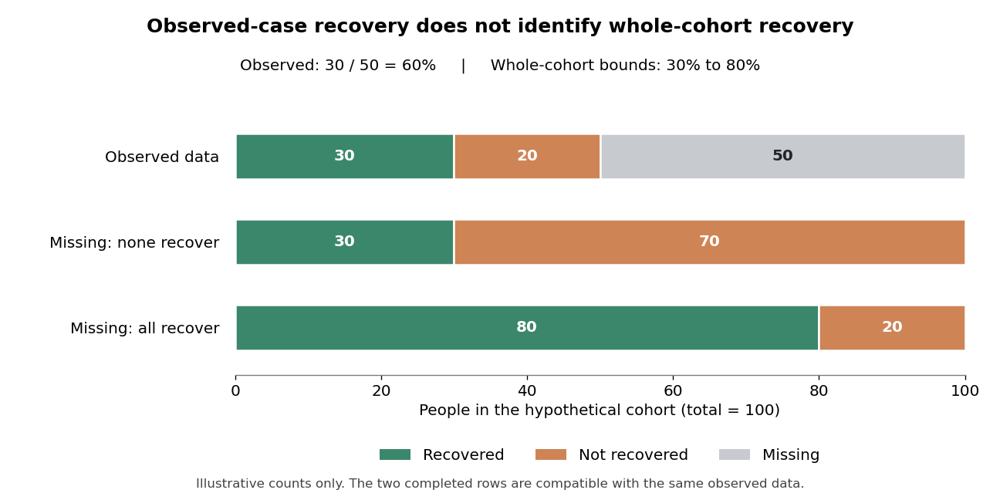

<h1 id="2/solution">Solution</h1>

↑ **Parent:** [2](../2.md)

[Routine outcome monitoring](../../../routine-outcome-monitoring.md) has made the results of [IAPT](../../../improving-access-to-psychological-therapies.md) services unusually visible and has created opportunities to improve care. Its benefits should be separated into three claims: measurement is more complete, the resulting information supports clinical and organisational decisions, and acting on that information improves patient outcomes. The first two do not automatically prove the third. A service can record a [recovery](../../../clinical-recovery.md) accurately without the act of recording being its cause.

The historical [IAPT](../../../improving-access-to-psychological-therapies.md) programme expanded [psychological treatment](../../../psychotherapy.md) for [depression](../../../depression.md) and [anxiety](../../../anxiety.md), using evidence-based interventions and [stepped care](../../../stepped-care.md) where appropriate. Repeated measures allow a trajectory to be examined instead of relying on a clinician's general impression at discharge. [Depression](../../../depression.md), general [anxiety](../../../anxiety.md) and disorder-relevant [symptoms](../../../symptom.md) can be monitored alongside functioning and the person's own goals. A [symptom](../../../symptom.md) questionnaire is a useful indicator, but a cutoff-based service definition of [recovery](../../../clinical-recovery.md) is not identical to a [blinded](../../../blinding.md) diagnostic interview or to complete restoration of everyday life.

[David M. Clark](../../../david-m-clark.md) and colleagues' evaluation of the Doncaster and Newham demonstration sites showed that session-by-session collection could achieve unusually complete before-and-after information in routine care. Reported [recovery](../../../clinical-recovery.md) was about 55–56% among patients seen at least twice, and a follow-up examined maintenance beyond the last session. These prospective service cohorts demonstrated feasibility and informed implementation, but were not [randomised](../../../randomization.md) tests of monitoring itself. Their denominator also excluded people who never progressed beyond an initial contact.[Behaviour Research and Therapy 47, 910–920; Doncaster and Newham prospective service cohorts, sessional monitoring and ten-month follow-up](../../../improving-access-to-psychological-therapy-initial-evaluation-of-two-uk-demonstration-sites-by-david-m-clark-and-others.md)

Completeness matters because selective follow-up can substantially distort apparent success. Consider a purely hypothetical cohort of one hundred baseline cases: fifty have an endpoint recorded and thirty of those meet the chosen [recovery](../../../clinical-recovery.md) criterion. The observed-case [recovery](../../../clinical-recovery.md) rate is 60%. If none of the fifty missing cases recovered, the whole-cohort rate is 30%; if all recovered, it is 80%. The [missing-outcome bounds for a binary endpoint](../../../missing-outcome-bounds-for-a-binary-endpoint.md) are sharp: both extremes fit exactly the observed data. Without assumptions or additional measurements, the observations alone cannot identify where within those bounds the cohort lies. This example is not an estimate of any [IAPT](../../../improving-access-to-psychological-therapies.md) service.

**[Figure 1](#2/image-hypothetical-missing-outcomes-and-sharp-bounds-on-whole-cohort-recovery). Hypothetical missing outcomes and sharp bounds on whole-cohort recovery**.

Sessional collection reduces dependence on a separate final questionnaire: a last available observation often exists even when a planned final appointment is missed. It does not make all missingness harmless. A last attended session can occur earlier for someone who disengages, and is not automatically equivalent to a common long-term endpoint. Outcomes should therefore be reported with clear eligibility, timing, completion and [missing data](../../../missing-data.md) definitions. Monitoring treated patients very thoroughly still does not describe those who were referred but never entered treatment.

[David M. Clark](../../../david-m-clark.md) and colleagues' 2018 analysis reported approximately 98% before-and-after [symptom](../../../symptom.md) coverage among treated [IAPT](../../../improving-access-to-psychological-therapies.md) patients. It related public service outcomes to organisational characteristics and examined whether those characteristics also predicted changes between years. Waiting, missed appointments and the organisation of treatment were associated with outcomes; deprivation remained relevant. This made variation actionable and generated specific implementation hypotheses. Nevertheless, service-level associations and longitudinal prediction remain vulnerable to [case mix](../../../case-mix.md), selection and unmeasured organisational differences.[Lancet 391, 679–686; 98% outcome coverage among treated patients, organisational predictors and between-year analyses](../../../transparency-about-the-outcomes-of-mental-health-services-iapt-approach-an-analysis-of-public-data-by-david-m-clark-and-others.md)

At the individual level, a visible trajectory can identify deterioration or lack of progress earlier than an end-of-treatment assessment. This provides a reason to review the [formulation](../../../clinical-formulation.md), barriers, intervention [fidelity](../../../treatment-fidelity.md) or level of care. It can make supervision concrete: a supervisor and therapist can examine which patients are not improving and whether the active treatment has actually been delivered. A score should initiate inquiry rather than automatically trigger a uniform decision, since transient [distress](../../../distress.md), measurement error and contextual crises can change a session's result.

There is experimental evidence for an additional feedback system. [Jaime Delgadillo](../../../jaime-delgadillo.md) and colleagues [randomised](../../../randomization.md) therapists to automated [outcome feedback](../../../outcome-feedback.md) or usual [psychological treatment](../../../psychotherapy.md) across eight NHS trusts. Seventy-seven therapists participated and 2233 patients were included. The system flagged people who were not on track and prompted supervisory review. Among those classified as not on track, feedback was associated with modestly better [depression](../../../depression.md) and [anxiety](../../../anxiety.md) outcomes, with [effect sizes](../../../effect-size.md) around 0.23 and 0.19 respectively. The trial tested feedback and its linked clinical response within services already collecting measures, not questionnaire collection versus no monitoring.[Lancet Psychiatry 5, 564–572; 77 participating therapists, 2233 patients, cluster allocation and not-on-track outcomes](../../../feedback-informed-treatment-versus-usual-psychological-treatment-for-depression-and-anxiety-a-multisite-open-label-cluster-randomised-controlled-trial-by-jaime-delgadillo-and-others.md)

This distinction is central to interpreting the benefits. Data make a problem detectable; feedback makes it salient; a feasible clinical action must then address it. An alert that repeatedly identifies nonresponse without available treatment alternatives may add burden without improvement. Cluster allocation appropriately recognises that therapists change their practice across patients, while open-label delivery and quasi-random patient allocation to available therapists still qualify the causal interpretation. The modest subgroup effects should not be presented as proof that monitoring transforms every case.

At service level, routinely available outcomes support accountability, training evaluation and investigation of [inequalities](../../../inequality-mathematics.md). Comparisons can identify where referral pathways, waiting times or treatment delivery need examination. However, unadjusted league tables can penalise services treating more complex or disadvantaged populations. Risk adjustment should be transparent and should not erase the very [inequalities](../../../inequality-mathematics.md) that require [attention](../../../attention.md). Process measures, [symptom](../../../symptom.md) outcomes, functioning and reach together give a fuller picture than one [recovery](../../../clinical-recovery.md) percentage.

Targets can also create incentives to select easier cases, change denominators or emphasise crossing a threshold over a person's priorities. A [reliable change index](../../../reliable-change-index.md) scales change by expected measurement error. [Reliable improvement](../../../reliable-improvement.md) distinguishes such a change from a small numerical movement, while [reliable recovery](../../../reliable-recovery.md) additionally considers [caseness](../../../clinical-caseness.md); neither removes the need to monitor deterioration and residual disability. Questionnaire accessibility, language and the validity of comparing groups require [attention](../../../attention.md). Patients should understand why information is collected and how it contributes to care.

By May 2022, the clearest benefits were high outcome coverage, a transparent basis for improving implementation and a modest experimentally supported benefit from targeted feedback. Routine data had narrowed the gap between trial evidence and what services actually achieved. Further progress required responding intelligently to trajectories, preserving inclusive denominators and testing organisational changes, rather than treating measurement or a rising aggregate [recovery](../../../clinical-recovery.md) figure as self-validating evidence of effectiveness.

## ↑ Ancestors (11)

1. [2](../2.md)
2. [2022](../../2022-split.md)
3. [Past exam of the developing new and effective psychological treatments for anxiety disorders and psychosis course of the University of Oxford](../../split.md)
4. [Developing new and effective psychological treatments for anxiety disorders and psychosis course of the University of Oxford](../../../developing-new-and-effective-psychological-treatments-for-anxiety-disorders-and-psychosis-course-of-the-university-of-oxford.md)
5. [Year 3 of the psychology (experimental) course of the University of Oxford](../../../year-3-of-the-psychology-experimental-course-of-the-university-of-oxford.md)
6. [Psychology (experimental) course of the University of Oxford](../../../psychology-experimental-course-of-the-university-of-oxford.md)
7. [Undergraduate course of the University of Oxford](../../../undergraduate-course-of-the-university-of-oxford.md)
8. [Course of the University of Oxford](../../../course-of-the-university-of-oxford.md)
9. [University of Oxford](../../../university-of-oxford-split.md)
10. [List of universities](../../../list-of-universities.md)
11. [Codex Wiki](../../../split.md)
