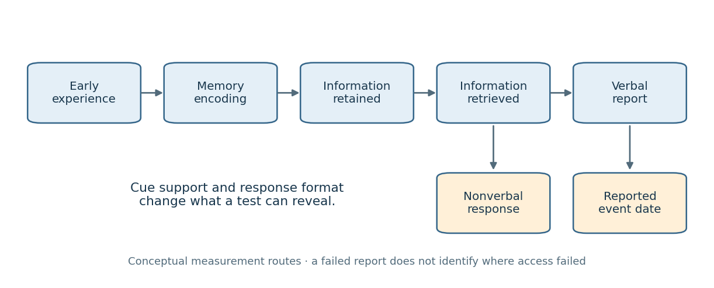

# 2022

↑ **Parent:** [Past exam of the developmental science course of the year 2 of the psychology (experimental) course of the University of Oxford](../past-exam-of-the-developmental-science-course-of-the-year-2-of-the-psychology-experimental-course-of-the-university-of-oxford.md)

Developmental science, Part I, Trinity Term 2022: 20 April, 09:30 BST; one hour writing time. These independent essays answer all five printed options and use an evidence cutoff of 20 April 2022. Later findings are not used to answer the historical paper.

Course: [Developmental science course of the year 2 of the psychology (experimental) course of the University of Oxford](../university-of-oxford.md#developmental-science-course-of-the-year-2-of-the-psychology-experimental-course-of-the-university-of-oxford). Public source: [Oxford-supplied archive, member a16818w1.pdf](https://www.whatdotheyknow.com/request/experimental_psychology_past_exa/response/2757831/attach/3/New%20Compressed%20zipped%20Folder.zip?cookie_passthrough=1).[Cover and question page, A16818W1](../psychology-bibliography.md#developmental-science-part-i-2022-by-university-of-oxford)

**Table of contents**

- [1](#1)
  - [Solution](#1/solution)
- [2](#2)
  - [Solution](#2/solution)
- [3](#3)
  - [Solution](#3/solution)
- [4](#4)
  - [Solution](#4/solution)
- [5](#5)
  - [Solution](#5/solution)

## 1

↑ **Parent:** [2022](2022.md)

<h3 id="1/solution">Solution</h3>

↑ **Parent:** [1](#1)

[Executive functions](../psychology.md#executive-function) should contribute most when [learning](../animal-behaviour.md#learning) or assessment requires keeping several pieces of information active, suppressing an attractive error, coordinating successive operations or changing strategy. This predicts particularly strong links with multistep [mathematics](../mathematics.md), mathematical problem solving and [reading comprehension](../psychology.md#reading-comprehension), alongside classroom engagement and following instructions. It predicts a smaller _direct_ contribution to well-practised fact retrieval or fluent decoding once those operations are automated. That is a task-demand [hypothesis](../README.md#hypothesis), not a claim that every [mathematics](../mathematics.md) score must correlate more strongly with [executive functions](../psychology.md#executive-function) than every literacy score.

[Working memory](../neuroscience.md#working-memory) maintains goals and intermediate results: a [child](../organism.md#child) doing a [subtraction](../arithmetic.md#subtraction) with borrowing must retain both the original problem and its updated intermediate state. [Inhibitory control](../psychology.md#inhibitory-control) helps suppress a larger-number answer that is tempting but irrelevant, or a familiar operation when the problem requires another. [Cognitive flexibility](../psychology.md#cognitive-flexibility) supports switching between representations or abandoning an unsuccessful strategy. In [reading](../psychology.md#reading), maintaining earlier propositions and rejecting an initially plausible interpretation should matter especially for comprehension and inference; knowledge of letter–sound correspondences is not itself an [executive function](../psychology.md#executive-function). Repeated practice can change which process is the bottleneck, so developmental stage and familiarity matter.

Historically, the unity-and-diversity framework helped replace an undifferentiated “executive ability” with correlated but distinguishable processes. [Akira Miyake](../psychologist.md#akira-miyake) and colleagues used several tasks per proposed component and [latent variable](../latent-variable.md) analysis to separate common executive [variance](../variance.md) from individual task demands. Their influential study tested adults: its factor structure cannot simply be assumed to describe preschool [children](../organism.md#child). It nevertheless supplies a crucial methodological lesson. A single executive task measures the intended control process together with [perception](../neuroscience.md#perception), [language](../README.md#language), motor speed and task-specific strategies. Treating a raw score as a pure capacity risks attributing the wrong source of [variance](../variance.md) to school achievement.[Cognitive Psychology 41, 49–100; latent-variable analyses](../psychology-bibliography.md#the-unity-and-diversity-of-executive-functions-and-their-contributions-to-complex-frontal-lobe-tasks-by-akira-miyake-and-others)

More directly, [Clancy Blair](../psychologist.md#clancy-blair) and [Rachel Peters Razza](../psychologist.md#rachel-peters-razza) followed 141 [children](../organism.md#child) from low-income homes, measuring preschool [self-regulation](../psychology.md#self-regulation) and later kindergarten [mathematics](../mathematics.md) and literacy. Their [inhibition](../psychology.md#inhibitory-control) measure required [children](../organism.md#child) to tap once when the experimenter tapped twice and twice after one tap: the apparatus is simple, but the rule requires suppressing [imitation](../animal-behaviour.md#imitation) and maintaining an opposite response mapping. [Inhibitory control](../psychology.md#inhibitory-control) was associated with emerging [mathematics](../mathematics.md) and [reading](../psychology.md#reading) after accounting for [intelligence](../psychology.md#intelligence). This supports the importance of regulation during early [learning](../animal-behaviour.md#learning), but the design was observational, not random assignment to different inhibitory capacities. Shared [language](../README.md#language), family circumstances or classroom experience could influence both performances.[Child Development 78, 647–663; Measures and academic-outcome regressions](../psychology-bibliography.md#relating-effortful-control-executive-function-and-false-belief-understanding-to-emerging-math-and-literacy-ability-in-kindergarten-by-clancy-blair-and-rachel-peters-razza)

[Lucy Cragg](../psychologist.md#lucy-cragg) and colleagues provided a more differentiated mathematical analysis. Their sample of 293 participants aged eight to twenty-five completed executive tasks and measures of factual knowledge, procedures and conceptual understanding. [Working memory](../neuroscience.md#working-memory) had both an association with overall [mathematics](../mathematics.md) and indirect associations through mathematical component skills; [inhibition](../psychology.md#inhibitory-control) measured in a numerical context was linked to factual and procedural knowledge. This is more informative than treating “[mathematics](../mathematics.md)” as one outcome. However, [statistical mediation](../statistical-modelling.md#statistical-mediation) in an age-spanning observational sample does not establish that changing the putative mediator would change attainment. Numerically framed executive tasks can also share content with the achievement measures, increasing the apparent specificity of the association.[Cognition 162, 12–26; abstract, executive-function battery and mediation models](../psychology-bibliography.md#direct-and-indirect-influences-of-executive-functions-on-mathematics-achievement-by-lucy-cragg-and-others)

[Kate Cain](../psychologist.md#kate-cain) and colleagues supply a corresponding literacy result. In assessments at ages eight, nine and eleven, [working memory](../neuroscience.md#working-memory) and comprehension components such as inference and monitoring predicted [reading comprehension](../psychology.md#reading-comprehension) after controls for word [reading](../psychology.md#reading) and verbal ability. Sentence-span and digit-working-memory measures helped avoid defining the entire construct by one task. This supports a contribution beyond decoding, but the reported concurrent relations at successive ages are not an experimental demonstration of causal direction; comprehension itself can affect performance on verbally loaded [memory](../neuroscience.md#memory-in-animals) tasks.[Journal of Educational Psychology 96, 31–42; longitudinal assessments at eight, nine and eleven years, concurrent prediction models](../psychology-bibliography.md#children-s-reading-comprehension-ability-concurrent-prediction-by-working-memory-verbal-ability-and-component-skills-by-kate-cain-and-others)

Evidence across populations qualifies the temptation to make [executive functions](../psychology.md#executive-function) the master explanation of achievement. [Greg J. Duncan](../README.md#greg-j-duncan) and colleagues compared six longitudinal datasets while controlling earlier [child](../organism.md#child) skills and family background. School-entry [mathematics](../mathematics.md) and [reading](../psychology.md#reading) were strong predictors of subsequent attainment; [attention](../psychology.md#attention) added prediction, whereas several socioemotional measures did not. [Attention](../psychology.md#attention) ratings are not interchangeable with laboratory [inhibition](../psychology.md#inhibitory-control) or [working memory](../neuroscience.md#working-memory) measures. The result supports a classroom-regulation pathway while showing that already acquired domain knowledge remains central. [Learning](../animal-behaviour.md#learning) also exercises executive control, so baseline-adjusted longitudinal associations do not eliminate reciprocal influence or unmeasured [confounding](../causal-inference.md#confounding).[Developmental Psychology 43, 1428–1446; abstract and cross-dataset models; corrected version](../psychology-bibliography.md#school-readiness-and-later-achievement-by-greg-j-duncan-and-others)

Intervention offers a sharper causal test, but its target and outcome must be distinguished. [Darren L. Dunning](../psychologist.md#darren-l-dunning) and colleagues randomly allocated seven- to nine-year-olds with low [working memory](../neuroscience.md#working-memory) to adaptive computerised training, low-load nonadaptive training or no training. The adaptive condition improved several untrained [working memory](../neuroscience.md#working-memory) tests, with some gains maintained over time, but did not produce corresponding academic or classroom-analogue benefits. The active comparison helps separate memory-load effects from [attention](../psychology.md#attention), computer practice and expectations. Crucially, improvement on an untrained but structurally similar [memory](../neuroscience.md#memory-in-animals) test is [near transfer](../animal-behaviour.md#near-transfer); improved [reading](../psychology.md#reading) or [mathematics](../mathematics.md) would be [far transfer](../animal-behaviour.md#far-transfer). One does not entail the other.[Developmental Science 16, 915–925; three-arm randomised trial, Results and Discussion](../psychology-bibliography.md#does-working-memory-training-lead-to-generalized-improvements-in-children-with-low-working-memory-by-darren-l-dunning-and-others)

This trial does not show that [working memory](../neuroscience.md#working-memory) is irrelevant to achievement. A resource can constrain performance even when practising isolated tasks fails to change how it is deployed in a classroom. Nor does one intervention test all executive components, age groups or teaching methods. It does undermine the stronger inference from [correlation](../variance.md#pearson-correlation-coefficient) to a promise that generic executive training will raise school attainment. Supporting instruction through shorter directions, external reminders and staged problems can reduce executive demands; whether any particular classroom support improves [learning](../animal-behaviour.md#learning) still requires an appropriately controlled outcome study.

The most defensible answer is therefore conditional and specific. Executive differences are especially plausible influences on managing novel, attentionally demanding, multistep [learning](../animal-behaviour.md#learning) and demonstrating that [learning](../animal-behaviour.md#learning) under load. They operate alongside knowledge, [language](../README.md#language), motivation and opportunity. Strong evidence would combine reliable multi-task executive measures, differentiated academic outcomes, repeated measurements with comparable meaning across ages, and interventions with [active controls](../design-of-experiments.md#active-control) and delayed achievement tests. Existing prospective and experimental evidence supports [executive functions](../psychology.md#executive-function) as contributors to [learning](../animal-behaviour.md#learning), while limiting claims that they are a single cause of educational success.

## 2

↑ **Parent:** [2022](2022.md)

<h3 id="2/solution">Solution</h3>

↑ **Parent:** [2](#2)

Calling [childhood amnesia](../neuroscience.md#childhood-amnesia) a myth is defensible only if the supposed myth is that [infants](../organism.md#infant) cannot form lasting [memories](../neuroscience.md#memory-in-animals), or that adults' earliest reported age is an exact biological boundary. Neither proposition is warranted. It does not follow that the relative scarcity of accessible [autobiographical memories](../neuroscience.md#autobiographical-memory) from early childhood is imaginary. The central distinction is between forming a [memory](../neuroscience.md#memory-in-animals), retaining information, retrieving it with particular cues, reporting it verbally and assigning it a date. Evidence about one stage cannot automatically settle the others.

An important methodological change was the development of tests that do not ask [infants](../organism.md#infant) to narrate an event. [Carolyn Rovee-Collier](../psychologist.md#carolyn-rovee-collier) and colleagues trained three-month-olds to move a crib mobile through footkicking. A ribbon-linked mobile provides a visible consequence of the [infant](../organism.md#infant)'s action; retention can then be assessed with the mobile present but no longer moving contingently. Elevated kicking relative to a pretraining baseline indicates retention of the learned relation, rather than a verbal report. In their 1980 study, a brief reminder exposure twenty-four hours before testing reinstated performance after delays of two or four weeks, despite the usual loss of the trained response after a much shorter interval. This directly challenges an account equating an initial failure to perform with complete erasure of the earlier experience.[Science 208, 1159–1161; mobile conditioning, reminder and retention experiments](../psychology-bibliography.md#reactivation-of-infant-memory-by-carolyn-rovee-collier-and-others)

The inference has limits. Reminder controls must show that the exposure does not simply teach an untrained [infant](../organism.md#infant) the response, and changes in general activity must be separated from memory-specific kicking. More fundamentally, [memory](../neuroscience.md#memory-in-animals) for an action–outcome contingency is not equivalent to an adult's consciously recollected autobiographical episode. A demonstration of [infant](../organism.md#infant) [learning](../animal-behaviour.md#learning) refutes global incapacity to remember; it does not prove that the adult can later re-experience that mobile episode as part of a personal life history. Reactivation under a matching cue also need not imply spontaneous retrieval without that cue.

[Gabrielle Simcock](../psychologist.md#gabrielle-simcock) and [Harlene Hayne](../psychologist.md#harlene-hayne) brought the verbal-report problem into a more naturalistic event. Young [children](../organism.md#child) experienced a novel “Magic Shrinking Machine”: interacting with an apparatus produced apparently smaller versions of toys. Vocabulary was measured when the event occurred and again after a delay; later tests included verbal recall, photograph recognition and behavioural reenactment. [Children](../organism.md#child) could retain event information nonverbally while failing to describe aspects for which they had lacked productive vocabulary at encoding, even after their vocabulary expanded. The design provides known event content and an opportunity to compare different response formats. It shows how a later verbal interview can underestimate retained information.[Psychological Science 13, 225–231; Magic Shrinking Machine, verbal and nonverbal tests](../psychology-bibliography.md#breaking-the-barrier-children-fail-to-translate-their-preverbal-memories-into-language-by-gabrielle-simcock-and-harlene-hayne)

It would still be too strong to infer intact, adult-like [episodic memory](../neuroscience.md#episodic-memory) hidden behind a purely linguistic barrier. Recognition supplies information unavailable in free recall, and reenactment can exploit familiar objects and motor routines. Unequal performance may therefore reflect unequal cue support as well as representational format. The appropriate conclusion is that reporting limitations contribute to apparent amnesia, not that every unreported early event survives unchanged. Prospective tests should separately vary cue reinstatement and response modality rather than interpreting all nonverbal successes as full autobiographical recollection.

[Memory](../neuroscience.md#memory-in-animals) dating provides another challenge to a sharp boundary. [Qi Wang](../psychologist.md#qi-wang) and [Carole Peterson](../psychologist.md#carole-peterson) followed a small group of [children](../organism.md#child) across an eight-year interval, asking for their earliest [memories](../neuroscience.md#memory-in-animals) and their estimated ages at those events. Some of the _same_ events remained reportable but were assigned progressively later ages. This [forward telescoping](../neuroscience.md#forward-telescoping) can make an early-life period seem empty when surviving [memories](../neuroscience.md#memory-in-animals) have migrated out of it on a retrospective timeline. Repeatedly following individual events is more informative than comparing different people's single earliest-memory reports. However, substantial attrition and uncertain initial dates limit the inference: a change in reported date does not establish the objectively correct date or show that dating error explains all missing [memories](../neuroscience.md#memory-in-animals).[Frontiers in Psychology 6, 2038; initial, two-year and eight-year memory dating interviews](../psychology-bibliography.md#the-fate-of-childhood-memories-by-qi-wang-and-carole-peterson)

The strongest reason to reject the blanket “myth” claim comes from prospective evidence of actual loss of access. [Patricia J. Bauer](../psychologist.md#patricia-j-bauer) and [Marina Larkina](../psychologist.md#marina-larkina) documented conversations about specific events when [children](../organism.md#child) were three, then interviewed different subgroups at ages five to nine. Five- to seven-year-olds recalled at least sixty per cent of those early events, whereas eight- and nine-year-olds recalled fewer than forty per cent. Thus [memories](../neuroscience.md#memory-in-animals) that demonstrably existed in childhood later became unavailable to the interview procedure. Older [children](../organism.md#child)'s surviving narratives could be richer even while fewer events remained accessible: increasing narrative skill and increasing loss of early [memories](../neuroscience.md#memory-in-animals) are compatible.[Memory 22, 907–924; age-three interviews and prospective follow-ups at ages five to nine](../psychology-bibliography.md#the-onset-of-childhood-amnesia-in-childhood-by-patricia-j-bauer-and-marina-larkina)

That study does not isolate a single neural cause. Longer retention intervals accompany older test ages, parent–[child](../organism.md#child) conversations are themselves retrieval practice, and forgotten-at-test does not mean physically erased. Nevertheless, it rules out explaining the entire phenomenon as failure to encode in the first place, and it cannot be dismissed as adults merely misdating every surviving [memory](../neuroscience.md#memory-in-animals). The outcome to explain is a developmental distribution of accessibility produced over time.

**[Figure 1](#2/image-different-routes-from-an-early-experience-to-a-later-measurable-response). Different routes from an early experience to a later measurable response**.

This framework yields clear discriminating predictions. A retrieval account predicts improvement when appropriate cues are reinstated without teaching new event content. A verbal-expression account predicts better nonverbal than verbal performance when [language](../README.md#language) at encoding is limited. A dating account predicts shifts in the age assigned to an otherwise recognisable event. A forgetting account predicts loss of access to prospectively documented events. These mechanisms can coexist, so success for one is not a refutation of all the others.

By the 2022 evidence base, [childhood amnesia](../neuroscience.md#childhood-amnesia) should therefore be treated as a genuine pattern of sparse later autobiographical access whose boundaries and mechanisms are often oversimplified. The myths are a memoryless infancy, a universal discontinuity at one birthday and the assumption that an unsuccessful verbal report proves no retained information. Rejecting those myths makes the phenomenon more precise; it does not abolish the explanatory problem.

## 3

↑ **Parent:** [2022](2022.md)

<h3 id="3/solution">Solution</h3>

↑ **Parent:** [3](#3)

Greater [transparency](../README.md#research-transparency) and [reproducibility](../README.md#scientific-reproducibility) have changed [developmental psychology](../psychology.md#developmental-psychology)'s estimates, measurement practices and theoretical confidence, but have not simply replaced a collection of “true” findings with “false” ones. [Computational reproducibility](../README.md#computational-reproducibility) asks whether the same data and documented analysis yield the same result. [Scientific replication](../README.md#scientific-replication) asks what happens with new observations. [Preregistration](../README.md#preregistration) makes planned tests distinguishable from exploratory choices; open materials permit checking whether ostensibly similar studies actually use the same procedure. None of these, by itself, guarantees [construct validity](../design-of-experiments.md#construct-validity) or representative sampling.

The [marshmallow task](../psychology.md#marshmallow-test) illustrates a substantive change in interpretation. [Walter Mischel](../psychologist.md#walter-mischel)'s early experiments offered preschoolers a smaller immediate reward or a preferred delayed reward and manipulated how [attention](../psychology.md#attention) was directed during waiting. Distraction increased delay. The original experimental programme therefore already showed sensitivity to cognitive strategy and setting, rather than a fixed quantity of virtue revealed by a treat. Later predictive associations are a different claim from those immediate experimental effects.[Journal of Personality and Social Psychology 21, 204–218; experimental manipulations of attention during waiting](../psychology-bibliography.md#cognitive-and-attentional-mechanisms-in-delay-of-gratification-by-walter-mischel-and-others)

[Tyler W. Watts](../README.md#tyler-w-watts) and colleagues revisited long-term prediction in a larger and more diverse cohort. Their 2018 conceptual [replication](../README.md#scientific-replication) used a waiting task at fifty-four months and adolescent achievement outcomes. Associations were substantially reduced after adjustment for family background, early cognitive abilities and the home environment; much of the achievement difference was concentrated at the lowest waiting times. An important measurement difference was the seven-minute ceiling, rather than treating all waiting tasks as interchangeable. These results weaken a simple causal story in which training a preschooler to wait longer should, by itself, transform later attainment. They do not show that [self-regulation](../psychology.md#self-regulation) never matters, because adjustment can remove both [confounding](../causal-inference.md#confounding) and potentially meaningful pathways.[Psychological Science 29, 1159–1177; Delay of gratification measure, adjusted models and measurement limitations](../psychology-bibliography.md#revisiting-the-marshmallow-test-by-tyler-w-watts-and-others)

[Celeste Kidd](../psychologist.md#celeste-kidd) and colleagues supplied experimental evidence for one alternative mechanism: environmental [reliability](../psychology.md#measurement-reliability). Before the waiting task, [children](../organism.md#child) encountered an adult who either fulfilled or failed promises about appealing materials. [Children](../organism.md#child) subsequently waited longer after reliable experiences. The observation matters because apparent “poor self-control” can be an understandable response to expecting that a promised reward will not arrive. This small experiment supports contextual causation under its own conditions, not a claim that all socioeconomic differences in waiting are caused by trust. Together, the studies shift the target from an isolated [child](../organism.md#child) trait to the interaction between control, expectations and circumstances.[Cognition 126, 109–114; reliable versus unreliable experimenter manipulation](../psychology-bibliography.md#rational-snacking-by-celeste-kidd-and-others)

[Neonatal imitation](../animal-behaviour.md#neonatal-imitation) illustrates why replicability also depends on the inferential contrast. [Andrew N. Meltzoff](../psychologist.md#andrew-n-meltzoff) and [M. Keith Moore](../psychologist.md#m-keith-moore)'s 1977 report described very young [infants](../organism.md#infant) matching facial and manual gestures. In this paradigm an adult models an action and [infant](../organism.md#infant) responses are recorded and coded; the crucial question is whether the [infant](../organism.md#infant) produces a given action preferentially after its matching model, not merely whether the action occurs. An increase in tongue protrusion after interesting stimulation is insufficient unless appropriate nonmatching controls exclude general arousal or exploration.[Science 198, 75–78; modelled facial/manual actions and coded infant responses](../psychology-bibliography.md#imitation-of-facial-and-manual-gestures-by-human-neonates-by-andrew-n-meltzoff-and-m-keith-moore)

[Janine Oostenbroek](../psychologist.md#janine-oostenbroek) and colleagues tested 106 [infants](../organism.md#infant) longitudinally with nine social and two nonsocial models at one, three, six and nine weeks. Their broad comparisons did not support model-specific [imitation](../animal-behaviour.md#imitation), although restricted cross-sections could resemble earlier positive findings. This challenged a general innate-imitation account and highlighted the consequences of selecting particular gestures, ages and contrasts after observing results. Yet the study's breadth also created substantive questions about fatigue, presentation and how each action was scored.[Current Biology 26, 1334–1338; nine social and two nonsocial models across four ages](../psychology-bibliography.md#comprehensive-longitudinal-study-challenges-the-existence-of-neonatal-imitation-in-humans-by-janine-oostenbroek-and-others)

The subsequent requested-data reanalysis by Meltzoff and colleagues reported tongue-protrusion matching under pooled-control contrasts and criticised features of the elicitation and scoring procedures. That was not an independent [replication](../README.md#scientific-replication): it reused the same observations. It nevertheless shows the scientific value of access to raw data. The disagreement became one about estimands, comparison sets and measurement sensitivity that another [preregistered](../README.md#preregistration) experiment could adjudicate, rather than an unsupported declaration that one team must be wrong. Evidence for one gesture would also not automatically vindicate a broad, domain-specific [imitation](../animal-behaviour.md#imitation) mechanism.[Developmental Science 21, e12609; requested raw data, pooled-control tongue-protrusion analyses and design criticisms](../psychology-bibliography.md#re-examination-of-oostenbroek-et-al-2016-evidence-for-neonatal-imitation-of-tongue-protrusion-by-andrew-n-meltzoff-and-others)

[ManyBabies](../psychology.md#the-manybabies-consortium) 1 provides a constructive counterexample to the notion that open developmental research only dismantles effects. In a [Registered report](../README.md#registered-report), an international collaboration used common speech stimuli and prespecified analyses to test infant-directed versus adult-directed speech preferences. The final sample included 2,329 [infants](../organism.md#infant) from 67 laboratories. A preference for [infant-directed speech](../animal-behaviour.md#infant-directed-speech) survived, while its magnitude varied with age, [language](../README.md#language) experience and measurement method. Laboratories used central fixation, head-turn preference or [eye tracking](../neuroscience.md#eye-tracking) procedures, making methodological variability an object of analysis. The result supports a reproducible average preference without treating the same [effect size](../statistical-inference.md#effect-size) as universal for every [infant](../organism.md#infant) or cultural setting.[Advances in Methods and Practices in Psychological Science 3, 24–52; Participants, preregistered analyses and Discussion](../psychology-bibliography.md#quantifying-sources-of-variability-in-infancy-research-using-the-infant-directed-speech-preference-by-the-manybabies-consortium)

Several changes to our understanding follow. First, an established group-level tendency can coexist with weak prediction for an individual [child](../organism.md#child). Secondly, stimulus choice, stopping rules, exclusions and coding decisions can change what has actually been measured. Thirdly, heterogeneous outcomes can identify theoretically useful boundary conditions, but a moderator discovered after a failure needs a new test rather than serving as an unlimited excuse. Finally, openly available null results reduce selective visibility of successful studies, improving the evidential base used to build developmental accounts.

The causal claim about reform itself should remain modest. Larger samples, broader recruitment and better controls often accompany [transparency](../README.md#research-transparency), so a change in an estimate cannot be attributed uniquely to [preregistration](../README.md#preregistration). A perfectly reproducible analysis can reproduce a biased model, and an underpowered [replication](../README.md#scientific-replication) may be inconclusive. [Reliability](../psychology.md#measurement-reliability) and measurement equivalence are especially important for looking-time and single-trial [child](../organism.md#child) tasks; independent coding and predefined exclusion rules help, but do not establish the intended psychological construct. Open [child](../organism.md#child) data also require appropriate consent and controlled access where identification is possible; useful [transparency](../README.md#research-transparency) need not mean publishing recognisable videos.

By 2022, these developments justified a more conditional developmental science: waiting reflects more than a decontextualised trait; claims of newborn action matching require precise controls; and an [infant](../organism.md#infant) speech preference can be robust while method-sensitive. The main advance is a tighter connection between a theoretical claim, an explicitly defined measure and evidence that others can inspect or independently test. [Transparency](../README.md#research-transparency) changes what can be learned from disagreement, while [replication](../README.md#scientific-replication) establishes how far a finding travels.

## 4

↑ **Parent:** [2022](2022.md)

<h3 id="4/solution">Solution</h3>

↑ **Parent:** [4](#4)

Performance factors affect both the expression of an existing understanding and, potentially, the experiences through which that understanding emerges. These are different causal claims. An expression account says that a [child](../organism.md#child) represents an agent's mistaken [belief](../psychology.md#belief) but fails to demonstrate it because the task overloads [language](../README.md#language), [memory](../neuroscience.md#memory-in-animals), response selection or [inhibition](../psychology.md#inhibitory-control). An emergence account says that developing those capacities helps construct increasingly flexible representations of [belief](../psychology.md#belief). The same association between executive control and [false belief](../psychology.md#false-belief) performance is compatible with either account; a discriminating argument must examine manipulations, time course and transfer.

The classic unexpected-transfer procedure, associated with [Heinz Wimmer](../psychologist.md#heinz-wimmer) and [Josef Perner](../psychologist.md#josef-perner)'s 1983 study, makes the diagnostic contrast clear. A protagonist leaves an object in one location, does not witness its displacement, and returns. Predicting the protagonist's initial search requires distinguishing the protagonist's representation from the [child](../organism.md#child)'s own knowledge of reality. A traditional failure might reflect treating [belief](../psychology.md#belief) as reality, but it might also reflect misunderstanding the request, forgetting the agent's informational access or selecting the salient actual location. [Memory](../neuroscience.md#memory-in-animals) and reality-control questions help verify story comprehension without eliminating every demand of coordinating the representations.[Cognition 13, 103–128; unexpected-transfer stories](../psychology-bibliography.md#beliefs-about-beliefs-by-heinz-wimmer-and-josef-perner)

Conversational evidence particularly supports expression. [Michael Siegal](../psychologist.md#michael-siegal) and [Karen Beattie](../psychologist.md#karen-beattie) clarified that the question concerned where the protagonist would look _first_. Three-year-olds were more successful when the intended initial-search interpretation was made explicit. A [child](../organism.md#child) answering the actual location to an ambiguous request may be giving helpful advice about where to find the object, rather than revealing an inability to represent a mistaken [belief](../psychology.md#belief). Because the conceptual relation can remain unchanged while wording changes, the result demonstrates a task contribution. It does not establish that every younger [child](../organism.md#child)'s standard-task error has that pragmatic origin.[Cognition 38, 1–12; initial-search wording manipulation](../psychology-bibliography.md#where-to-look-first-for-children-s-knowledge-of-false-beliefs-by-michael-siegal-and-karen-beattie)

[Peipei Setoh](../psychologist.md#peipei-setoh) and colleagues separated two concurrent demands in a picture-book procedure. Two-and-a-half-year-olds followed an illustrated search story in which the object was taken away, reducing the lure of a known competing location. Interspersed “where” practice questions about familiar pictures reduced response-generation demands without directly teaching a [false belief](../psychology.md#false-belief) answer. In the first experiment, 25 of 32 [children](../organism.md#child) selected the belief-consistent container. Further experiments varied the practice procedure; when inhibitory demands were increased, response practice was insufficient. The conjunction is informative: failure can result from interacting demands, so removing one demand need not rescue performance if another remains high.[PNAS 113, 13360–13365; Experiments 1–4 and picture-book apparatus](../psychology-bibliography.md#two-and-a-half-year-olds-succeed-at-a-traditional-false-belief-task-with-reduced-processing-demands-by-peipei-setoh-and-others)

These findings make a purely stage-like inference from standard failure to complete conceptual absence untenable. However, scaffolded success does not prove fully adult-like, context-independent competence. A modified task may supply external support that is part of the solution, and repeated practice may change strategy during the test. Strong expression evidence preserves the false-belief-versus-reality contrast, avoids location cueing and response coaching, and tests transfer to new agents, stories and response formats. Task simplification that removes the need to represent another person's mistaken [belief](../psychology.md#belief) would not be diagnostic.

Nonverbal [infant](../organism.md#infant) studies extend the argument but increase the measurement burden. [Kristine H. Onishi](../psychologist.md#kristine-h-onishi) and [Renée Baillargeon](../psychologist.md#renee-baillargeon) used a staged apparatus containing green and yellow boxes and a hidden toy. The actor's visual access to the toy's movements produced true- or [false belief](../psychology.md#false-belief) conditions, after which she reached into a box. Fifteen-month-olds looked longer at belief-incongruent reaches. The factorial manipulation is more informative than a single surprising action because it distinguishes the [infant](../organism.md#infant)'s knowledge of the toy's location from what the actor witnessed. Removing the verbal question is consistent with an expression limitation in older traditional tasks.[Science 308, 255–258; green/yellow boxes, true- and false-belief induction and test reaches](../psychology-bibliography.md#do-15-month-old-infants-understand-false-beliefs-by-kristine-h-onishi-and-renee-baillargeon)

Nevertheless, looking longer is an indirect dependent measure. [Belief](../psychology.md#belief) attribution must be distinguished from remembered action–location associations, novelty and other expectations about behaviour. [Sebastian Dörrenberg](../psychologist.md#sebastian-dorrenberg) and colleagues tested four nonverbal measures in 66 twenty-four-month-olds. [Anticipatory looking](../animal-behaviour.md#anticipatory-looking) and interaction results did not reproduce earlier effects, other measures showed order-sensitive evidence, and there were no systematic intertask [correlations](../variance.md#pearson-correlation-coefficient). This does not demonstrate that [infants](../organism.md#infant) lack every belief-related expectation. It weakens the claim that all such measures reveal a single, robustly measured competence already complete in infancy. Low individual-level [reliability](../psychology.md#measurement-reliability) can itself attenuate intertask [correlations](../variance.md#pearson-correlation-coefficient), so absence of convergence is a warning about the measures, not decisive proof of conceptual absence.[Cognitive Development 46, 12–30; four measures in 66 two-year-olds, abstract and convergent-validity analyses](../psychology-bibliography.md#how-not-to-measure-infant-theory-of-mind-by-sebastian-dorrenberg-and-others)

Evidence for emergence is stronger when developing another capacity changes performance beyond an immediate response aid. [Courtney Melinda Hale](../psychology.md#courtney-melinda-hale) and [Helen Tager-Flusberg](../psychologist.md#helen-tager-flusberg) randomly assigned sixty preschoolers who failed initial [false belief](../psychology.md#false-belief) and complement tests to training on [false belief](../psychology.md#false-belief), [sentential complements](../README.md#sentential-complement) or relative clauses. Complement training improved both the trained [language](../README.md#language) skill and several [theory of mind](../animal-behaviour.md#theory-of-mind) posttests; relative-clause training did not produce the same transfer. Complement [syntax](../README.md#syntax) can represent a report such as “she says that the toy is in the box” without requiring the embedded proposition to be true, providing a plausible representational tool. But [false belief](../psychology.md#false-belief) training improved [theory of mind](../animal-behaviour.md#theory-of-mind) scores without improving complements, so the study does not establish that mastery of that [syntax](../README.md#syntax) is a necessary prerequisite.[Developmental Science 6, 346–359; random allocation to complement, false-belief or relative-clause training](../psychology-bibliography.md#the-influence-of-language-on-theory-of-mind-by-courtney-melinda-hale-and-helen-tager-flusberg)

The emergence interpretation must also be calibrated. The posttests followed training over a short interval, so improved coordination or access remains an alternative to a new concept. More persuasive evidence would show retained gains across untrained measures and environments, with reliable baseline assessment. Conversely, an expression-only theory cannot explain every developmental change merely by labelling poor performance a load effect: it must specify the required representation, quantify the demands and predict when targeted reductions should help or fail.

An integrated account is therefore best supported. [Language](../README.md#language) and executive control can enable [children](../organism.md#child) to acquire, compare and discuss conflicting perspectives over development; the same capacities then determine whether a representation can be accessed and translated into the demanded answer on a particular trial. A low-load success establishes an ability under supportive conditions. A later high-load success demonstrates more independent and flexible deployment, which is itself a developmental achievement. Short-term demand manipulations primarily test expression; longitudinal and training designs can constrain emergence, provided they separate conceptual change from strategy and practice. The evidence supports contributions from both rather than an unrestricted conclusion of either complete competence from infancy or wholly absent understanding before conventional task success.

## 5

↑ **Parent:** [2022](2022.md)

<h3 id="5/solution">Solution</h3>

↑ **Parent:** [5](#5)

[Children](../organism.md#child) detect distributional structure at several levels: variation within speech sounds, sequential relations that help identify word-sized units, dependencies across intervening words, and word–referent co-occurrences across scenes. These findings challenge the claim that [language](../README.md#language) is acquired without powerful [learning](../animal-behaviour.md#learning) from experience. They do not, by themselves, show that linguistic representations, perceptual constraints or specialised [learning](../animal-behaviour.md#learning) biases are dispensable. A [learning](../animal-behaviour.md#learning) algorithm and the representations over which it operates are different parts of an explanation.

At the phonetic level, [Jessica Maye](../README.md#jessica-maye) and colleagues familiarised six- and eight-month-olds with tokens from a speech-sound continuum. Exposure concentrated near one region or around two regions, creating unimodal versus bimodal frequency distributions. Only the bimodally exposed group subsequently discriminated the tested endpoints. Holding the range of speech sounds while changing their frequency profile gives a causal manipulation of distributional input, supporting a mechanism through which experience could tune [phonetic categories](../README.md#phonetic-category). Endpoint discrimination is still not equivalent to acquiring the full [phoneme](../README.md#phoneme) inventory of a natural [language](../README.md#language), and [infants](../organism.md#infant)' prior perceptual organisation constrains what distributions are available to learn.[Cognition 82, B101–B111; unimodal/bimodal speech-sound exposure and discrimination](../psychology-bibliography.md#infant-sensitivity-to-distributional-information-can-affect-phonetic-discrimination-by-jessica-maye-and-others)

At the word-boundary level, [Jenny R. Saffran](../psychologist.md#jenny-saffran) and colleagues exposed eight-month-olds for two minutes to a continuous artificial speech stream with repeated trisyllabic units but no pauses marking their boundaries. A [head-turn preference procedure](../neuroscience.md#head-turn-preference-procedure) then measured responses to familiar units and comparison sequences. [Infants](../organism.md#infant) differentiated units supported by the stream's sequential regularities. The arrangement matters: after a central light attracted [attention](../psychology.md#attention), a side light and loudspeaker supported a controlled measure of how long the [infant](../organism.md#infant) maintained orientation. Masking sound for the accompanying adult and observer reduced inadvertent cueing. This made a nonverbal test of sequence [learning](../animal-behaviour.md#learning) possible well before [children](../organism.md#child) could explain a segmentation strategy.[Science 274, 1926–1928; two-minute artificial-speech exposure and head-turn preference tests](../psychology-bibliography.md#statistical-learning-by-8-month-old-infants-by-jenny-r-saffran-and-others)

The relevant statistic can be expressed as the [conditional probability](../probability-theory.md#conditional-probability) $P(s_{t+1}\mid s_t)$ of the next syllable given the current one. High predictability within a recurring unit and lower predictability across units can supply boundary information. This is a candidate computation, not a claim that [infants](../organism.md#infant) explicitly calculate numerical fractions. Association strength, chunk formation or predictive processing can produce related behavioural discrimination, and a preference test alone may not identify which algorithm was used. Recognition of a recurrent sound sequence also does not yet make it a meaningful word.

[Rebecca L. Gómez](../psychologist.md#rebecca-l-gomez) extended [learning](../animal-behaviour.md#learning) beyond adjacent pairs. Adults and eighteen-month-olds heard three-element artificial-language strings whose first and last elements were related while the middle element varied. Adjacent dependencies were matched between the [languages](../README.md#language); the discriminating information lay in the nonadjacent relation. Greater variability in the middle position helped reveal the invariant outer relation. This shows that variability can improve [learning](../animal-behaviour.md#learning) rather than merely introducing noise, and that distributional sensitivity can extend over an intervening element. It remains a constrained sequence-learning result, not a demonstration that [infants](../organism.md#infant) have induced hierarchical [syntax](../README.md#syntax) or every long-distance dependency of natural [grammar](../README.md#grammar).[Psychological Science 13, 431–436; three-element artificial-language strings, middle-element variability and nonadjacent dependencies](../psychology-bibliography.md#variability-and-detection-of-invariant-structure-by-rebecca-l-gomez)

At the lexical–semantic interface, [Linda B. Smith](../psychologist.md#linda-b-smith) and [Chen Yu](../psychologist.md#chen-yu) presented twelve- and fourteen-month-olds with ambiguous picture–word situations. A single encounter contained two objects and two words, so it did not uniquely specify which word referred to which object. Across encounters, the correct word–object pairings recurred more consistently. At test, a spoken label elicited greater looking to its associated target than to a distractor. Accumulating evidence across individually ambiguous scenes therefore supports [learning](../animal-behaviour.md#learning) several mappings without a uniquely informative naming event on each trial. The result does not show whether each [infant](../organism.md#infant) maintained competing associations or tested a single candidate [hypothesis](../README.md#hypothesis), and the controlled visual scenes simplify the attentional problem of everyday [word learning](../animal-behaviour.md#word-learning).[Cognition 106, 1558–1568; ambiguous word/picture pairings and target-versus-distractor looking](../psychology-bibliography.md#infants-rapidly-learn-word-referent-mappings-via-cross-situational-statistics-by-linda-b-smith-and-chen-yu)

These levels address different uncertainty problems. A distribution over acoustic tokens can alter discriminability; a sequence distribution can identify recurring units; nonadjacent relations can support dependency [learning](../animal-behaviour.md#learning); cross-situational co-occurrence can link forms to referents. None entails that the others are solved automatically. To explain a natural [language](../README.md#language), an account must specify how learners select relevant features, integrate conflicting cues, remember the necessary history and move from surface regularities to productive representations. Successful [learning](../animal-behaviour.md#learning) of a small artificial input establishes capacity under those conditions, not that the available natural input necessarily suffices for every proposed grammatical generalisation.

Evidence against _exclusive_ linguistic specialisation comes from transfer of the statistical problem to nonlinguistic materials. In a 1999 study, Saffran and colleagues arranged tones into continuous streams with analogous boundary structure. Eight-month-olds and adults segmented those streams using their regularities. Thus the relevant capacity is not restricted to syllables. This supports a domain-general contribution but does not prove identical neural implementation, equal learnability for every stimulus class or the absence of specialisation elsewhere in [language](../README.md#language).[Cognition 70, 27–52; nonlinguistic tone-stream segmentation by infants and adults](../psychology-bibliography.md#statistical-learning-of-tone-sequences-by-human-infants-and-adults-by-jenny-r-saffran-and-others)

The strongest version of an encapsulated [linguistic module](../psychology.md#linguistic-module), if it claims that such acquisition cannot exploit general sequence [learning](../animal-behaviour.md#learning), must accommodate this evidence or be revised. A weaker linguistic toolkit can remain compatible with it. Constraints on representations, [attention](../psychology.md#attention) to particular acoustic dimensions, biases about possible dependencies and socially guided selection of referents can determine the input on which an otherwise general learner operates. Experience can also produce increasing specialisation, so a specialised mature system does not entail a fully specified innate one. Conversely, [learning](../animal-behaviour.md#learning) some regularities early does not demonstrate a blank slate: a learner needs a perceptual space, [memory](../neuroscience.md#memory-in-animals) and inductive assumptions before any frequency can be counted.

To distinguish these accounts, studies should compare linguistic and carefully matched nonlinguistic materials, separate frequency from conditional predictability, test generalisation to new items, and establish which cues [children](../organism.md#child) actually exploit in less constrained settings. A model that fits a familiarisation preference but cannot learn or generalise beyond that particular stream has not explained [language acquisition](../animal-behaviour.md#language-acquisition). Evidence of reliable cross-domain [learning](../animal-behaviour.md#learning) constrains claims of exclusivity; evidence for selective biases constrains an unrestricted domain-general model. By 2022, the warranted position was to retain [distributional learning](../animal-behaviour.md#distributional-learning) as a demonstrated part of the toolkit while treating the scope, representational format and degree of specialisation as empirical questions.

## ↑ Ancestors (9)

1. [Past exam of the developmental science course of the year 2 of the psychology (experimental) course of the University of Oxford](../past-exam-of-the-developmental-science-course-of-the-year-2-of-the-psychology-experimental-course-of-the-university-of-oxford.md)
2. [Developmental science course of the year 2 of the psychology (experimental) course of the University of Oxford](../university-of-oxford.md#developmental-science-course-of-the-year-2-of-the-psychology-experimental-course-of-the-university-of-oxford)
3. [Year 2 of the psychology (experimental) course of the University of Oxford](../university-of-oxford.md#year-2-of-the-psychology-experimental-course-of-the-university-of-oxford)
4. [Psychology (experimental) course of the University of Oxford](../university-of-oxford.md#psychology-experimental-course-of-the-university-of-oxford)
5. [Undergraduate course of the University of Oxford](../university-of-oxford.md#undergraduate-course-of-the-university-of-oxford)
6. [Course of the University of Oxford](../university-of-oxford.md#course-of-the-university-of-oxford)
7. [University of Oxford](../university-of-oxford.md)
8. [List of universities](../README.md#list-of-universities)
9. [Codex Wiki](../README.md)
