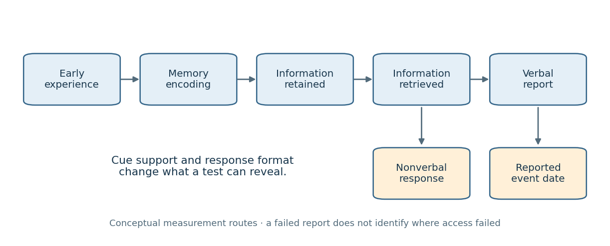

<h1 id="2/solution">Solution</h1>

↑ **Parent:** [2](../2.md)

Calling [childhood amnesia](../../../childhood-amnesia.md) a myth is defensible only if the supposed myth is that [infants](../../../infant.md) cannot form lasting [memories](../../../memory-in-animals.md), or that adults' earliest reported age is an exact biological boundary. Neither proposition is warranted. It does not follow that the relative scarcity of accessible [autobiographical memories](../../../autobiographical-memory.md) from early childhood is imaginary. The central distinction is between forming a [memory](../../../memory-in-animals.md), retaining information, retrieving it with particular cues, reporting it verbally and assigning it a date. Evidence about one stage cannot automatically settle the others.

An important methodological change was the development of tests that do not ask [infants](../../../infant.md) to narrate an event. [Carolyn Rovee-Collier](../../../carolyn-rovee-collier.md) and colleagues trained three-month-olds to move a crib mobile through footkicking. A ribbon-linked mobile provides a visible consequence of the [infant](../../../infant.md)'s action; retention can then be assessed with the mobile present but no longer moving contingently. Elevated kicking relative to a pretraining baseline indicates retention of the learned relation, rather than a verbal report. In their 1980 study, a brief reminder exposure twenty-four hours before testing reinstated performance after delays of two or four weeks, despite the usual loss of the trained response after a much shorter interval. This directly challenges an account equating an initial failure to perform with complete erasure of the earlier experience.[Science 208, 1159–1161; mobile conditioning, reminder and retention experiments](../../../reactivation-of-infant-memory-by-carolyn-rovee-collier-and-others.md)

The inference has limits. Reminder controls must show that the exposure does not simply teach an untrained [infant](../../../infant.md) the response, and changes in general activity must be separated from memory-specific kicking. More fundamentally, [memory](../../../memory-in-animals.md) for an action–outcome contingency is not equivalent to an adult's consciously recollected autobiographical episode. A demonstration of [infant](../../../infant.md) [learning](../../../learning.md) refutes global incapacity to remember; it does not prove that the adult can later re-experience that mobile episode as part of a personal life history. Reactivation under a matching cue also need not imply spontaneous retrieval without that cue.

[Gabrielle Simcock](../../../gabrielle-simcock.md) and [Harlene Hayne](../../../harlene-hayne.md) brought the verbal-report problem into a more naturalistic event. Young [children](../../../child.md) experienced a novel “Magic Shrinking Machine”: interacting with an apparatus produced apparently smaller versions of toys. Vocabulary was measured when the event occurred and again after a delay; later tests included verbal recall, photograph recognition and behavioural reenactment. [Children](../../../child.md) could retain event information nonverbally while failing to describe aspects for which they had lacked productive vocabulary at encoding, even after their vocabulary expanded. The design provides known event content and an opportunity to compare different response formats. It shows how a later verbal interview can underestimate retained information.[Psychological Science 13, 225–231; Magic Shrinking Machine, verbal and nonverbal tests](../../../breaking-the-barrier-children-fail-to-translate-their-preverbal-memories-into-language-by-gabrielle-simcock-and-harlene-hayne.md)

It would still be too strong to infer intact, adult-like [episodic memory](../../../episodic-memory.md) hidden behind a purely linguistic barrier. Recognition supplies information unavailable in free recall, and reenactment can exploit familiar objects and motor routines. Unequal performance may therefore reflect unequal cue support as well as representational format. The appropriate conclusion is that reporting limitations contribute to apparent amnesia, not that every unreported early event survives unchanged. Prospective tests should separately vary cue reinstatement and response modality rather than interpreting all nonverbal successes as full autobiographical recollection.

[Memory](../../../memory-in-animals.md) dating provides another challenge to a sharp boundary. [Qi Wang](../../../qi-wang.md) and [Carole Peterson](../../../carole-peterson.md) followed a small group of [children](../../../child.md) across an eight-year interval, asking for their earliest [memories](../../../memory-in-animals.md) and their estimated ages at those events. Some of the _same_ events remained reportable but were assigned progressively later ages. This [forward telescoping](../../../forward-telescoping.md) can make an early-life period seem empty when surviving [memories](../../../memory-in-animals.md) have migrated out of it on a retrospective timeline. Repeatedly following individual events is more informative than comparing different people's single earliest-memory reports. However, substantial attrition and uncertain initial dates limit the inference: a change in reported date does not establish the objectively correct date or show that dating error explains all missing [memories](../../../memory-in-animals.md).[Frontiers in Psychology 6, 2038; initial, two-year and eight-year memory dating interviews](../../../the-fate-of-childhood-memories-by-qi-wang-and-carole-peterson.md)

The strongest reason to reject the blanket “myth” claim comes from prospective evidence of actual loss of access. [Patricia J. Bauer](../../../patricia-j-bauer.md) and [Marina Larkina](../../../marina-larkina.md) documented conversations about specific events when [children](../../../child.md) were three, then interviewed different subgroups at ages five to nine. Five- to seven-year-olds recalled at least sixty per cent of those early events, whereas eight- and nine-year-olds recalled fewer than forty per cent. Thus [memories](../../../memory-in-animals.md) that demonstrably existed in childhood later became unavailable to the interview procedure. Older [children](../../../child.md)'s surviving narratives could be richer even while fewer events remained accessible: increasing narrative skill and increasing loss of early [memories](../../../memory-in-animals.md) are compatible.[Memory 22, 907–924; age-three interviews and prospective follow-ups at ages five to nine](../../../the-onset-of-childhood-amnesia-in-childhood-by-patricia-j-bauer-and-marina-larkina.md)

That study does not isolate a single neural cause. Longer retention intervals accompany older test ages, parent–[child](../../../child.md) conversations are themselves retrieval practice, and forgotten-at-test does not mean physically erased. Nevertheless, it rules out explaining the entire phenomenon as failure to encode in the first place, and it cannot be dismissed as adults merely misdating every surviving [memory](../../../memory-in-animals.md). The outcome to explain is a developmental distribution of accessibility produced over time.

**[Figure 1](#2/image-different-routes-from-an-early-experience-to-a-later-measurable-response). Different routes from an early experience to a later measurable response**.

This framework yields clear discriminating predictions. A retrieval account predicts improvement when appropriate cues are reinstated without teaching new event content. A verbal-expression account predicts better nonverbal than verbal performance when [language](../../../language.md) at encoding is limited. A dating account predicts shifts in the age assigned to an otherwise recognisable event. A forgetting account predicts loss of access to prospectively documented events. These mechanisms can coexist, so success for one is not a refutation of all the others.

By the 2022 evidence base, [childhood amnesia](../../../childhood-amnesia.md) should therefore be treated as a genuine pattern of sparse later autobiographical access whose boundaries and mechanisms are often oversimplified. The myths are a memoryless infancy, a universal discontinuity at one birthday and the assumption that an unsuccessful verbal report proves no retained information. Rejecting those myths makes the phenomenon more precise; it does not abolish the explanatory problem.

## ↑ Ancestors (11)

1. [2](../2.md)
2. [2022](../../2022-split.md)
3. [Past exam of the developmental science course of the year 2 of the psychology (experimental) course of the University of Oxford](../../split.md)
4. [Developmental science course of the year 2 of the psychology (experimental) course of the University of Oxford](../../../developmental-science-course-of-the-year-2-of-the-psychology-experimental-course-of-the-university-of-oxford.md)
5. [Year 2 of the psychology (experimental) course of the University of Oxford](../../../year-2-of-the-psychology-experimental-course-of-the-university-of-oxford.md)
6. [Psychology (experimental) course of the University of Oxford](../../../psychology-experimental-course-of-the-university-of-oxford.md)
7. [Undergraduate course of the University of Oxford](../../../undergraduate-course-of-the-university-of-oxford.md)
8. [Course of the University of Oxford](../../../course-of-the-university-of-oxford.md)
9. [University of Oxford](../../../university-of-oxford-split.md)
10. [List of universities](../../../list-of-universities.md)
11. [Codex Wiki](../../../split.md)
