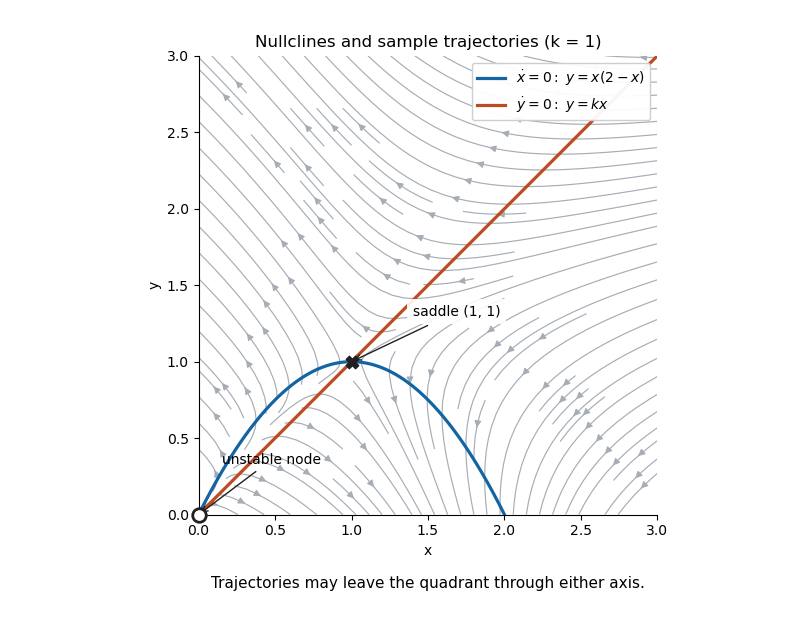
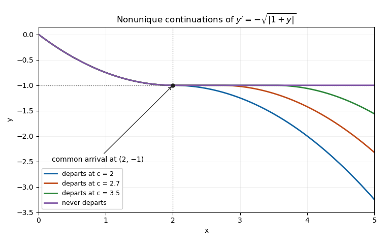
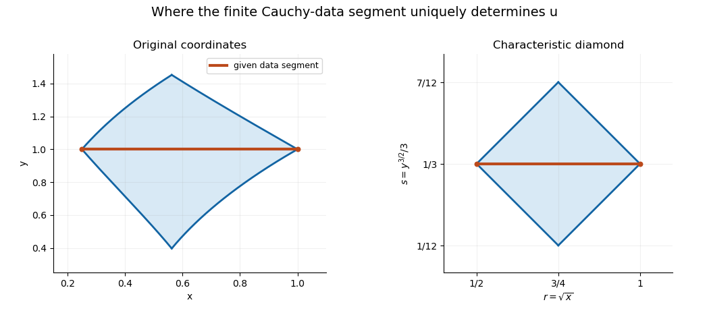

# 2017

↑ **Parent:** [Past exam of the differential equations 1 course of the University of Oxford](../past-exam-of-the-differential-equations-1-course-of-the-university-of-oxford.md)

Source paper: [released examination archive](https://www.whatdotheyknow.com/request/ba_computer_science_past_papers/response/2577745/attach/2/202402%20183%20CS%20Papers.zip?cookie_passthrough=1), member `2016/T/a15294w1.pdf`. The printed cover dates the examination to 16 June 2017. All three questions and all eighteen terminal subparts, including the two displayed cases in part 3(d), are answered below.

**Table of contents**

- [1](#1)
  - [a](#1/a)
    - [i](#1/a/i)
      - [Solution](#1/a/i/solution)
    - [ii](#1/a/ii)
      - [Solution](#1/a/ii/solution)
    - [iii](#1/a/iii)
      - [Solution](#1/a/iii/solution)
  - [b](#1/b)
    - [i](#1/b/i)
      - [Solution](#1/b/i/solution)
    - [ii](#1/b/ii)
      - [Solution](#1/b/ii/solution)
    - [iii](#1/b/iii)
      - [Solution](#1/b/iii/solution)
- [2](#2)
  - [a](#2/a)
    - [i](#2/a/i)
      - [Solution](#2/a/i/solution)
    - [ii](#2/a/ii)
      - [Solution](#2/a/ii/solution)
    - [iii](#2/a/iii)
      - [Solution](#2/a/iii/solution)
  - [b](#2/b)
    - [i](#2/b/i)
      - [Solution](#2/b/i/solution)
    - [ii](#2/b/ii)
      - [Solution](#2/b/ii/solution)
    - [iii](#2/b/iii)
      - [Solution](#2/b/iii/solution)
    - [iv](#2/b/iv)
      - [Solution](#2/b/iv/solution)
- [3](#3)
  - [a](#3/a)
    - [Solution](#3/a/solution)
  - [b](#3/b)
    - [Solution](#3/b/solution)
  - [c](#3/c)
    - [Solution](#3/c/solution)
  - [d](#3/d)
    - [i](#3/d/i)
      - [Solution](#3/d/i/solution)
    - [ii](#3/d/ii)
      - [Solution](#3/d/ii/solution)

## 1

↑ **Parent:** [2017](2017.md)

<h3 id="1/a">a</h3>

↑ **Parent:** [1](#1)

<h4 id="1/a/i">i</h4>

↑ **Parent:** [A](#1/a)

<h5 id="1/a/i/solution">Solution</h5>

↑ **Parent:** [I](#1/a/i)

The [autonomous planar system](../dynamical-systems.md#autonomous-planar-system) has two real state variables, so its [phase space](../hamiltonian-mechanics.md#phase-space) is a subset of $\mathbb R^2$. It is autonomous because its [vector field](../multivariable-calculus.md#vector-field) $(X(x,y),Y(x,y))$ has no explicit time dependence. The [nullclines](../dynamical-systems.md#nullcline) are $X(x,y)=0$ and $Y(x,y)=0$, on which the respective coordinate's instantaneous rate of change vanishes. A [critical point of a dynamical system](../dynamical-systems.md#equilibrium-point-of-a-dynamical-system) is an intersection where **$X=Y=0$**; the constant trajectory at that point is an [equilibrium of an autonomous differential equation](../dynamical-systems.md#equilibrium-of-an-autonomous-differential-equation). A nullcline alone need not consist of equilibria.

<h4 id="1/a/ii">ii</h4>

↑ **Parent:** [A](#1/a)

<h5 id="1/a/ii/solution">Solution</h5>

↑ **Parent:** [Ii](#1/a/ii)

Assume $X,Y$ are continuously differentiable near the equilibrium. Put $\xi=x-a$, $\eta=y-b$ and expand the [vector field](../multivariable-calculus.md#vector-field):

$$
\frac d{dt}\begin{pmatrix}\xi\\\eta\end{pmatrix}=M\begin{pmatrix}\xi\\\eta\end{pmatrix}+o\!\left(\sqrt{\xi^2+\eta^2}\right),\qquad
\boxed{M=\begin{pmatrix}X_x(a,b)&X_y(a,b)\\Y_x(a,b)&Y_y(a,b)\end{pmatrix}.}
$$

This [Jacobian matrix](../multivariable-calculus.md#jacobian-matrix) defines the linearized system. For distinct real [eigenvalues](../linear-operator-theory.md#eigenvalue), two negative values give a stable node, two positive values an unstable node, and opposite signs a [saddle point of a dynamical system](../dynamical-systems.md#saddle-equilibrium). A complex-conjugate pair with negative real part gives a stable focus, and one with positive real part an unstable focus. Thus a hyperbolic saddle has **two real [eigenvalues](../linear-operator-theory.md#eigenvalue) of opposite signs**, equivalently $\det M<0$.

The [linearization stability theorem](../dynamical-systems.md#linearization-stability-theorem) transfers these stability conclusions to the nonlinear system when no [eigenvalue](../linear-operator-theory.md#eigenvalue) has zero real part. Distinctness alone is insufficient: a zero eigenvalue or a purely imaginary conjugate pair leaves a [nonhyperbolic equilibrium](../dynamical-systems.md#nonhyperbolic-equilibrium), for which the nonlinear terms must be examined. In the purely imaginary case the linearized trajectories form a centre, but that does not establish a nonlinear centre.

<h4 id="1/a/iii">iii</h4>

↑ **Parent:** [A](#1/a)

<h5 id="1/a/iii/solution">Solution</h5>

↑ **Parent:** [Iii](#1/a/iii)

One useful form of the [Bendixson-Dulac theorem](../dynamical-systems.md#bendixson-dulac-theorem) is this: let $D\subseteq\mathbb R^2$ be open and [simply connected](../algebraic-topology.md#simply-connected-space), and let $X,Y,\psi$ be continuously differentiable on $D$. If

$$
\frac{\partial(\psi X)}{\partial x}+\frac{\partial(\psi Y)}{\partial y}
$$

has one strict sign throughout $D$, then **there is no nonconstant [periodic orbit](../dynamical-systems.md#periodic-orbit) lying entirely in $D$**. More generally the divergence may have a weak sign provided it is not identically zero on any nonempty open subset. The multiplier $\psi$ is a [Dulac function](../dynamical-systems.md#dulac-function). [Green's theorem](../multivariable-calculus.md#green-theorem) proves the criterion: the vector field is tangent to a hypothetical closed orbit, so its scaled flux across that boundary is zero, whereas the signed area integral of its [divergence](../multivariable-calculus.md#divergence) would be nonzero.

<h3 id="1/b">b</h3>

↑ **Parent:** [1](#1)

<h4 id="1/b/i">i</h4>

↑ **Parent:** [B](#1/b)

<h5 id="1/b/i/solution">Solution</h5>

↑ **Parent:** [I](#1/b/i)

Intersect the [nullclines](../dynamical-systems.md#nullcline) $y=x(2-x)$ and $y=kx$. Their intersection equation is $x(2-k-x)=0$, giving the origin and $(2-k,k(2-k))$. The [Jacobian matrix](../multivariable-calculus.md#jacobian-matrix) is

$$
M(x,y)=\begin{pmatrix}2-2x&-1\\-k&1\end{pmatrix}.
$$

At the origin, $\operatorname{tr}M=3$, $\det M=2-k$ and

$$
\lambda_\pm=\frac{3\pm\sqrt{1+4k}}2.
$$

For **$k>2$**, only the origin is in the nonnegative quadrant, and it is a **saddle** because its determinant is negative. For **$0<k<2$**, the origin is an **unstable node**, with two distinct positive [eigenvalues](../linear-operator-theory.md#eigenvalue), and there is a second equilibrium in the open quadrant. At that second equilibrium, $\det M=k-2<0$, so it is a **saddle**. These signs give [hyperbolic equilibria](../dynamical-systems.md#hyperbolic-equilibrium-point), so the nonlinear classifications follow from the [linearization stability theorem](../dynamical-systems.md#linearization-stability-theorem). The boundary value $k=2$ is excluded from the two stated cases.

<h4 id="1/b/ii">ii</h4>

↑ **Parent:** [B](#1/b)

<h5 id="1/b/ii/solution">Solution</h5>

↑ **Parent:** [Ii](#1/b/ii)

Draw the downward-opening [nullcline](../dynamical-systems.md#nullcline) $y=x(2-x)$, meeting the axes at $x=0,2$, and the line $y=kx$. Their positive intersection is $P=(2-k,k(2-k))$. Use the sign rules

$$
\dot x>0\iff y<x(2-x),\qquad \dot y>0\iff y>kx.
$$

Above both curves the arrows point northwest; below both they point southeast. For $0<x<2-k$, the parabola lies above the line, so arrows between them point northeast. For $2-k<x<2$, their order reverses, so arrows between them point southwest. For $x>2$, $\dot x<0$ throughout the nonnegative quadrant, with the vertical direction still determined by the line. Mark the origin as an unstable node and $P$ as a saddle, and trace sample trajectories consistent with those directions.

**[Figure 1](#1/b/ii/image-nullclines-and-sample-trajectories-for-the-representative-value-k-1). Nullclines and sample trajectories for the representative value $k=1$**. The displayed vector field is restricted to the nonnegative quadrant. The origin is an unstable node and the interior equilibrium is a saddle.

The quadrant is **not positively invariant**: on $x=0,y>0$, $\dot x=-y<0$; on $y=0,x>0$, $\dot y=-kx<0$. Trajectories reaching either axis there leave the plotted region. The [phase portrait](../dynamical-systems.md#phase-portrait) describes the portions inside the quadrant, not a claim that all forward trajectories remain inside it.

<h4 id="1/b/iii">iii</h4>

↑ **Parent:** [B](#1/b)

<h5 id="1/b/iii/solution">Solution</h5>

↑ **Parent:** [Iii](#1/b/iii)

Let $k>2$ and choose the positive [Dulac function](../dynamical-systems.md#dulac-function)

$$
\psi(x,y)=\exp\!\left(-\frac{2(x+y)}{k-2}\right).
$$

More generally, for $\psi=e^{a(x+y)}$, direct differentiation gives

$$
\nabla\cdot(\psi(X,Y))=\psi\bigl[3+(-2+(2-k)a)x-ax^2\bigr].
$$

Taking $a=-2/(k-2)$ cancels the linear term and makes the quadratic term nonnegative:

$$
\boxed{\nabla\cdot(\psi(X,Y))=\psi\left(3+\frac{2x^2}{k-2}\right)>0.}
$$

The open positive quadrant is [simply connected](../algebraic-topology.md#simply-connected-space), so the [Bendixson-Dulac theorem](../dynamical-systems.md#bendixson-dulac-theorem) excludes every nonconstant [periodic orbit](../dynamical-systems.md#periodic-orbit) entirely inside it. Such an orbit cannot touch $x=0,y>0$ while staying in the closed quadrant, since its differentiable coordinate $x$ would have a local minimum there but $\dot x=-y\ne0$. The same argument applies on $y=0,x>0$. It cannot pass through the origin either, by local uniqueness of this smooth [autonomous system](../dynamical-systems.md#autonomous-system-mathematics). Therefore **there is no nonconstant closed trajectory in the entire nonnegative quadrant**. The calculation illustrates an [exponential Dulac multiplier for a quadratic planar system](../dynamical-systems.md#exponential-dulac-multiplier-for-a-quadratic-planar-system).

## 2

↑ **Parent:** [2017](2017.md)

<h3 id="2/a">a</h3>

↑ **Parent:** [2](#2)

<h4 id="2/a/i">i</h4>

↑ **Parent:** [A](#2/a)

<h5 id="2/a/i/solution">Solution</h5>

↑ **Parent:** [I](#2/a/i)

The [contraction mapping theorem](../analysis.md#contraction-mapping-theorem) states that a [contraction mapping](../analysis.md#contraction-mapping) $T:S\to S$ on a nonempty [complete metric space](../topological-analysis.md#complete-metric-space) has a unique [fixed point](../function.md#fixed-point). Explicitly, if $d(Tu,Tv)\leq qd(u,v)$ for all $u,v\in S$ and one fixed $0\leq q<1$, then the iterates $u_{n+1}=Tu_n$ converge to that fixed point from every $u_0\in S$. Both self-mapping and completeness are needed; the set need not be a [vector space](../vector-space.md).

<h4 id="2/a/ii">ii</h4>

↑ **Parent:** [A](#2/a)

<h5 id="2/a/ii/solution">Solution</h5>

↑ **Parent:** [Ii](#2/a/ii)

For $0<\eta\leq h$, work on the closed subset

$$
C_\eta=\{y\in C([a-\eta,a+\eta]): |y(x)-b|\leq k\},\qquad d(y,z)=\|y-z\|_\infty.
$$

It is a nonempty [complete metric space](../topological-analysis.md#complete-metric-space) because it is closed in the [Banach space](../banach-space.md) of continuous functions with the [supremum norm](../normed-vector-space.md#supremum-norm). Define the [Picard iteration](../differential-equation.md#picard-iteration) operator

$$
(Ty)(x)=b+\int_a^x f(s,y(s))\,ds.
$$

Choose $\eta$ so that **$M\eta\leq k$ and $L\eta<1$**, omitting a bound whose constant is zero. Such a positive $\eta$ exists. The first inequality makes $T$ a self-map, since $|(Ty)(x)-b|\leq M|x-a|\leq k$. The [Lipschitz condition](../real-analysis.md#lipschitz-continuity) gives

$$
\|Ty-Tz\|_\infty\leq L\eta\|y-z\|_\infty,
$$

so the [contraction mapping theorem](../analysis.md#contraction-mapping-theorem) yields a unique fixed point. The [fundamental theorem of calculus](../calculus.md#fundamental-theorem-of-calculus) makes it a differentiable solution of $y'=f(x,y)$ with $y(a)=b$; conversely every solution staying in the rectangle satisfies the integral equation and is a fixed point. This is the local [Picard-Lindelöf theorem](../differential-equation.md#picard-lindelof-theorem) construction. The interval-restricted space $C_\eta$ avoids treating functions defined on a shorter interval as elements of $C_h$.

<h4 id="2/a/iii">iii</h4>

↑ **Parent:** [A](#2/a)

<h5 id="2/a/iii/solution">Solution</h5>

↑ **Parent:** [Iii](#2/a/iii)

Under $Mh\leq k$, the same [Picard iteration](../differential-equation.md#picard-iteration) operator maps all of $C_h$ into itself. It need not be a [contraction mapping](../analysis.md#contraction-mapping) in one step, since $Lh$ can exceed one. Instead repeated integration gives the [factorial estimate for Picard iteration](../differential-equation.md#factorial-estimate-for-picard-iteration)

$$
|(T^ny)(x)-(T^nz)(x)|\leq\frac{L^n|x-a|^n}{n!}\|y-z\|_\infty,
$$

proved inductively by integrating the preceding bound between $a$ and $x$. Thus

$$
\|T^ny-T^nz\|_\infty\leq\frac{(Lh)^n}{n!}\|y-z\|_\infty.
$$

For some $n$ the coefficient is less than one, so $T^n$ is a contraction. Its unique fixed point $y_*$ is also fixed by $T$: $T^n(Ty_*)=T(T^ny_*)=Ty_*$ and uniqueness forces $Ty_*=y_*$. Conversely any fixed point of $T$ is one of $T^n$. This [iterated contraction](../analysis.md#iterated-contraction) argument gives **a unique solution on the full interval $[a-h,a+h]$**, without the unjustified extra assumption $Lh<1$.

The uniqueness statement is for solutions in the specified rectangle, where $f$ is given and controlled. The bound $Mh\leq k$ keeps the constructed solution inside that rectangle throughout the interval.

<h3 id="2/b">b</h3>

↑ **Parent:** [2](#2)

<h4 id="2/b/i">i</h4>

↑ **Parent:** [B](#2/b)

<h5 id="2/b/i/solution">Solution</h5>

↑ **Parent:** [I](#2/b/i)

Where $y\ne-1$, **$y'=-\sqrt{|1+y|}<0$**. By the [mean value theorem](../calculus.md#mean-value-theorem), the solution is strictly decreasing on every interval where it avoids $-1$. At $y=-1$, the derivative is zero, so a constant segment there is possible. Thus all solutions are nonincreasing, while strict decrease need not persist through an interval spent at that equilibrium.

<h4 id="2/b/ii">ii</h4>

↑ **Parent:** [B](#2/b)

<h5 id="2/b/ii/solution">Solution</h5>

↑ **Parent:** [Ii](#2/b/ii)

For example, choose $h=1/4$ and $k=1/2$ around $(a,b)=(0,0)$. On the rectangle, $1+y\geq1/2$, so $f=-\sqrt{1+y}$ is continuous, $|f|\leq\sqrt{3/2}$ and $|\partial f/\partial y|\leq1/\sqrt2$. The [mean value theorem](../calculus.md#mean-value-theorem) therefore supplies a [Lipschitz constant](../real-analysis.md#lipschitz-constant) $L=1/\sqrt2$. These choices even satisfy $Mh<k$ and $Lh<1$.

While $y>-1$, [separation of variables](../partial-differential-equation.md#separation-of-variables) gives $2\sqrt{1+y}=2-x$. Therefore the uniquely determined branch up to its first arrival at $-1$ is

$$
\boxed{y(x)=\left(1-\frac x2\right)^2-1,\qquad 0\leq x\leq2.}
$$

It reaches $y=-1$ at $x=2$, with derivative zero. The restriction $x\leq2$ is essential: extending the same quadratic beyond two would make its derivative positive and violate the original differential equation. Beyond that time the [waiting-time continuation at a non-Lipschitz equilibrium](../differential-equation.md#waiting-time-continuation-at-a-non-lipschitz-equilibrium) is nonunique.

<h4 id="2/b/iii">iii</h4>

↑ **Parent:** [B](#2/b)

<h5 id="2/b/iii/solution">Solution</h5>

↑ **Parent:** [Iii](#2/b/iii)

Two solutions for $x\geq2$ are

$$
\boxed{y_1(x)=-1,\qquad y_2(x)=-1-\frac{(x-2)^2}{4}.}
$$

For the second, $y_2'=-(x-2)/2=-\sqrt{|1+y_2|}$ because $x\geq2$; both have value $-1$ and derivative zero at two. They are distinct for every $x>2$. Local [Lipschitz continuity](../real-analysis.md#lipschitz-continuity) fails at the equilibrium, so the existence of these two continuations is compatible with the [Picard-Lindelöf theorem](../differential-equation.md#picard-lindelof-theorem).

<h4 id="2/b/iv">iv</h4>

↑ **Parent:** [B](#2/b)

<h5 id="2/b/iv/solution">Solution</h5>

↑ **Parent:** [Iv](#2/b/iv)

For each departure time $c\in[2,h]$, define

$$
y_c(x)=\begin{cases}
(1-x/2)^2-1,&0\leq x\leq2,\\
-1,&2\leq x\leq c,\\
-1-(x-c)^2/4,&c\leq x\leq h.
\end{cases}
$$

Each branch satisfies the [ordinary differential equation](../differential-equation.md#ordinary-differential-equation), and both joins have matching value $-1$ and matching derivative zero. Thus $y_c$ is continuously differentiable and satisfies the same [initial value problem](../differential-equation.md#initial-value-problem). If $2\leq c_1<c_2\leq h$, the solutions differ on $(c_1,c_2)$, proving **infinitely many solutions on every $[0,h]$ with $h>2$**.

The uniqueness hypotheses fail when the solution reaches $-1$. Indeed

$$
\frac{|f(-1+\varepsilon)-f(-1)|}{\varepsilon}=\frac1{\sqrt\varepsilon}\longrightarrow\infty.
$$

No finite [Lipschitz constant](../real-analysis.md#lipschitz-constant) works on a rectangle containing that level in its interior. The local theorem still controls the earlier branch near zero; it cannot be extended through a point where its hypotheses fail. These are [waiting-time continuations at a non-Lipschitz equilibrium](../differential-equation.md#waiting-time-continuation-at-a-non-lipschitz-equilibrium).

**[Figure 2](#2/b/iv/image-the-same-initial-solution-admits-different-departure-times-from-a-non-lipschitz-equilibrium). The same initial solution admits different departure times from a non-Lipschitz equilibrium**. Each curve arrives at $y=-1$ at time two, may remain there, and then decreases again. All displayed joins are continuously differentiable.

## 3

↑ **Parent:** [2017](2017.md)

<h3 id="3/a">a</h3>

↑ **Parent:** [3](#3)

<h4 id="3/a/solution">Solution</h4>

↑ **Parent:** [A](#3/a)

The principal coefficients are $A=-xy$, $B=0$, $C=1$, in the convention $Au_{xx}+2Bu_{xy}+Cu_{yy}$. Their [discriminant](../polynomial.md#discriminant) is **$B^2-AC=xy$**. Thus it is a [hyperbolic partial differential equation](../partial-differential-equation.md#hyperbolic-partial-differential-equation) where $xy>0$ and an [elliptic partial differential equation](../partial-differential-equation.md#elliptic-partial-differential-equation) where $xy<0$. Its principal part has [parabolic type](../partial-differential-equation.md#parabolic-partial-differential-equation) where $xy=0$; however the full equation contains $u_y/y$ and is undefined on $y=0$. On its actual domain $y\ne0$, the parabolic locus is $x=0$.

The [characteristic equation of a partial differential equation](../partial-differential-equation.md#characteristic-equation-of-a-partial-differential-equation) is

$$
\boxed{A(dy)^2-2B\,dx\,dy+C(dx)^2=0,\qquad (dx)^2-xy(dy)^2=0.}
$$

In a hyperbolic region this gives two distinct real [characteristic directions](../partial-differential-equation.md#characteristic-direction). The singular lower-order coefficient should not be mistaken for an ordinary parabolic point of the full equation on $y=0$.

<h3 id="3/b">b</h3>

↑ **Parent:** [3](#3)

<h4 id="3/b/solution">Solution</h4>

↑ **Parent:** [B](#3/b)

In $x,y>0$, the [characteristic equation of a partial differential equation](../partial-differential-equation.md#characteristic-equation-of-a-partial-differential-equation) gives $dx/\sqrt x=\pm\sqrt y\,dy$. Integration yields the [characteristic coordinates](../partial-differential-equation.md#characteristic-coordinate)

$$
\xi=\sqrt x+\frac{y^{3/2}}3,\qquad \eta=\sqrt x-\frac{y^{3/2}}3.
$$

Their [Jacobian determinant](../multivariable-calculus.md#jacobian-determinant) is $-\sqrt y/(2\sqrt x)\ne0$, so they are valid independent coordinates. To see cancellation of the lower-order terms explicitly, first put $r=\sqrt x$, $s=y^{3/2}/3$ and $u(x,y)=U(r,s)$. The [chain rule](../calculus.md#chain-rule) gives

$$
u_x=\frac{U_r}{2\sqrt x},\quad u_{xx}=\frac{U_{rr}}{4x}-\frac{U_r}{4x^{3/2}},\quad
u_y=\frac{\sqrt y}{2}U_s,\quad u_{yy}=\frac y4U_{ss}+\frac{U_s}{4\sqrt y}.
$$

Substitution cancels the first-derivative terms, leaving **$U_{ss}-U_{rr}=0$**. With $\xi=r+s$, $\eta=r-s$ and $U=V(\xi,\eta)$, the [characteristic normal form](../partial-differential-equation.md#characteristic-normal-form) is **$V_{\xi\eta}=0$**. Integrating once in each variable gives

$$
\boxed{u(x,y)=g\!\left(\sqrt x+\frac{y^{3/2}}3\right)+h\!\left(\sqrt x-\frac{y^{3/2}}3\right),}
$$

where $g,h$ are arbitrary twice continuously differentiable functions on the relevant coordinate intervals. This is a [curvilinear reduction to the one-dimensional wave equation](../partial-differential-equation.md#curvilinear-reduction-to-the-one-dimensional-wave-equation).

<h3 id="3/c">c</h3>

↑ **Parent:** [3](#3)

<h4 id="3/c/solution">Solution</h4>

↑ **Parent:** [C](#3/c)

On $y=1$, the transformed variables satisfy $s=1/3$ and $1/2\leq r\leq1$. Differentiating the displacement data tangentially and using $u_y=1$ gives

$$
g'(r+1/3)+h'(r-1/3)=2,\qquad \tfrac12\bigl(g'(r+1/3)-h'(r-1/3)\bigr)=1.
$$

Hence $g'=2$ on $[5/6,4/3]$, $h'=0$ on $[1/6,2/3]$, and the additive constants have sum $-2/3$. The uniquely determined solution is therefore

$$
\boxed{u(x,y)=2\sqrt x+\frac23(y^{3/2}-1).}
$$

It is fixed by the data exactly where both needed characteristic arguments belong to their known intervals:

$$
\boxed{\frac56\leq\sqrt x+\frac{y^{3/2}}3\leq\frac43,\qquad\frac16\leq\sqrt x-\frac{y^{3/2}}3\leq\frac23.}
$$

Equivalently, in the $(r,s)$ plane this is the diamond $|r-3/4|+|s-1/3|\leq1/4$. In the original coordinates it is bounded by four curved [characteristic curves](../transport-equation.md#characteristic-curve). It lies wholly in $x,y>0$. The displayed formula supplies one smooth extension beyond the diamond too, but the specified finite data segment does not determine that extension: one may change $g$ or $h$ outside its known argument interval. This is the [characteristic-coordinate domain of dependence](../partial-differential-equation.md#characteristic-coordinate-domain-of-dependence).

**[Figure 3](#3/c/image-the-finite-cauchy-data-segment-determines-a-characteristic-diamond-in-transformed-coordinates). The finite Cauchy-data segment determines a characteristic diamond in transformed coordinates**. The left panel shows its curved image in the original quadrant; the right panel shows the straight-sided diamond after the change of variables. Shading includes both forward and backward determination from the data segment.

<h3 id="3/d">d</h3>

↑ **Parent:** [3](#3)

<h4 id="3/d/i">i</h4>

↑ **Parent:** [D](#3/d)

<h5 id="3/d/i/solution">Solution</h5>

↑ **Parent:** [I](#3/d/i)

The initial curve $y^3=9x$ is **$\eta=0$**, with $\xi=2\sqrt x\in[1,2]$, so it is characteristic. The displacement data force $g(\xi)+h(0)=\xi$ and therefore $g'=1$ on that interval. Along the curve,

$$
u_y=\frac{\sqrt y}{2}\bigl(1-h'(0)\bigr),\qquad\sqrt y=3^{1/3}x^{1/6}.
$$

The derivative data in case (i) are compatible precisely when $h'(0)=-1$. They place no restriction on the rest of $h$. For example, for every real constant $C$,

$$
\boxed{u_C(x,y)=\frac23y^{3/2}+C\left(\sqrt x-\frac{y^{3/2}}3\right)^2}
$$

solves the equation and has both prescribed data on the curve. Choosing $C=0$ and $C=1$ exhibits **more than one solution** directly. The initial curve follows one characteristic family, so its data do not determine the other wave family. This is the compatible case of [compatibility of Cauchy data on a characteristic curve](../partial-differential-equation.md#compatibility-of-cauchy-data-on-a-characteristic-curve).

<h4 id="3/d/ii">ii</h4>

↑ **Parent:** [D](#3/d)

<h5 id="3/d/ii/solution">Solution</h5>

↑ **Parent:** [Ii](#3/d/ii)

As in case (i), the initial curve is characteristic and its displacement data force $g'=1$. The new derivative data would therefore require

$$
1=\frac{\sqrt y}{2}\bigl(1-h'(0)\bigr),\qquad h'(0)=1-\frac2{\sqrt y}.
$$

The right-hand side varies along the initial segment. A single number $h'(0)$ cannot satisfy those conditions, so **no classical solution exists**.

Characteristic [Cauchy data](../partial-differential-equation.md#cauchy-data) impose a compatibility condition on transverse derivatives without determining the missing independent wave family. Compatible data can leave nonuniqueness, as in case (i); incompatible data have no solution, as here. The distinction follows from [compatibility of Cauchy data on a characteristic curve](../partial-differential-equation.md#compatibility-of-cauchy-data-on-a-characteristic-curve), rather than a noncharacteristic existence-and-uniqueness theorem.

## ↑ Ancestors (9)

1. [Past exam of the differential equations 1 course of the University of Oxford](../past-exam-of-the-differential-equations-1-course-of-the-university-of-oxford.md)
2. [Differential equations 1 course of the University of Oxford](../university-of-oxford.md#differential-equations-1-course-of-the-university-of-oxford)
3. [Year 2 of the mathematics course of the University of Oxford](../university-of-oxford.md#year-2-of-the-mathematics-course-of-the-university-of-oxford)
4. [Mathematics course of the University of Oxford](../university-of-oxford.md#mathematics-course-of-the-university-of-oxford)
5. [Undergraduate course of the University of Oxford](../university-of-oxford.md#undergraduate-course-of-the-university-of-oxford)
6. [Course of the University of Oxford](../university-of-oxford.md#course-of-the-university-of-oxford)
7. [University of Oxford](../university-of-oxford.md)
8. [List of universities](../README.md#list-of-universities)
9. [Codex Wiki](../README.md)
