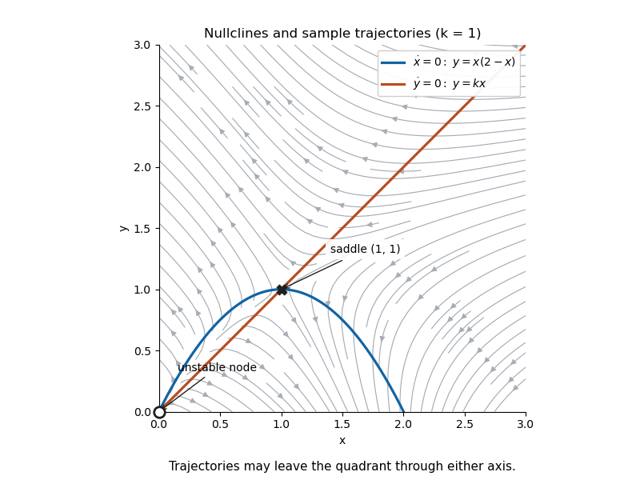

<h1 id="1/b/ii/solution">Solution</h1>

↑ **Parent:** [Ii](../ii.md)

Draw the downward-opening [nullcline](../../../../../nullcline.md) $y=x(2-x)$, meeting the axes at $x=0,2$, and the line $y=kx$. Their positive intersection is $P=(2-k,k(2-k))$. Use the sign rules

$$
\dot x>0\iff y<x(2-x),\qquad \dot y>0\iff y>kx.
$$

Above both curves the arrows point northwest; below both they point southeast. For $0<x<2-k$, the parabola lies above the line, so arrows between them point northeast. For $2-k<x<2$, their order reverses, so arrows between them point southwest. For $x>2$, $\dot x<0$ throughout the nonnegative quadrant, with the vertical direction still determined by the line. Mark the origin as an unstable node and $P$ as a saddle, and trace sample trajectories consistent with those directions.

**[Figure 1](#1/b/ii/image-nullclines-and-sample-trajectories-for-the-representative-value-k-1). Nullclines and sample trajectories for the representative value $k=1$**. The displayed vector field is restricted to the nonnegative quadrant. The origin is an unstable node and the interior equilibrium is a saddle.

The quadrant is **not positively invariant**: on $x=0,y>0$, $\dot x=-y<0$; on $y=0,x>0$, $\dot y=-kx<0$. Trajectories reaching either axis there leave the plotted region. The [phase portrait](../../../../../phase-portrait.md) describes the portions inside the quadrant, not a claim that all forward trajectories remain inside it.

## ↑ Ancestors (13)

1. [Ii](../ii.md)
2. [B](../../b.md)
3. [1](../../../1.md)
4. [2017](../../../../2017-split.md)
5. [Past exam of the differential equations 1 course of the University of Oxford](../../../../split.md)
6. [Differential equations 1 course of the University of Oxford](../../../../../differential-equations-1-course-of-the-university-of-oxford.md)
7. [Year 2 of the mathematics course of the University of Oxford](../../../../../year-2-of-the-mathematics-course-of-the-university-of-oxford.md)
8. [Mathematics course of the University of Oxford](../../../../../mathematics-course-of-the-university-of-oxford.md)
9. [Undergraduate course of the University of Oxford](../../../../../undergraduate-course-of-the-university-of-oxford.md)
10. [Course of the University of Oxford](../../../../../course-of-the-university-of-oxford.md)
11. [University of Oxford](../../../../../university-of-oxford-split.md)
12. [List of universities](../../../../../list-of-universities.md)
13. [Codex Wiki](../../../../../split.md)
