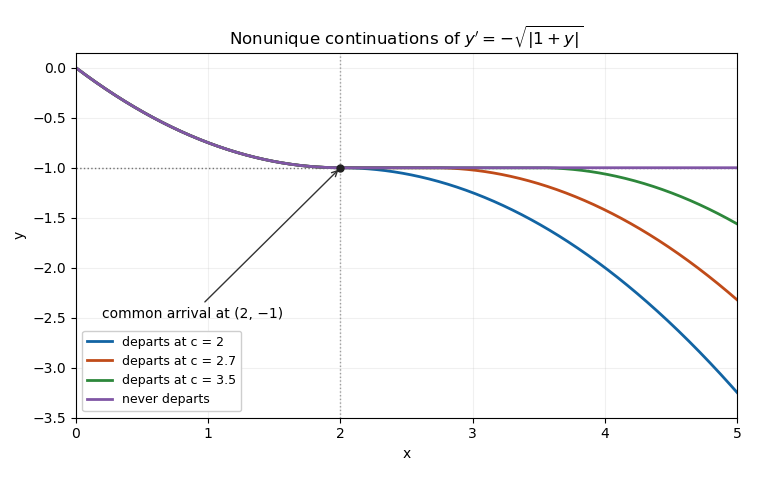

<h1 id="2/b/iv/solution">Solution</h1>

↑ **Parent:** [Iv](../iv.md)

For each departure time $c\in[2,h]$, define

$$
y_c(x)=\begin{cases}
(1-x/2)^2-1,&0\leq x\leq2,\\
-1,&2\leq x\leq c,\\
-1-(x-c)^2/4,&c\leq x\leq h.
\end{cases}
$$

Each branch satisfies the [ordinary differential equation](../../../../../ordinary-differential-equation.md), and both joins have matching value $-1$ and matching derivative zero. Thus $y_c$ is continuously differentiable and satisfies the same [initial value problem](../../../../../initial-value-problem.md). If $2\leq c_1<c_2\leq h$, the solutions differ on $(c_1,c_2)$, proving **infinitely many solutions on every $[0,h]$ with $h>2$**.

The uniqueness hypotheses fail when the solution reaches $-1$. Indeed

$$
\frac{|f(-1+\varepsilon)-f(-1)|}{\varepsilon}=\frac1{\sqrt\varepsilon}\longrightarrow\infty.
$$

No finite [Lipschitz constant](../../../../../lipschitz-constant.md) works on a rectangle containing that level in its interior. The local theorem still controls the earlier branch near zero; it cannot be extended through a point where its hypotheses fail. These are [waiting-time continuations at a non-Lipschitz equilibrium](../../../../../waiting-time-continuation-at-a-non-lipschitz-equilibrium.md).

**[Figure 2](#2/b/iv/image-the-same-initial-solution-admits-different-departure-times-from-a-non-lipschitz-equilibrium). The same initial solution admits different departure times from a non-Lipschitz equilibrium**. Each curve arrives at $y=-1$ at time two, may remain there, and then decreases again. All displayed joins are continuously differentiable.

## ↑ Ancestors (13)

1. [Iv](../iv.md)
2. [B](../../b.md)
3. [2](../../../2.md)
4. [2017](../../../../2017-split.md)
5. [Past exam of the differential equations 1 course of the University of Oxford](../../../../split.md)
6. [Differential equations 1 course of the University of Oxford](../../../../../differential-equations-1-course-of-the-university-of-oxford.md)
7. [Year 2 of the mathematics course of the University of Oxford](../../../../../year-2-of-the-mathematics-course-of-the-university-of-oxford.md)
8. [Mathematics course of the University of Oxford](../../../../../mathematics-course-of-the-university-of-oxford.md)
9. [Undergraduate course of the University of Oxford](../../../../../undergraduate-course-of-the-university-of-oxford.md)
10. [Course of the University of Oxford](../../../../../course-of-the-university-of-oxford.md)
11. [University of Oxford](../../../../../university-of-oxford-split.md)
12. [List of universities](../../../../../list-of-universities.md)
13. [Codex Wiki](../../../../../split.md)
