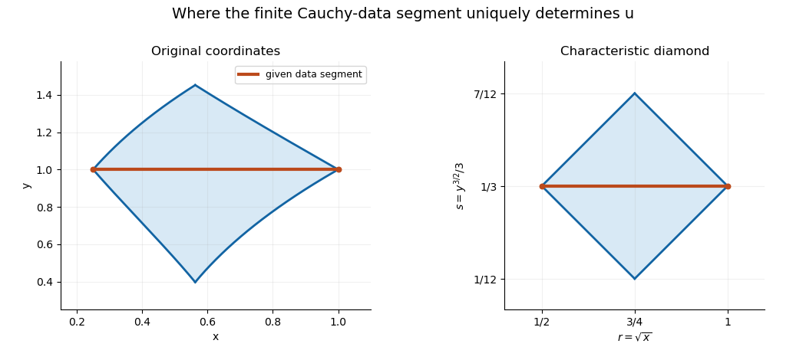

<h1 id="3/c/solution">Solution</h1>

↑ **Parent:** [C](../c.md)

On $y=1$, the transformed variables satisfy $s=1/3$ and $1/2\leq r\leq1$. Differentiating the displacement data tangentially and using $u_y=1$ gives

$$
g'(r+1/3)+h'(r-1/3)=2,\qquad \tfrac12\bigl(g'(r+1/3)-h'(r-1/3)\bigr)=1.
$$

Hence $g'=2$ on $[5/6,4/3]$, $h'=0$ on $[1/6,2/3]$, and the additive constants have sum $-2/3$. The uniquely determined solution is therefore

$$
\boxed{u(x,y)=2\sqrt x+\frac23(y^{3/2}-1).}
$$

It is fixed by the data exactly where both needed characteristic arguments belong to their known intervals:

$$
\boxed{\frac56\leq\sqrt x+\frac{y^{3/2}}3\leq\frac43,\qquad\frac16\leq\sqrt x-\frac{y^{3/2}}3\leq\frac23.}
$$

Equivalently, in the $(r,s)$ plane this is the diamond $|r-3/4|+|s-1/3|\leq1/4$. In the original coordinates it is bounded by four curved [characteristic curves](../../../../characteristic-curve.md). It lies wholly in $x,y>0$. The displayed formula supplies one smooth extension beyond the diamond too, but the specified finite data segment does not determine that extension: one may change $g$ or $h$ outside its known argument interval. This is the [characteristic-coordinate domain of dependence](../../../../characteristic-coordinate-domain-of-dependence.md).

**[Figure 3](#3/c/image-the-finite-cauchy-data-segment-determines-a-characteristic-diamond-in-transformed-coordinates). The finite Cauchy-data segment determines a characteristic diamond in transformed coordinates**. The left panel shows its curved image in the original quadrant; the right panel shows the straight-sided diamond after the change of variables. Shading includes both forward and backward determination from the data segment.

## ↑ Ancestors (12)

1. [C](../c.md)
2. [3](../../3.md)
3. [2017](../../../2017-split.md)
4. [Past exam of the differential equations 1 course of the University of Oxford](../../../split.md)
5. [Differential equations 1 course of the University of Oxford](../../../../differential-equations-1-course-of-the-university-of-oxford.md)
6. [Year 2 of the mathematics course of the University of Oxford](../../../../year-2-of-the-mathematics-course-of-the-university-of-oxford.md)
7. [Mathematics course of the University of Oxford](../../../../mathematics-course-of-the-university-of-oxford.md)
8. [Undergraduate course of the University of Oxford](../../../../undergraduate-course-of-the-university-of-oxford.md)
9. [Course of the University of Oxford](../../../../course-of-the-university-of-oxford.md)
10. [University of Oxford](../../../../university-of-oxford-split.md)
11. [List of universities](../../../../list-of-universities.md)
12. [Codex Wiki](../../../../split.md)
