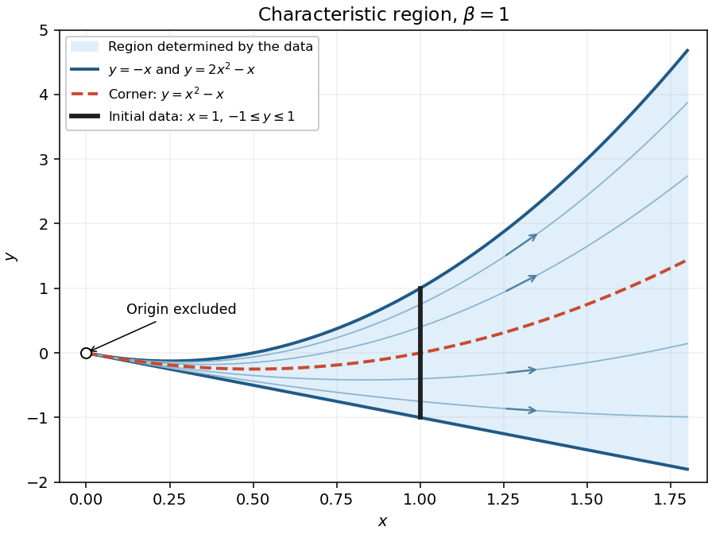
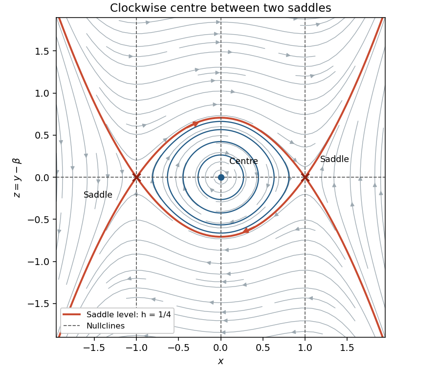

# 2021

↑ **Parent:** [Past exam of the differential equations 1 course of the University of Oxford](../past-exam-of-the-differential-equations-1-course-of-the-university-of-oxford.md)

Source: [Oxford Part A paper A1, A15294W1, Differential Equations, 22 June 2021; bundle pages 268–271, paper pages 1–4](https://www.whatdotheyknow.com/request/bsc_mathematics_part_a_examinati/response/2820674/attach/3/FOI%20202410%20944%20Data.pdf#page=268). All three questions, both proof options in Question 2(a), and every subpart are solved below.

**Table of contents**

- [1](#1)
  - [a](#1/a)
    - [Solution](#1/a/solution)
  - [b](#1/b)
    - [i](#1/b/i)
      - [Solution](#1/b/i/solution)
    - [ii](#1/b/ii)
      - [Solution](#1/b/ii/solution)
    - [iii](#1/b/iii)
      - [Solution](#1/b/iii/solution)
    - [iv](#1/b/iv)
      - [Solution](#1/b/iv/solution)
  - [c](#1/c)
    - [i](#1/c/i)
      - [Solution](#1/c/i/solution)
    - [ii](#1/c/ii)
      - [Solution](#1/c/ii/solution)
    - [iii](#1/c/iii)
      - [Solution](#1/c/iii/solution)
- [2](#2)
  - [a](#2/a)
    - [1](#2/a/1)
      - [Solution](#2/a/1/solution)
    - [2](#2/a/2)
      - [Solution](#2/a/2/solution)
  - [b](#2/b)
    - [i](#2/b/i)
      - [Solution](#2/b/i/solution)
    - [ii](#2/b/ii)
      - [Solution](#2/b/ii/solution)
    - [iii](#2/b/iii)
      - [Solution](#2/b/iii/solution)
  - [c](#2/c)
    - [i](#2/c/i)
      - [Solution](#2/c/i/solution)
    - [ii](#2/c/ii)
      - [Solution](#2/c/ii/solution)
- [3](#3)
  - [a](#3/a)
    - [i](#3/a/i)
      - [Solution](#3/a/i/solution)
    - [ii](#3/a/ii)
      - [Solution](#3/a/ii/solution)
    - [iii](#3/a/iii)
      - [Solution](#3/a/iii/solution)
    - [iv](#3/a/iv)
      - [Solution](#3/a/iv/solution)
  - [b](#3/b)
    - [i](#3/b/i)
      - [Solution](#3/b/i/solution)
    - [ii](#3/b/ii)
      - [Solution](#3/b/ii/solution)
    - [iii](#3/b/iii)
      - [Solution](#3/b/iii/solution)

## 1

↑ **Parent:** [2021](2021.md)

<h3 id="1/a">a</h3>

↑ **Parent:** [1](#1)

<h4 id="1/a/solution">Solution</h4>

↑ **Parent:** [A](#1/a)

The [method of characteristics](../transport-equation.md#method-of-characteristics) replaces the [first-order partial differential equation](../partial-differential-equation.md#first-order-partial-differential-equation) by the [ordinary differential equations](../differential-equation.md#ordinary-differential-equation)

$$
\dot x=x,\qquad \dot y=2y+\beta x,\qquad \dot u=x+2.
$$

An [integrating factor](../linear-ordinary-differential-equation.md#integrating-factor) for the second equation gives $d(e^{-2s}y)/ds=\beta C e^{-s}$, so their general [solution of a differential equation](../differential-equation.md#solution-of-a-differential-equation) is

$$
\boxed{x=C e^s,\qquad y=D e^{2s}-\beta C e^s,\qquad u=C e^s+2s+E.}
$$

Here $C,D,E$ are real constants. For $C\ne0$, eliminating $s$ gives the [characteristic projections](../transport-equation.md#characteristic-projection)

$$
\boxed{y=Kx^2-\beta x,\qquad K=D/C^2,}
$$

each restricted to either $x>0$ or $x<0$. These are arcs of [parabolas](../euclidean-geometry.md#parabola), with the straight-line exception $K=0$. Along an oriented [characteristic curve](../transport-equation.md#characteristic-curve), $|x|$ increases with $s$.

For $C=0$, the [characteristic projections](../transport-equation.md#characteristic-projection) lie on $x=0$: $y=D e^{2s}$ describes either vertical half-line when $D\ne0$. For $C=D=0$ the projection is the single point $(0,0)$, although $u=2s+E$ still changes. This last lifted [characteristic curve](../transport-equation.md#characteristic-curve) cannot be contained in the [function graph](../function.md#graph-of-a-function) of a [classical solution](../partial-differential-equation.md#classical-solution): at $(0,0)$ the original [partial differential equation](../partial-differential-equation.md) would require $0=2$.

<h3 id="1/b">b</h3>

↑ **Parent:** [1](#1)

<h4 id="1/b/i">i</h4>

↑ **Parent:** [B](#1/b)

<h5 id="1/b/i/solution">Solution</h5>

↑ **Parent:** [I](#1/b/i)

Parametrize the initial curve by $(x_0(r),y_0(r))=(1,r)$, $-1\leq r\leq1$. Its tangent is $(0,1)$, whereas the projected [characteristic vector field](../transport-equation.md#characteristic-vector-field) there is $(1,2r+\beta)$. The [determinant](../multilinear-algebra.md#determinant)

$$
\boxed{\det\begin{pmatrix}1&0\\2r+\beta&1\end{pmatrix}=1\ne0}
$$

proves that these are [Noncharacteristic Cauchy data](../partial-differential-equation.md#noncharacteristic-cauchy-data): the initial curve is everywhere transverse to the [characteristic curves](../transport-equation.md#characteristic-curve).

There is a regularity qualification. The prescribed [function](../function.md) $g(r)=\min\{r,0\}$ is [continuous](../calculus.md#continuous-function) and [Lipschitz continuous](../real-analysis.md#lipschitz-continuity), but is not differentiable at $r=0$. Thus the data are Cauchy in this geometric sense, with data given by a [smooth function](../analysis.md#smooth-function) on each of $r<0$ and $r>0$; the usual theorem giving a global [classical solution](../partial-differential-equation.md#classical-solution) from continuously differentiable data does not apply across $r=0$.

<h4 id="1/b/ii">ii</h4>

↑ **Parent:** [B](#1/b)

<h5 id="1/b/ii/solution">Solution</h5>

↑ **Parent:** [Ii](#1/b/ii)

Use the initial conditions $x(0,r)=1$, $y(0,r)=r$, $u(0,r)=g(r)$ in the [characteristic equations for a transport equation](../transport-equation.md#characteristic-equations-for-a-transport-equation). The resulting parametrized [solution surface](../partial-differential-equation.md#solution-surface) is

$$
\boxed{\begin{aligned}
x(s,r)&=e^s,\\
y(s,r)&=(r+\beta)e^{2s}-\beta e^s,\\
u(s,r)&=\min\{r,0\}+e^s-1+2s,
\end{aligned}\qquad s\in\mathbb R,\ -1\leq r\leq1.}
$$

The [Jacobian determinant](../multivariable-calculus.md#jacobian-determinant) of $(s,r)\mapsto(x,y)$ is $e^{3s}>0$. In fact the inverse is explicit:

$$
s=\log x,\qquad r=q(x,y):=\frac{y+\beta x}{x^2}-\beta.
$$

Consequently the explicit [solution of a differential equation](../differential-equation.md#solution-of-a-differential-equation) on the region reached from the data is

$$
\boxed{u(x,y)=x-1+2\log x+\min\left\{\frac{y+\beta x}{x^2}-\beta,0\right\}.}
$$

To verify it away from $q=0$, set $D=x\partial_x+(2y+\beta x)\partial_y$. Direct [differentiation](../calculus.md#differentiation) gives $Dq=0$ and $D(x-1+2\log x)=x+2$. At $x=1$ we have $q=y$, giving precisely the prescribed [boundary condition](../differential-equation.md#boundary-condition).

Across $q=0$ the formula remains [continuous](../calculus.md#continuous-function) and [locally Lipschitz](../real-analysis.md#locally-lipschitz-function), is a [smooth function](../analysis.md#smooth-function) on each side, and solves the [partial differential equation](../partial-differential-equation.md) along every [characteristic curve](../transport-equation.md#characteristic-curve). It is also a [weak solution](../partial-differential-equation.md#weak-solution), since its first [distributional derivatives](../distribution-theory.md#distributional-derivative) agree almost everywhere with its ordinary [derivatives](../calculus.md#derivative). It is not a [classical solution](../partial-differential-equation.md#classical-solution) throughout the region because of the inherited corner.

<h4 id="1/b/iii">iii</h4>

↑ **Parent:** [B](#1/b)

<h5 id="1/b/iii/solution">Solution</h5>

↑ **Parent:** [Iii](#1/b/iii)

Every point with $x>0$ has exactly one backward [characteristic curve](../transport-equation.md#characteristic-curve) meeting $x=1$, at the point $(1,q(x,y))$. It meets the specified data precisely when $-1\leq q\leq1$. Thus the whole region determined by these data, including the two bounding [characteristic curves](../transport-equation.md#characteristic-curve), is

$$
\boxed{\mathcal D_\beta=\{(x,y):x>0,\ (\beta-1)x^2-\beta x\leq y\leq(\beta+1)x^2-\beta x\}.}
$$

Its interior is the corresponding open domain for the [partial differential equation](../partial-differential-equation.md). Uniqueness here means uniqueness in the class of [continuous functions](../calculus.md#continuous-function) satisfying the [characteristic equations for a transport equation](../transport-equation.md#characteristic-equations-for-a-transport-equation), including the piecewise [smooth function](../analysis.md#smooth-function) defining the [solution of a differential equation](../differential-equation.md#solution-of-a-differential-equation) above. The endpoints of the initial segment determine the two boundary values by [continuity](../calculus.md#continuous-function).

This region is maximal for determination by the given data: on $x>0$, arbitrary extensions of $g$ outside $[-1,1]$ give different values on the [characteristic curves](../transport-equation.md#characteristic-curve) with $q\notin[-1,1]$. No [characteristic curve](../transport-equation.md#characteristic-curve) from $x=1$ reaches $x\leq0$.

For $\beta=1$,

$$
\boxed{x>0,\qquad -x\leq y\leq2x^2-x.}
$$

The lower boundary is a straight line, the upper boundary is a [parabola](../euclidean-geometry.md#parabola), and the characteristic carrying the corner is $y=x^2-x$. All three approach the excluded origin as $x\downarrow0$.

**[Figure 1](#1/b/iii/image-the-characteristic-region-for-beta-equal-to-one-with-the-curve-carrying-the-corner). The characteristic region for beta equal to one, with the curve carrying the corner**.

<h4 id="1/b/iv">iv</h4>

↑ **Parent:** [B](#1/b)

<h5 id="1/b/iv/solution">Solution</h5>

↑ **Parent:** [Iv](#1/b/iv)

For $\beta=1$, $q=(y+x-x^2)/x^2$. On the two sides of the corner-carrying [characteristic curve](../transport-equation.md#characteristic-curve), the [partial derivative](../multivariable-calculus.md#partial-derivative) is

$$
\boxed{u_y(x,y)=\begin{cases}x^{-2},&-x<y<x^2-x,\\0,&x^2-x<y<2x^2-x,\end{cases}\qquad x>0.}
$$

At every point $(x,x^2-x)$ with $x>0$, the two one-sided [partial derivatives](../multivariable-calculus.md#partial-derivative) are $x^{-2}$ and $0$. Therefore $u_y$ does not exist on this curve; its piecewise values have a [jump discontinuity](../calculus.md#jump-discontinuity) of magnitude $x^{-2}$. There are no other interior discontinuities. The values on the outer boundaries are interpreted from within $\mathcal D_1$.

This is exactly [propagation of a derivative jump along a characteristic](../transport-equation.md#propagation-of-a-derivative-jump-along-a-characteristic). Already on $x=1$, the data have slopes $1$ and $0$ on the two sides of $y=0$. The [transport equation](../transport-equation.md) transports this corner along the [characteristic curve](../transport-equation.md#characteristic-curve) from $(1,0)$, which is $y=x^2-x$; it provides no smoothing. This is consistent with [Noncharacteristic Cauchy data](../partial-differential-equation.md#noncharacteristic-cauchy-data) and does not contradict the smooth-data theorem, whose differentiability hypothesis fails here.

<h3 id="1/c">c</h3>

↑ **Parent:** [1](#1)

<h4 id="1/c/i">i</h4>

↑ **Parent:** [C](#1/c)

<h5 id="1/c/i/solution">Solution</h5>

↑ **Parent:** [I](#1/c/i)

In the convention $Av_{xx}+2Bv_{xy}+Cv_{yy}=\cdots$, the coefficients of the [principal symbol](../partial-differential-equation.md#principal-symbol-of-a-partial-differential-equation) are

$$
A=x,\qquad B=y+\frac{\beta x}{2},\qquad C=0,\qquad B^2-AC=\frac{(2y+\beta x)^2}{4}.
$$

Thus the [second-order partial differential equation](../partial-differential-equation.md#second-order-partial-differential-equation) is

$$
\boxed{\begin{array}{ll}
\text{hyperbolic},&2y+\beta x\ne0,\\
\text{parabolic},&2y+\beta x=0,\quad x\ne0.
\end{array}}
$$

There is no region of [elliptic partial differential equation](../partial-differential-equation.md#elliptic-partial-differential-equation) type. The terms hyperbolic, parabolic and elliptic refer to the [pointwise classification of a second-order partial differential equation](../partial-differential-equation.md#pointwise-classification-of-a-second-order-partial-differential-equation). At $(0,0)$ every second-order coefficient vanishes, so the [principal symbol](../partial-differential-equation.md#principal-symbol-of-a-partial-differential-equation) has rank zero and the equation is degenerate rather than genuinely parabolic there. Moreover the right side is $2$, so no twice continuously differentiable [classical solution](../partial-differential-equation.md#classical-solution) can satisfy the equation at the origin.

<h4 id="1/c/ii">ii</h4>

↑ **Parent:** [C](#1/c)

<h5 id="1/c/ii/solution">Solution</h5>

↑ **Parent:** [Ii](#1/c/ii)

For $\beta=0$, the equation for the [characteristic curves](../transport-equation.md#characteristic-curve) is

$$
x(dy)^2-2y\,dx\,dy=dy\,(x\,dy-2y\,dx)=0.
$$

The two families are therefore $y=\text{constant}$ and the [characteristic projections](../transport-equation.md#characteristic-projection) from part (a), $y=Kx^2$, together with the vertical characteristic $x=0$. On either region $y>0$ or $y<0$, the [hyperbolic partial differential equation](../partial-differential-equation.md#hyperbolic-partial-differential-equation) admits the [characteristic coordinates](../partial-differential-equation.md#characteristic-coordinate)

$$
\boxed{\varphi=y,\qquad \psi=\frac{x}{\sqrt{|y|}}.}
$$

Indeed $\varphi$ is constant along the first family, while $(x\partial_x+2y\partial_y)\psi=0$. Their [Jacobian determinant](../multivariable-calculus.md#jacobian-determinant) is

$$
\frac{\partial(\varphi,\psi)}{\partial(x,y)}=-\frac1{\sqrt{|y|}}\ne0.
$$

The coefficients of the two pure second [partial derivatives](../multivariable-calculus.md#partial-derivative) in these coordinates vanish, and the coefficient of the mixed [partial derivative](../multivariable-calculus.md#partial-derivative) is $2y/\sqrt{|y|}\ne0$. Hence they give the hyperbolic [characteristic normal form](../partial-differential-equation.md#characteristic-normal-form). They also remain regular at $x=0$, provided $y\ne0$.

The alternative $\varphi=y$, $\psi=y/x^2$ is valid on patches with $xy\ne0$. On $y=0$, it is a [parabolic partial differential equation](../partial-differential-equation.md#parabolic-partial-differential-equation) away from the fully degenerate origin, so two independent hyperbolic [characteristic coordinates](../partial-differential-equation.md#characteristic-coordinate) are unavailable.

<h4 id="1/c/iii">iii</h4>

↑ **Parent:** [C](#1/c)

<h5 id="1/c/iii/solution">Solution</h5>

↑ **Parent:** [Iii](#1/c/iii)

The second-order [differential operator](../analysis.md#differential-operator) factors as

$$
\boxed{xv_{xx}+(2y+\beta x)v_{xy}=\bigl(x\partial_x+(2y+\beta x)\partial_y\bigr)(v_x).}
$$

Therefore setting $u=v_x$ turns the second-order [partial differential equation](../partial-differential-equation.md) into exactly the first-order [partial differential equation](../partial-differential-equation.md) in part (a). Conversely, given a sufficiently smooth [solution of a differential equation](../differential-equation.md#solution-of-a-differential-equation) $u$ of that equation on a coordinate rectangle, define

$$
v(x,y)=\int_{x_*}^{x}u(\xi,y)\,d\xi+F(y).
$$

The [fundamental theorem of calculus](../calculus.md#fundamental-theorem-of-calculus) gives $v_x=u$, so this solves the second-order equation, with an arbitrary twice continuously differentiable [function](../function.md) $F$. This classical correspondence is local on smooth patches; for the cornered solution of part (b), it can instead be interpreted using [distributional derivatives](../distribution-theory.md#distributional-derivative).

## 2

↑ **Parent:** [2021](2021.md)

<h3 id="2/a">a</h3>

↑ **Parent:** [2](#2)

<h4 id="2/a/1">1</h4>

↑ **Parent:** [A](#2/a)

<h5 id="2/a/1/solution">Solution</h5>

↑ **Parent:** [1](#2/a/1)

For the [Weierstrass M-test](../probability-and-statistics.md#weierstrass-m-test) proof of the [Picard-Lindelöf theorem](../differential-equation.md#picard-lindelof-theorem), the required bound is

$$
\boxed{Mh\leq k,\qquad\text{with no additional restriction on }Lh.}
$$

To see this, use [Picard iteration](../differential-equation.md#picard-iteration) starting with $y_0(x)=b$ and

$$
y_{n+1}(x)=b+\int_a^x f(s,y_n(s))\,ds.
$$

If $y_n$ takes its values in $[b-k,b+k]$, then $|y_{n+1}-b|\leq M|x-a|\leq Mh\leq k$. Thus every [Picard iterate](../differential-equation.md#picard-iterate) remains in the rectangle where the hypotheses hold. Successive applications of the [Lipschitz condition](../real-analysis.md#lipschitz-continuity) and [integration](../integral.md) give the [factorial estimate for Picard iteration](../differential-equation.md#factorial-estimate-for-picard-iteration)

$$
|y_{n+1}(x)-y_n(x)|\leq\frac{ML^n|x-a|^{n+1}}{(n+1)!}.
$$

For example, the $n=0$ estimate is $M|x-a|$, and integrating the $n$th estimate multiplied by $L$ proves the next one. The sum of the uniform bounds is

$$
\sum_{n=0}^{\infty}\frac{ML^nh^{n+1}}{(n+1)!}<\infty
$$

for every finite $Lh$, by the [exponential series](../calculus.md#exponential-series). Hence the telescoping series of [Picard iterates](../differential-equation.md#picard-iterate) converges uniformly by the [Weierstrass M-test](../probability-and-statistics.md#weierstrass-m-test). The [uniform limit](../sequence-and-series.md#uniform-limit) stays in the closed rectangle, and the [Lipschitz condition](../real-analysis.md#lipschitz-continuity) permits passage to the limit in the [integral equation](../analysis.md#integral-equation). The [fundamental theorem of calculus](../calculus.md#fundamental-theorem-of-calculus) then gives the desired [solution of a differential equation](../differential-equation.md#solution-of-a-differential-equation) on $[a-h,a+h]$.

<h4 id="2/a/2">2</h4>

↑ **Parent:** [A](#2/a)

<h5 id="2/a/2/solution">Solution</h5>

↑ **Parent:** [2](#2/a/2)

For the direct [contraction mapping theorem](../analysis.md#contraction-mapping-theorem) proof with the usual [supremum norm](../normed-vector-space.md#supremum-norm), take the [complete metric space](../topological-analysis.md#complete-metric-space)

$$
\mathcal B=\{z\in C([a-h,a+h]):\|z-b\|_\infty\leq k\}
$$

and the [Picard iteration](../differential-equation.md#picard-iteration) map $Tz(x)=b+\int_a^x f(s,z(s))\,ds$. The estimates are

$$
\|Tz-b\|_\infty\leq Mh,\qquad
\|Tz-Tw\|_\infty\leq Lh\|z-w\|_\infty.
$$

Thus this proof requires

$$
\boxed{Mh\leq k\quad\text{and}\quad Lh<1.}
$$

The first inequality makes $T$ preserve $\mathcal B$; the strict second inequality makes it a [contraction mapping](../analysis.md#contraction-mapping). Its unique [fixed point](../function.md#fixed-point) is the desired [solution of a differential equation](../differential-equation.md#solution-of-a-differential-equation).

This is more restrictive than the preceding [Weierstrass M-test](../probability-and-statistics.md#weierstrass-m-test) argument: a single application of $T$ must shrink every difference in the [supremum norm](../normed-vector-space.md#supremum-norm), whereas repeated [integration](../integral.md) in the other proof produces the [factorial](../combinatorics.md#factorial) $(n+1)!$ and convergence even when $Lh\geq1$. If $L=0$, the additional condition is automatic. These are conditions for the two stated direct proofs; they are not necessary bounds on the actual existence interval.

<h3 id="2/b">b</h3>

↑ **Parent:** [2](#2)

<h4 id="2/b/i">i</h4>

↑ **Parent:** [B](#2/b)

<h5 id="2/b/i/solution">Solution</h5>

↑ **Parent:** [I](#2/b/i)

With the standard constant starting [Picard iterate](../differential-equation.md#picard-iterate), $y_0(x)=1$, the next two [Picard iterates](../differential-equation.md#picard-iterate) are

$$
y_1(x)=1+\int_1^x\left(s+\frac{s}{1}\right)\,ds=x^2
$$

and, for $x>0$,

$$
\begin{aligned}
y_2(x)&=1+\int_1^x\left(s+\frac{s}{s^2}\right)\,ds\\
&=1+\frac{x^2-1}{2}+\log x.
\end{aligned}
$$

Thus

$$
\boxed{y_0(x)=1,\qquad y_1(x)=x^2,\qquad y_2(x)=\frac{x^2+1}{2}+\log x.}
$$

The restriction $x>0$ for $y_2$ is essential for the [integral](../integral.md) from $1$ to $x$: the preceding iterate $y_1$ vanishes at $0$, where the new integrand $s+1/s$ is undefined.

<h4 id="2/b/ii">ii</h4>

↑ **Parent:** [B](#2/b)

<h5 id="2/b/ii/solution">Solution</h5>

↑ **Parent:** [Ii](#2/b/ii)

The rectangle avoids the singular line $y=0$ exactly when $0<k<1$. There $y>0$, and the largest $|x|$ on $[1-h,1+h]$ is $1+h$. Since $1+1/y$ decreases with $y$, the smallest feasible uniform bound is

$$
\boxed{M(h,k)=(1+h)\frac{2-k}{1-k},\qquad h>0,\ 0<k<1.}
$$

It is attained at $x=1+h$, $y=1-k$. For the [Lipschitz constant](../real-analysis.md#lipschitz-constant), the [mean value theorem](../calculus.md#mean-value-theorem) gives

$$
|f(x,y)-f(x,z)|=\frac{|x|}{yz}|y-z|\leq\frac{1+h}{(1-k)^2}|y-z|.
$$

The quotients approach this upper bound as $x=1+h$ and $y,z\downarrow1-k$, so the smallest feasible constant is

$$
\boxed{L(h,k)=\frac{1+h}{(1-k)^2}.}
$$

Substitution into part (a) gives

$$
\begin{array}{ll}
\text{M-test:}&h(1+h)\leq A(k):=\dfrac{k(1-k)}{2-k},\\[4pt]
\text{contraction:}&h(1+h)\leq A(k),\quad h(1+h)<B(k):=(1-k)^2.
\end{array}
$$

The [contraction mapping](../analysis.md#contraction-mapping) restriction is automatic for every M-test-admissible $h$ precisely when $A(k)<B(k)$. Because $0<k<1$,

$$
A(k)<B(k)\iff k<(1-k)(2-k)\iff k^2-4k+2>0.
$$

Therefore

$$
\boxed{0<k<2-\sqrt2}
$$

is exactly the range where the two proofs guarantee all the same closed symmetric intervals, including the largest M-test interval.

For completeness, set $h_M=(\sqrt{1+4A(k)}-1)/2$ and $h_C=(\sqrt{1+4B(k)}-1)/2$. The M-test allows $0<h\leq h_M$; the [contraction mapping theorem](../analysis.md#contraction-mapping-theorem) allows $0<h\leq h_M$ with $h<h_C$. At $k=2-\sqrt2$, these have the same supremum $h_M=h_C$, but contraction excludes the endpoint $h=h_M$. For $2-\sqrt2<k<1$, it gives the strictly shorter range $0<h<h_C<h_M$. For a particular $h$, both proofs work exactly when both displayed inequalities hold, even for these larger $k$.

<h4 id="2/b/iii">iii</h4>

↑ **Parent:** [B](#2/b)

<h5 id="2/b/iii/solution">Solution</h5>

↑ **Parent:** [Iii](#2/b/iii)

Near $(1,1)$ the [solution of a differential equation](../differential-equation.md#solution-of-a-differential-equation) has $y>0$, so the [separable differential equation](../differential-equation.md#separable-differential-equation) gives

$$
\frac{y}{y+1}\,dy=x\,dx,\qquad
y-\log(1+y)=\frac{x^2}{2}+\frac12-\log2.
$$

Equivalently its trajectory lies on the [level set](../topology.md#level-set)

$$
\boxed{h(x,y):=y-\log(1+y)-\frac{x^2}{2}=\frac12-\log2.}
$$

On $y>0$, the [function](../function.md) $G(y)=y-\log(1+y)$ is [strictly increasing](../calculus.md#strictly-increasing-function) because $G'(y)=y/(1+y)>0$, and its range is $(0,\infty)$. Thus the positive branch exists exactly where

$$
\frac{x^2}{2}+\frac12-\log2>0.
$$

The [connected component](../geometry-and-topology.md#connected-component) containing $x=1$ is

$$
\boxed{x>x_*:=\sqrt{2\log2-1}\approx0.621526.}
$$

The [implicit function theorem](../multivariable-calculus.md#implicit-function-theorem) gives a smooth [solution of a differential equation](../differential-equation.md#solution-of-a-differential-equation) at every such $x$. It remains finite at every finite $x>x_*$, because $G$ increases without bound. As $x\downarrow x_*$, we have $y\downarrow0$, and the original right side $x+x/y$ becomes singular. Hence this is the maximal interval $(x_*,\infty)$ through the prescribed [initial condition](../differential-equation.md#initial-condition).

In particular, **the solution is not defined for all $x\in(0,2)$**. It cannot pass through $x=x_*$ as a [classical solution](../partial-differential-equation.md#classical-solution), since its required value there is $y=0$.

<h3 id="2/c">c</h3>

↑ **Parent:** [2](#2)

<h4 id="2/c/i">i</h4>

↑ **Parent:** [C](#2/c)

<h5 id="2/c/i/solution">Solution</h5>

↑ **Parent:** [I](#2/c/i)

Treat both sides of $a$ at once: for $\sigma\in\{-1,1\}$ set $w(t)=v(a+\sigma t)$, $0\leq t\leq h$. Nonnegativity gives

$$
\left|\int_a^{a+\sigma t}v(s)\,ds\right|=\int_0^t w(r)\,dr,
\qquad w(t)\leq ct+A\int_0^t w(r)\,dr.
$$

Define $W(t)=ct+A\int_0^t w(r)\,dr$. By the [fundamental theorem of calculus](../calculus.md#fundamental-theorem-of-calculus), $W'(t)=c+Aw(t)\leq c+AW(t)$ and $W(0)=0$. The [integrating factor](../linear-ordinary-differential-equation.md#integrating-factor) $e^{-At}$ gives

$$
\frac{d}{dt}(e^{-At}W(t))\leq ce^{-At},\qquad
W(t)\leq\frac{c}{A}(e^{At}-1).
$$

Since $w\leq W$, this proves the [affine Gronwall estimate](../probability-and-statistics.md#affine-gronwall-estimate)

$$
\boxed{v(x)\leq\frac{c}{A}\bigl(e^{A|x-a|}-1\bigr),\qquad |x-a|\leq h.}
$$

<h4 id="2/c/ii">ii</h4>

↑ **Parent:** [C](#2/c)

<h5 id="2/c/ii/solution">Solution</h5>

↑ **Parent:** [Ii](#2/c/ii)

[Continuous dependence of an ODE solution on parameters](../differential-equation.md#continuous-dependence-of-an-ode-solution-on-parameters) here means continuity of the map $\beta\mapsto y_\beta$ into $C([a-h,a+h])$ with its [supremum norm](../normed-vector-space.md#supremum-norm): for every $\beta_0\in I$ and $\varepsilon>0$, all sufficiently close $\beta\in I$ satisfy

$$
\sup_{|x-a|\leq h}|y_\beta(x)-y_{\beta_0}(x)|<\varepsilon.
$$

Subtract the two [integral equations](../analysis.md#integral-equation) and use the uniform [Lipschitz constant](../real-analysis.md#lipschitz-constant) $L$ on the rectangle. With $v(x)=|y_\beta(x)-y_\gamma(x)|$ we obtain

$$
v(x)\leq|\beta-\gamma|\,|x-a|+L\left|\int_a^x v(s)\,ds\right|.
$$

Part (i), with $c=|\beta-\gamma|$ and $A=L$, therefore proves, for $L>0$,

$$
\boxed{\|y_\beta-y_\gamma\|_\infty\leq\frac{e^{Lh}-1}{L}|\beta-\gamma|.}
$$

The case $\beta=\gamma$ follows from uniqueness or the same estimate with zero forcing. If $L=0$, the direct [integral](../integral.md) estimate gives $\|y_\beta-y_\gamma\|_\infty\leq h|\beta-\gamma|$. In either case the map is even [Lipschitz continuous](../real-analysis.md#lipschitz-continuity), and hence [continuous](../calculus.md#continuous-function), throughout $I$ in the stated [supremum norm](../normed-vector-space.md#supremum-norm).

## 3

↑ **Parent:** [2021](2021.md)

<h3 id="3/a">a</h3>

↑ **Parent:** [3](#3)

<h4 id="3/a/i">i</h4>

↑ **Parent:** [A](#3/a)

<h5 id="3/a/i/solution">Solution</h5>

↑ **Parent:** [I](#3/a/i)

The [equilibrium points](../dynamical-systems.md#equilibrium-point-of-a-dynamical-system) satisfy $y=\beta$ and $x(x^2-1)=0$, so they are

$$
\boxed{(-1,\beta),\qquad(0,\beta),\qquad(1,\beta).}
$$

The [Jacobian matrix](../multivariable-calculus.md#jacobian-matrix) and its [eigenvalue](../linear-operator-theory.md#eigenvalue) equation are

$$
J(x,y)=\begin{pmatrix}0&1\\3x^2-1&0\end{pmatrix},\qquad \lambda^2=3x^2-1.
$$

At $x=\pm1$ the [eigenvalues](../linear-operator-theory.md#eigenvalue) are $\pm\sqrt2$, so both points are [saddle equilibria](../dynamical-systems.md#saddle-equilibrium). Their stable and unstable tangent directions have slopes $-\sqrt2$ and $\sqrt2$, respectively.

At $x=0$ the [eigenvalues](../linear-operator-theory.md#eigenvalue) are $\pm i$, giving a centre for the [linearized equation](../differential-equation.md#linearized-equation). Purely imaginary [eigenvalues](../linear-operator-theory.md#eigenvalue) alone do not classify the nonlinear system. The [first integral](../differential-equation.md#first-integral) established in part (ii) proves that $(0,\beta)$ is in fact a [centre equilibrium](../dynamical-systems.md#center-equilibrium). It is clockwise: immediately to its right, with $0<x<1$ and $y=\beta$, the [vector field](../multivariable-calculus.md#vector-field) points downwards. Thus the final nonlinear classification is

$$
\boxed{(-1,\beta),(1,\beta)\text{ are saddles};\quad(0,\beta)\text{ is a clockwise centre}.}
$$

<h4 id="3/a/ii">ii</h4>

↑ **Parent:** [A](#3/a)

<h5 id="3/a/ii/solution">Solution</h5>

↑ **Parent:** [Ii](#3/a/ii)

Where $y\ne\beta$, taking the quotient of the two [ordinary differential equations](../differential-equation.md#ordinary-differential-equation) gives

$$
\frac{dy}{dx}=\frac{x^3-x}{y-\beta},\qquad
\frac{(y-\beta)^2}{2}=\frac{x^4}{4}-\frac{x^2}{2}+\text{constant}.
$$

Choose the [first integral](../differential-equation.md#first-integral)

$$
\boxed{h(x,y)=\frac{(y-\beta)^2}{2}+\frac{x^2}{2}-\frac{x^4}{4}.}
$$

The [chain rule](../calculus.md#chain-rule) checks conservation even at points excluded in taking that quotient:

$$
\dot h=(x-x^3)(y-\beta)+(y-\beta)(x^3-x)=0.
$$

Thus each trajectory is contained in a [connected component](../geometry-and-topology.md#connected-component) of a [level set](../topology.md#level-set) of $h$. At $(0,\beta)$ the [gradient](../multivariable-calculus.md#gradient) vanishes and the [Hessian matrix](../multivariable-calculus.md#hessian-matrix) is the identity, so $h$ has a strict [local minimum](../analysis.md#local-minimum) there. To make the closed-trajectory argument explicit, put $z=y-\beta$ and $0<E<1/4$. The bounded component of $h=E$ is

$$
z=\pm\sqrt{2E-x^2+x^4/2},\qquad
|x|\leq r_E:=\sqrt{1-\sqrt{1-4E}}<1.
$$

The two arcs join at $(\pm r_E,0)$ to form a [simple closed curve](../geometry-and-topology.md#simple-closed-curve) that is a [regular level set](../topology.md#regular-level-set). The [gradient](../multivariable-calculus.md#gradient) cannot vanish on it: the only [critical point of a dynamical system](../dynamical-systems.md#equilibrium-point-of-a-dynamical-system) in $|x|<1$ is the centre, whose level is $0$.

The [vector field](../multivariable-calculus.md#vector-field) is tangent and nowhere zero on this [compact set](../topology.md#compact-space), so its speed has a positive minimum. It therefore traverses the curve in finite time and returns to its initial point, giving a [periodic orbit](../dynamical-systems.md#periodic-orbit). These ovals shrink to the centre as $E\downarrow0$. This is the [planar first integral criterion for a centre](../dynamical-systems.md#planar-first-integral-criterion-for-a-centre) and proves the required nonlinear assertion; it also gives [Lyapunov stability](../dynamical-systems.md#lyapunov-stability) without [asymptotic stability](../dynamical-systems.md#asymptotic-stability).

<h4 id="3/a/iii">iii</h4>

↑ **Parent:** [A](#3/a)

<h5 id="3/a/iii/solution">Solution</h5>

↑ **Parent:** [Iii](#3/a/iii)

The [nullclines](../dynamical-systems.md#nullcline) are

$$
\boxed{\dot x=0:\ y=\beta;\qquad \dot y=0:\ x=-1,0,1.}
$$

On $y=\beta$, away from the [equilibrium points](../dynamical-systems.md#equilibrium-point-of-a-dynamical-system), the [vector field](../multivariable-calculus.md#vector-field) is vertical. Its crossing direction is downwards for $x<-1$, upwards for $-1<x<0$, downwards for $0<x<1$, and upwards for $x>1$, because $\dot y=x(x^2-1)$. On each of $x=-1,0,1$, the [vector field](../multivariable-calculus.md#vector-field) is horizontal: it points right when $y>\beta$ and left when $y<\beta$.

Throughout each complementary region, $\dot x$ has the sign of $y-\beta$, and $\dot y$ has the four signs just listed. These signs orient the [level sets](../topology.md#level-set) from part (ii). In particular, the inner [periodic orbits](../dynamical-systems.md#periodic-orbit) are clockwise. The saddle level is $h=1/4$, whose [separatrices](../dynamical-systems.md#separatrix) satisfy

$$
\boxed{(y-\beta)^2=\frac{(x^2-1)^2}{2}.}
$$

For $-1<x<1$, the upper arc $y-\beta=(1-x^2)/\sqrt2$ goes from $(-1,\beta)$ to $(1,\beta)$; the lower arc goes back from $(1,\beta)$ to $(-1,\beta)$. These two [heteroclinic orbits](../dynamical-systems.md#heteroclinic-orbit) form a closed boundary around the family of [periodic orbits](../dynamical-systems.md#periodic-orbit). The remaining branches of the same saddle level extend outwards. The sketch shows the surrounding nonclosed trajectories as well as the [nullclines](../dynamical-systems.md#nullcline) and [equilibrium points](../dynamical-systems.md#equilibrium-point-of-a-dynamical-system).

**[Figure 2](#3/a/iii/image-the-phase-plane-in-coordinates-x-and-y-minus-beta-showing-clockwise-periodic-orbits-and-saddle-connections). The phase plane in coordinates x and y minus beta, showing clockwise periodic orbits and saddle connections**.

<h4 id="3/a/iv">iv</h4>

↑ **Parent:** [A](#3/a)

<h5 id="3/a/iv/solution">Solution</h5>

↑ **Parent:** [Iv](#3/a/iv)

Set $z=y-\beta$. Then the [autonomous planar system](../dynamical-systems.md#autonomous-planar-system) becomes

$$
\dot x=z,\qquad \dot z=x^3-x,
$$

which has no $\beta$ dependence. Therefore

$$
\boxed{\text{changing }\beta\text{ translates the entire phase portrait vertically}.}
$$

More precisely, replacing $\beta$ by $\beta+\delta$ sends every trajectory $(x(t),y(t))$ to $(x(t),y(t)+\delta)$, with the same time parametrization. The [equilibrium points](../dynamical-systems.md#equilibrium-point-of-a-dynamical-system), [nullclines](../dynamical-systems.md#nullcline), [periodic orbits](../dynamical-systems.md#periodic-orbit) and [separatrices](../dynamical-systems.md#separatrix) all undergo this same [translation](../geometry-and-topology.md#translation-geometry). Their types and orientations are independent of $\beta$, so varying $\beta$ produces no [bifurcation](../bifurcation-theory.md#bifurcation).

<h3 id="3/b">b</h3>

↑ **Parent:** [3](#3)

<h4 id="3/b/i">i</h4>

↑ **Parent:** [B](#3/b)

<h5 id="3/b/i/solution">Solution</h5>

↑ **Parent:** [I](#3/b/i)

Using $x=-u$, $y=-v$ in the original [autonomous planar system](../dynamical-systems.md#autonomous-planar-system) gives

$$
\boxed{\dot u=v+1,\qquad \dot v=1-u^2.}
$$

The map $(x,y)\mapsto(-x,-y)$ is a [rotation](../riemannian-geometry.md#rotation-mathematics) by $\pi$, preserving time and the clockwise or counterclockwise orientation of trajectories. Hence the given [centre equilibrium](../dynamical-systems.md#center-equilibrium) at $(-1,1)$ becomes a **clockwise centre at $(1,-1)$**, and the given [saddle equilibrium](../dynamical-systems.md#saddle-equilibrium) at $(1,1)$ becomes a **saddle at $(-1,-1)$**. These are the only [equilibrium points](../dynamical-systems.md#equilibrium-point-of-a-dynamical-system), because [rotation](../riemannian-geometry.md#rotation-mathematics) is invertible.

<h4 id="3/b/ii">ii</h4>

↑ **Parent:** [B](#3/b)

<h5 id="3/b/ii/solution">Solution</h5>

↑ **Parent:** [Ii](#3/b/ii)

Applying [time reversal of an autonomous differential equation](../dynamical-systems.md#time-reversal-of-an-autonomous-differential-equation) to the system from part (i), and renaming its coordinates $(x,y)$, gives

$$
\boxed{\widetilde X(x,y)=-(y+1),\qquad \widetilde Y(x,y)=x^2-1.}
$$

The [equilibrium points](../dynamical-systems.md#equilibrium-point-of-a-dynamical-system) remain $(1,-1)$ and $(-1,-1)$. [Time reversal of an autonomous differential equation](../dynamical-systems.md#time-reversal-of-an-autonomous-differential-equation) preserves a [saddle equilibrium](../dynamical-systems.md#saddle-equilibrium), interchanging its stable and unstable directions; it also reverses the direction around a [centre equilibrium](../dynamical-systems.md#center-equilibrium). Therefore this system has precisely the required **counterclockwise centre at $(1,-1)$ and saddle at $(-1,-1)$**.

<h4 id="3/b/iii">iii</h4>

↑ **Parent:** [B](#3/b)

<h5 id="3/b/iii/solution">Solution</h5>

↑ **Parent:** [Iii](#3/b/iii)

One suitable [autonomous planar system](../dynamical-systems.md#autonomous-planar-system) is

$$
\boxed{\dot x=y^2-1,\qquad \dot y=x^2-1.}
$$

Its [equilibrium points](../dynamical-systems.md#equilibrium-point-of-a-dynamical-system) are exactly the four combinations $(x,y)=(\pm1,\pm1)$. Its [Jacobian matrix](../multivariable-calculus.md#jacobian-matrix) is

$$
J(x,y)=\begin{pmatrix}0&2y\\2x&0\end{pmatrix},\qquad \lambda^2=4xy.
$$

Thus $(-1,-1)$ and $(1,1)$ have [eigenvalues](../linear-operator-theory.md#eigenvalue) $\pm2$ and are [saddle equilibria](../dynamical-systems.md#saddle-equilibrium). At the other two points the [eigenvalues](../linear-operator-theory.md#eigenvalue) are $\pm2i$. To establish the nonlinear [centre equilibrium](../dynamical-systems.md#center-equilibrium) classifications, use the [first integral](../differential-equation.md#first-integral)

$$
H(x,y)=\frac{x^3}{3}-x-\frac{y^3}{3}+y,\qquad
\dot H=(x^2-1)(y^2-1)-(y^2-1)(x^2-1)=0.
$$

Its [Hessian matrix](../multivariable-calculus.md#hessian-matrix) is $\operatorname{diag}(2x,-2y)$, a [negative-definite matrix](../quadratic-form.md#negative-definite-matrix) at $(-1,1)$ and a [positive-definite matrix](../quadratic-form.md#positive-definite-matrix) at $(1,-1)$. Thus each is a strict [local extremum](../mathematical-optimization.md#local-extremum), and nearby [regular level sets](../topology.md#regular-level-set) are [closed curves](../topology.md#closed-curve) supporting [periodic orbits](../dynamical-systems.md#periodic-orbit), by the [planar first integral criterion for a centre](../dynamical-systems.md#planar-first-integral-criterion-for-a-centre).

Immediately to the right of $(-1,1)$, the [vector field](../multivariable-calculus.md#vector-field) points down because $x^2-1<0$, so that centre is clockwise. Immediately to the right of $(1,-1)$ it points up because $x^2-1>0$, so that centre is counterclockwise. This verifies both the nonlinear classifications and the prescribed orientations, with exactly four [equilibrium points](../dynamical-systems.md#equilibrium-point-of-a-dynamical-system).

## ↑ Ancestors (9)

1. [Past exam of the differential equations 1 course of the University of Oxford](../past-exam-of-the-differential-equations-1-course-of-the-university-of-oxford.md)
2. [Differential equations 1 course of the University of Oxford](../university-of-oxford.md#differential-equations-1-course-of-the-university-of-oxford)
3. [Year 2 of the mathematics course of the University of Oxford](../university-of-oxford.md#year-2-of-the-mathematics-course-of-the-university-of-oxford)
4. [Mathematics course of the University of Oxford](../university-of-oxford.md#mathematics-course-of-the-university-of-oxford)
5. [Undergraduate course of the University of Oxford](../university-of-oxford.md#undergraduate-course-of-the-university-of-oxford)
6. [Course of the University of Oxford](../university-of-oxford.md#course-of-the-university-of-oxford)
7. [University of Oxford](../university-of-oxford.md)
8. [List of universities](../README.md#list-of-universities)
9. [Codex Wiki](../README.md)
