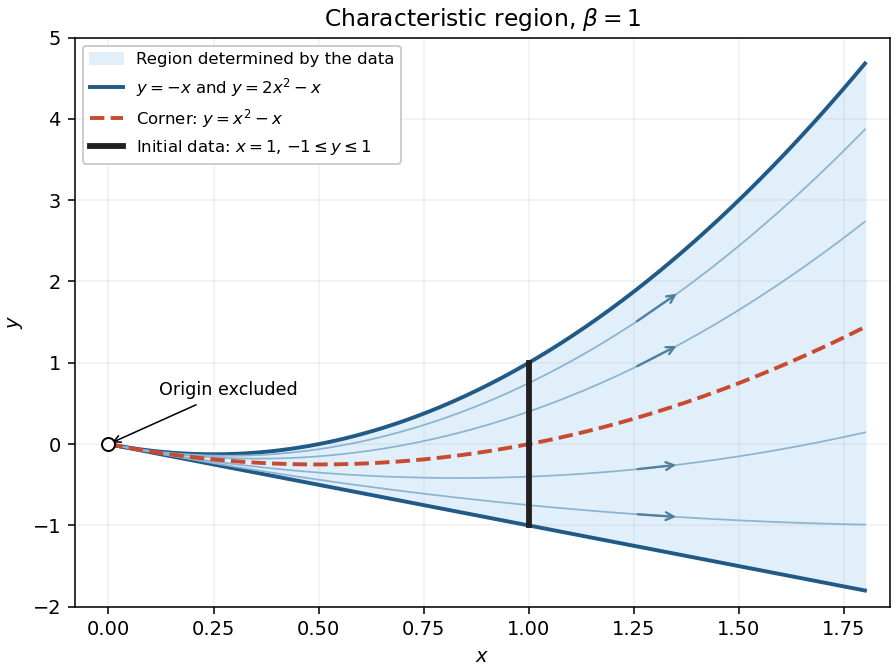

<h1 id="1/b/iii/solution">Solution</h1>

↑ **Parent:** [Iii](../iii.md)

Every point with $x>0$ has exactly one backward [characteristic curve](../../../../../characteristic-curve.md) meeting $x=1$, at the point $(1,q(x,y))$. It meets the specified data precisely when $-1\leq q\leq1$. Thus the whole region determined by these data, including the two bounding [characteristic curves](../../../../../characteristic-curve.md), is

$$
\boxed{\mathcal D_\beta=\{(x,y):x>0,\ (\beta-1)x^2-\beta x\leq y\leq(\beta+1)x^2-\beta x\}.}
$$

Its interior is the corresponding open domain for the [partial differential equation](../../../../../partial-differential-equation-split.md). Uniqueness here means uniqueness in the class of [continuous functions](../../../../../continuous-function.md) satisfying the [characteristic equations for a transport equation](../../../../../characteristic-equations-for-a-transport-equation.md), including the piecewise [smooth function](../../../../../smooth-function.md) defining the [solution of a differential equation](../../../../../solution-of-a-differential-equation.md) above. The endpoints of the initial segment determine the two boundary values by [continuity](../../../../../continuous-function.md).

This region is maximal for determination by the given data: on $x>0$, arbitrary extensions of $g$ outside $[-1,1]$ give different values on the [characteristic curves](../../../../../characteristic-curve.md) with $q\notin[-1,1]$. No [characteristic curve](../../../../../characteristic-curve.md) from $x=1$ reaches $x\leq0$.

For $\beta=1$,

$$
\boxed{x>0,\qquad -x\leq y\leq2x^2-x.}
$$

The lower boundary is a straight line, the upper boundary is a [parabola](../../../../../parabola.md), and the characteristic carrying the corner is $y=x^2-x$. All three approach the excluded origin as $x\downarrow0$.

**[Figure 1](#1/b/iii/image-the-characteristic-region-for-beta-equal-to-one-with-the-curve-carrying-the-corner). The characteristic region for beta equal to one, with the curve carrying the corner**.

## ↑ Ancestors (13)

1. [Iii](../iii.md)
2. [B](../../b.md)
3. [1](../../../1.md)
4. [2021](../../../../2021-split.md)
5. [Past exam of the differential equations 1 course of the University of Oxford](../../../../split.md)
6. [Differential equations 1 course of the University of Oxford](../../../../../differential-equations-1-course-of-the-university-of-oxford.md)
7. [Year 2 of the mathematics course of the University of Oxford](../../../../../year-2-of-the-mathematics-course-of-the-university-of-oxford.md)
8. [Mathematics course of the University of Oxford](../../../../../mathematics-course-of-the-university-of-oxford.md)
9. [Undergraduate course of the University of Oxford](../../../../../undergraduate-course-of-the-university-of-oxford.md)
10. [Course of the University of Oxford](../../../../../course-of-the-university-of-oxford.md)
11. [University of Oxford](../../../../../university-of-oxford-split.md)
12. [List of universities](../../../../../list-of-universities.md)
13. [Codex Wiki](../../../../../split.md)
