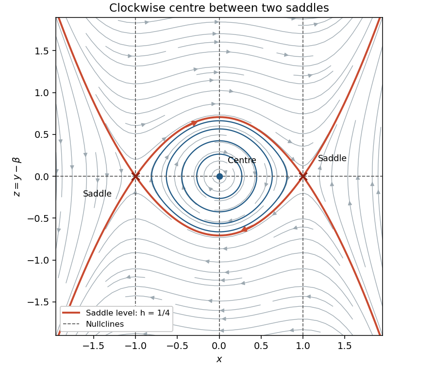

<h1 id="3/a/iii/solution">Solution</h1>

↑ **Parent:** [Iii](../iii.md)

The [nullclines](../../../../../nullcline.md) are

$$
\boxed{\dot x=0:\ y=\beta;\qquad \dot y=0:\ x=-1,0,1.}
$$

On $y=\beta$, away from the [equilibrium points](../../../../../equilibrium-point-of-a-dynamical-system.md), the [vector field](../../../../../vector-field.md) is vertical. Its crossing direction is downwards for $x<-1$, upwards for $-1<x<0$, downwards for $0<x<1$, and upwards for $x>1$, because $\dot y=x(x^2-1)$. On each of $x=-1,0,1$, the [vector field](../../../../../vector-field.md) is horizontal: it points right when $y>\beta$ and left when $y<\beta$.

Throughout each complementary region, $\dot x$ has the sign of $y-\beta$, and $\dot y$ has the four signs just listed. These signs orient the [level sets](../../../../../level-set.md) from part (ii). In particular, the inner [periodic orbits](../../../../../periodic-orbit.md) are clockwise. The saddle level is $h=1/4$, whose [separatrices](../../../../../separatrix.md) satisfy

$$
\boxed{(y-\beta)^2=\frac{(x^2-1)^2}{2}.}
$$

For $-1<x<1$, the upper arc $y-\beta=(1-x^2)/\sqrt2$ goes from $(-1,\beta)$ to $(1,\beta)$; the lower arc goes back from $(1,\beta)$ to $(-1,\beta)$. These two [heteroclinic orbits](../../../../../heteroclinic-orbit.md) form a closed boundary around the family of [periodic orbits](../../../../../periodic-orbit.md). The remaining branches of the same saddle level extend outwards. The sketch shows the surrounding nonclosed trajectories as well as the [nullclines](../../../../../nullcline.md) and [equilibrium points](../../../../../equilibrium-point-of-a-dynamical-system.md).

**[Figure 2](#3/a/iii/image-the-phase-plane-in-coordinates-x-and-y-minus-beta-showing-clockwise-periodic-orbits-and-saddle-connections). The phase plane in coordinates x and y minus beta, showing clockwise periodic orbits and saddle connections**.

## ↑ Ancestors (13)

1. [Iii](../iii.md)
2. [A](../../a.md)
3. [3](../../../3.md)
4. [2021](../../../../2021-split.md)
5. [Past exam of the differential equations 1 course of the University of Oxford](../../../../split.md)
6. [Differential equations 1 course of the University of Oxford](../../../../../differential-equations-1-course-of-the-university-of-oxford.md)
7. [Year 2 of the mathematics course of the University of Oxford](../../../../../year-2-of-the-mathematics-course-of-the-university-of-oxford.md)
8. [Mathematics course of the University of Oxford](../../../../../mathematics-course-of-the-university-of-oxford.md)
9. [Undergraduate course of the University of Oxford](../../../../../undergraduate-course-of-the-university-of-oxford.md)
10. [Course of the University of Oxford](../../../../../course-of-the-university-of-oxford.md)
11. [University of Oxford](../../../../../university-of-oxford-split.md)
12. [List of universities](../../../../../list-of-universities.md)
13. [Codex Wiki](../../../../../split.md)
