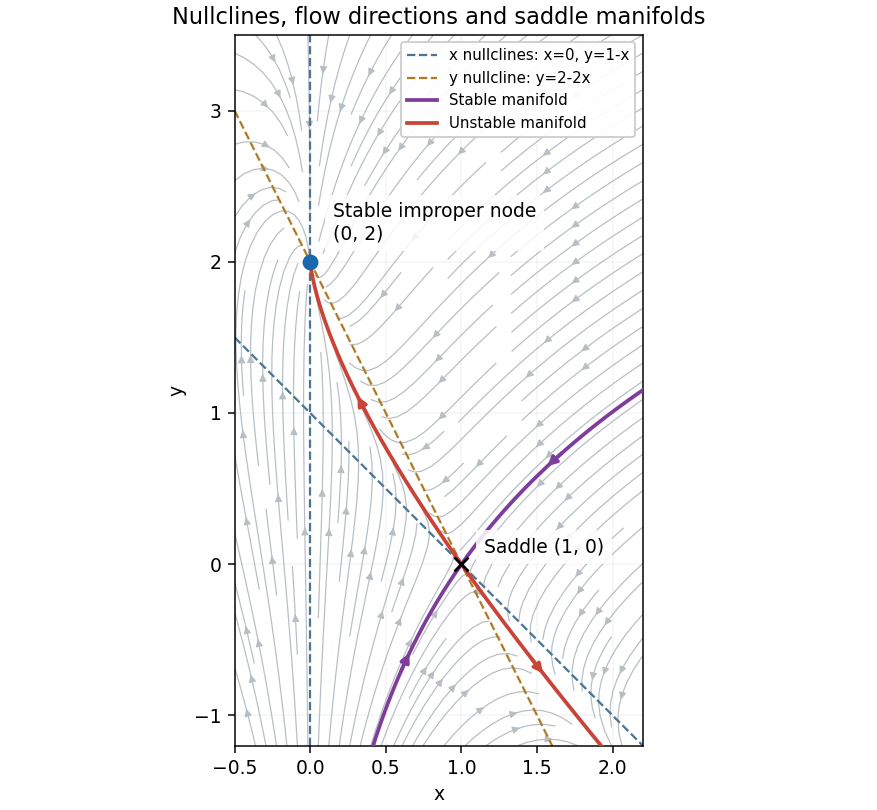
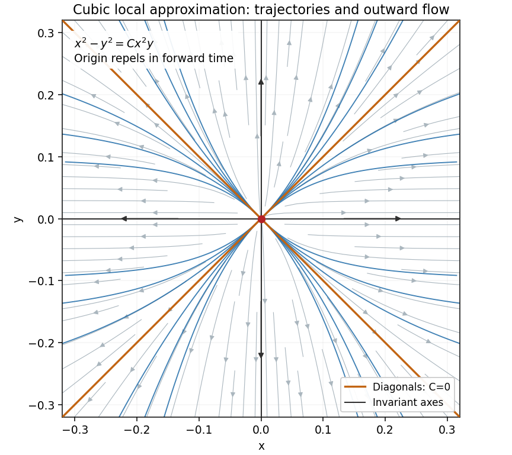

# 2014

↑ **Parent:** [Past exam of the differential equations 2 course of the University of Oxford](../past-exam-of-the-differential-equations-2-course-of-the-university-of-oxford.md)

Source release: [Oxford examination archive](https://www.whatdotheyknow.com/request/maths_papers_2/response/1850333/attach/3/FOI%2020210708%201%20Data.zip?cookie_passthrough=1), member `FOI-20210708-1 - Data/4325.pdf`. The cover prints formal code `4325`, Trinity Term 2014, and Saturday 21 June.

Answer availability checked on 28 October 2026: a bounded search of official Oxford sources found no advertisement covering complete or selected-part answers for this exact paper. The current general advertisement of even-year solutions dating back to at least 2016 does not identify coverage of 2014.[Mathematical Institute, “Past papers and model solutions”: even-year solutions dating back to at least 2016](https://www.maths.ox.ac.uk/members/students/undergraduate-courses/examinations-assessments/overview-examinations)

**Table of contents**

- [1](#1)
  - [a](#1/a)
    - [Solution](#1/a/solution)
  - [b](#1/b)
    - [Solution](#1/b/solution)
- [2](#2)
  - [a](#2/a)
    - [Solution](#2/a/solution)
  - [b](#2/b)
    - [Solution](#2/b/solution)
- [3](#3)
  - [a](#3/a)
    - [Solution](#3/a/solution)
  - [b](#3/b)
    - [i](#3/b/i)
      - [Solution](#3/b/i/solution)
    - [ii](#3/b/ii)
      - [Solution](#3/b/ii/solution)
    - [iii](#3/b/iii)
      - [Solution](#3/b/iii/solution)
    - [iv](#3/b/iv)
      - [Solution](#3/b/iv/solution)

## 1

↑ **Parent:** [2014](2014.md)

<h3 id="1/a">a</h3>

↑ **Parent:** [1](#1)

<h4 id="1/a/solution">Solution</h4>

↑ **Parent:** [A](#1/a)

At an [equilibrium point](../dynamical-systems.md#equilibrium-point-of-a-dynamical-system), $x(1-x-y)=0$ and $2-2x-y=0$. The first equation gives $x=0$ or $y=1-x$. Substituting in the second gives, respectively,

$$
\boxed{(x,y)=(0,2)\quad\text{or}\quad(1,0).}
$$

These are all the [equilibrium points](../dynamical-systems.md#equilibrium-point-of-a-dynamical-system). The [Jacobian matrix](../multivariable-calculus.md#jacobian-matrix) of the [vector field](../multivariable-calculus.md#vector-field) is

$$
J(x,y)=\begin{pmatrix}1-2x-y&-x\\-2&-1\end{pmatrix}.
$$

At $(0,2)$,

$$
J(0,2)=\begin{pmatrix}-1&0\\-2&-1\end{pmatrix}.
$$

The [eigenvalue](../linear-operator-theory.md#eigenvalue) $-1$ has algebraic multiplicity two and [eigenspace](../linear-operator-theory.md#eigenspace) $\operatorname{span}\{(0,1)^T\}$. For the linearized coordinates $u=x$, $v=y-2$,

$$
u(t)=Ae^{-t},\qquad v(t)=(B-2At)e^{-t}.
$$

Both components tend to zero. The repeated [eigenvalue](../linear-operator-theory.md#eigenvalue) with one independent [eigenvector](../linear-operator-theory.md#eigenvector) makes this a **stable improper [degenerate node](../dynamical-systems.md#degenerate-node)**, a [sink equilibrium](../dynamical-systems.md#sink-equilibrium). The term $t e^{-t}$ is the signature of the nontrivial [Jordan block](../linear-operator-theory.md#jordan-block). Since it is a [hyperbolic equilibrium point](../dynamical-systems.md#hyperbolic-equilibrium-point), the [linearization stability theorem](../dynamical-systems.md#linearization-stability-theorem) gives local [asymptotic stability](../dynamical-systems.md#asymptotic-stability) of the nonlinear system. Approaching trajectories are tangent to the vertical [eigendirection](../linear-operator-theory.md#eigendirection).

At $(1,0)$,

$$
J(1,0)=\begin{pmatrix}-1&-1\\-2&-1\end{pmatrix},\qquad
\lambda_+=-1+\sqrt2,\quad v_+=\begin{pmatrix}1\\-\sqrt2\end{pmatrix},\qquad
\lambda_-=-1-\sqrt2,\quad v_-=\begin{pmatrix}1\\\sqrt2\end{pmatrix}.
$$

One [eigenvalue](../linear-operator-theory.md#eigenvalue) is positive and one negative, so this point is a **[saddle equilibrium](../dynamical-systems.md#saddle-equilibrium)**. Its [stable manifold](../dynamical-systems.md#stable-manifold) is tangent to $y=\sqrt2(x-1)$, and its [unstable manifold](../dynamical-systems.md#unstable-manifold) is tangent to $y=-\sqrt2(x-1)$.

For the [phase portrait](../dynamical-systems.md#phase-portrait), the [nullclines](../dynamical-systems.md#nullcline) are

$$
\dot x=0:\quad x=0\text{ or }y=1-x,\qquad
\dot y=0:\quad y=2-2x.
$$

Above the second line the vertical flow is downward, and below it upward. For $x>0$, horizontal flow is to the right below $y=1-x$ and to the left above it; for $x<0$ the directions reverse. The line $x=0$ is invariant, with $\dot y=2-y$, so it flows toward $(0,2)$. Together with the saddle's two invariant directions, these signs determine the sketch.

**[Figure 1](#1/a/image-phase-portrait-with-the-stable-improper-degenerate-node-at-0-2-the-saddle-equilibrium-at-1-0-and-their-nullclines). Phase portrait with the stable improper degenerate node at $(0,2)$, the saddle equilibrium at $(1,0)$, and their nullclines**.

<h3 id="1/b">b</h3>

↑ **Parent:** [1](#1)

<h4 id="1/b/solution">Solution</h4>

↑ **Parent:** [B](#1/b)

The [Bendixson-Dulac theorem](../dynamical-systems.md#bendixson-dulac-theorem) says that a continuously differentiable planar [vector field](../multivariable-calculus.md#vector-field) has no nonconstant [periodic orbit](../dynamical-systems.md#periodic-orbit) in a [simply connected](../algebraic-topology.md#simply-connected-space) region if a continuously differentiable [Dulac function](../dynamical-systems.md#dulac-function) makes its rescaled [divergence](../multivariable-calculus.md#divergence) have one sign and not vanish identically on any open subset of that region. Isolated zeros of the [divergence](../multivariable-calculus.md#divergence) are allowed in this form.

Take the [Dulac function](../dynamical-systems.md#dulac-function) to be one. For the exact [vector field](../multivariable-calculus.md#vector-field) $(P,Q)$,

$$
\frac{\partial P}{\partial x}+\frac{\partial Q}{\partial y}
=3x^2+7y^2+12x^2y^2.
$$

This is positive except at the origin. The plane is [simply connected](../algebraic-topology.md#simply-connected-space), so **there are no nonconstant periodic solutions**. Equivalently, a hypothetical closed trajectory would have zero outward flux of its tangent [vector field](../multivariable-calculus.md#vector-field), while [Green's theorem](../multivariable-calculus.md#green-theorem) would make that flux the strictly positive area [integral](../integral.md) of the [divergence](../multivariable-calculus.md#divergence).

The origin is the only [equilibrium point](../dynamical-systems.md#equilibrium-point-of-a-dynamical-system): $Q=0$ forces $y=0$, and then $P=x^3$ forces $x=0$. Its [Jacobian matrix](../multivariable-calculus.md#jacobian-matrix) is zero, so the linearized equations are $\dot x=\dot y=0$. They give no stability classification.

Keeping cubic terms gives the homogeneous approximation

$$
\dot x=x(x^2+y^2),\qquad\dot y=2y^3.
$$

In a sector where $xy\ne0$, use $y$ as the independent variable and put $w=x^{-2}$. Dividing the two equations gives

$$
\frac{dx}{dy}=\frac{x(x^2+y^2)}{2y^3},\qquad
\frac{dw}{dy}+\frac wy=-\frac1{y^3}.
$$

The [integrating factor](../linear-ordinary-differential-equation.md#integrating-factor) $y$ gives $(yw)'=-y^{-2}$, hence $yw=1/y+C_0$. Rearranging and renaming the arbitrary constant yields the implicit trajectories

$$
\boxed{\frac1y-\frac y{x^2}=C,\qquad\text{equivalently}\qquad x^2-y^2=Cx^2y.}
$$

This is the [first integral](../differential-equation.md#first-integral) of the cubic approximation, not an exact first integral of the higher-degree original system. The invariant axes, excluded by the divisions, must be added: on $y=0$, $\dot x=x^3$; on $x=0$, $\dot y=2y^3$. The diagonal trajectories $y=\pm x$ correspond to $C=0$. For fixed finite $C$, non-axis trajectories approaching the origin satisfy $y^2/x^2=1-Cy\to1$, so their limiting tangent lines are the diagonals. This is the [cubic planar flow with diagonal approach directions](../differential-equation.md#cubic-planar-flow-with-diagonal-approach-directions).

Every nonzero trajectory moves outward locally. For $V=x^2+y^2$, the exact system gives

$$
\dot V=2x^4+2x^2y^2+4y^4+2x^4y^2+6x^2y^4\geq V^2>0.
$$

This implies departure from any fixed small circle for every nonzero starting point inside it: while a trajectory stayed inside forever, $\frac{d}{dt}(1/V)\leq-1$ would eventually force $1/V$ negative. Thus the origin is **unstable and repelling** for both the cubic approximation and the full system. The argument establishes nonlinear instability despite the zero linearization.

**[Figure 2](#1/b/image-implicit-trajectories-of-the-cubic-approximation-invariant-axes-and-diagonal-limiting-directions-with-all-forward-arrows-outward). Implicit trajectories of the cubic approximation: invariant axes and diagonal limiting directions, with all forward arrows outward**.

## 2

↑ **Parent:** [2014](2014.md)

<h3 id="2/a">a</h3>

↑ **Parent:** [2](#2)

<h4 id="2/a/solution">Solution</h4>

↑ **Parent:** [A](#2/a)

Work first on $0<x<1$. Divide by $x-1$ to put the equation in leading-coefficient-one form. Its first-derivative coefficient is $-x/(x-1)$, so the [integrating factor](../linear-ordinary-differential-equation.md#integrating-factor) for the [self-adjoint differential operator](../sturm-liouville-theory.md#self-adjoint-differential-operator) is

$$
p(x)=\exp\left(\int\frac{-x}{x-1}\,dx\right)=\frac{e^{-x}}{1-x}.
$$

The resulting coefficients are

$$
\boxed{p(x)=\frac{e^{-x}}{1-x},\qquad q(x)=-\frac{e^{-x}}{(1-x)^2},\qquad
F(x)=-\frac{e^{-x}}{(1-x)^2}.}
$$

Indeed $p'(x)=x e^{-x}/(1-x)^2$, and multiplying the original equation by $-e^{-x}/(1-x)^2$ gives $(py')'+qy=F$. These transformed coefficients are singular at the right endpoint; the boundary value there is understood as the endpoint limit.

Substituting $y=x$ and $y=e^x$ in the homogeneous original equation gives zero in both cases. Their [Wronskian](../linear-ordinary-differential-equation.md#wronskian) is

$$
W(x,e^x)=xe^x-e^x=(x-1)e^x,
$$

which is nonzero for $0<x<1$. Thus they are [linearly independent](../vector-space.md#linear-independence) on the solution interval.

To construct a [Dirichlet Green function](../green-s-function.md#dirichlet-green-function), choose homogeneous solutions adapted to the two endpoints:

$$
u(x)=x,\qquad v(x)=e^x-ex,\qquad u(0)=0,\quad v(1)=0.
$$

Their [Wronskian](../linear-ordinary-differential-equation.md#wronskian) is again $(x-1)e^x$, and $pW=-1$. Therefore the Green function for $L=(p\,d/dx)'+q$ with zero endpoint values is

$$
\boxed{G(x,s)=-u(\min(x,s))v(\max(x,s))
=\begin{cases}-x(e^s-es),&x\leq s,\\-s(e^x-ex),&s\leq x.\end{cases}}
$$

For fixed $s\in(0,1)$ it is continuous in $x$, vanishes at both endpoints, and satisfies the unit-flux jump condition

$$
p(s)\bigl[G_x(s^+,s)-G_x(s^-,s)\bigr]=1.
$$

Consequently $L_xG(x,s)=\delta(x-s)$ in the sense of [distributions](../distribution-theory.md#distribution-mathematical-analysis). This is a [singular-endpoint Green function with a double-zero right solution](../green-s-function.md#singular-endpoint-green-function-with-a-double-zero-right-solution).

The endpoint data are nonhomogeneous, so use the homogeneous lifting $2x$ and write

$$
y(x)=2x+\int_0^1G(x,s)F(s)\,ds.
$$

Although $F(s)$ is singular at one, the integral exists for each interior $x$: the right solution satisfies $v(s)\sim e(1-s)^2/2$, cancelling the $(1-s)^{-2}$ forcing when $s>x$.

Splitting the integral at $s=x$ gives

$$
y(x)=2x+v(x)I_1(x)+xI_2(x),
$$

where elementary antiderivatives yield

$$
I_1(x)=\int_0^x\frac{s e^{-s}}{(1-s)^2}\,ds=\frac{e^{-x}}{1-x}-1,
$$

$$
I_2(x)=\int_x^1\frac{(e^s-es)e^{-s}}{(1-s)^2}\,ds
=\frac{e^{1-x}-1}{1-x}-1.
$$

For the second equality, an antiderivative is $(1-e^{1-s})/(1-s)$, whose endpoint limit at one is $-1$. Simplifying the Green representation gives

$$
\boxed{y(x)=1+(1+e)x-e^x.}
$$

It has the prescribed endpoint values. Direct substitution gives $(x-1)y''-xy'+y=1$, and at the degenerate endpoint it also obeys $-y'(1)+y(1)=1$. The only homogeneous solution satisfying both zero endpoint conditions is zero, so this solution is unique in the corresponding classical class.

<h3 id="2/b">b</h3>

↑ **Parent:** [2](#2)

<h4 id="2/b/solution">Solution</h4>

↑ **Parent:** [B](#2/b)

Let $X=(x,y)$ be the integration variable and $P=(\xi,\eta)$ the interior source point. [Green's second identity](../partial-differential-equation.md#green-second-identity), obtained from [Green's theorem](../multivariable-calculus.md#green-theorem) by applying the [divergence theorem](../multivariable-calculus.md#divergence-theorem) to $u\nabla G-G\nabla u$, is

$$
\int_D(u\Delta G-G\Delta u)\,dA
=\int_{\partial D}\left(u\frac{\partial G}{\partial n}-G\frac{\partial u}{\partial n}\right)ds.
$$

The outward normal is used throughout. To obtain the prescribed representation with its positive volume term, choose

$$
\boxed{\Delta_XG(X,P)=\delta(X-P),\qquad
G=0\text{ on }\partial D_1,\qquad
\partial_nG=0\text{ on }\partial D_2.}
$$

Indeed, substituting $\Delta u=f$ makes the left side $u(P)-\int_DGf$. On the Dirichlet portion, $u=g$ and $G=0$ leave only $g\partial_nG$. On the Neumann portion, both normal derivatives vanish. Rearranging gives exactly the desired boundary-plus-volume representation. The distributional identity can equivalently be justified by excluding a small circle around $P$ and using the logarithmic singularity there.

For the quarter-plane, the [fundamental solution of the Laplace equation](../partial-differential-equation.md#fundamental-solution-of-the-laplace-equation) with this sign convention is $\Phi(X,P)=(2\pi)^{-1}\log|X-P|$, since $\Delta\Phi=\delta_P$. The [method of images](../mathematics.md#method-of-images) uses an equal-sign reflection across the Neumann boundary $x=0$ and an opposite-sign reflection across the Dirichlet boundary $y=0$. Hence

$$
G(X,P)=\frac1{2\pi}\bigl[\log|X-(\xi,\eta)|+\log|X-(-\xi,\eta)|
-\log|X-(\xi,-\eta)|-\log|X-(-\xi,-\eta)|\bigr].
$$

Equivalently,

$$
\boxed{G(x,y,\xi,\eta)=\frac1{4\pi}\log
\frac{\bigl((x-\xi)^2+(y-\eta)^2\bigr)\bigl((x+\xi)^2+(y-\eta)^2\bigr)}
{\bigl((x-\xi)^2+(y+\eta)^2\bigr)\bigl((x+\xi)^2+(y+\eta)^2\bigr)}.}
$$

Only $(\xi,\eta)$ lies inside the domain, so the interior [Laplacian](../multivariable-calculus.md#laplacian) has exactly the required unit point source. At $y=0$ numerator and denominator agree, giving $G=0$. The formula is even in $x$, giving $\partial_xG=0$ at $x=0$, and therefore zero outward normal derivative there.

On the Dirichlet boundary $y=0$, the outward normal is $-\partial_y$, and differentiation gives the useful check

$$
\frac{\partial G}{\partial n}(x,0,\xi,\eta)
=\frac\eta\pi\left[\frac1{(x-\xi)^2+\eta^2}+\frac1{(x+\xi)^2+\eta^2}\right]>0.
$$

This is the [mixed Dirichlet-Neumann Green function in a quadrant](../green-s-function.md#mixed-dirichlet-neumann-green-function-in-a-quadrant). The image solution tends to zero at spatial infinity; on the unbounded domain the representation uses data and solutions for which the [boundary term at infinity in Green's second identity](../partial-differential-equation.md#boundary-term-at-infinity-in-green-s-second-identity) vanishes.

## 3

↑ **Parent:** [2014](2014.md)

<h3 id="3/a">a</h3>

↑ **Parent:** [3](#3)

<h4 id="3/a/solution">Solution</h4>

↑ **Parent:** [A](#3/a)

Write the equation as $\epsilon x^3-(x-1)^2=0$. For $\epsilon\to0^+$, two [roots of a polynomial](../polynomial.md#root-of-a-polynomial) approach the double root one. Their splitting follows a fractional-power [dominant balance](../asymptotic-expansion.md#dominant-balance), rather than an ordinary expansion in integer powers.

Put $\delta=\sqrt\epsilon$ and $x=1+a\delta+b\delta^2+\cdots$. Substitution gives

$$
0=(1-a^2)\delta^2+(3a-2ab)\delta^3+O(\delta^4).
$$

Thus $a=\pm1$ and $b=3/2$. The two bounded roots have the [Puiseux series](../analysis.md#puiseux-series) expansions

$$
\boxed{x_\pm=1\pm\sqrt\epsilon+\frac32\epsilon+O(\epsilon^{3/2}).}
$$

The first two nonzero terms are $1\pm\sqrt\epsilon$; the displayed correction also resolves their common order-$\epsilon$ shift.

The third root escapes to infinity because the leading [polynomial degree](../polynomial.md#degree-of-a-polynomial) drops when $\epsilon=0$. Balance $\epsilon x^3$ against $x^2$, giving $x=O(\epsilon^{-1})$. Set $X=\epsilon x$; the equation becomes

$$
X^3-X^2+2\epsilon X-\epsilon^2=0.
$$

For $X=1+A\epsilon+B\epsilon^2+\cdots$, the first two coefficient equations are $A+2=0$ and $B+2A^2+2A-1=0$. Hence

$$
\boxed{x_\infty=\epsilon^{-1}-2-3\epsilon+O(\epsilon^2).}
$$

Its first two nonzero terms are $\epsilon^{-1}-2$. These three distinct branches account for all roots of the cubic for sufficiently small positive $\epsilon$. The [Vieta formulas](../polynomial.md#vieta-s-formulas) provide a consistency check: their sum is $\epsilon^{-1}$, with the constant and order-$\epsilon$ terms cancelling.

If $\epsilon$ approaches zero through negative values, the bounded pair is complex: $x_\pm=1\pm i\sqrt{|\epsilon|}+\tfrac32\epsilon+O(|\epsilon|^{3/2})$. The large-root expansion is unchanged as a real asymptotic formula. The positive-parameter regime is used for the boundary-layer problem below.

<h3 id="3/b">b</h3>

↑ **Parent:** [3](#3)

<h4 id="3/b/i">i</h4>

↑ **Parent:** [B](#3/b)

<h5 id="3/b/i/solution">Solution</h5>

↑ **Parent:** [I](#3/b/i)

Seek an order-one [outer expansion](../singular-perturbation.md#outer-expansion) as $\epsilon\to0^+$:

$$
y_{\rm out}(x)=y_0(x)+\epsilon y_1(x)+O(\epsilon^2).
$$

At leading order, $0=y_0-x^2$, so $y_0=x^2$. At order $\epsilon$,

$$
y_0''=y_1+2+y_0^2.
$$

Since $y_0''=2$, this gives $y_1=-x^4$. Therefore

$$
\boxed{y_{\rm out}(x)=x^2-\epsilon x^4+O(\epsilon^2).}
$$

This is an approximation away from any [boundary layer](../continuum-mechanics.md#boundary-layer); the small coefficient of the highest [derivative](../calculus.md#derivative) means the reduced equation cannot generally impose both endpoint conditions.

<h4 id="3/b/ii">ii</h4>

↑ **Parent:** [B](#3/b)

<h5 id="3/b/ii/solution">Solution</h5>

↑ **Parent:** [Ii](#3/b/ii)

At the left endpoint, both computed [outer expansion](../singular-perturbation.md#outer-expansion) terms vanish, so $y_{\rm out}(0)=0$ agrees with the boundary data. At the right endpoint,

$$
y_{\rm out}(1)=1-\epsilon+O(\epsilon^2),
$$

which differs by order one from the required zero value. Hence **the boundary layer is at $x=1$**. The left boundary requires no order-one layer for this outer branch.

<h4 id="3/b/iii">iii</h4>

↑ **Parent:** [B](#3/b)

<h5 id="3/b/iii/solution">Solution</h5>

↑ **Parent:** [Iii](#3/b/iii)

Suppose the right-end [boundary layer](../continuum-mechanics.md#boundary-layer) has width $\ell(\epsilon)$, and let $X=(1-x)/\ell$. An order-one change of $y$ over this width gives $\epsilon y''=O(\epsilon/\ell^2)$. Near $x=1$, the leading terms $y-x^2$ are order one. The [dominant balance](../asymptotic-expansion.md#dominant-balance) is therefore

$$
\frac\epsilon{\ell^2}\sim1.
$$

Thus

$$
\boxed{\ell=\sqrt\epsilon,\qquad X=\frac{1-x}{\sqrt\epsilon}.}
$$

The [inner variable](../singular-perturbation.md#inner-variable) satisfies $X\geq0$ inside the domain and resolves the [reaction boundary layer with square-root thickness](../singular-perturbation.md#reaction-boundary-layer-with-square-root-thickness).

<h4 id="3/b/iv">iv</h4>

↑ **Parent:** [B](#3/b)

<h5 id="3/b/iv/solution">Solution</h5>

↑ **Parent:** [Iv](#3/b/iv)

Write $y(x)=Y(X)$ with $X=(1-x)/\sqrt\epsilon$. The transformed equation is

$$
Y''=Y-(1-\sqrt\epsilon X)^2+\epsilon(2+Y^2).
$$

Since the rescaled forcing contains $\sqrt\epsilon$, an [inner expansion](../singular-perturbation.md#inner-expansion) naturally uses powers of $\sqrt\epsilon$. Its leading term satisfies

$$
Y_0''=Y_0-1,\qquad Y_0(0)=0.
$$

The [asymptotic matching condition](../singular-perturbation.md#asymptotic-matching-condition) with the leading [outer solution](../singular-perturbation.md#outer-expansion) is

$$
Y_0(X)\longrightarrow y_0(1)=1\qquad(X\to\infty).
$$

The general solution is $Y_0=1+Ae^X+Be^{-X}$. Matching eliminates $Ae^X$, and the boundary condition gives $B=-1$. Hence

$$
\boxed{Y_0(X)=1-e^{-X},\qquad
y_{\rm inner}(x)\sim1-\exp\left(-\frac{1-x}{\sqrt\epsilon}\right).}
$$

This tends to the boundary value zero at $x=1$ and to the matching value one on the interior side of the layer. The negative sign in the exponential follows from measuring the [inner variable](../singular-perturbation.md#inner-variable) inward from the right endpoint.

For an optional uniform leading approximation, combine the leading inner and outer terms and subtract their common overlap value one. The [additive composite expansion](../singular-perturbation.md#additive-composite-expansion) is

$$
\boxed{y_{\rm comp}(x)=x^2-\exp\left(-\frac{1-x}{\sqrt\epsilon}\right).}
$$

It satisfies the right boundary condition exactly; its left-end discrepancy is the exponentially small value $-e^{-1/\sqrt\epsilon}$. The requested leading [inner expansion](../singular-perturbation.md#inner-expansion) is $Y_0$ above.

## ↑ Ancestors (9)

1. [Past exam of the differential equations 2 course of the University of Oxford](../past-exam-of-the-differential-equations-2-course-of-the-university-of-oxford.md)
2. [Differential equations 2 course of the University of Oxford](../university-of-oxford.md#differential-equations-2-course-of-the-university-of-oxford)
3. [Year 2 of the mathematics course of the University of Oxford](../university-of-oxford.md#year-2-of-the-mathematics-course-of-the-university-of-oxford)
4. [Mathematics course of the University of Oxford](../university-of-oxford.md#mathematics-course-of-the-university-of-oxford)
5. [Undergraduate course of the University of Oxford](../university-of-oxford.md#undergraduate-course-of-the-university-of-oxford)
6. [Course of the University of Oxford](../university-of-oxford.md#course-of-the-university-of-oxford)
7. [University of Oxford](../university-of-oxford.md)
8. [List of universities](../README.md#list-of-universities)
9. [Codex Wiki](../README.md)
