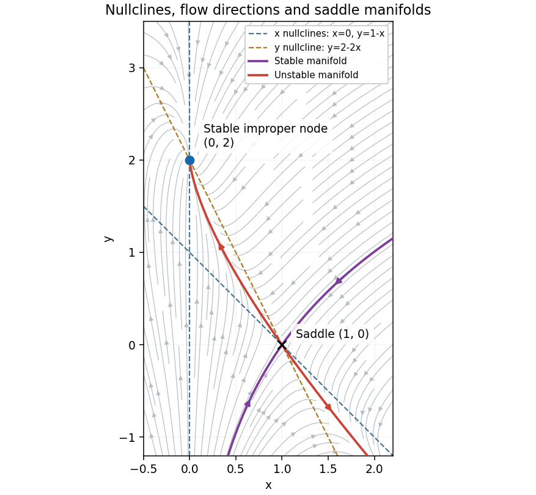

<h1 id="1/a/solution">Solution</h1>

↑ **Parent:** [A](../a.md)

At an [equilibrium point](../../../../equilibrium-point-of-a-dynamical-system.md), $x(1-x-y)=0$ and $2-2x-y=0$. The first equation gives $x=0$ or $y=1-x$. Substituting in the second gives, respectively,

$$
\boxed{(x,y)=(0,2)\quad\text{or}\quad(1,0).}
$$

These are all the [equilibrium points](../../../../equilibrium-point-of-a-dynamical-system.md). The [Jacobian matrix](../../../../jacobian-matrix.md) of the [vector field](../../../../vector-field.md) is

$$
J(x,y)=\begin{pmatrix}1-2x-y&-x\\-2&-1\end{pmatrix}.
$$

At $(0,2)$,

$$
J(0,2)=\begin{pmatrix}-1&0\\-2&-1\end{pmatrix}.
$$

The [eigenvalue](../../../../eigenvalue.md) $-1$ has algebraic multiplicity two and [eigenspace](../../../../eigenspace.md) $\operatorname{span}\{(0,1)^T\}$. For the linearized coordinates $u=x$, $v=y-2$,

$$
u(t)=Ae^{-t},\qquad v(t)=(B-2At)e^{-t}.
$$

Both components tend to zero. The repeated [eigenvalue](../../../../eigenvalue.md) with one independent [eigenvector](../../../../eigenvector.md) makes this a **stable improper [degenerate node](../../../../degenerate-node.md)**, a [sink equilibrium](../../../../sink-equilibrium.md). The term $t e^{-t}$ is the signature of the nontrivial [Jordan block](../../../../jordan-block.md). Since it is a [hyperbolic equilibrium point](../../../../hyperbolic-equilibrium-point.md), the [linearization stability theorem](../../../../linearization-stability-theorem.md) gives local [asymptotic stability](../../../../asymptotic-stability.md) of the nonlinear system. Approaching trajectories are tangent to the vertical [eigendirection](../../../../eigendirection.md).

At $(1,0)$,

$$
J(1,0)=\begin{pmatrix}-1&-1\\-2&-1\end{pmatrix},\qquad
\lambda_+=-1+\sqrt2,\quad v_+=\begin{pmatrix}1\\-\sqrt2\end{pmatrix},\qquad
\lambda_-=-1-\sqrt2,\quad v_-=\begin{pmatrix}1\\\sqrt2\end{pmatrix}.
$$

One [eigenvalue](../../../../eigenvalue.md) is positive and one negative, so this point is a **[saddle equilibrium](../../../../saddle-equilibrium.md)**. Its [stable manifold](../../../../stable-manifold.md) is tangent to $y=\sqrt2(x-1)$, and its [unstable manifold](../../../../unstable-manifold.md) is tangent to $y=-\sqrt2(x-1)$.

For the [phase portrait](../../../../phase-portrait.md), the [nullclines](../../../../nullcline.md) are

$$
\dot x=0:\quad x=0\text{ or }y=1-x,\qquad
\dot y=0:\quad y=2-2x.
$$

Above the second line the vertical flow is downward, and below it upward. For $x>0$, horizontal flow is to the right below $y=1-x$ and to the left above it; for $x<0$ the directions reverse. The line $x=0$ is invariant, with $\dot y=2-y$, so it flows toward $(0,2)$. Together with the saddle's two invariant directions, these signs determine the sketch.

**[Figure 1](#1/a/image-phase-portrait-with-the-stable-improper-degenerate-node-at-0-2-the-saddle-equilibrium-at-1-0-and-their-nullclines). Phase portrait with the stable improper degenerate node at $(0,2)$, the saddle equilibrium at $(1,0)$, and their nullclines**.

## ↑ Ancestors (12)

1. [A](../a.md)
2. [1](../../1.md)
3. [2014](../../../2014-split.md)
4. [Past exam of the differential equations 2 course of the University of Oxford](../../../split.md)
5. [Differential equations 2 course of the University of Oxford](../../../../differential-equations-2-course-of-the-university-of-oxford.md)
6. [Year 2 of the mathematics course of the University of Oxford](../../../../year-2-of-the-mathematics-course-of-the-university-of-oxford.md)
7. [Mathematics course of the University of Oxford](../../../../mathematics-course-of-the-university-of-oxford.md)
8. [Undergraduate course of the University of Oxford](../../../../undergraduate-course-of-the-university-of-oxford.md)
9. [Course of the University of Oxford](../../../../course-of-the-university-of-oxford.md)
10. [University of Oxford](../../../../university-of-oxford-split.md)
11. [List of universities](../../../../list-of-universities.md)
12. [Codex Wiki](../../../../split.md)
