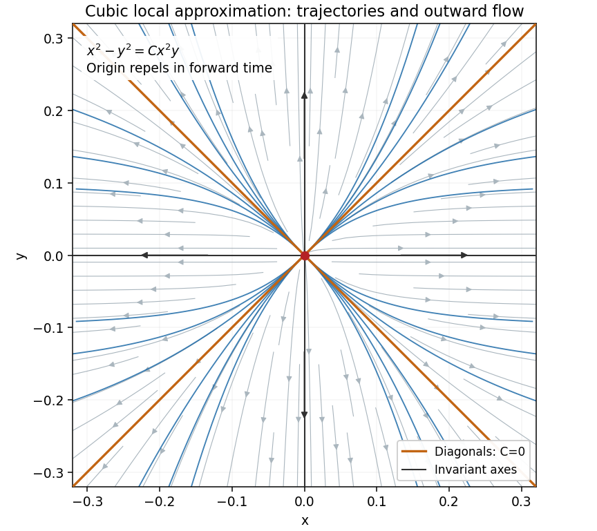

<h1 id="1/b/solution">Solution</h1>

↑ **Parent:** [B](../b.md)

The [Bendixson-Dulac theorem](../../../../bendixson-dulac-theorem.md) says that a continuously differentiable planar [vector field](../../../../vector-field.md) has no nonconstant [periodic orbit](../../../../periodic-orbit.md) in a [simply connected](../../../../simply-connected-space.md) region if a continuously differentiable [Dulac function](../../../../dulac-function.md) makes its rescaled [divergence](../../../../divergence.md) have one sign and not vanish identically on any open subset of that region. Isolated zeros of the [divergence](../../../../divergence.md) are allowed in this form.

Take the [Dulac function](../../../../dulac-function.md) to be one. For the exact [vector field](../../../../vector-field.md) $(P,Q)$,

$$
\frac{\partial P}{\partial x}+\frac{\partial Q}{\partial y}
=3x^2+7y^2+12x^2y^2.
$$

This is positive except at the origin. The plane is [simply connected](../../../../simply-connected-space.md), so **there are no nonconstant periodic solutions**. Equivalently, a hypothetical closed trajectory would have zero outward flux of its tangent [vector field](../../../../vector-field.md), while [Green's theorem](../../../../green-theorem.md) would make that flux the strictly positive area [integral](../../../../integral-split.md) of the [divergence](../../../../divergence.md).

The origin is the only [equilibrium point](../../../../equilibrium-point-of-a-dynamical-system.md): $Q=0$ forces $y=0$, and then $P=x^3$ forces $x=0$. Its [Jacobian matrix](../../../../jacobian-matrix.md) is zero, so the linearized equations are $\dot x=\dot y=0$. They give no stability classification.

Keeping cubic terms gives the homogeneous approximation

$$
\dot x=x(x^2+y^2),\qquad\dot y=2y^3.
$$

In a sector where $xy\ne0$, use $y$ as the independent variable and put $w=x^{-2}$. Dividing the two equations gives

$$
\frac{dx}{dy}=\frac{x(x^2+y^2)}{2y^3},\qquad
\frac{dw}{dy}+\frac wy=-\frac1{y^3}.
$$

The [integrating factor](../../../../integrating-factor.md) $y$ gives $(yw)'=-y^{-2}$, hence $yw=1/y+C_0$. Rearranging and renaming the arbitrary constant yields the implicit trajectories

$$
\boxed{\frac1y-\frac y{x^2}=C,\qquad\text{equivalently}\qquad x^2-y^2=Cx^2y.}
$$

This is the [first integral](../../../../first-integral.md) of the cubic approximation, not an exact first integral of the higher-degree original system. The invariant axes, excluded by the divisions, must be added: on $y=0$, $\dot x=x^3$; on $x=0$, $\dot y=2y^3$. The diagonal trajectories $y=\pm x$ correspond to $C=0$. For fixed finite $C$, non-axis trajectories approaching the origin satisfy $y^2/x^2=1-Cy\to1$, so their limiting tangent lines are the diagonals. This is the [cubic planar flow with diagonal approach directions](../../../../cubic-planar-flow-with-diagonal-approach-directions.md).

Every nonzero trajectory moves outward locally. For $V=x^2+y^2$, the exact system gives

$$
\dot V=2x^4+2x^2y^2+4y^4+2x^4y^2+6x^2y^4\geq V^2>0.
$$

This implies departure from any fixed small circle for every nonzero starting point inside it: while a trajectory stayed inside forever, $\frac{d}{dt}(1/V)\leq-1$ would eventually force $1/V$ negative. Thus the origin is **unstable and repelling** for both the cubic approximation and the full system. The argument establishes nonlinear instability despite the zero linearization.

**[Figure 2](#1/b/image-implicit-trajectories-of-the-cubic-approximation-invariant-axes-and-diagonal-limiting-directions-with-all-forward-arrows-outward). Implicit trajectories of the cubic approximation: invariant axes and diagonal limiting directions, with all forward arrows outward**.

## ↑ Ancestors (12)

1. [B](../b.md)
2. [1](../../1.md)
3. [2014](../../../2014-split.md)
4. [Past exam of the differential equations 2 course of the University of Oxford](../../../split.md)
5. [Differential equations 2 course of the University of Oxford](../../../../differential-equations-2-course-of-the-university-of-oxford.md)
6. [Year 2 of the mathematics course of the University of Oxford](../../../../year-2-of-the-mathematics-course-of-the-university-of-oxford.md)
7. [Mathematics course of the University of Oxford](../../../../mathematics-course-of-the-university-of-oxford.md)
8. [Undergraduate course of the University of Oxford](../../../../undergraduate-course-of-the-university-of-oxford.md)
9. [Course of the University of Oxford](../../../../course-of-the-university-of-oxford.md)
10. [University of Oxford](../../../../university-of-oxford-split.md)
11. [List of universities](../../../../list-of-universities.md)
12. [Codex Wiki](../../../../split.md)
