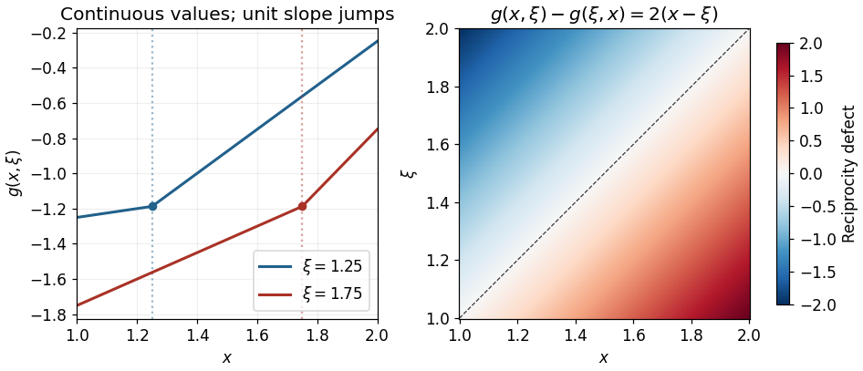

# 2015

↑ **Parent:** [Past exam of the differential equations 2 course of the University of Oxford](../past-exam-of-the-differential-equations-2-course-of-the-university-of-oxford.md)

Source paper: [released examination archive](https://www.whatdotheyknow.com/request/ba_computer_science_past_papers/response/2577745/attach/2/202402%20183%20CS%20Papers.zip?cookie_passthrough=1), member `2014/T/a13758w1.pdf`.

The complete cover is now readable in [the Mathematics Part A FOI release](https://www.whatdotheyknow.com/request/maths_papers_2/response/1850333/attach/3/FOI%2020210708%201%20Data.zip?cookie_passthrough=1), member `FOI-20210708-1 - Data/a13758w1 (5).pdf`. It identifies A13758W1, paper A6, Differential Equations 2, Trinity Term 2015, held on Saturday, 20 June 2015, 9.30am to 11.00am, for Mathematics and Mathematics and Statistics Part A. All questions and mark allocations match the earlier transcription: three questions and ten solution leaves, with no additional questions. The original source above is retained for provenance.

The intact cover directly confirms the year previously inferred from the official examiner report.[Printed page 16, A6 comments matching the held question sequence](../mathematics-bibliography.md#examiners-report-final-honour-school-of-mathematics-part-a-2015)

**Table of contents**

- [1](#1)
  - [a](#1/a)
    - [Solution](#1/a/solution)
  - [b](#1/b)
    - [Solution](#1/b/solution)
  - [c](#1/c)
    - [Solution](#1/c/solution)
- [2](#2)
  - [a](#2/a)
    - [Solution](#2/a/solution)
  - [b](#2/b)
    - [Solution](#2/b/solution)
  - [c](#2/c)
    - [Solution](#2/c/solution)
- [3](#3)
  - [a](#3/a)
    - [Solution](#3/a/solution)
  - [b](#3/b)
    - [Solution](#3/b/solution)
  - [c](#3/c)
    - [i](#3/c/i)
      - [Solution](#3/c/i/solution)
    - [ii](#3/c/ii)
      - [Solution](#3/c/ii/solution)

## 1

↑ **Parent:** [2015](2015.md)

<h3 id="1/a">a</h3>

↑ **Parent:** [1](#1)

<h4 id="1/a/solution">Solution</h4>

↑ **Parent:** [A](#1/a)

On an [interval](../real-analysis.md#interval-mathematics) with $x>0$, use the [power-law ansatz](../linear-ordinary-differential-equation.md#power-law-ansatz) $y=x^r$. Substitution gives $r(r-1)+2r+1=r^2+r+1=0$, whose roots are $r=-1/2\pm i\sqrt3/2$. Taking real and imaginary parts of $x^r$ gives

$$
\boxed{y(x)=x^{-1/2}\left[C_1\cos\left(\frac{\sqrt3}{2}\log x\right)+C_2\sin\left(\frac{\sqrt3}{2}\log x\right)\right].}
$$

These two real solutions are [linearly independent](../vector-space.md#linear-independence): their [Wronskian](../linear-ordinary-differential-equation.md#wronskian) is $(\sqrt3/2)x^{-2}\ne0$. They therefore span the solution space of the second-order [linear ordinary differential equation](../linear-ordinary-differential-equation.md) on that [interval](../real-analysis.md#interval-mathematics).

For $x<0$, replace $x^{-1/2}$ by $|x|^{-1/2}$ and $\log x$ by $\log|x|$, with independent real constants on the negative [interval](../real-analysis.md#interval-mathematics). This follows equally by the change of variable $t=\log|x|$, which turns the [Cauchy-Euler equation](../linear-ordinary-differential-equation.md#cauchy-euler-equation) into $d^2y/dt^2+dy/dt+y=0$. The [coefficient](../vector-space.md#coefficient) of $y''$ vanishes at zero, so the general formula is stated separately on either side. Every nonzero mode has an unbounded oscillatory envelope as $x\to0$; a continuous extension through zero requires the solution to vanish identically on both sides.

<h3 id="1/b">b</h3>

↑ **Parent:** [1](#1)

<h4 id="1/b/solution">Solution</h4>

↑ **Parent:** [B](#1/b)

Use the usual [inner product](../inner-product.md) $\langle u,v\rangle=\int_0^1\overline u v\,dx$. Moving four [derivatives](../calculus.md#derivative) by [integration by parts](../calculus.md#integration-by-parts) leaves $L^*=D^4+1$ and gives the fourth-order boundary identity

$$
\langle u,Lv\rangle-\langle Lu,v\rangle
=\left[\overline u v'''-\overline {u'}v''+\overline {u''}v'-\overline {u'''}v\right]_0^1.
$$

Thus the differential expression is formally [self-adjoint](../linear-operator-theory.md#self-adjoint-operator). If both [functions](../function.md) satisfy the [clamped boundary conditions](../differential-equation.md#clamped-boundary-condition), every displayed endpoint product vanishes, proving symmetry on the specified domain.

To check full [self-adjointness](../linear-operator-theory.md#self-adjoint-operator), also identify the adjoint domain. Allow $v$ to run through the clamped domain. At either endpoint, $v''$ and $v'''$ can be chosen independently, for instance using a [polynomial](../polynomial.md) near that endpoint multiplied by a [smooth cutoff function](../analysis.md#smooth-cutoff-function). The remaining boundary form is $[\overline u v'''-\overline {u'}v'']_0^1$. It vanishes for every such $v$ precisely when $u=u'=0$ at both endpoints. These are exactly the original [boundary conditions](../differential-equation.md#boundary-condition). On the regular finite [interval](../real-analysis.md#interval-mathematics), the adjoint domain consequently equals $\{u\in H^4(0,1):u(0)=u'(0)=u(1)=u'(1)=0\}$, rather than a larger domain. Here $H^4$ is the [Sobolev space](../sobolev-space.md) of [functions](../function.md) whose [weak derivatives](../distribution-theory.md#weak-derivative) through order four are [square-integrable](../measure-theory.md#square-integrable-function).

**The operator together with these [boundary conditions](../differential-equation.md#boundary-condition) is fully [self-adjoint](../linear-operator-theory.md#self-adjoint-operator).** As a further consistency check, [integration by parts](../calculus.md#integration-by-parts) gives $\langle y,Ly\rangle=\int_0^1(|y''|^2+|y|^2)\,dx>0$ for every nonzero admissible $y$. The reusable calculation is the [Lagrange identity for a fourth-order differential operator](../sturm-liouville-theory.md#lagrange-identity-for-a-fourth-order-differential-operator).

<h3 id="1/c">c</h3>

↑ **Parent:** [1](#1)

<h4 id="1/c/solution">Solution</h4>

↑ **Parent:** [C](#1/c)

Start with a [fundamental solution](../distribution-theory.md#fundamental-solution-of-a-linear-differential-operator) of the second [derivative](../calculus.md#derivative) operator:

$$
\widetilde g(x,\xi)=(x-\xi)H(x-\xi),\qquad \partial_x\widetilde g=H(x-\xi),\qquad \partial_x^2\widetilde g=\delta(x-\xi).
$$

Here $H$ is the [Heaviside step function](../integral-transform.md#heaviside-step-function) and the last equality holds in the sense of [distributions](../distribution-theory.md#distribution-mathematical-analysis). The factor $x-\xi$ removes a jump in the [function](../function.md) itself, while its first [derivative](../calculus.md#derivative) has a unit jump. Adding any [homogeneous solution](../linear-ordinary-differential-equation.md#homogeneous-solution) preserves the [Dirac delta](../distribution-theory.md#dirac-delta-function) source.

Choose $y_1(x)=x-2$ and $y_2(x)=x-3$. They are independent [homogeneous solutions](../linear-ordinary-differential-equation.md#homogeneous-solution), with $B_1y_1=0$, $B_2y_2=0$, $B_1y_2=-1$, and $B_2y_1=1$. Since $1<\xi<2$, the [fundamental solution](../distribution-theory.md#fundamental-solution-of-a-linear-differential-operator) has $B_1\widetilde g=1$ and $B_2\widetilde g=2-\xi$. Imposing the two [boundary conditions](../differential-equation.md#boundary-condition) on the proposed combination therefore gives $-A_2+1=0$ and $A_1+2-\xi=0$. Consequently

$$
\boxed{A_1(\xi)=\xi-2,\qquad A_2(\xi)=1,\qquad
 g(x,\xi)=(\xi-2)(x-2)+(x-3)+(x-\xi)H(x-\xi).}
$$

Equivalently,

$$
g(x,\xi)=\begin{cases}(\xi-1)x+1-2\xi,&1\leq x\leq\xi,\\ \xi x+1-3\xi,&\xi\leq x\leq2.\end{cases}
$$

At $x=\xi$ both expressions equal $\xi^2-3\xi+1$ and the right slope minus the left slope is $\xi-(\xi-1)=1$. At the endpoints, $g(1,\xi)=-\xi$ and $g_x(2,\xi)=\xi$, while $g_x(1,\xi)=\xi-1$ and $g(2,\xi)=1-\xi$. These explicitly verify both [coupled boundary conditions](../differential-equation.md#coupled-boundary-condition). The homogeneous equation has only affine solutions; its two [boundary conditions](../differential-equation.md#boundary-condition) give $2a+b=3a+b=0$, hence $a=b=0$, proving [uniqueness](../mathematical-logic.md#uniqueness) of the [Green function](../green-s-function.md).

The reciprocity defect is $g(x,\xi)-g(\xi,x)=2(x-\xi)$. It records how the [coupled boundary conditions](../differential-equation.md#coupled-boundary-condition) affect [self-adjointness](../linear-operator-theory.md#self-adjoint-operator), even though the differential expression $D^2$ is formally [self-adjoint](../linear-operator-theory.md#self-adjoint-operator). The construction is an instance of the [boundary-matrix construction of an ordinary differential Green function](../green-s-function.md#boundary-matrix-construction-of-an-ordinary-differential-green-function).

**[Figure 1](#1/c/image-unit-slope-jumps-and-the-reciprocity-defect-of-the-coupled-endpoint-green-function). Unit slope jumps and the reciprocity defect of the coupled-endpoint Green function**.

## 2

↑ **Parent:** [2015](2015.md)

<h3 id="2/a">a</h3>

↑ **Parent:** [2](#2)

<h4 id="2/a/solution">Solution</h4>

↑ **Parent:** [A](#2/a)

Divide by $2x$ away from zero to obtain $y''+P(x)y'+Q(x)y=0$, with $P(x)=x/2-1/(2x)$ and $Q(x)=\lambda/2$. At zero, the quantities $xP(x)=(x^2-1)/2$ and $x^2Q(x)=\lambda x^2/2$ are analytic. The [pole](../isolated-singularity.md#pole) in $P$ makes zero singular, so **$x=0$ is a [regular singular point](../complex-analysis.md#regular-singular-point)**. Its [indicial equation](../linear-ordinary-differential-equation.md#indicial-equation) is

$$
r(r-1)+\left(-\frac12\right)r+0=0,
\qquad\boxed{r_1=0,\quad r_2=\frac32.}
$$

At $x=1$, both normalized [coefficients](../vector-space.md#coefficient) are analytic [functions](../function.md), so **$x=1$ is an [ordinary point](../complex-analysis.md#ordinary-point-criterion-for-a-second-order-equation)**. These are the standard normalized-[coefficient](../vector-space.md#coefficient) and indicial tests.[§2.7(i), equations 2.7.1–2.7.3](../mathematics-bibliography.md#nist-digital-library-of-mathematical-functions)

For infinity, set $t=1/x$ and $Y(t)=y(1/t)$. The [chain rule](../calculus.md#chain-rule) gives $y'=-t^2Y'$ and $y''=t^4Y''+2t^3Y'$, so the transformed normalized equation is

$$
Y''+\left(\frac5{2t}-\frac1{2t^3}\right)Y'+\frac\lambda{2t^4}Y=0.
$$

The product of the first-[derivative](../calculus.md#derivative) [coefficient](../vector-space.md#coefficient) with $t$ still has a second-order [pole](../isolated-singularity.md#pole) at zero. Hence the criterion for a [regular singular point](../complex-analysis.md#regular-singular-point) fails and **$x=\infty$ is an [irregular singular point](../complex-analysis.md#irregular-singular-point)**, including when $\lambda=0$. The primes on $Y$ here refer to [differentiation](../calculus.md#differentiation) with respect to $t$.

<h3 id="2/b">b</h3>

↑ **Parent:** [2](#2)

<h4 id="2/b/solution">Solution</h4>

↑ **Parent:** [B](#2/b)

Seek a [Frobenius series](../complex-analysis.md#frobenius-solution) $y=x^r\sum_{n\geq0}a_nx^n$, with $a_0\ne0$, on the positive side of zero. The lowest [coefficient](../vector-space.md#coefficient) gives the [indicial equation](../linear-ordinary-differential-equation.md#indicial-equation) from part (a); the next gives $(r+1)(2r-1)a_1=0$. For either permitted [indicial exponent](../linear-ordinary-differential-equation.md#indicial-exponent), $a_1=0$. Matching the subsequent powers gives

$$
a_{n+2}=-\frac{n+r+\lambda}{(n+r+2)(2n+2r+1)}a_n,\qquad n\geq0.
$$

The two [indicial exponents](../linear-ordinary-differential-equation.md#indicial-exponent) differ by a noninteger, so there are two independent Frobenius solutions without a logarithmic companion. Normalizing each leading [coefficient](../vector-space.md#coefficient) to one, their forms are

$$
f_0(x)=1-\frac\lambda2x^2+O(x^4),\qquad
f_{3/2}(x)=x^{3/2}\left[1-\frac{2\lambda+3}{28}x^2+O(x^4)\right].
$$

Thus the general local solution is $C_0f_0+C_1f_{3/2}$. The endpoint condition at zero forces $C_0=0$. For a nontrivial solution, $C_1\ne0$, so $y(x)\sim C_1x^{3/2}$ and **$\alpha=3/2$**, with the arbitrary nonzero amplitude understood.

The condition at one selects values of $\lambda$ for which this branch also vanishes there; it does not change the selected local exponent. The zero solution, available for every $\lambda$, has no nonzero leading [coefficient](../vector-space.md#coefficient) and is excluded when asking for a leading exponent. This is a direct application of the [Frobenius method](../complex-analysis.md#frobenius-method) and the noninteger-separated-root case.[§2.7(i), equations 2.7.3–2.7.4](../mathematics-bibliography.md#nist-digital-library-of-mathematical-functions)

<h3 id="2/c">c</h3>

↑ **Parent:** [2](#2)

<h4 id="2/c/solution">Solution</h4>

↑ **Parent:** [C](#2/c)

First classify nonzero [polynomial](../polynomial.md) solutions of the [differential equation](../differential-equation.md) itself. If $y$ has degree $d$ and leading [coefficient](../vector-space.md#coefficient) $a_d\ne0$, the [coefficient](../vector-space.md#coefficient) of $x^{d+1}$ is $(d+\lambda)a_d$. Hence $\lambda=-d$ is necessary.

An analytic solution at zero belongs to the exponent-zero Frobenius branch. Its odd-power [coefficients](../vector-space.md#coefficient) vanish, because $a_1=0$ and the [recurrence relation](../sequence-and-series.md#recurrence-relation) preserves [parity](../quantum-mechanics.md#parity). For the even-power [coefficients](../vector-space.md#coefficient),

$$
a_{2j+2}=-\frac{2j+\lambda}{(2j+2)(4j+1)}a_{2j}.
$$

All denominators are nonzero for $j\geq0$. With $\lambda=-2m$, the [coefficients](../vector-space.md#coefficient) through $a_{2m}$ are nonzero when $a_0\ne0$, the next [coefficient](../vector-space.md#coefficient) vanishes, and every subsequent [coefficient](../vector-space.md#coefficient) vanishes. This proves sufficiency as well as the restriction to even [polynomial](../polynomial.md) degree:

$$
\boxed{\lambda=-2m,\qquad m=0,1,2,\ldots,\qquad \deg y=2m=-\lambda.}
$$

For example, setting $a_0=1$ gives $1$ when $\lambda=0$, $1+x^2$ when $\lambda=-2$, and $1+2x^2+x^4/5$ when $\lambda=-4$. A [polynomial](../polynomial.md) cannot instead begin with a [positive integer](../integer.md#positive-integer) power: its lowest power must have an [indicial exponent](../linear-ordinary-differential-equation.md#indicial-exponent), and the only [integer](../integer.md) [indicial exponent](../linear-ordinary-differential-equation.md#indicial-exponent) is zero. This also proves that no odd-degree family was missed. The finite-series mechanism is a [terminating Frobenius series](../complex-analysis.md#terminating-frobenius-series).

**If the additional endpoint conditions from part (b) are imposed on this part too, there is no nonzero [polynomial](../polynomial.md) solution:** every nonzero [polynomial](../polynomial.md) just classified has $y(0)=a_0\ne0$. The displayed family and degree answer therefore concern the [differential equation](../differential-equation.md) without those extra endpoint conditions.

## 3

↑ **Parent:** [2015](2015.md)

<h3 id="3/a">a</h3>

↑ **Parent:** [3](#3)

<h4 id="3/a/solution">Solution</h4>

↑ **Parent:** [A](#3/a)

By the definition of [little o notation](../real-analysis.md#little-o-notation), the required quotient is

$$
\frac{\epsilon^2\log\epsilon}{\epsilon}=\epsilon\log\epsilon.
$$

As $\epsilon\to0^+$, write this as $\log\epsilon/(1/\epsilon)$. [L'Hôpital's rule](../calculus.md#l-hopital-s-rule) applies to this infinite-over-infinite ratio and gives

$$
\lim_{\epsilon\to0^+}\frac{\log\epsilon}{1/\epsilon}
=\lim_{\epsilon\to0^+}\frac{1/\epsilon}{-1/\epsilon^2}
=\lim_{\epsilon\to0^+}(-\epsilon)=0.
$$

Therefore **$\epsilon^2\log\epsilon=o(\epsilon)$**. The [logarithm](../calculus.md#logarithm) is negative on this approach, which is consistent with a quotient tending to zero from below; [little o notation](../real-analysis.md#little-o-notation) concerns the limiting ratio, not its sign.[§2.1(i), equation 2.1.2](../mathematics-bibliography.md#nist-digital-library-of-mathematical-functions/2-1-definitions-and-elementary-properties)

<h3 id="3/b">b</h3>

↑ **Parent:** [3](#3)

<h4 id="3/b/solution">Solution</h4>

↑ **Parent:** [B](#3/b)

Take $\epsilon\to0^+$. A root on the smaller scale has $x=\epsilon u$, giving $u+2+\epsilon u^3=0$. Put $u=u_0+\epsilon u_1+O(\epsilon^2)$. Successive [coefficients](../vector-space.md#coefficient) give $u_0=-2$ and $u_1+u_0^3=0$, hence $u_1=8$. The real root is therefore

$$
\boxed{x_0=-2\epsilon+8\epsilon^2+O(\epsilon^3).}
$$

The other [dominant balance](../asymptotic-expansion.md#dominant-balance) is between the cubic and linear terms, requiring $x=\epsilon^{1/2}z$. Set $t=\epsilon^{1/2}$; the equation becomes $z^3+z+2t=0$. At $t=0$ the two nonzero roots are $z_0=\pm i$. With $z=z_0+t z_1+O(t^2)$, the first correction satisfies $(3z_0^2+1)z_1+2=0$, so $-2z_1+2=0$ and $z_1=1$. Thus

$$
\boxed{x_+=i\epsilon^{1/2}+\epsilon+O(\epsilon^{3/2}),\qquad
x_-=-i\epsilon^{1/2}+\epsilon+O(\epsilon^{3/2}).}
$$

The limiting roots in both rescalings are simple, so the [implicit function theorem](../multivariable-calculus.md#implicit-function-theorem) justifies these regular expansions in their respective small parameters. The fractional powers in the original variable are a [fractional-power root expansion](../analysis.md#fractional-power-root-expansion). The real [derivative](../calculus.md#derivative) $3x^2+\epsilon$ is strictly positive; the cubic therefore has exactly one real root. Its other roots are the displayed [complex conjugate](../complex-analysis.md#complex-conjugate) pair, accounting for all three roots. Their leading real corrections sum to $-2\epsilon+\epsilon+\epsilon=0$, as required by the absence of a quadratic [coefficient](../vector-space.md#coefficient).

<h3 id="3/c">c</h3>

↑ **Parent:** [3](#3)

<h4 id="3/c/i">i</h4>

↑ **Parent:** [C](#3/c)

<h5 id="3/c/i/solution">Solution</h5>

↑ **Parent:** [I](#3/c/i)

For a positive [eigenvalue](../linear-operator-theory.md#eigenvalue) write $\mu=\sqrt\lambda>0$. The [general solution](../linear-ordinary-differential-equation.md#general-solution) of the limiting [constant-coefficient differential equation](../linear-ordinary-differential-equation.md#constant-coefficient-differential-equation) is $y=A\cos(\mu x)+B\sin(\mu x)$. The endpoint at zero gives $A=0$. A nonzero [eigenfunction](../linear-operator-theory.md#eigenfunction) then requires $B\ne0$, and the endpoint at $\pi$ gives $\sin(\mu\pi)=0$. Consequently

$$
\boxed{\lambda_k=k^2,\qquad y_k(x)=C_k\sin(kx),\qquad k=1,2,\ldots,\quad C_k\ne0.}
$$

For real [eigenfunctions](../linear-operator-theory.md#eigenfunction) the constants may be any nonzero real amplitudes. Requiring unit [L2 norm](../real-analysis.md#l2-norm) would set $|C_k|=\sqrt{2/\pi}$, but that normalization is not required by the question. The lowest [eigenvalue](../linear-operator-theory.md#eigenvalue) is $\lambda_1=1$ and its [eigenspace](../linear-operator-theory.md#eigenspace) is spanned by $\sin x$. For completeness, zero yields only an affine solution annihilated by both endpoints, and negative [eigenvalues](../linear-operator-theory.md#eigenvalue) yield [hyperbolic functions](../calculus.md#hyperbolic-function) whose two zero endpoint values also force the zero solution.

<h4 id="3/c/ii">ii</h4>

↑ **Parent:** [C](#3/c)

<h5 id="3/c/ii/solution">Solution</h5>

↑ **Parent:** [Ii](#3/c/ii)

Choose the real leading [eigenfunction](../linear-operator-theory.md#eigenfunction) $y_1=C\sin x$, keeping its amplitude $C\ne0$ fixed. At first order in the [regular perturbation](../asymptotic-expansion.md#regular-perturbation) expansion, the equation becomes

$$
y_{11}''+y_{11}=-\lambda_{11}y_1-y_1^2,\qquad y_{11}(0)=y_{11}(\pi)=0.
$$

The operator $L=D^2+1$ with these homogeneous [Dirichlet boundary conditions](../differential-equation.md#dirichlet-boundary-condition) is [self-adjoint](../linear-operator-theory.md#self-adjoint-operator), as allowed in the question, and its [null space](../kernel-of-a-linear-map.md) is spanned by $y_1$. The [Fredholm solvability condition](../sturm-liouville-theory.md#fredholm-solvability-condition) requires the forcing to be [orthogonal](../inner-product.md#orthogonal-vectors) to that [null space](../kernel-of-a-linear-map.md):

$$
0=\int_0^\pi y_1\bigl(-\lambda_{11}y_1-y_1^2\bigr)\,dx.
$$

The same condition follows directly by integrating $y_1Ly_{11}$ by parts: the endpoint term $[y_1y_{11}'-y_1'y_{11}]_0^\pi$ vanishes, and $Ly_1=0$. Since a nonzero real $y_1$ has a positive squared [integral](../integral.md),

$$
\boxed{\lambda_{11}=-\frac{\displaystyle\int_0^\pi y_1(x)^3\,dx}{\displaystyle\int_0^\pi y_1(x)^2\,dx}.}
$$

This is the requested expression and is an instance of the [leading nonlinear eigenvalue shift in a Sturm-Liouville problem](../sturm-liouville-theory.md#leading-nonlinear-eigenvalue-shift-in-a-sturm-liouville-problem). In the amplitude convention above, $\int_0^\pi\sin^2x\,dx=\pi/2$ and $\int_0^\pi\sin^3x\,dx=4/3$, so $\lambda_{11}=-8C/(3\pi)$. For the particular choice $C=1$, it is $-8/(3\pi)$.

The [amplitude dependence of a nonlinear eigenvalue correction](../sturm-liouville-theory.md#amplitude-dependence-of-a-nonlinear-eigenvalue-correction) follows here from the quadratic term: rescaling the [eigenfunction](../linear-operator-theory.md#eigenfunction) changes the [eigenvalue](../linear-operator-theory.md#eigenvalue) shift. There is no single numerical correction independent of the chosen leading amplitude. Once the [solvability condition](../linear-operator-theory.md#solvability-condition) is met, $y_{11}$ is determined up to addition of a multiple of $y_1$; a normalization such as $\int_0^\pi y_1y_{11}\,dx=0$ can fix that remaining freedom.

## ↑ Ancestors (9)

1. [Past exam of the differential equations 2 course of the University of Oxford](../past-exam-of-the-differential-equations-2-course-of-the-university-of-oxford.md)
2. [Differential equations 2 course of the University of Oxford](../university-of-oxford.md#differential-equations-2-course-of-the-university-of-oxford)
3. [Year 2 of the mathematics course of the University of Oxford](../university-of-oxford.md#year-2-of-the-mathematics-course-of-the-university-of-oxford)
4. [Mathematics course of the University of Oxford](../university-of-oxford.md#mathematics-course-of-the-university-of-oxford)
5. [Undergraduate course of the University of Oxford](../university-of-oxford.md#undergraduate-course-of-the-university-of-oxford)
6. [Course of the University of Oxford](../university-of-oxford.md#course-of-the-university-of-oxford)
7. [University of Oxford](../university-of-oxford.md)
8. [List of universities](../README.md#list-of-universities)
9. [Codex Wiki](../README.md)
