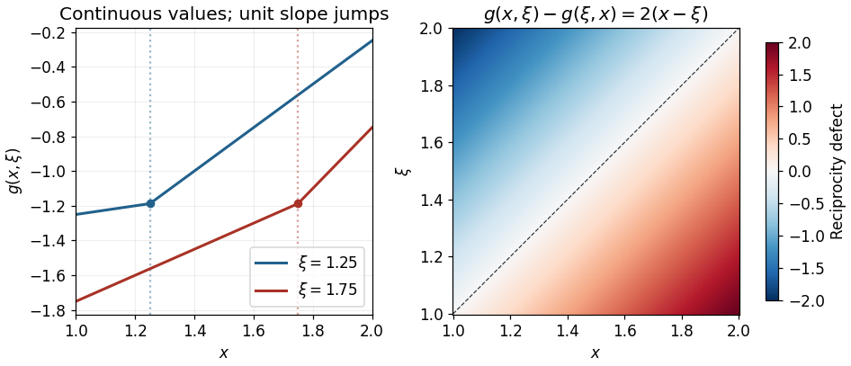

<h1 id="1/c/solution">Solution</h1>

↑ **Parent:** [C](../c.md)

Start with a [fundamental solution](../../../../fundamental-solution-of-a-linear-differential-operator.md) of the second [derivative](../../../../derivative.md) operator:

$$
\widetilde g(x,\xi)=(x-\xi)H(x-\xi),\qquad \partial_x\widetilde g=H(x-\xi),\qquad \partial_x^2\widetilde g=\delta(x-\xi).
$$

Here $H$ is the [Heaviside step function](../../../../heaviside-step-function.md) and the last equality holds in the sense of [distributions](../../../../distribution-mathematical-analysis.md). The factor $x-\xi$ removes a jump in the [function](../../../../function-split.md) itself, while its first [derivative](../../../../derivative.md) has a unit jump. Adding any [homogeneous solution](../../../../homogeneous-solution.md) preserves the [Dirac delta](../../../../dirac-delta-function.md) source.

Choose $y_1(x)=x-2$ and $y_2(x)=x-3$. They are independent [homogeneous solutions](../../../../homogeneous-solution.md), with $B_1y_1=0$, $B_2y_2=0$, $B_1y_2=-1$, and $B_2y_1=1$. Since $1<\xi<2$, the [fundamental solution](../../../../fundamental-solution-of-a-linear-differential-operator.md) has $B_1\widetilde g=1$ and $B_2\widetilde g=2-\xi$. Imposing the two [boundary conditions](../../../../boundary-condition.md) on the proposed combination therefore gives $-A_2+1=0$ and $A_1+2-\xi=0$. Consequently

$$
\boxed{A_1(\xi)=\xi-2,\qquad A_2(\xi)=1,\qquad
 g(x,\xi)=(\xi-2)(x-2)+(x-3)+(x-\xi)H(x-\xi).}
$$

Equivalently,

$$
g(x,\xi)=\begin{cases}(\xi-1)x+1-2\xi,&1\leq x\leq\xi,\\ \xi x+1-3\xi,&\xi\leq x\leq2.\end{cases}
$$

At $x=\xi$ both expressions equal $\xi^2-3\xi+1$ and the right slope minus the left slope is $\xi-(\xi-1)=1$. At the endpoints, $g(1,\xi)=-\xi$ and $g_x(2,\xi)=\xi$, while $g_x(1,\xi)=\xi-1$ and $g(2,\xi)=1-\xi$. These explicitly verify both [coupled boundary conditions](../../../../coupled-boundary-condition.md). The homogeneous equation has only affine solutions; its two [boundary conditions](../../../../boundary-condition.md) give $2a+b=3a+b=0$, hence $a=b=0$, proving [uniqueness](../../../../uniqueness.md) of the [Green function](../../../../green-s-function-split.md).

The reciprocity defect is $g(x,\xi)-g(\xi,x)=2(x-\xi)$. It records how the [coupled boundary conditions](../../../../coupled-boundary-condition.md) affect [self-adjointness](../../../../self-adjoint-operator.md), even though the differential expression $D^2$ is formally [self-adjoint](../../../../self-adjoint-operator.md). The construction is an instance of the [boundary-matrix construction of an ordinary differential Green function](../../../../boundary-matrix-construction-of-an-ordinary-differential-green-function.md).

**[Figure 1](#1/c/image-unit-slope-jumps-and-the-reciprocity-defect-of-the-coupled-endpoint-green-function). Unit slope jumps and the reciprocity defect of the coupled-endpoint Green function**.

## ↑ Ancestors (12)

1. [C](../c.md)
2. [1](../../1.md)
3. [2015](../../../2015-split.md)
4. [Past exam of the differential equations 2 course of the University of Oxford](../../../split.md)
5. [Differential equations 2 course of the University of Oxford](../../../../differential-equations-2-course-of-the-university-of-oxford.md)
6. [Year 2 of the mathematics course of the University of Oxford](../../../../year-2-of-the-mathematics-course-of-the-university-of-oxford.md)
7. [Mathematics course of the University of Oxford](../../../../mathematics-course-of-the-university-of-oxford.md)
8. [Undergraduate course of the University of Oxford](../../../../undergraduate-course-of-the-university-of-oxford.md)
9. [Course of the University of Oxford](../../../../course-of-the-university-of-oxford.md)
10. [University of Oxford](../../../../university-of-oxford-split.md)
11. [List of universities](../../../../list-of-universities.md)
12. [Codex Wiki](../../../../split.md)
