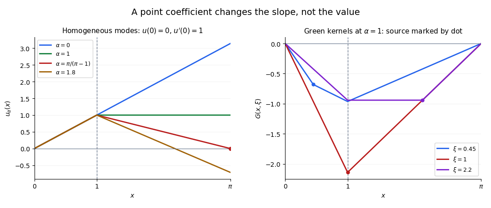

<h1 id="1/b/ii/solution">Solution</h1>

↑ **Parent:** [Ii](../ii.md)

Use a [Green function](../../../../../green-s-function-split.md) satisfying $L_xG(x,\xi)=\delta(x-\xi)$ with homogeneous [Dirichlet boundary conditions](../../../../../dirichlet-boundary-condition.md) $G(0,\xi)=G(\pi,\xi)=0$, for $0<\xi<\pi$. Since $G_{xx}=0$ away from $x=1$ and $x=\xi$, it is continuous and piecewise affine, with possible derivative jumps at those two locations.

For $\xi\ne1$, the [transmission conditions for a delta coefficient](../../../../../transmission-conditions-for-a-delta-coefficient.md) and the unit source condition are

$$
\begin{aligned}
[G]_1&=0,&[G_x]_1&=-G(1,\xi),\\
[G]_\xi&=0,&[G_x]_\xi&=1.
\end{aligned}
$$

If $\xi=1$, there is a single junction, and the correct combined condition is

$$
\boxed{[G]_1=0,\qquad [G_x]_1+G(1,1)=1.}
$$

For example, a suitable piecewise form when $0<\xi<1$ is

$$
G(x,\xi)=\begin{cases}A x,&0\leq x\leq\xi,\\B x+C,&\xi\leq x\leq1,\\D(\pi-x),&1\leq x\leq\pi,\end{cases}
$$

where the coefficients depend on $\xi$. The two continuity conditions, $B-A=1$ and $-D-B=-G(1,\xi)$ determine them. When $1<\xi<\pi$, use the same affine form on the intervals cut at $1,\xi$, with $B-A=-G(1,\xi)$ and $-D-B=1$ instead. This gives all requested boundary and jump conditions without needing the coefficients.

An explicit compact kernel also makes the construction transparent. The left and right homogeneous solutions at $\alpha=1$ are

$$
u(x)=\begin{cases}x,&x\leq1,\\1,&x\geq1,\end{cases}
\qquad
v(x)=\begin{cases}1+(\pi-2)x,&x\leq1,\\\pi-x,&x\geq1.\end{cases}
$$

They obey the interaction jump and have [Wronskian](../../../../../wronskian.md) $uv'-u'v=-1$ on either side. Therefore

$$
\boxed{G(x,\xi)=-u\bigl(\min(x,\xi)\bigr)v\bigl(\max(x,\xi)\bigr).}
$$

Differentiating its two branches at the source gives a unit derivative jump whenever $\xi\ne1$. At $\xi=1$, $G(1,1)=-(\pi-1)$ and $[G_x]_1=\pi$, so the combined condition is also satisfied. This is the [Dirichlet Green function for a point interaction](../../../../../dirichlet-green-function-for-a-point-interaction.md) specialized to the present parameters.

The Green kernel itself has zero endpoint values. The prescribed nonzero endpoint values enter through the homogeneous lift:

$$
\boxed{y(x)=c_1v(x)+c_2u(x)+\int_0^\pi G(x,\xi)f(\xi)\,d\xi.}
$$

Indeed, $v(0)=u(\pi)=1$ and $u(0)=v(\pi)=0$. The kernel accounts for the forcing; the lift accounts for the boundary data. Uniqueness follows from part (i), since $1\ne\pi/(\pi-1)$.

**[Figure 1](#1/b/ii/image-the-resonant-homogeneous-mode-and-the-derivative-jumps-of-the-green-kernel). The resonant homogeneous mode and the derivative jumps of the Green kernel**. Original calculations for an interaction at $x=1$ on $(0,\pi)$. The left panel varies the coefficient with a fixed initial slope; the resonant curve alone meets the zero right boundary. The right panel shows three source positions at coefficient one, including a source coinciding with the interaction.

## ↑ Ancestors (13)

1. [Ii](../ii.md)
2. [B](../../b.md)
3. [1](../../../1.md)
4. [2017](../../../../2017-split.md)
5. [Past exam of the differential equations 2 course of the University of Oxford](../../../../split.md)
6. [Differential equations 2 course of the University of Oxford](../../../../../differential-equations-2-course-of-the-university-of-oxford.md)
7. [Year 2 of the mathematics course of the University of Oxford](../../../../../year-2-of-the-mathematics-course-of-the-university-of-oxford.md)
8. [Mathematics course of the University of Oxford](../../../../../mathematics-course-of-the-university-of-oxford.md)
9. [Undergraduate course of the University of Oxford](../../../../../undergraduate-course-of-the-university-of-oxford.md)
10. [Course of the University of Oxford](../../../../../course-of-the-university-of-oxford.md)
11. [University of Oxford](../../../../../university-of-oxford-split.md)
12. [List of universities](../../../../../list-of-universities.md)
13. [Codex Wiki](../../../../../split.md)
