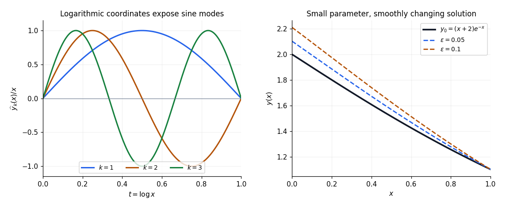

<h1 id="3/b/i/solution">Solution</h1>

↑ **Parent:** [I](../i.md)

The leading [regular perturbation](../../../../../regular-perturbation.md) equation has $c=0$. Its homogeneous solutions are $1$ and $(x+2)e^{-x}$, so

$$
y_0(x)=A+B(x+2)e^{-x}.
$$

The boundary data must also be expanded: $2e^\epsilon=2+2\epsilon+\cdots$, while the right endpoint value is independent of $\epsilon$. Thus $y_0(0)=2$ and $y_0(1)=3/e$, giving

$$
A+2B=2,\qquad A+\frac3eB=\frac3e.
$$

Since $2-3/e\ne0$, the unique values are $A=0$, $B=1$. Therefore

$$
\boxed{y_0(x)=(x+2)e^{-x}.}
$$

Its [derivatives](../../../../../derivative.md) are $y_0'=-(x+1)e^{-x}$ and $y_0''=xe^{-x}$, so the leading differential equation and both leading endpoint values can be checked directly.

**[Figure 2](#3/b/i/image-logarithmic-eigenmodes-and-the-leading-regular-perturbation-solution). Logarithmic eigenmodes and the leading regular perturbation solution**. The left panel shows three eigenfunctions after division by x and the change of variable t = log x. The right panel compares the derived leading term with numerical boundary value solutions at two small parameter values; these are original calculations.

## ↑ Ancestors (13)

1. [I](../i.md)
2. [B](../../b.md)
3. [3](../../../3.md)
4. [2017](../../../../2017-split.md)
5. [Past exam of the differential equations 2 course of the University of Oxford](../../../../split.md)
6. [Differential equations 2 course of the University of Oxford](../../../../../differential-equations-2-course-of-the-university-of-oxford.md)
7. [Year 2 of the mathematics course of the University of Oxford](../../../../../year-2-of-the-mathematics-course-of-the-university-of-oxford.md)
8. [Mathematics course of the University of Oxford](../../../../../mathematics-course-of-the-university-of-oxford.md)
9. [Undergraduate course of the University of Oxford](../../../../../undergraduate-course-of-the-university-of-oxford.md)
10. [Course of the University of Oxford](../../../../../course-of-the-university-of-oxford.md)
11. [University of Oxford](../../../../../university-of-oxford-split.md)
12. [List of universities](../../../../../list-of-universities.md)
13. [Codex Wiki](../../../../../split.md)
