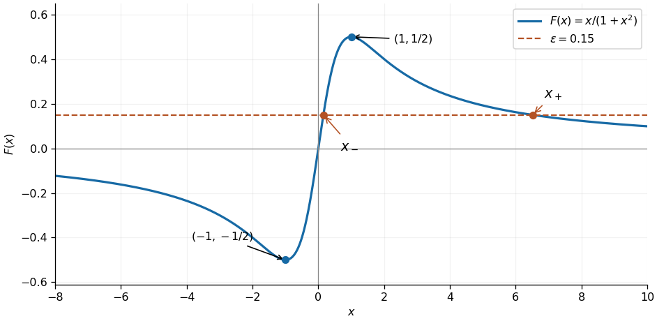
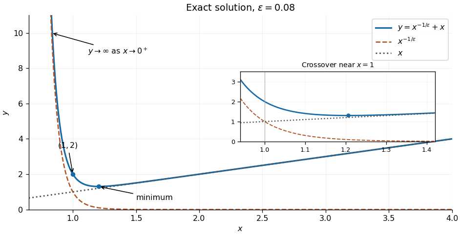
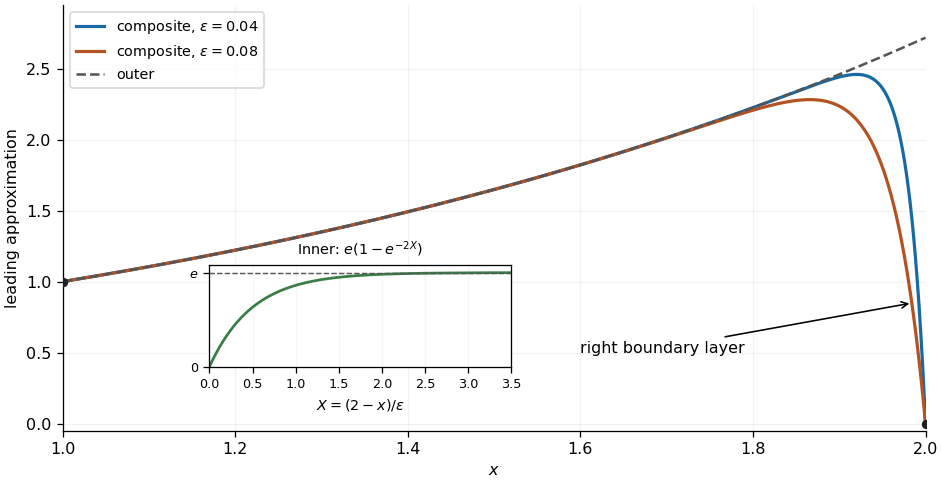

# 2021

↑ **Parent:** [Past exam of the differential equations 2 course of the University of Oxford](../past-exam-of-the-differential-equations-2-course-of-the-university-of-oxford.md)

Solutions to all three questions of the [University of Oxford](../university-of-oxford.md) Differential Equations II paper, sat on 25 June 2021. Source: [released examination PDF, bundle pages 111–113; questions on pages 112–113](https://www.whatdotheyknow.com/request/bsc_mathematics_part_a_examinati/response/2820674/attach/3/FOI%20202410%20944%20Data.pdf#page=111).

**Table of contents**

- [1](#1)
  - [a](#1/a)
    - [i](#1/a/i)
      - [Solution](#1/a/i/solution)
    - [ii](#1/a/ii)
      - [Solution](#1/a/ii/solution)
  - [b](#1/b)
    - [i](#1/b/i)
      - [Solution](#1/b/i/solution)
    - [ii](#1/b/ii)
      - [Solution](#1/b/ii/solution)
  - [c](#1/c)
    - [i](#1/c/i)
      - [Solution](#1/c/i/solution)
    - [ii](#1/c/ii)
      - [Solution](#1/c/ii/solution)
- [2](#2)
  - [a](#2/a)
    - [Solution](#2/a/solution)
  - [b](#2/b)
    - [Solution](#2/b/solution)
  - [c](#2/c)
    - [Solution](#2/c/solution)
  - [d](#2/d)
    - [Solution](#2/d/solution)
- [3](#3)
  - [a](#3/a)
    - [Solution](#3/a/solution)
  - [b](#3/b)
    - [Solution](#3/b/solution)
  - [c](#3/c)
    - [i](#3/c/i)
      - [Solution](#3/c/i/solution)
    - [ii](#3/c/ii)
      - [Solution](#3/c/ii/solution)
    - [iii](#3/c/iii)
      - [Solution](#3/c/iii/solution)

## 1

↑ **Parent:** [2021](2021.md)

<h3 id="1/a">a</h3>

↑ **Parent:** [1](#1)

<h4 id="1/a/i">i</h4>

↑ **Parent:** [A](#1/a)

<h5 id="1/a/i/solution">Solution</h5>

↑ **Parent:** [I](#1/a/i)

Take $l>0$ and use the [inner product](../inner-product.md) $\langle u,v\rangle=\int_0^l\overline u v\,dx$ on the [Hilbert space](../hilbert-space.md) $L^2(0,l)$. The [differential operator](../analysis.md#differential-operator) has domain

$$
D(\mathcal L)=\{u\in H^2(0,l):u(0)=u(l)=0\},
$$

where $H^2$ is a [Sobolev space](../sobolev-space.md). Twice applying [integration by parts](../calculus.md#integration-by-parts) gives the [Lagrange identity for a Sturm-Liouville operator](../sturm-liouville-theory.md#lagrange-identity-for-a-sturm-liouville-operator)

$$
\langle u,\mathcal Lv\rangle-\langle\mathcal Lu,v\rangle
=[\overline u v'-\overline{u'}v]_0^l.
$$

The [Dirichlet boundary conditions](../differential-equation.md#dirichlet-boundary-condition) make this expression zero for $u,v\in D(\mathcal L)$, and the [formal adjoint](../hilbert-space.md#formal-adjoint) is $\mathcal L^*=d^2/dx^2+1$. To obtain the domain of the [adjoint operator](../hilbert-space.md#adjoint-operator), initially impose the [boundary conditions](../differential-equation.md#boundary-condition) only on $u$. The remaining expression is $-[\overline{u'}v]_0^l$. Since $u'(0)$ and $u'(l)$ vary independently, it vanishes for all such $u$ exactly when $v(0)=v(l)=0$. The adjoint domain is therefore the original domain: this is full [self-adjointness](../linear-operator-theory.md#self-adjoint-operator), including the [boundary conditions](../differential-equation.md#boundary-condition).

Consequently the [eigenvalues](../linear-operator-theory.md#eigenvalue) are real, [eigenfunctions](../linear-operator-theory.md#eigenfunction) for distinct [eigenvalues](../linear-operator-theory.md#eigenvalue) are [orthogonal](../inner-product.md#orthogonal-vectors), and regular [Sturm-Liouville theory](../sturm-liouville-theory.md) supplies a complete [orthonormal eigenbasis](../linear-operator-theory.md#orthonormal-eigenbasis). Here these objects can be exhibited explicitly:

$$
\boxed{\phi_n(x)=\sqrt{\frac2l}\sin\frac{n\pi x}{l},\qquad
\lambda_n=1-\left(\frac{n\pi}{l}\right)^2,\qquad n=1,2,\ldots.}
$$

Indeed $\mathcal L\phi_n=\lambda_n\phi_n$, and the [Fourier sine basis](../fourier-series.md#fourier-sine-basis) is complete in $L^2(0,l)$. There are no additional [eigenvalues](../linear-operator-theory.md#eigenvalue): for a nonzero [eigenfunction](../linear-operator-theory.md#eigenfunction) $u$, [integration by parts](../calculus.md#integration-by-parts) gives

$$
\lambda=1-\frac{\int_0^l|u'|^2\,dx}{\int_0^l|u|^2\,dx}<1,
$$

so $u''+(1-\lambda)u=0$ and the endpoint values force $\sqrt{1-\lambda}\,l=n\pi$. All these [eigenvalues](../linear-operator-theory.md#eigenvalue) are simple. The [eigenvectors](../linear-operator-theory.md#eigenvector) are precisely the nonzero multiples of these [eigenfunctions](../linear-operator-theory.md#eigenfunction), regarded as [vectors](../vector-space.md#vector) in the [Hilbert space](../hilbert-space.md).

<h4 id="1/a/ii">ii</h4>

↑ **Parent:** [A](#1/a)

<h5 id="1/a/ii/solution">Solution</h5>

↑ **Parent:** [Ii](#1/a/ii)

The [homogeneous solution](../linear-ordinary-differential-equation.md#homogeneous-solution) is $A\cos x+B\sin x$. The left [boundary condition](../differential-equation.md#boundary-condition) removes $A$, and the right [boundary condition](../differential-equation.md#boundary-condition) gives $B\sin l=0$. Thus the [kernel of a linear map](../kernel-of-a-linear-map.md) associated with this [boundary value problem](../boundary-value-problem.md) is

$$
\boxed{\ker\mathcal L=
\begin{cases}
\{0\},&l\notin\pi\mathbb N_{>0},\\
\operatorname{span}\{\sin x\},&l=m\pi,\quad m\in\mathbb N_{>0}.
\end{cases}}
$$

The [Fredholm alternative](../compact-operator.md#fredholm-alternative) now gives the complete classification:

$$
\boxed{\begin{array}{c|c|c}
l&\text{condition on }f&\text{solutions}\\\hline
l\notin\pi\mathbb N_{>0}&\text{any prescribed }f&\text{exactly one}\\
l=m\pi&\displaystyle\int_0^{m\pi}f(x)\sin x\,dx=0&\text{infinitely many}\\
l=m\pi&\displaystyle\int_0^{m\pi}f(x)\sin x\,dx\ne0&\text{none}.
\end{array}}
$$

For necessity at $l=m\pi$, multiply by the [homogeneous solution](../linear-ordinary-differential-equation.md#homogeneous-solution) $\sin x$ and use the [Lagrange identity for a Sturm-Liouville operator](../sturm-liouville-theory.md#lagrange-identity-for-a-sturm-liouville-operator) to obtain $\int_0^lf\sin x\,dx=0$. For sufficiency, the [particular solution](../linear-ordinary-differential-equation.md#particular-solution)

$$
z(x)=\int_0^x\sin(x-t)f(t)\,dt
$$

satisfies $z(0)=0$ and $z''+z=f$. At the other endpoint,

$$
z(m\pi)=(-1)^{m+1}\int_0^{m\pi}\sin t\,f(t)\,dt,
$$

which is zero under the compatibility condition. All solutions are then $z+B\sin x$, with $B$ arbitrary. The assumed [Lipschitz continuity](../real-analysis.md#lipschitz-continuity) of $f$ in particular makes $f$ continuous, so the displayed [integral](../integral.md) defines a classical solution. The length $l=0$ is excluded: it would not define a nonempty interval for this [boundary value problem](../boundary-value-problem.md).

<h3 id="1/b">b</h3>

↑ **Parent:** [1](#1)

<h4 id="1/b/i">i</h4>

↑ **Parent:** [B](#1/b)

<h5 id="1/b/i/solution">Solution</h5>

↑ **Parent:** [I](#1/b/i)

For $\sin l\ne0$, use [variation of parameters](../linear-ordinary-differential-equation.md#variation-of-parameters) with the [homogeneous solutions](../linear-ordinary-differential-equation.md#homogeneous-solution) $\cos x,\sin x$, whose [Wronskian](../linear-ordinary-differential-equation.md#wronskian) is one. Write $y=A(x)\cos x+B(x)\sin x$ and impose $A'\cos x+B'\sin x=0$. The [differential equation](../differential-equation.md) gives $-A'\sin x+B'\cos x=f$, hence

$$
A'=-f\sin x,\qquad B'=f\cos x.
$$

After integrating from zero and using the left [boundary condition](../differential-equation.md#boundary-condition),

$$
y(x)=C\sin x+\int_0^x\sin(x-t)f(t)\,dt.
$$

The right [boundary condition](../differential-equation.md#boundary-condition) determines

$$
C=-\frac1{\sin l}\int_0^l\sin(l-t)f(t)\,dt,
$$

so the unique solution is

$$
\boxed{y(x)=\int_0^x\sin(x-t)f(t)\,dt
-\frac{\sin x}{\sin l}\int_0^l\sin(l-t)f(t)\,dt.}
$$

Combining the two [integrals](../integral.md) gives $y(x)=\int_0^lG(x,t)f(t)\,dt$, with [Green's function](../green-s-function.md)

$$
\boxed{G(x,t)=-\frac1{\sin l}
\begin{cases}
\sin x\sin(l-t),&0\leq x\leq t,\\
\sin t\sin(l-x),&t\leq x\leq l.
\end{cases}}
$$

It is symmetric in $x,t$, as expected from [self-adjointness](../linear-operator-theory.md#self-adjoint-operator), and has zero endpoint values. At $x=t$ it is continuous, while its first [derivative](../calculus.md#derivative) obeys the [jump condition](../differential-equation.md#jump-condition)

$$
G_x(t^+,t)-G_x(t^-,t)
=\frac{\sin t\cos(l-t)+\cos t\sin(l-t)}{\sin l}=1.
$$

Thus $(\partial_x^2+1)G=\delta(x-t)$, with the positive normalization of the [Dirac delta function](../distribution-theory.md#dirac-delta-function) required for $\mathcal Ly=f$.

<h4 id="1/b/ii">ii</h4>

↑ **Parent:** [B](#1/b)

<h5 id="1/b/ii/solution">Solution</h5>

↑ **Parent:** [Ii](#1/b/ii)

Expand in the [Fourier sine basis](../fourier-series.md#fourier-sine-basis), using unnormalized [eigenfunctions](../linear-operator-theory.md#eigenfunction):

$$
f(x)=\sum_{n=1}^\infty f_n\sin\frac{n\pi x}{l},\qquad
f_n=\frac2l\int_0^lf(t)\sin\frac{n\pi t}{l}\,dt,
\qquad y(x)=\sum_{n=1}^\infty c_n\sin\frac{n\pi x}{l}.
$$

Projection of $\mathcal Ly=f$ onto each [eigenfunction](../linear-operator-theory.md#eigenfunction) gives

$$
\boxed{\left[1-\left(\frac{n\pi}{l}\right)^2\right]c_n=f_n.}
$$

When $l\notin\pi\mathbb N_{>0}$, every [eigenvalue](../linear-operator-theory.md#eigenvalue) is nonzero and the [eigenfunction expansion](../algebra.md#eigenfunction-expansion) is uniquely determined:

$$
\boxed{y(x)=\sum_{n=1}^\infty
\frac{f_n}{1-(n\pi/l)^2}\sin\frac{n\pi x}{l}.}
$$

When $l=m\pi$, the exceptional index is $n=m$, for which the [eigenfunction](../linear-operator-theory.md#eigenfunction) is $\sin x$. If $f_m\ne0$, its coefficient equation is $0=f_m$, an inconsistency: there is no solution. If $f_m=0$, the coefficient equation is $0=0$, and $c_m$ is arbitrary. The full family is

$$
\boxed{y(x)=C\sin x+
\sum_{\substack{n\geq1\\n\ne m}}
\frac{f_n}{1-(n/m)^2}\sin\frac{nx}{m},\qquad C\in\mathbb R.}
$$

This is the [Fredholm alternative](../compact-operator.md#fredholm-alternative) directly in the coefficient equations: nonzero [eigenvalues](../linear-operator-theory.md#eigenvalue) fix their coefficients; a zero [eigenvalue](../linear-operator-theory.md#eigenvalue) requires zero forcing in that direction and leaves the corresponding coefficient free. An inconsistent equation at a zero [eigenvalue](../linear-operator-theory.md#eigenvalue) cannot be repaired by assigning an infinite coefficient.

For convergence, [Lipschitz continuity](../real-analysis.md#lipschitz-continuity) implies [absolute continuity](../sobolev-space.md#absolutely-continuous-function) of $f$, with bounded [derivative](../calculus.md#derivative) almost everywhere. One [integration by parts](../calculus.md#integration-by-parts) gives $f_n=O(n^{-1})$; since the denominators grow quadratically, $c_n=O(n^{-3})$ apart from the single free coefficient. The solution series and its first [derivative](../calculus.md#derivative) therefore converge uniformly. The second [derivative](../calculus.md#derivative) converges in $L^2$, and the resulting [Sobolev space](../sobolev-space.md) solution satisfies $y''=f-y$. As $f-y$ is a [continuous function](../calculus.md#continuous-function), this is a classical $C^2$ solution, with both [boundary conditions](../differential-equation.md#boundary-condition) satisfied. The forcing's [Fourier sine series](../fourier-series.md#fourier-sine-series) is interpreted on the open interval or in $L^2$; its endpoint values need not equal the endpoint values of $f$.

<h3 id="1/c">c</h3>

↑ **Parent:** [1](#1)

<h4 id="1/c/i">i</h4>

↑ **Parent:** [C](#1/c)

<h5 id="1/c/i/solution">Solution</h5>

↑ **Parent:** [I](#1/c/i)

At $l=\pi$, the [Fredholm solvability condition](../sturm-liouville-theory.md#fredholm-solvability-condition) is

$$
0=\int_0^\pi(a\sin x+b\sin2x)\sin x\,dx=\frac{a\pi}{2},
$$

by [orthogonality](../inner-product.md#orthogonal-vectors) of the [Fourier sine basis](../fourier-series.md#fourier-sine-basis). Thus a non-unique solution exists exactly when $a=0$, with any real $b$. Since $(d^2/dx^2+1)\sin2x=-3\sin2x$, the complete family is

$$
\boxed{a=0:\quad y(x)=C\sin x-\frac b3\sin2x,\quad C\in\mathbb R.}
$$

If $a\ne0$ there is no solution, for any $b$. In particular, when $a=b=0$, the family reduces to the [kernel](../kernel-of-a-linear-map.md) $C\sin x$; it is still non-unique. There is no choice of $a,b$ producing a unique solution for this length.

<h4 id="1/c/ii">ii</h4>

↑ **Parent:** [C](#1/c)

<h5 id="1/c/ii/solution">Solution</h5>

↑ **Parent:** [Ii](#1/c/ii)

Putting both data at zero makes this an [initial value problem](../differential-equation.md#initial-value-problem). The [uniqueness theorem for ordinary differential equations](../analysis.md#uniqueness-theorem-for-ordinary-differential-equations) applies, and one can also prove uniqueness directly: the difference of two solutions is a [homogeneous solution](../linear-ordinary-differential-equation.md#homogeneous-solution) $A\cos x+B\sin x$ whose value and first [derivative](../calculus.md#derivative) at zero are both zero, forcing $A=B=0$. In fact, for every prescribed [continuous function](../calculus.md#continuous-function) $f$,

$$
\boxed{y(x)=\int_0^x\sin(x-t)f(t)\,dt}
$$

satisfies both initial data and $y''+y=f$. Consequently non-uniqueness is impossible for every $l>0$, including $l=m\pi$. In this setting the [kernel](../kernel-of-a-linear-map.md) is trivial. The [boundary conditions](../differential-equation.md#boundary-condition) at a single endpoint do not give the same [self-adjoint operator](../linear-operator-theory.md#self-adjoint-operator) domain as the two separated [Dirichlet boundary conditions](../differential-equation.md#dirichlet-boundary-condition), so the earlier exceptional lengths do not apply.

## 2

↑ **Parent:** [2021](2021.md)

<h3 id="2/a">a</h3>

↑ **Parent:** [2](#2)

<h4 id="2/a/solution">Solution</h4>

↑ **Parent:** [A](#2/a)

Work first on $x>0$. For $b=0$, the [power-law ansatz](../linear-ordinary-differential-equation.md#power-law-ansatz) $y=x^r$ gives the [indicial equation](../linear-ordinary-differential-equation.md#indicial-equation) $r(r-1)+r-a^2=r^2-a^2=0$. Therefore the [Cauchy-Euler equation](../linear-ordinary-differential-equation.md#cauchy-euler-equation) has [general solution](../linear-ordinary-differential-equation.md#general-solution)

$$
\boxed{y(x)=
\begin{cases}
C_1x^a+C_2x^{-a},&a>0,\\
C_1+C_2\log x,&a=0.
\end{cases}}
$$

For $a=0$ the repeated [indicial root](../linear-ordinary-differential-equation.md#indicial-root) supplies the [logarithm](../calculus.md#logarithm) rather than two copies of the constant solution. Alternatively, the [change of variables](../multivariable-calculus.md#change-of-variables-formula) $t=\log x$ turns the [differential equation](../differential-equation.md) into $Y''-a^2Y=0$. On $x<0$ the corresponding real formulas use $|x|$ and $\log|x|$, with independent constants on the two sides of zero.

For general $b$, normalize the [second-order linear differential equation](../linear-ordinary-differential-equation.md#second-order-linear-differential-equation) as

$$
y''+P(x)y'+Q(x)y=0,\qquad P(x)=\frac1x,\qquad Q(x)=-\frac{a^2}{x^2}+bx^{\beta-2}.
$$

The coefficient $P$ is singular at zero, but $xP(x)=1$ and $x^2Q(x)=-a^2+bx^\beta$ are [analytic functions](../holomorphic-function.md) there because $\beta$ is a positive integer. The [regular singular point criterion for a second-order equation](../complex-analysis.md#regular-singular-point-criterion-for-a-second-order-equation) therefore proves that zero is a [regular singular point](../complex-analysis.md#regular-singular-point) for every allowed $a,b,\beta$. The [indicial equation](../linear-ordinary-differential-equation.md#indicial-equation) remains $r^2-a^2=0$.

<h3 id="2/b">b</h3>

↑ **Parent:** [2](#2)

<h4 id="2/b/solution">Solution</h4>

↑ **Parent:** [B](#2/b)

For the first [Frobenius solution](../complex-analysis.md#frobenius-solution), take the larger [indicial root](../linear-ordinary-differential-equation.md#indicial-root) $r=a$ and normalize the first coefficient to one:

$$
y_+(x)=x^a\sum_{n=0}^\infty c_nx^n,\qquad c_0=1,
\qquad c_j=0\quad(j<0).
$$

Substitution and comparison of the coefficient of $x^{n+a}$ give

$$
\big[(n+a)^2-a^2\big]c_n+bc_{n-\beta}=0,
\qquad\boxed{c_n=-\frac{b\,c_{n-\beta}}{n(n+2a)}\quad(n\geq1).}
$$

Every denominator is nonzero because $a\geq0$.

For $\beta=1$, the [recurrence relation](../sequence-and-series.md#recurrence-relation) is $c_n=-bc_{n-1}/[n(n+2a)]$, so

$$
\boxed{y_+(x)=x^a\left[1-\frac{b}{1+2a}x+
\frac{b^2}{2(1+2a)(2+2a)}x^2+\cdots\right],\quad
c_n=\frac{(-b)^n}{\prod_{j=1}^n j(j+2a)}.}
$$

For $\beta=2$, $c_1=0$ and all odd coefficients vanish; the even coefficients satisfy $c_{2k}=-bc_{2k-2}/[2k(2k+2a)]$. Hence

$$
\boxed{y_+(x)=x^a\left[1-\frac{b}{4(1+a)}x^2+
\frac{b^2}{32(1+a)(2+a)}x^4+\cdots\right].}
$$

For any positive integer $\beta$, induction in the [recurrence relation](../sequence-and-series.md#recurrence-relation) shows that only indices divisible by $\beta$ survive:

$$
\boxed{y_+(x)=x^a\sum_{k=0}^\infty
\frac{(-b)^k x^{k\beta}}{\prod_{j=1}^k j\beta(j\beta+2a)}.}
$$

The empty product for $k=0$ equals one. Successive terms in the [power series](../sequence-and-series.md#power-series) factor have ratio of magnitudes

$$
\frac{|b|\,|x|^\beta}{(k+1)\beta((k+1)\beta+2a)}\longrightarrow0.
$$

Thus the [ratio test](../sequence-and-series.md#ratio-test) gives convergence for every finite $x$; a nonintegral $a$ still requires a chosen side of zero or a complex branch for the factor $x^a$.

<h3 id="2/c">c</h3>

↑ **Parent:** [2](#2)

<h4 id="2/c/solution">Solution</h4>

↑ **Parent:** [C](#2/c)

For a putative second [Frobenius solution](../complex-analysis.md#frobenius-solution) with the smaller [indicial root](../linear-ordinary-differential-equation.md#indicial-root) $-a$, set $y_-=x^{-a}\sum_{n\geq0}d_nx^n$, with $d_0=1$ and $d_j=0$ for $j<0$. Its [recurrence relation](../sequence-and-series.md#recurrence-relation) is

$$
\boxed{n(n-2a)d_n=-b\,d_{n-\beta}.}
$$

The [Frobenius case classification](../complex-analysis.md#frobenius-case-classification) concerns the gap $2a$ between the [indicial roots](../linear-ordinary-differential-equation.md#indicial-root). In the course convention, Case IIIa is the obstructed recurrence requiring a [Logarithmic Frobenius solution](../complex-analysis.md#logarithmic-solution-from-a-repeated-frobenius-exponent); Case IIIb permits two pure [Frobenius series](../complex-analysis.md#frobenius-solution).

If $a>0$ and $2a\notin\mathbb Z$, this is **Case I**: no denominator vanishes. There are two [linearly independent](../vector-space.md#linear-independence) pure [Frobenius solutions](../complex-analysis.md#frobenius-solution), with

$$
y_-(x)=x^{-a}\sum_{k=0}^\infty
\frac{(-b)^kx^{k\beta}}{\prod_{j=1}^k j\beta(j\beta-2a)}.
$$

Their different leading powers establish [linear independence](../vector-space.md#linear-independence).

If $a=0$, this is **Case II**, with a repeated [indicial root](../linear-ordinary-differential-equation.md#indicial-root). There is only one pure [Frobenius series](../complex-analysis.md#frobenius-solution) with a nonzero leading coefficient. To see the second solution's form, [reduction of order](../linear-ordinary-differential-equation.md#reduction-of-order) gives

$$
y_2(x)=y_+(x)\int^x\frac{dt}{t\,y_+(t)^2}.
$$

Here $y_+(t)=1+O(t^\beta)$, so the integrand is $t^{-1}+O(t^{\beta-1})$. Consequently

$$
\boxed{y_2(x)=y_+(x)\log x+\text{an analytic power series}.}
$$

The [logarithm](../calculus.md#logarithm) has a nonzero coefficient and cannot be removed by adding a multiple of $y_+$.

If $N=2a$ is a positive integer, the only potentially obstructed coefficient is $n=N$. Below that index, $d_n=0$ unless $\beta$ divides $n$. At the exceptional index the equation reads

$$
0=-b\,d_{N-\beta}.
$$

If $N=m\beta$ for some positive integer $m$, all coefficients $d_0,d_\beta,\ldots,d_{(m-1)\beta}$ are nonzero because $b\ne0$. The exceptional equation is inconsistent. This is **Case IIIa**, and the independent second solution has the form

$$
\boxed{y_2=x^{-a}\sum_{n=0}^\infty d_nx^n+K y_+\log x,\qquad K\ne0.}
$$

The [Frobenius resonance for an Euler equation with monomial potential](../complex-analysis.md#frobenius-resonance-for-an-euler-equation-with-monomial-potential) explains why divisibility, rather than the integer gap alone, decides this outcome. For example, with $d_0=1$, applying the original [differential operator](../analysis.md#differential-operator) to $y_+\log x$ gives $2xy_+'$. Cancellation of the coefficient of $x^a$ requires $K=-bd_{N-\beta}/(2a)\ne0$.

If $\beta$ does not divide $N$, then $d_{N-\beta}=0$; this includes $N<\beta$ through the negative-index convention. The exceptional equation is $0=0$, so $d_N$ is free. This is **Case IIIb**: set $d_N=0$ to select an independent pure [Frobenius series](../complex-analysis.md#frobenius-solution) starting with $x^{-a}$. Subsequent coefficients again follow the [recurrence relation](../sequence-and-series.md#recurrence-relation). Changing $d_N$ simply adds a multiple of $y_+$, the [undetermined coefficient at Frobenius resonance](../complex-analysis.md#undetermined-coefficient-at-frobenius-resonance).

The complete answer is therefore

$$
\boxed{\begin{array}{c|c}
\text{parameters}&\text{case}\\\hline
a=0&\mathrm{II}\\
a>0,\quad 2a\notin\mathbb Z&\mathrm{I}\\
2a\in\mathbb N_{>0},\quad 2a/\beta\in\mathbb N_{>0}&\mathrm{IIIa}\\
2a\in\mathbb N_{>0},\quad 2a/\beta\notin\mathbb N_{>0}&\mathrm{IIIb}.
\end{array}}
$$

In particular, for $\beta=1$ every positive integer gap gives Case IIIa. For $\beta=2$, positive integer $a$ gives Case IIIa, while $a=1/2,3/2,5/2,\ldots$ gives Case IIIb; the remaining positive $a$ give Case I. The condition $b\ne0$ matters: at $b=0$ the two [Cauchy-Euler equation](../linear-ordinary-differential-equation.md#cauchy-euler-equation) powers already give independent solutions whenever $a>0$.

<h3 id="2/d">d</h3>

↑ **Parent:** [2](#2)

<h4 id="2/d/solution">Solution</h4>

↑ **Parent:** [D](#2/d)

Normalize both leading coefficients to one. For the [indicial root](../linear-ordinary-differential-equation.md#indicial-root) $a=1/2$, the [recurrence relation](../sequence-and-series.md#recurrence-relation) from part (b) gives

$$
c_{2k}=\frac{(-1)^k}{(2k+1)!},\qquad c_{2k+1}=0.
$$

Recognizing the [Taylor series](../calculus.md#taylor-series) of the [sine](../geometry-and-topology.md#sine) gives the first [Frobenius solution](../complex-analysis.md#frobenius-solution)

$$
\boxed{y_+(x)=x^{1/2}\sum_{k=0}^\infty\frac{(-1)^kx^{2k}}{(2k+1)!}
=\frac{\sin x}{\sqrt x}.}
$$

For the smaller [indicial root](../linear-ordinary-differential-equation.md#indicial-root) $-1/2$, $n(n-1)d_n=-d_{n-2}$. The equation at $n=1$ is $0=0$; choose the free coefficient $d_1=0$ to avoid adding the first [Frobenius solution](../complex-analysis.md#frobenius-solution). The remaining coefficients are

$$
d_{2k}=\frac{(-1)^k}{(2k)!},\qquad d_{2k+1}=0.
$$

Thus the [Taylor series](../calculus.md#taylor-series) of the [cosine](../geometry-and-topology.md#cosine) gives

$$
\boxed{y_-(x)=x^{-1/2}\sum_{k=0}^\infty\frac{(-1)^kx^{2k}}{(2k)!}
=\frac{\cos x}{\sqrt x}.}
$$

Their leading terms are $x^{1/2}$ and $x^{-1/2}$, as required for Case IIIb. A direct check uses $y=x^{-1/2}u$: the [differential equation](../differential-equation.md) becomes $x^{3/2}(u''+u)=0$, so these two functions solve it on $x>0$. Their [Wronskian](../linear-ordinary-differential-equation.md#wronskian) is $-1/x\ne0$, proving [linear independence](../vector-space.md#linear-independence). The [general solution](../linear-ordinary-differential-equation.md#general-solution) is $(C_1\sin x+C_2\cos x)/\sqrt x$.

## 3

↑ **Parent:** [2021](2021.md)

<h3 id="3/a">a</h3>

↑ **Parent:** [3](#3)

<h4 id="3/a/solution">Solution</h4>

↑ **Parent:** [A](#3/a)

The [function](../function.md) $F$ is an [odd function](../calculus.md#odd-function), passes through $(0,0)$, and has the horizontal [asymptote](../topology.md#asymptote) $F=0$ at both infinities. Its [derivative](../calculus.md#derivative) is

$$
F'(x)=\frac{1-x^2}{(1+x^2)^2}.
$$

It decreases for $|x|>1$ and increases for $|x|<1$, with its lowest value $F(-1)=-1/2$ and highest value $F(1)=1/2$. These features determine the [graph of a function](../function.md#graph-of-a-function) shown below.

For $0<\epsilon<1/2$, the equation is the [quadratic equation](../polynomial.md#quadratic-equation) $\epsilon x^2-x+\epsilon=0$. The [quadratic formula](../polynomial.md#quadratic-formula) gives exactly two real [equation roots](../polynomial.md#root-of-an-equation):

$$
x_\pm=\frac{1\pm\sqrt{1-4\epsilon^2}}{2\epsilon}.
$$

The [binomial series](../sequence-and-series.md#binomial-series) gives $\sqrt{1-4\epsilon^2}=1-2\epsilon^2-2\epsilon^4-4\epsilon^6+O(\epsilon^8)$, hence the two requested [asymptotic expansions](../asymptotic-expansion.md) are

$$
\boxed{x_-=\epsilon+\epsilon^3+O(\epsilon^5),\qquad
x_+=\epsilon^{-1}-\epsilon+O(\epsilon^3).}
$$

Their product is exactly one. Both are positive, with $x_-<1<x_+$; there are no negative [equation roots](../polynomial.md#root-of-an-equation) because $F(x)<0$ for $x<0$. At $\epsilon=1/2$ the two real [equation roots](../polynomial.md#root-of-an-equation) coincide at one, and for $\epsilon>1/2$ there are none. In the stated limit $\epsilon\to0^+$, these two branches are therefore exhaustive.

**[Figure 1](#3/a/image-two-positive-intersections-of-the-rational-function-with-a-small-positive-level). Two positive intersections of the rational function with a small positive level**. Original sketch of $F(x)=x/(1+x^2)$ with the two real [equation roots](../polynomial.md#root-of-an-equation) marked for $\epsilon=0.15$. The curve also shows its negative lowest point and positive highest point.

<h3 id="3/b">b</h3>

↑ **Parent:** [3](#3)

<h4 id="3/b/solution">Solution</h4>

↑ **Parent:** [B](#3/b)

The [power-law ansatz](../linear-ordinary-differential-equation.md#power-law-ansatz) $y=x^r$ gives

$$
\epsilon r(r-1)+r-1=(r-1)(\epsilon r+1)=0.
$$

Since $\epsilon>0$, the [equation roots](../polynomial.md#root-of-an-equation) $1$ and $-1/\epsilon$ are distinct. The [Cauchy-Euler equation](../linear-ordinary-differential-equation.md#cauchy-euler-equation) therefore has [general solution](../linear-ordinary-differential-equation.md#general-solution)

$$
\boxed{y(x)=C_1x^{-1/\epsilon}+C_2x.}
$$

For $C_1=C_2=1$, the first [derivative](../calculus.md#derivative) and second [derivative](../calculus.md#derivative) are

$$
y'=1-\frac1\epsilon x^{-1/\epsilon-1},\qquad
y''=\frac{1+\epsilon}{\epsilon^2}x^{-1/\epsilon-2}>0.
$$

The [strictly convex function](../real-analysis.md#strictly-convex-function) diverges to $+\infty$ as $x\to0^+$, passes through $(1,2)$, and has a unique lowest point at

$$
\boxed{x_{\min}=\epsilon^{-\epsilon/(1+\epsilon)},\qquad
y_{\min}=(1+\epsilon)x_{\min}.}
$$

As $x\to\infty$, $y-x\to0$, so the line $y=x$ is an [asymptote](../topology.md#asymptote). When $0<\epsilon<1$, the lowest point is to the right of one; at $\epsilon=1$ it is at one, and for $\epsilon>1$ it is to the left of one.

The ratio of the two terms is

$$
\frac{x^{-1/\epsilon}}x=x^{-(1+1/\epsilon)}.
$$

Thus $x^{-1/\epsilon}$ is larger for $0<x<1$, the terms are equal at $x=1$, and $x$ is larger for $x>1$. In the stronger asymptotic sense as $\epsilon\to0^+$, $x^{-1/\epsilon}$ dominates at each fixed $x<1$, and $x$ dominates at each fixed $x>1$. Their crossover has $|\log x|=O(\epsilon)$, equivalently $x=1+O(\epsilon)$, as described by the [power-law crossover in a singular perturbation](../singular-perturbation.md#power-law-crossover-in-a-singular-perturbation). In that region $x=1+\epsilon X$ with bounded $X$ gives $y\sim1+e^{-X}$.

Substitute the proposed [regular perturbation](../asymptotic-expansion.md#regular-perturbation) $y=y_0+\epsilon y_1+\cdots$ into the [differential equation](../differential-equation.md). The leading and subsequent equations are

$$
xy_0'-y_0=0,\qquad xy_j'-y_j=-x^2y_{j-1}''\quad(j\geq1).
$$

Consequently $y_0=Cx$, and in fact each successive coefficient has the form $y_j=C_jx$, because the preceding second [derivative](../calculus.md#derivative) is zero. The leading approximation is therefore

$$
\boxed{y\sim Cx;\qquad y\sim x\text{ when matched to the specified solution at fixed }x>1.}
$$

It has only one adjustable constant and generally cannot impose two independent [boundary conditions](../differential-equation.md#boundary-condition). Those assumed in the question require a nonzero $x^{-1/\epsilon}$ coefficient, which a [power series](../sequence-and-series.md#power-series) in $\epsilon$ cannot recover: at fixed $x>1$ it is exponentially small, and at fixed $x<1$ it grows without bound as $\epsilon\to0^+$. Thus the [regular perturbation](../asymptotic-expansion.md#regular-perturbation) describes the specified solution only in the region to the right of the crossover, away from $x=1$; it is not a uniform approximation on $(0,\infty)$.

**[Figure 2](#3/b/image-the-exact-solution-and-its-two-power-law-contributions). The exact solution and its two power-law contributions**. Original sketch for $\epsilon=0.08$, showing the decreasing $x^{-1/\epsilon}$ contribution, the increasing $x$ contribution, their sum, and its lowest point. The inset resolves the region where both terms contribute.

<h3 id="3/c">c</h3>

↑ **Parent:** [3](#3)

<h4 id="3/c/i">i</h4>

↑ **Parent:** [C](#3/c)

<h5 id="3/c/i/solution">Solution</h5>

↑ **Parent:** [I](#3/c/i)

Setting $\epsilon=0$ gives the reduced [first-order linear differential equation](../linear-ordinary-differential-equation.md#first-order-linear-differential-equation) $y'=y$. Its nonzero solutions cannot satisfy the zero value at $x=2$, so one endpoint needs a [boundary layer](../continuum-mechanics.md#boundary-layer). To determine which endpoint, freeze the coefficient at $x=x_b>0$ in the rapidly varying part: $\epsilon y''-x_by'=0$ has fast mode $e^{x_b(x-x_b)/\epsilon}$. It decays into the interval from the right endpoint but grows into the interval from the left endpoint. Hence

$$
\boxed{\text{the boundary layer is at }x=2,\text{ with thickness }O(\epsilon).}
$$

The [dominant balance](../asymptotic-expansion.md#dominant-balance) $\epsilon/\delta^2\sim x_b/\delta$ gives $\delta\sim\epsilon/x_b$, so a convenient local thickness is $\epsilon/2$. The left [boundary condition](../differential-equation.md#boundary-condition) must select the [outer solution](../singular-perturbation.md#outer-expansion). Equivalently, a putative left [inner variable](../singular-perturbation.md#inner-variable) $X=(x-1)/\epsilon$ would give $Y_{XX}-Y_X=0$, whose nonconstant solution grows like $e^X$ and cannot satisfy the [asymptotic matching condition](../singular-perturbation.md#asymptotic-matching-condition) as $X\to\infty$.

<h4 id="3/c/ii">ii</h4>

↑ **Parent:** [C](#3/c)

<h5 id="3/c/ii/solution">Solution</h5>

↑ **Parent:** [Ii](#3/c/ii)

The reduced equation and the left [boundary condition](../differential-equation.md#boundary-condition) give the leading [outer solution](../singular-perturbation.md#outer-expansion)

$$
y_{\mathrm{out},0}'=y_{\mathrm{out},0},\qquad y_{\mathrm{out},0}(1)=1,
\qquad\boxed{y_{\mathrm{out},0}(x)=e^{x-1}.}
$$

Introduce the right [inner variable](../singular-perturbation.md#inner-variable) $X=(2-x)/\epsilon\geq0$ and write $Y(X)=y(2-\epsilon X)$. The [chain rule](../calculus.md#chain-rule) gives $y'=-Y_X/\epsilon$ and $y''=Y_{XX}/\epsilon^2$. Multiplying the rescaled [differential equation](../differential-equation.md) by $\epsilon$ gives the exact equation

$$
Y_{XX}+(2-\epsilon X)Y_X+\epsilon(2-\epsilon X)Y=0.
$$

At leading order, $Y_{0,XX}+2Y_{0,X}=0$, with [general solution](../linear-ordinary-differential-equation.md#general-solution) $Y_0=A+Be^{-2X}$. The right [boundary condition](../differential-equation.md#boundary-condition) gives $Y_0(0)=0$. The [asymptotic matching condition](../singular-perturbation.md#asymptotic-matching-condition) in the [overlap region](../singular-perturbation.md#overlap-region) $\epsilon\ll2-x\ll1$ gives

$$
\lim_{X\to\infty}Y_0(X)=\lim_{x\to2^-}y_{\mathrm{out},0}(x)=e.
$$

Thus $A=e$ and $B=-e$, yielding the leading [inner expansion](../singular-perturbation.md#inner-expansion)

$$
\boxed{Y_0(X)=e(1-e^{-2X}),\qquad
y_{\mathrm{in},0}(x)=e\left(1-e^{-2(2-x)/\epsilon}\right).}
$$

Equivalently, the [inner variable](../singular-perturbation.md#inner-variable) $\xi=2(2-x)/\epsilon$ gives $Y_0=e(1-e^{-\xi})$. Both normalizations describe the same [boundary layer](../continuum-mechanics.md#boundary-layer).

<h4 id="3/c/iii">iii</h4>

↑ **Parent:** [C](#3/c)

<h5 id="3/c/iii/solution">Solution</h5>

↑ **Parent:** [Iii](#3/c/iii)

The common value in the [overlap region](../singular-perturbation.md#overlap-region) is $e$. The [additive composite expansion](../singular-perturbation.md#additive-composite-expansion) therefore gives

$$
\boxed{y_{\mathrm{comp},0}(x)=y_{\mathrm{out},0}(x)+y_{\mathrm{in},0}(x)-e
=e^{x-1}-e\,e^{-2(2-x)/\epsilon}.}
$$

This leading approximation has $y_{\mathrm{comp},0}(2)=0$ and $y_{\mathrm{comp},0}(1)=1-e^{1-2/\epsilon}$; the left endpoint error is exponentially small. It rises from near one following the [outer solution](../singular-perturbation.md#outer-expansion) $e^{x-1}$, approaches a value close to $e$, then drops rapidly to zero in the right [boundary layer](../continuum-mechanics.md#boundary-layer). Its first [derivative](../calculus.md#derivative) is

$$
y_{\mathrm{comp},0}'=e^{x-1}-\frac{2e}{\epsilon}e^{-2(2-x)/\epsilon},
\qquad y_{\mathrm{comp},0}'(2)=e\left(1-\frac2\epsilon\right).
$$

For small $\epsilon$ the largest value lies slightly inside the interval. For this [additive composite expansion](../singular-perturbation.md#additive-composite-expansion), the first [derivative](../calculus.md#derivative) vanishes at

$$
2-x_{\max}=\frac{\epsilon\log(2/\epsilon)}{2-\epsilon}
\sim\frac\epsilon2\log\frac2\epsilon.
$$

This locates the rounded top of the sketch; the rapid final drop has the $O(\epsilon)$ scale found above. The [additive composite expansion](../singular-perturbation.md#additive-composite-expansion) is a leading approximation, so its exponentially small endpoint error does not imply an exponentially small error throughout the interval: neglected algebraic corrections to the [outer expansion](../singular-perturbation.md#outer-expansion) and [inner expansion](../singular-perturbation.md#inner-expansion) remain.

**[Figure 3](#3/c/iii/image-leading-composite-approximation-with-a-boundary-layer-at-the-right-endpoint). Leading composite approximation with a boundary layer at the right endpoint**. Original sketches for $\epsilon=0.04$ and $0.08$. The dashed curve is the [outer solution](../singular-perturbation.md#outer-expansion) $e^{x-1}$; the inset plots the leading [inner expansion](../singular-perturbation.md#inner-expansion) $e(1-e^{-2X})$ against $X=(2-x)/\epsilon$.

## ↑ Ancestors (9)

1. [Past exam of the differential equations 2 course of the University of Oxford](../past-exam-of-the-differential-equations-2-course-of-the-university-of-oxford.md)
2. [Differential equations 2 course of the University of Oxford](../university-of-oxford.md#differential-equations-2-course-of-the-university-of-oxford)
3. [Year 2 of the mathematics course of the University of Oxford](../university-of-oxford.md#year-2-of-the-mathematics-course-of-the-university-of-oxford)
4. [Mathematics course of the University of Oxford](../university-of-oxford.md#mathematics-course-of-the-university-of-oxford)
5. [Undergraduate course of the University of Oxford](../university-of-oxford.md#undergraduate-course-of-the-university-of-oxford)
6. [Course of the University of Oxford](../university-of-oxford.md#course-of-the-university-of-oxford)
7. [University of Oxford](../university-of-oxford.md)
8. [List of universities](../README.md#list-of-universities)
9. [Codex Wiki](../README.md)
