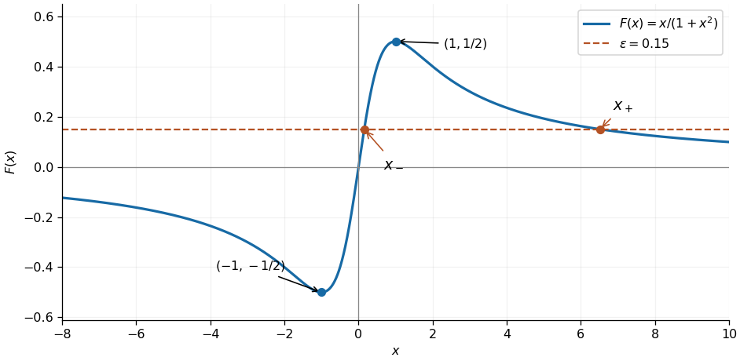

<h1 id="3/a/solution">Solution</h1>

↑ **Parent:** [A](../a.md)

The [function](../../../../function-split.md) $F$ is an [odd function](../../../../odd-function.md), passes through $(0,0)$, and has the horizontal [asymptote](../../../../asymptote.md) $F=0$ at both infinities. Its [derivative](../../../../derivative.md) is

$$
F'(x)=\frac{1-x^2}{(1+x^2)^2}.
$$

It decreases for $|x|>1$ and increases for $|x|<1$, with its lowest value $F(-1)=-1/2$ and highest value $F(1)=1/2$. These features determine the [graph of a function](../../../../graph-of-a-function.md) shown below.

For $0<\epsilon<1/2$, the equation is the [quadratic equation](../../../../quadratic-equation.md) $\epsilon x^2-x+\epsilon=0$. The [quadratic formula](../../../../quadratic-formula.md) gives exactly two real [equation roots](../../../../root-of-an-equation.md):

$$
x_\pm=\frac{1\pm\sqrt{1-4\epsilon^2}}{2\epsilon}.
$$

The [binomial series](../../../../binomial-series.md) gives $\sqrt{1-4\epsilon^2}=1-2\epsilon^2-2\epsilon^4-4\epsilon^6+O(\epsilon^8)$, hence the two requested [asymptotic expansions](../../../../asymptotic-expansion-split.md) are

$$
\boxed{x_-=\epsilon+\epsilon^3+O(\epsilon^5),\qquad
x_+=\epsilon^{-1}-\epsilon+O(\epsilon^3).}
$$

Their product is exactly one. Both are positive, with $x_-<1<x_+$; there are no negative [equation roots](../../../../root-of-an-equation.md) because $F(x)<0$ for $x<0$. At $\epsilon=1/2$ the two real [equation roots](../../../../root-of-an-equation.md) coincide at one, and for $\epsilon>1/2$ there are none. In the stated limit $\epsilon\to0^+$, these two branches are therefore exhaustive.

**[Figure 1](#3/a/image-two-positive-intersections-of-the-rational-function-with-a-small-positive-level). Two positive intersections of the rational function with a small positive level**. Original sketch of $F(x)=x/(1+x^2)$ with the two real [equation roots](../../../../root-of-an-equation.md) marked for $\epsilon=0.15$. The curve also shows its negative lowest point and positive highest point.

## ↑ Ancestors (12)

1. [A](../a.md)
2. [3](../../3.md)
3. [2021](../../../2021-split.md)
4. [Past exam of the differential equations 2 course of the University of Oxford](../../../split.md)
5. [Differential equations 2 course of the University of Oxford](../../../../differential-equations-2-course-of-the-university-of-oxford.md)
6. [Year 2 of the mathematics course of the University of Oxford](../../../../year-2-of-the-mathematics-course-of-the-university-of-oxford.md)
7. [Mathematics course of the University of Oxford](../../../../mathematics-course-of-the-university-of-oxford.md)
8. [Undergraduate course of the University of Oxford](../../../../undergraduate-course-of-the-university-of-oxford.md)
9. [Course of the University of Oxford](../../../../course-of-the-university-of-oxford.md)
10. [University of Oxford](../../../../university-of-oxford-split.md)
11. [List of universities](../../../../list-of-universities.md)
12. [Codex Wiki](../../../../split.md)
