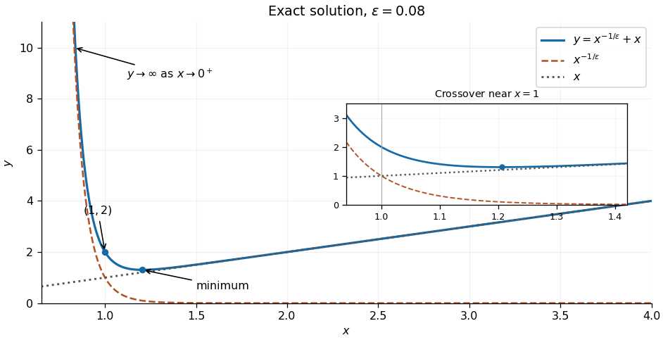

<h1 id="3/b/solution">Solution</h1>

↑ **Parent:** [B](../b.md)

The [power-law ansatz](../../../../power-law-ansatz.md) $y=x^r$ gives

$$
\epsilon r(r-1)+r-1=(r-1)(\epsilon r+1)=0.
$$

Since $\epsilon>0$, the [equation roots](../../../../root-of-an-equation.md) $1$ and $-1/\epsilon$ are distinct. The [Cauchy-Euler equation](../../../../cauchy-euler-equation.md) therefore has [general solution](../../../../general-solution.md)

$$
\boxed{y(x)=C_1x^{-1/\epsilon}+C_2x.}
$$

For $C_1=C_2=1$, the first [derivative](../../../../derivative.md) and second [derivative](../../../../derivative.md) are

$$
y'=1-\frac1\epsilon x^{-1/\epsilon-1},\qquad
y''=\frac{1+\epsilon}{\epsilon^2}x^{-1/\epsilon-2}>0.
$$

The [strictly convex function](../../../../strictly-convex-function.md) diverges to $+\infty$ as $x\to0^+$, passes through $(1,2)$, and has a unique lowest point at

$$
\boxed{x_{\min}=\epsilon^{-\epsilon/(1+\epsilon)},\qquad
y_{\min}=(1+\epsilon)x_{\min}.}
$$

As $x\to\infty$, $y-x\to0$, so the line $y=x$ is an [asymptote](../../../../asymptote.md). When $0<\epsilon<1$, the lowest point is to the right of one; at $\epsilon=1$ it is at one, and for $\epsilon>1$ it is to the left of one.

The ratio of the two terms is

$$
\frac{x^{-1/\epsilon}}x=x^{-(1+1/\epsilon)}.
$$

Thus $x^{-1/\epsilon}$ is larger for $0<x<1$, the terms are equal at $x=1$, and $x$ is larger for $x>1$. In the stronger asymptotic sense as $\epsilon\to0^+$, $x^{-1/\epsilon}$ dominates at each fixed $x<1$, and $x$ dominates at each fixed $x>1$. Their crossover has $|\log x|=O(\epsilon)$, equivalently $x=1+O(\epsilon)$, as described by the [power-law crossover in a singular perturbation](../../../../power-law-crossover-in-a-singular-perturbation.md). In that region $x=1+\epsilon X$ with bounded $X$ gives $y\sim1+e^{-X}$.

Substitute the proposed [regular perturbation](../../../../regular-perturbation.md) $y=y_0+\epsilon y_1+\cdots$ into the [differential equation](../../../../differential-equation-split.md). The leading and subsequent equations are

$$
xy_0'-y_0=0,\qquad xy_j'-y_j=-x^2y_{j-1}''\quad(j\geq1).
$$

Consequently $y_0=Cx$, and in fact each successive coefficient has the form $y_j=C_jx$, because the preceding second [derivative](../../../../derivative.md) is zero. The leading approximation is therefore

$$
\boxed{y\sim Cx;\qquad y\sim x\text{ when matched to the specified solution at fixed }x>1.}
$$

It has only one adjustable constant and generally cannot impose two independent [boundary conditions](../../../../boundary-condition.md). Those assumed in the question require a nonzero $x^{-1/\epsilon}$ coefficient, which a [power series](../../../../power-series.md) in $\epsilon$ cannot recover: at fixed $x>1$ it is exponentially small, and at fixed $x<1$ it grows without bound as $\epsilon\to0^+$. Thus the [regular perturbation](../../../../regular-perturbation.md) describes the specified solution only in the region to the right of the crossover, away from $x=1$; it is not a uniform approximation on $(0,\infty)$.

**[Figure 2](#3/b/image-the-exact-solution-and-its-two-power-law-contributions). The exact solution and its two power-law contributions**. Original sketch for $\epsilon=0.08$, showing the decreasing $x^{-1/\epsilon}$ contribution, the increasing $x$ contribution, their sum, and its lowest point. The inset resolves the region where both terms contribute.

## ↑ Ancestors (12)

1. [B](../b.md)
2. [3](../../3.md)
3. [2021](../../../2021-split.md)
4. [Past exam of the differential equations 2 course of the University of Oxford](../../../split.md)
5. [Differential equations 2 course of the University of Oxford](../../../../differential-equations-2-course-of-the-university-of-oxford.md)
6. [Year 2 of the mathematics course of the University of Oxford](../../../../year-2-of-the-mathematics-course-of-the-university-of-oxford.md)
7. [Mathematics course of the University of Oxford](../../../../mathematics-course-of-the-university-of-oxford.md)
8. [Undergraduate course of the University of Oxford](../../../../undergraduate-course-of-the-university-of-oxford.md)
9. [Course of the University of Oxford](../../../../course-of-the-university-of-oxford.md)
10. [University of Oxford](../../../../university-of-oxford-split.md)
11. [List of universities](../../../../list-of-universities.md)
12. [Codex Wiki](../../../../split.md)
