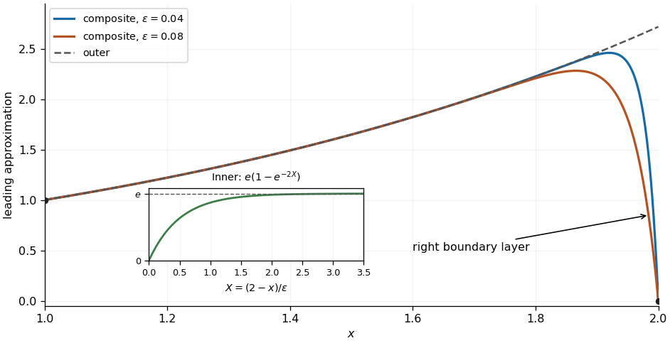

<h1 id="3/c/iii/solution">Solution</h1>

↑ **Parent:** [Iii](../iii.md)

The common value in the [overlap region](../../../../../overlap-region.md) is $e$. The [additive composite expansion](../../../../../additive-composite-expansion.md) therefore gives

$$
\boxed{y_{\mathrm{comp},0}(x)=y_{\mathrm{out},0}(x)+y_{\mathrm{in},0}(x)-e
=e^{x-1}-e\,e^{-2(2-x)/\epsilon}.}
$$

This leading approximation has $y_{\mathrm{comp},0}(2)=0$ and $y_{\mathrm{comp},0}(1)=1-e^{1-2/\epsilon}$; the left endpoint error is exponentially small. It rises from near one following the [outer solution](../../../../../outer-expansion.md) $e^{x-1}$, approaches a value close to $e$, then drops rapidly to zero in the right [boundary layer](../../../../../boundary-layer.md). Its first [derivative](../../../../../derivative.md) is

$$
y_{\mathrm{comp},0}'=e^{x-1}-\frac{2e}{\epsilon}e^{-2(2-x)/\epsilon},
\qquad y_{\mathrm{comp},0}'(2)=e\left(1-\frac2\epsilon\right).
$$

For small $\epsilon$ the largest value lies slightly inside the interval. For this [additive composite expansion](../../../../../additive-composite-expansion.md), the first [derivative](../../../../../derivative.md) vanishes at

$$
2-x_{\max}=\frac{\epsilon\log(2/\epsilon)}{2-\epsilon}
\sim\frac\epsilon2\log\frac2\epsilon.
$$

This locates the rounded top of the sketch; the rapid final drop has the $O(\epsilon)$ scale found above. The [additive composite expansion](../../../../../additive-composite-expansion.md) is a leading approximation, so its exponentially small endpoint error does not imply an exponentially small error throughout the interval: neglected algebraic corrections to the [outer expansion](../../../../../outer-expansion.md) and [inner expansion](../../../../../inner-expansion.md) remain.

**[Figure 3](#3/c/iii/image-leading-composite-approximation-with-a-boundary-layer-at-the-right-endpoint). Leading composite approximation with a boundary layer at the right endpoint**. Original sketches for $\epsilon=0.04$ and $0.08$. The dashed curve is the [outer solution](../../../../../outer-expansion.md) $e^{x-1}$; the inset plots the leading [inner expansion](../../../../../inner-expansion.md) $e(1-e^{-2X})$ against $X=(2-x)/\epsilon$.

## ↑ Ancestors (13)

1. [Iii](../iii.md)
2. [C](../../c.md)
3. [3](../../../3.md)
4. [2021](../../../../2021-split.md)
5. [Past exam of the differential equations 2 course of the University of Oxford](../../../../split.md)
6. [Differential equations 2 course of the University of Oxford](../../../../../differential-equations-2-course-of-the-university-of-oxford.md)
7. [Year 2 of the mathematics course of the University of Oxford](../../../../../year-2-of-the-mathematics-course-of-the-university-of-oxford.md)
8. [Mathematics course of the University of Oxford](../../../../../mathematics-course-of-the-university-of-oxford.md)
9. [Undergraduate course of the University of Oxford](../../../../../undergraduate-course-of-the-university-of-oxford.md)
10. [Course of the University of Oxford](../../../../../course-of-the-university-of-oxford.md)
11. [University of Oxford](../../../../../university-of-oxford-split.md)
12. [List of universities](../../../../../list-of-universities.md)
13. [Codex Wiki](../../../../../split.md)
