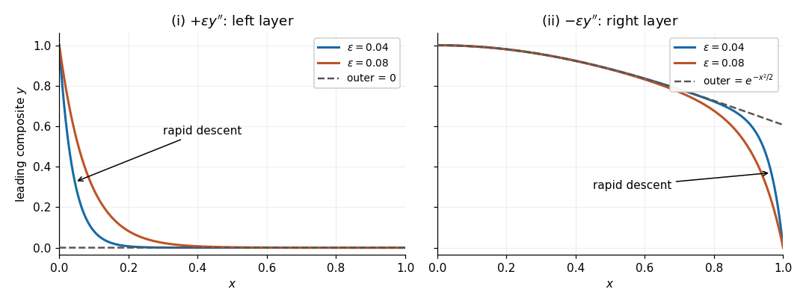

# 2023

↑ **Parent:** [Past exam of the differential equations 2 course of the University of Oxford](../past-exam-of-the-differential-equations-2-course-of-the-university-of-oxford.md)

Solutions to all three questions of the [University of Oxford](../university-of-oxford.md) Differential Equations II paper, sat on 22 June 2023. Source: [released examination PDF, parent PDF pages 118–120; questions on pages 119–120](https://www.whatdotheyknow.com/request/bsc_mathematics_part_a_examinati/response/2820674/attach/3/FOI%20202410%20944%20Data.pdf#page=118). Question statements are omitted. In Question 2(b), the usual interpretation that the forcing extends continuously to the closed interval is distinguished from continuity only in the interior.

**Table of contents**

- [1](#1)
  - [a](#1/a)
    - [i](#1/a/i)
      - [Solution](#1/a/i/solution)
    - [ii](#1/a/ii)
      - [Solution](#1/a/ii/solution)
  - [b](#1/b)
    - [i](#1/b/i)
      - [Solution](#1/b/i/solution)
    - [ii](#1/b/ii)
      - [Solution](#1/b/ii/solution)
  - [c](#1/c)
    - [i](#1/c/i)
      - [Solution](#1/c/i/solution)
    - [ii](#1/c/ii)
      - [Solution](#1/c/ii/solution)
- [2](#2)
  - [a](#2/a)
    - [i](#2/a/i)
      - [Solution](#2/a/i/solution)
    - [ii](#2/a/ii)
      - [Solution](#2/a/ii/solution)
  - [b](#2/b)
    - [i](#2/b/i)
      - [Solution](#2/b/i/solution)
    - [ii](#2/b/ii)
      - [Solution](#2/b/ii/solution)
  - [c](#2/c)
    - [Solution](#2/c/solution)
- [3](#3)
  - [a](#3/a)
    - [i](#3/a/i)
      - [Solution](#3/a/i/solution)
    - [ii](#3/a/ii)
      - [Solution](#3/a/ii/solution)
  - [b](#3/b)
    - [i](#3/b/i)
      - [Solution](#3/b/i/solution)
    - [ii](#3/b/ii)
      - [Solution](#3/b/ii/solution)

## 1

↑ **Parent:** [2023](2023.md)

<h3 id="1/a">a</h3>

↑ **Parent:** [1](#1)

<h4 id="1/a/i">i</h4>

↑ **Parent:** [A](#1/a)

<h5 id="1/a/i/solution">Solution</h5>

↑ **Parent:** [I](#1/a/i)

The [characteristic equation](../linear-ordinary-differential-equation.md#characteristic-equation-of-a-constant-coefficient-differential-equation) of the [linear ordinary differential equation](../linear-ordinary-differential-equation.md) is $r^2+2r+2=0$, with roots $-1\pm i$. A real pair of [homogeneous solutions](../linear-ordinary-differential-equation.md#homogeneous-solution) is therefore

$$
\boxed{y_1(x)=e^{-x}\cos x,\qquad y_2(x)=e^{-x}\sin x}.
$$

Their [Wronskian](../linear-ordinary-differential-equation.md#wronskian), with the convention $W=y_1y_2'-y_1'y_2$, is

$$
W(x)=e^{-2x}\{\cos x(\cos x-\sin x)+(\sin x+\cos x)\sin x\}
=\boxed{e^{-2x}\ne0}.
$$

Thus the two functions are [linearly independent](../vector-space.md#linear-independence) throughout the interval and span its [homogeneous solutions](../linear-ordinary-differential-equation.md#homogeneous-solution).

<h4 id="1/a/ii">ii</h4>

↑ **Parent:** [A](#1/a)

<h5 id="1/a/ii/solution">Solution</h5>

↑ **Parent:** [Ii](#1/a/ii)

Use the unweighted [inner product](../inner-product.md) $\langle w,y\rangle=\int_0^a\overline w y\,dx$. Two applications of [integration by parts](../calculus.md#integration-by-parts) give

$$
\int_0^a\overline w(y''+2y'+2y)\,dx
=\int_0^a(\overline w''-2\overline w'+2\overline w)y\,dx
+[\overline w y'-\overline w'y+2\overline w y]_0^a.
$$

The given [boundary conditions](../differential-equation.md#boundary-condition) set $y=0$ at both ends, but leave $y'(0)$ and $y'(a)$ independently variable. The remaining boundary term vanishes for every admissible $y$ precisely when $w(0)=w(a)=0$. Consequently the [formal adjoint](../hilbert-space.md#formal-adjoint) and the boundary conditions specifying the [adjoint operator](../hilbert-space.md#adjoint-operator) are

$$
\boxed{\mathcal L^*w=w''-2w'+2w,\qquad w(0)=w(a)=0}.
$$

<h3 id="1/b">b</h3>

↑ **Parent:** [1](#1)

<h4 id="1/b/i">i</h4>

↑ **Parent:** [B](#1/b)

<h5 id="1/b/i/solution">Solution</h5>

↑ **Parent:** [I](#1/b/i)

Set $a=\pi/2$. To construct the [Green's function](../green-s-function.md) from a [Dirac delta function](../distribution-theory.md#dirac-delta-function), require $\mathcal L_xg(x,\xi)=\delta(x-\xi)$ and zero endpoint values. Away from $x=\xi$, the [homogeneous solutions](../linear-ordinary-differential-equation.md#homogeneous-solution) satisfying the left and right [boundary conditions](../differential-equation.md#boundary-condition) are respectively

$$
u(x)=e^{-x}\sin x,\qquad v(x)=e^{-x}\cos x.
$$

Write $g=A(\xi)u(x)$ for $x<\xi$ and $g=B(\xi)v(x)$ for $x>\xi$. A discontinuity in $g$ would generate a derivative of the [Dirac delta function](../distribution-theory.md#dirac-delta-function), which is absent from the desired equation. Thus $g$ is continuous. Integrating that equation through $\xi$ then gives the [jump condition](../differential-equation.md#jump-condition)

$$
g_x(\xi^+,\xi)-g_x(\xi^-,\xi)=1.
$$

The resulting two equations are $Au(\xi)=Bv(\xi)$ and $Bv'(\xi)-Au'(\xi)=1$. Since the [Wronskian](../linear-ordinary-differential-equation.md#wronskian) $uv'-u'v=-e^{-2\xi}$, they give

$$
\boxed{g(x,\xi)=-e^{\xi-x}
\begin{cases}
\sin x\cos\xi,&0\leq x\leq\xi,\\
\sin\xi\cos x,&\xi\leq x\leq\pi/2.
\end{cases}}
$$

Both endpoint values vanish. At $x=\xi$, subtracting the two first [derivatives](../calculus.md#derivative) gives $\sin^2\xi+\cos^2\xi=1$, verifying the sign and normalization of the [Dirac delta function](../distribution-theory.md#dirac-delta-function).

<h4 id="1/b/ii">ii</h4>

↑ **Parent:** [B](#1/b)

<h5 id="1/b/ii/solution">Solution</h5>

↑ **Parent:** [Ii](#1/b/ii)

The [homogeneous solution](../linear-ordinary-differential-equation.md#homogeneous-solution) $h(x)=e^{-x}\cos x$ already has the prescribed endpoint values. Thus $z=y-h$ has zero [boundary conditions](../differential-equation.md#boundary-condition) and satisfies $\mathcal Lz=f$. The [Green's function](../green-s-function.md) gives

$$
\boxed{y(x)=e^{-x}\cos x+\int_0^{\pi/2}g(x,\xi)f(\xi)\,d\xi}.
$$

Equivalently, splitting the [integral](../integral.md) at $\xi=x$ gives the explicit formula

$$
y(x)=e^{-x}\left[
\cos x\left(1-\int_0^xe^\xi\sin\xi\,f(\xi)\,d\xi\right)
-\sin x\int_x^{\pi/2}e^\xi\cos\xi\,f(\xi)\,d\xi
\right].
$$

Any difference between two solutions would be $e^{-x}(C\cos x+D\sin x)$ with zero endpoint values, forcing $C=D=0$. The displayed solution is therefore unique.

<h3 id="1/c">c</h3>

↑ **Parent:** [1](#1)

<h4 id="1/c/i">i</h4>

↑ **Parent:** [C](#1/c)

<h5 id="1/c/i/solution">Solution</h5>

↑ **Parent:** [I](#1/c/i)

At $a=\pi$, the nonzero [homogeneous solution](../linear-ordinary-differential-equation.md#homogeneous-solution) $e^{-x}\sin x$ satisfies both zero [boundary conditions](../differential-equation.md#boundary-condition). Thus the [boundary value problem](../boundary-value-problem.md) has a nontrivial [kernel](../kernel-of-a-linear-map.md) and cannot have an inverse for arbitrary forcing.

More directly, the [adjoint operator](../hilbert-space.md#adjoint-operator) has the zero-endpoint [homogeneous solution](../linear-ordinary-differential-equation.md#homogeneous-solution) $w(x)=e^x\sin x$. If an ordinary [Green's function](../green-s-function.md) existed, the [integration by parts](../calculus.md#integration-by-parts) identity would imply

$$
0=\int_0^\pi w(x)\mathcal L_xg(x,\xi)\,dx
=\int_0^\pi w(x)\delta(x-\xi)\,dx=w(\xi).
$$

But $w(\xi)\ne0$ for $0<\xi<\pi$. This contradiction rules out the [Green's function](../green-s-function.md) for the unmodified operator. It is the [Fredholm alternative](../compact-operator.md#fredholm-alternative) obstruction.

<h4 id="1/c/ii">ii</h4>

↑ **Parent:** [C](#1/c)

<h5 id="1/c/ii/solution">Solution</h5>

↑ **Parent:** [Ii](#1/c/ii)

The nonzero endpoint data contribute to the [Fredholm alternative](../compact-operator.md#fredholm-alternative) condition. With $w=e^x\sin x$, the same [integration by parts](../calculus.md#integration-by-parts) identity gives

$$
\int_0^\pi w\mathcal Ly\,dx
=[wy'-w'y+2wy]_0^\pi
=-w'(\pi)y(\pi)+w'(0)y(0)=1.
$$

For the specified forcing the left side is $A\int_0^\pi\sin^2x\,dx=A\pi/2$. Hence

$$
\boxed{A=\frac2\pi}.
$$

To verify sufficiency, set $y=e^{-x}u$. Direct [differentiation](../calculus.md#differentiation) gives $\mathcal Ly=e^{-x}(u''+u)$. At this value of $A$, a [particular solution](../linear-ordinary-differential-equation.md#particular-solution) of $u''+u=(2/\pi)\sin x$ is $-(x/\pi)\cos x$. The complete family obeying the two [boundary conditions](../differential-equation.md#boundary-condition) is

$$
\boxed{y(x)=e^{-x}\left[\left(1-\frac{x}{\pi}\right)\cos x+C\sin x\right],\qquad C\in\mathbb R}.
$$

The arbitrary constant records the one-dimensional [kernel](../kernel-of-a-linear-map.md); existence does not imply uniqueness here.

## 2

↑ **Parent:** [2023](2023.md)

<h3 id="2/a">a</h3>

↑ **Parent:** [2](#2)

<h4 id="2/a/i">i</h4>

↑ **Parent:** [A](#2/a)

<h5 id="2/a/i/solution">Solution</h5>

↑ **Parent:** [I](#2/a/i)

Put $N=n(n+1)$. After division by $1-x^2$, the [Legendre differential equation](../linear-ordinary-differential-equation.md#legendre-differential-equation) has coefficients

$$
p(x)=\frac{-2x}{1-x^2},\qquad q(x)=\frac{N}{1-x^2}.
$$

Both are [analytic functions](../holomorphic-function.md) at zero, so $\boxed{x=0\text{ is an ordinary point}}$. At either $x_0=\pm1$, $p$ has a genuine [simple pole](../isolated-singularity.md#simple-pole); hence these are singular points even when $n=0$ makes $q$ vanish. However,

$$
\lim_{x\to x_0}(x-x_0)p(x)=1,\qquad
\lim_{x\to x_0}(x-x_0)^2q(x)=0,
$$

and both products extend analytically across $x_0$. By the [regular singular point criterion for a second-order equation](../complex-analysis.md#regular-singular-point-criterion-for-a-second-order-equation),

$$
\boxed{x=-1\text{ and }x=1\text{ are regular singular points}}.
$$

None of the three specified points is an [irregular singular point](../complex-analysis.md#irregular-singular-point).

<h4 id="2/a/ii">ii</h4>

↑ **Parent:** [A](#2/a)

<h5 id="2/a/ii/solution">Solution</h5>

↑ **Parent:** [Ii](#2/a/ii)

Use $t=x+1$. The [Legendre differential equation](../linear-ordinary-differential-equation.md#legendre-differential-equation) becomes

$$
t(2-t)y_{tt}+2(1-t)y_t+Ny=0.
$$

Substituting a [Frobenius series](../complex-analysis.md#frobenius-solution) $y=t^r\sum_{k\geq0}a_kt^k$, $a_0\ne0$, gives the [indicial equation](../linear-ordinary-differential-equation.md#indicial-equation) $2r^2=0$: the [indicial root](../linear-ordinary-differential-equation.md#indicial-root) zero is repeated. For $r=0$, the coefficient of $t^k$ yields

$$
2(k+1)^2a_{k+1}+[n(n+1)-k(k+1)]a_k=0,
$$

or

$$
\boxed{a_{k+1}=\frac{(k-n)(k+n+1)}{2(k+1)^2}a_k}.
$$

For $0\leq k<n$ the multiplying factor is nonzero. At $k=n$ it vanishes, so $a_{n+1}$ and all later coefficients are zero. Thus one solution is a [polynomial](../polynomial.md) of exact [polynomial degree](../polynomial.md#degree-of-a-polynomial) $n$, including a nonzero constant when $n=0$. Denote a chosen normalization by $P_n$.

The [linear recurrence relation](../algebra.md#linear-recurrence-relation) determines every analytic coefficient from $a_0$, so there cannot be a second independent analytic solution at $t=0$. To see the required logarithm explicitly, [reduction of order](../linear-ordinary-differential-equation.md#reduction-of-order) gives the second solution locally as

$$
P_n(x)\int^x\frac{ds}{(1-s^2)P_n(s)^2}.
$$

Near $t=0$, the integrand is $1/(2a_0^2t)$ plus an [analytic function](../holomorphic-function.md). After rescaling the second solution, its form is therefore

$$
\boxed{y_2(x)=P_n(x)\log(x+1)+\sum_{k=0}^\infty b_k(x+1)^k}.
$$

The analytic remainder converges locally; its constant term may be set to zero by adding a multiple of $P_n$. The nonzero logarithmic coefficient makes $y_2$ [linearly independent](../vector-space.md#linear-independence) of $P_n$. This [Frobenius expansion of the Legendre equation at an endpoint](../linear-ordinary-differential-equation.md#frobenius-expansion-of-the-legendre-equation-at-an-endpoint) gives a [Logarithmic Frobenius solution](../complex-analysis.md#logarithmic-solution-from-a-repeated-frobenius-exponent); the same endpoint calculation at $x=1$ explains why the independent [Legendre function of the second kind](../linear-ordinary-differential-equation.md#legendre-function-of-the-second-kind) is excluded when boundedness at both ends is required.

<h3 id="2/b">b</h3>

↑ **Parent:** [2](#2)

<h4 id="2/b/i">i</h4>

↑ **Parent:** [B](#2/b)

<h5 id="2/b/i/solution">Solution</h5>

↑ **Parent:** [I](#2/b/i)

Write the operator in divergence form:

$$
\mathcal Ly=\big((1-x^2)y'\big)'.
$$

The [Legendre differential equation](../linear-ordinary-differential-equation.md#legendre-differential-equation) therefore gives

$$
\boxed{\mathcal LP_n=-n(n+1)P_n,\qquad n=0,1,2,\ldots}.
$$

These are the [eigenvalues](../linear-operator-theory.md#eigenvalue) of $\mathcal L$. With the common positive-sign convention for a [Sturm-Liouville problem](../sturm-liouville-theory.md#sturm-liouville-problem), use $-\mathcal L$ instead:

$$
-\big(pP_n'\big)'=\lambda_n wP_n,\qquad
\boxed{p=1-x^2,\quad q=0,\quad w=1,\quad\lambda_n=n(n+1)}.
$$

This is a singular [Sturm-Liouville problem](../sturm-liouville-theory.md#sturm-liouville-problem), because $p$ vanishes at the endpoints. Bounded [eigenfunctions](../linear-operator-theory.md#eigenfunction) select the nonlogarithmic branches and satisfy $pP_n'\to0$ there. The [Lagrange identity for a Sturm-Liouville operator](../sturm-liouville-theory.md#lagrange-identity-for-a-sturm-liouville-operator) gives

$$
[m(m+1)-n(n+1)]\int_{-1}^1P_mP_n\,dx
=[(1-x^2)(P_mP_n'-P_nP_m')]_{-1}^1=0.
$$

The [eigenvalues](../linear-operator-theory.md#eigenvalue) are distinct, proving the [orthogonality](../inner-product.md#orthogonal-vectors) condition

$$
\boxed{\int_{-1}^1P_m(x)P_n(x)\,dx=0\quad(m\ne n)}.
$$

The weight is one. No choice of normalization of the [Legendre polynomials](../linear-ordinary-differential-equation.md#legendre-polynomial) is needed for this conclusion.

<h4 id="2/b/ii">ii</h4>

↑ **Parent:** [B](#2/b)

<h5 id="2/b/ii/solution">Solution</h5>

↑ **Parent:** [Ii](#2/b/ii)

First take the usual endpoint-regular interpretation $f\in C([-1,1])$. Integrating the divergence form shows that $F=(1-x^2)y'$ has finite endpoint limits. A nonzero limit would make $y'$ proportional to $1/(1\mp x)$ near that endpoint, forcing a logarithmically unbounded $y$. Thus boundedness requires $F(-1)=F(1)=0$, and consequently

$$
\boxed{\int_{-1}^1f(x)\,dx=0}.
$$

This is [orthogonality](../inner-product.md#orthogonal-vectors) to the constant [eigenfunction](../linear-operator-theory.md#eigenfunction) $P_0$, hence the [Fredholm alternative](../compact-operator.md#fredholm-alternative) condition. It is also sufficient under the stated endpoint regularity: put

$$
F(x)=\int_{-1}^xf(t)\,dt,\qquad
y(x)=C+\int_0^x\frac{F(s)}{1-s^2}\,ds.
$$

If $M=\max|f|$, the zero-mean condition gives $|F(s)|\leq M\min(1+s,1-s)$. Hence the last integrand is bounded, so $y$ extends continuously to both endpoints. Any two bounded solutions differ by a constant: their difference solves $((1-x^2)z')'=0$, whose other solution is $\tfrac12\log((1+x)/(1-x))$.

For the requested [eigenfunction expansion](../algebra.md#eigenfunction-expansion), set

$$
N_k=\int_{-1}^1P_k(t)^2\,dt,\qquad
f_k=\frac{\int_{-1}^1f(t)P_k(t)\,dt}{N_k}.
$$

The [Legendre polynomials](../linear-ordinary-differential-equation.md#legendre-polynomial) span all [polynomials](../polynomial.md), so their completeness follows from the [Weierstrass approximation theorem](../functional-analysis.md#weierstrass-approximation-theorem). Projecting $\mathcal Ly=f$ onto each [eigenfunction](../linear-operator-theory.md#eigenfunction) gives $-k(k+1)y_k=f_k$ for $k\geq1$. The zero mode is free, while $f_0=0$. Thus the full family is

$$
\boxed{y(x)=C-\sum_{k=1}^\infty
\frac{P_k(x)}{k(k+1)}
\frac{\int_{-1}^1f(t)P_k(t)\,dt}{\int_{-1}^1P_k(t)^2\,dt},\qquad C\in\mathbb R}.
$$

The formula is unchanged by rescaling any $P_k$. For the usual normalization $P_k(1)=1$, the facts $|P_k(x)|\leq1$ on $[-1,1]$ and $N_k=2/(2k+1)$, together with the [Cauchy-Schwarz inequality](../probability-and-statistics.md#cauchy-schwarz-inequality), bound each summand by a constant times $k^{-3/2}$. The series therefore converges absolutely and uniformly. Its identification with the preceding integral solution avoids unjustified termwise second [differentiation](../calculus.md#differentiation).

There is a source ambiguity: continuity only on $(-1,1)$ does not supply the endpoint control used above. Even for integrable forcing, zero mean alone is insufficient. For example, let

$$
H(x)=\log\frac{e}{1-x^2},\qquad
F(x)=\frac1{H(x)},\qquad
f(x)=F'(x)=\frac{-2x}{(1-x^2)H(x)^2}.
$$

This $f$ is continuous in the interior, absolutely integrable, and has zero mean because $F(\pm1)=0$. Yet every candidate with zero endpoint values of $(1-x^2)y'$ has

$$
y'(x)=\frac1{(1-x^2)H(x)},
$$

whose [integral](../integral.md) diverges logarithmically in $H$ at each endpoint. Thus no bounded solution exists. For a merely interior-continuous $f$, the exact criterion is that some constant $B$ makes

$$
\int_0^x\frac{B+\int_0^sf(t)\,dt}{1-s^2}\,ds
$$

bounded as $x$ approaches both endpoints. The [Bounded solvability for the Legendre operator](../sturm-liouville-theory.md#bounded-solvability-for-the-legendre-operator) criterion above covers the intended regular forcing and makes this endpoint limitation explicit.

<h3 id="2/c">c</h3>

↑ **Parent:** [2](#2)

<h4 id="2/c/solution">Solution</h4>

↑ **Parent:** [C](#2/c)

When $n=0$, the forcing has nonzero integral $\int_{-1}^11\,dx=2$, violating the [Fredholm alternative](../compact-operator.md#fredholm-alternative) condition. There is no bounded solution. Directly, integration gives $(1-x^2)y'=x+B$; cancellation of its logarithmic divergence at $x=-1$ requires $B=1$, while cancellation at $x=1$ requires $B=-1$.

For $n\geq1$, the constant $1/[n(n+1)]$ is a [particular solution](../linear-ordinary-differential-equation.md#particular-solution). Subtract it from any solution. The remainder satisfies the [Legendre differential equation](../linear-ordinary-differential-equation.md#legendre-differential-equation), whose [general solution](../linear-ordinary-differential-equation.md#general-solution) is a combination of $P_n$ and the logarithmically unbounded [Legendre function of the second kind](../linear-ordinary-differential-equation.md#legendre-function-of-the-second-kind). Boundedness removes the latter coefficient, giving

$$
\boxed{\begin{cases}
\text{no bounded solution},&n=0,\\
y(x)=\dfrac1{n(n+1)}+CP_n(x),\quad C\in\mathbb R,&n\geq1.
\end{cases}}
$$

The constant forcing is [orthogonal](../inner-product.md#orthogonal-vectors) to $P_n$ for $n\geq1$, consistently with [Orthogonality of Legendre polynomials](../linear-ordinary-differential-equation.md#orthogonality-of-legendre-polynomials) and the [Fredholm alternative](../compact-operator.md#fredholm-alternative).

## 3

↑ **Parent:** [2023](2023.md)

<h3 id="3/a">a</h3>

↑ **Parent:** [3](#3)

<h4 id="3/a/i">i</h4>

↑ **Parent:** [A](#3/a)

<h5 id="3/a/i/solution">Solution</h5>

↑ **Parent:** [I](#3/a/i)

Consider real roots. Every zero at $\epsilon=0$ is $k\pi$, $k\in\mathbb Z$, and its [derivative](../calculus.md#derivative) $\cos(k\pi)=(-1)^k$ is nonzero. For a [regular perturbation](../asymptotic-expansion.md#regular-perturbation), write $x=k\pi+\delta$. The [Taylor series](../calculus.md#taylor-series)

$$
\sin(k\pi+\delta)=(-1)^k\left(\delta-\frac{\delta^3}{6}+O(\delta^5)\right)
$$

gives $\delta=(-1)^k\epsilon+O(\epsilon^3)$. Thus, through the requested order,

$$
\boxed{x_k=k\pi+(-1)^k\epsilon+O(\epsilon^3),\qquad k\in\mathbb Z}.
$$

There is no quadratic term. The exact parametrization $x_k=k\pi+(-1)^k\arcsin\epsilon$ also verifies completeness and the remainder order for $|\epsilon|<1$.

<h4 id="3/a/ii">ii</h4>

↑ **Parent:** [A](#3/a)

<h5 id="3/a/ii/solution">Solution</h5>

↑ **Parent:** [Ii](#3/a/ii)

Take $\epsilon\to0^+$. There are two real branches, on different scales. For a root tending to zero, the [Taylor series](../calculus.md#taylor-series) gives

$$
-\frac{x^3}{6}+O(x^5)=\epsilon(1-x^2).
$$

The [dominant balance](../asymptotic-expansion.md#dominant-balance) is $x^3\sim-6\epsilon$, so a [fractional-power root expansion](../analysis.md#fractional-power-root-expansion) yields

$$
\boxed{x_-\sim-(6\epsilon)^{1/3}}.
$$

More precisely $x_-=-(6\epsilon)^{1/3}+O(\epsilon)$. An ordinary [power series](../sequence-and-series.md#power-series) in integer powers of $\epsilon$ would miss this scale.

There is also a root escaping to positive infinity. Boundedness of the [sine](../geometry-and-topology.md#sine) term makes the leading [dominant balance](../asymptotic-expansion.md#dominant-balance) $x-\epsilon x^2=0$. The nonzero branch is

$$
\boxed{x_+\sim\epsilon^{-1}}.
$$

Indeed the equation rearranges to $\epsilon x_+^2-x_+=\epsilon-\sin x_+$, which yields $x_+=\epsilon^{-1}+O(1)$ on this branch. The bounded oscillatory correction need not have a constant limiting value.

To check that these are all the real solutions, solve for the parameter:

$$
\epsilon=E(x):=\frac{x-\sin x}{x^2-1}.
$$

Positive values occur only on $(-1,0)$ and $(1,\infty)$; $x=\pm1$ are not roots. A useful exact [derivative](../calculus.md#derivative) is

$$
E'(x)=-\frac{2\{x\cos(x/2)-\sin(x/2)\}^2}{(x^2-1)^2}\leq0.
$$

It vanishes only at isolated points, so $E$ is strictly decreasing on each of these intervals. Its endpoint limits are $+\infty$ and zero on each interval. This [monotone parametrization of sine perturbation roots](../asymptotic-expansion.md#monotone-parametrization-of-sine-perturbation-roots) gives exactly one root in each interval for every $\epsilon>0$, proving that both asymptotic branches, and no others, have been included. If negative small parameters are allowed, the transformation $(x,\epsilon)\mapsto(-x,-\epsilon)$ reflects these two branches and gives all real solutions for that sign as well.

<h3 id="3/b">b</h3>

↑ **Parent:** [3](#3)

<h4 id="3/b/i">i</h4>

↑ **Parent:** [B](#3/b)

<h5 id="3/b/i/solution">Solution</h5>

↑ **Parent:** [I](#3/b/i)

For the positive coefficient of $y''$, setting $\epsilon=0$ gives the reduced equation $y_0'+xy_0=0$, with [general solution](../linear-ordinary-differential-equation.md#general-solution) $y_0=Ce^{-x^2/2}$. A fast decaying [homogeneous solution](../linear-ordinary-differential-equation.md#homogeneous-solution) of $\epsilon y''+y'=0$ is $e^{-x/\epsilon}$, placing the [boundary layer](../continuum-mechanics.md#boundary-layer) at the left endpoint. Thus use the right [boundary condition](../differential-equation.md#boundary-condition) for the [outer solution](../singular-perturbation.md#outer-expansion): $y_0(1)=0$ implies

$$
\boxed{y_{\mathrm{out},0}(x)=0}.
$$

The [dominant balance](../asymptotic-expansion.md#dominant-balance) $\epsilon/\delta^2\sim1/\delta$ gives width $\delta=\epsilon$. With the [inner variable](../singular-perturbation.md#inner-variable) $X=x/\epsilon$ and $Y(X)=y(\epsilon X)$, the exact rescaled equation is

$$
Y_{XX}+Y_X+\epsilon^2XY=0.
$$

At leading order, $Y_{0,XX}+Y_{0,X}=0$, so $Y_0=A+Be^{-X}$. The [asymptotic matching condition](../singular-perturbation.md#asymptotic-matching-condition) $Y_0(\infty)=y_{\mathrm{out},0}(0)=0$ sets $A=0$, and $Y_0(0)=1$ sets $B=1$. Therefore

$$
\boxed{Y_0(X)=e^{-X},\qquad y_{\mathrm{comp},0}(x)=e^{-x/\epsilon}}.
$$

The [additive composite expansion](../singular-perturbation.md#additive-composite-expansion) has zero overlap to subtract. Its graph starts at one, decreases steeply over $x=O(\epsilon)$, and then stays close to zero; its initial slope is $-1/\epsilon$. The right endpoint discrepancy $e^{-1/\epsilon}$ is exponentially small. The left panel of the figure below sketches this profile. A right-end [inner expansion](../singular-perturbation.md#inner-expansion) would instead contain a growing $e^X$ term and could not repair the left endpoint mismatch.

<h4 id="3/b/ii">ii</h4>

↑ **Parent:** [B](#3/b)

<h5 id="3/b/ii/solution">Solution</h5>

↑ **Parent:** [Ii](#3/b/ii)

With the negative coefficient of $y''$, the reduced equation is unchanged, but the fast mode now decays away from the right endpoint. Apply the left [boundary condition](../differential-equation.md#boundary-condition) to the [outer solution](../singular-perturbation.md#outer-expansion), giving

$$
\boxed{y_{\mathrm{out},0}(x)=e^{-x^2/2}}.
$$

The [boundary layer](../continuum-mechanics.md#boundary-layer) still has width $O(\epsilon)$. Put $X=(1-x)/\epsilon$ and $Y(X)=y(1-\epsilon X)$. The rescaled equation is

$$
-Y_{XX}-Y_X+\epsilon(1-\epsilon X)Y=0.
$$

Its leading [inner expansion](../singular-perturbation.md#inner-expansion) has $Y_0=A+Be^{-X}$. The [asymptotic matching condition](../singular-perturbation.md#asymptotic-matching-condition) is $Y_0(\infty)=e^{-1/2}$, while $Y_0(0)=0$. Thus

$$
\boxed{Y_0(X)=e^{-1/2}(1-e^{-X})}.
$$

Subtracting the overlap $e^{-1/2}$ in the [additive composite expansion](../singular-perturbation.md#additive-composite-expansion) gives

$$
\boxed{y_{\mathrm{comp},0}(x)=e^{-x^2/2}-e^{-1/2}e^{-(1-x)/\epsilon}}.
$$

Its graph starts exponentially close to one, follows the gently decreasing [outer solution](../singular-perturbation.md#outer-expansion), and drops from near $e^{-1/2}$ to zero in a right [boundary layer](../continuum-mechanics.md#boundary-layer) of width $O(\epsilon)$. The right endpoint value is exactly zero; the left endpoint error is $-e^{-1/2-1/\epsilon}$. Its right endpoint slope is $-e^{-1/2}(1+1/\epsilon)$, showing the rapid final descent.

**[Figure 1](#3/b/ii/image-leading-composite-profiles-for-the-two-signs-of-the-highest-derivative). Leading composite profiles for the two signs of the highest derivative**. Original sketches from the derived [additive composite expansions](../singular-perturbation.md#additive-composite-expansion), for $\epsilon=0.04$ and $0.08$. Left: the positive sign gives a left [boundary layer](../continuum-mechanics.md#boundary-layer) and zero [outer solution](../singular-perturbation.md#outer-expansion). Right: the negative sign gives a right [boundary layer](../continuum-mechanics.md#boundary-layer) and the [outer solution](../singular-perturbation.md#outer-expansion) $e^{-x^2/2}$. Dashed curves show the corresponding [outer solutions](../singular-perturbation.md#outer-expansion).

## ↑ Ancestors (9)

1. [Past exam of the differential equations 2 course of the University of Oxford](../past-exam-of-the-differential-equations-2-course-of-the-university-of-oxford.md)
2. [Differential equations 2 course of the University of Oxford](../university-of-oxford.md#differential-equations-2-course-of-the-university-of-oxford)
3. [Year 2 of the mathematics course of the University of Oxford](../university-of-oxford.md#year-2-of-the-mathematics-course-of-the-university-of-oxford)
4. [Mathematics course of the University of Oxford](../university-of-oxford.md#mathematics-course-of-the-university-of-oxford)
5. [Undergraduate course of the University of Oxford](../university-of-oxford.md#undergraduate-course-of-the-university-of-oxford)
6. [Course of the University of Oxford](../university-of-oxford.md#course-of-the-university-of-oxford)
7. [University of Oxford](../university-of-oxford.md)
8. [List of universities](../README.md#list-of-universities)
9. [Codex Wiki](../README.md)
