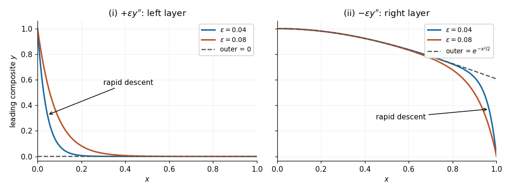

<h1 id="3/b/ii/solution">Solution</h1>

↑ **Parent:** [Ii](../ii.md)

With the negative coefficient of $y''$, the reduced equation is unchanged, but the fast mode now decays away from the right endpoint. Apply the left [boundary condition](../../../../../boundary-condition.md) to the [outer solution](../../../../../outer-expansion.md), giving

$$
\boxed{y_{\mathrm{out},0}(x)=e^{-x^2/2}}.
$$

The [boundary layer](../../../../../boundary-layer.md) still has width $O(\epsilon)$. Put $X=(1-x)/\epsilon$ and $Y(X)=y(1-\epsilon X)$. The rescaled equation is

$$
-Y_{XX}-Y_X+\epsilon(1-\epsilon X)Y=0.
$$

Its leading [inner expansion](../../../../../inner-expansion.md) has $Y_0=A+Be^{-X}$. The [asymptotic matching condition](../../../../../asymptotic-matching-condition.md) is $Y_0(\infty)=e^{-1/2}$, while $Y_0(0)=0$. Thus

$$
\boxed{Y_0(X)=e^{-1/2}(1-e^{-X})}.
$$

Subtracting the overlap $e^{-1/2}$ in the [additive composite expansion](../../../../../additive-composite-expansion.md) gives

$$
\boxed{y_{\mathrm{comp},0}(x)=e^{-x^2/2}-e^{-1/2}e^{-(1-x)/\epsilon}}.
$$

Its graph starts exponentially close to one, follows the gently decreasing [outer solution](../../../../../outer-expansion.md), and drops from near $e^{-1/2}$ to zero in a right [boundary layer](../../../../../boundary-layer.md) of width $O(\epsilon)$. The right endpoint value is exactly zero; the left endpoint error is $-e^{-1/2-1/\epsilon}$. Its right endpoint slope is $-e^{-1/2}(1+1/\epsilon)$, showing the rapid final descent.

**[Figure 1](#3/b/ii/image-leading-composite-profiles-for-the-two-signs-of-the-highest-derivative). Leading composite profiles for the two signs of the highest derivative**. Original sketches from the derived [additive composite expansions](../../../../../additive-composite-expansion.md), for $\epsilon=0.04$ and $0.08$. Left: the positive sign gives a left [boundary layer](../../../../../boundary-layer.md) and zero [outer solution](../../../../../outer-expansion.md). Right: the negative sign gives a right [boundary layer](../../../../../boundary-layer.md) and the [outer solution](../../../../../outer-expansion.md) $e^{-x^2/2}$. Dashed curves show the corresponding [outer solutions](../../../../../outer-expansion.md).

## ↑ Ancestors (13)

1. [Ii](../ii.md)
2. [B](../../b.md)
3. [3](../../../3.md)
4. [2023](../../../../2023-split.md)
5. [Past exam of the differential equations 2 course of the University of Oxford](../../../../split.md)
6. [Differential equations 2 course of the University of Oxford](../../../../../differential-equations-2-course-of-the-university-of-oxford.md)
7. [Year 2 of the mathematics course of the University of Oxford](../../../../../year-2-of-the-mathematics-course-of-the-university-of-oxford.md)
8. [Mathematics course of the University of Oxford](../../../../../mathematics-course-of-the-university-of-oxford.md)
9. [Undergraduate course of the University of Oxford](../../../../../undergraduate-course-of-the-university-of-oxford.md)
10. [Course of the University of Oxford](../../../../../course-of-the-university-of-oxford.md)
11. [University of Oxford](../../../../../university-of-oxford-split.md)
12. [List of universities](../../../../../list-of-universities.md)
13. [Codex Wiki](../../../../../split.md)
