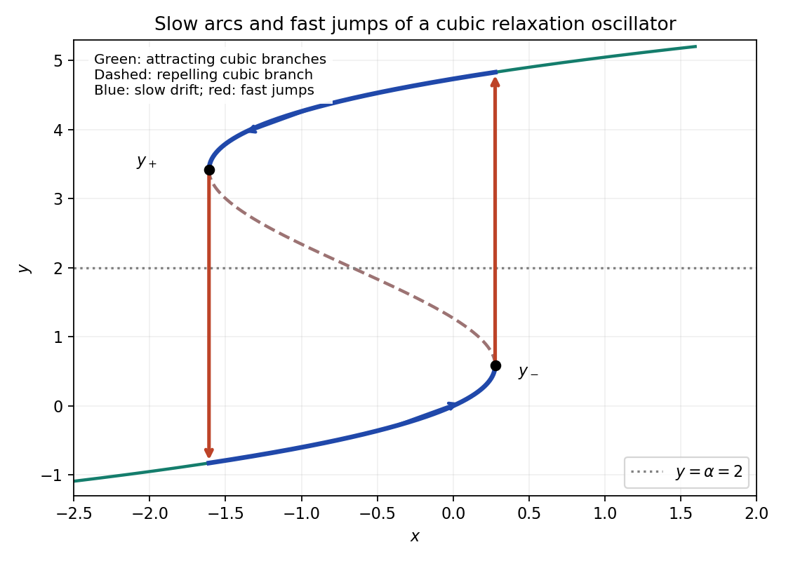

<h1 id="a/1/solution">Solution</h1>

↑ **Parent:** [1](../1.md)

Use [dimensionless variables](../../../../dimensionless-variable.md) $X=X_*x$, $Y=Y_*y$, $Z=Z_*z$, $t=T\tau$, with

$$
\boxed{Y_*=\frac1b,\quad Z_*=\frac g{mb},\quad X_*=\frac{lg}{rmb},\quad T=\frac{lg}{rmk}.}
$$

Substitution gives the requested system, with dots now meaning differentiation with respect to $\tau$, and

$$
\boxed{\alpha=\frac{ab}k,\qquad\epsilon=\frac{rm^2k}{l^2g^2},\qquad\delta=\frac{rk}{lg},\qquad\gamma=\frac{3c}{b^2}.}
$$

In particular the same scale for $Y$ makes the first two coefficients of the cubic equal in magnitude.

Its [derivative](../../../../derivative.md) is $f'(y)=1-2y+\gamma y^2$. For $0<\gamma<1$ its two simple zeros are

$$
\boxed{y_\pm=\frac{1\pm\sqrt{1-\gamma}}\gamma.}
$$

The cubic increases below $y_-$, decreases between the two [fold points of a critical manifold](../../../../fold-point-of-a-critical-manifold.md), and increases above $y_+$. It has a [local maximum](../../../../local-maximum.md) at $y_-$ and a local minimum at $y_+$.

After a rapidly decaying [transient response](../../../../transient-response.md), $z\simeq f(y)$ when its relaxation is faster than the other variables. The reduced [autonomous system](../../../../autonomous-system-mathematics.md) is

$$
\boxed{\dot x=\alpha-y,\qquad\dot y=\frac{x-f(y)}\epsilon.}
$$

For $\epsilon\ll1$, the fast $y$ dynamics at fixed $x$ attracts to the branches where $f'(y)>0$ and repels from the middle branch. On the low branch $y<y_-<\alpha$, $x$ increases slowly. At its [fold point of a critical manifold](../../../../fold-point-of-a-critical-manifold.md) $x=f(y_-)$, the attracting low branch disappears and $y$ jumps upward, with nearly constant $x$, to the high branch. On that branch $y>y_+>\alpha$, $x$ decreases slowly. At $x=f(y_+)$ it jumps back to the low branch. These slow arcs and fast jumps form the singular relaxation cycle. For small positive $\epsilon$, and parameters bounded away from the [fold point of a critical manifold](../../../../fold-point-of-a-critical-manifold.md)-endpoint cases, the nearby attracting periodic motion has the same pattern. The [equilibrium](../../../../equilibrium-point-of-a-dynamical-system.md) $(f(\alpha),\alpha)$ is on the repelling branch: its [Jacobian matrix](../../../../jacobian-matrix.md) has [determinant](../../../../determinant.md) $1/\epsilon>0$ and [trace](../../../../matrix-trace.md) $-f'(\alpha)/\epsilon>0$.

The limiting landing values are $3/\gamma-2y_-$ after the upward jump and $3/\gamma-2y_+$ after the downward jump, obtained from the third root of $f(y)=f(y_\pm)$. Thus the two vertical segments in the [phase plane](../../../../phase-plane.md) plot really connect roots of the same fast equation.

**[Figure 1](#a/1/image-cubic-folds-and-the-singular-relaxation-cycle-slow-drift-on-attracting-branches-and-fast-jumps-at-nearly-fixed-x). Cubic folds and the singular relaxation cycle: slow drift on attracting branches and fast jumps at nearly fixed x**.

If $\gamma>1$, $f'$ is strictly positive everywhere, so the cubic is [monotone](../../../../monotonic-function.md) and has no [fold points of a critical manifold](../../../../fold-point-of-a-critical-manifold.md). The reduced [equilibrium](../../../../equilibrium-point-of-a-dynamical-system.md) is asymptotically stable. In fact

$$
V=\tfrac12[x-f(\alpha)]^2+\tfrac\epsilon2(y-\alpha)^2,\qquad
\dot V=-(y-\alpha)[f(y)-f(\alpha)]\leq0.
$$

The only invariant trajectory in the zero-[derivative](../../../../derivative.md) set is the [equilibrium](../../../../equilibrium-point-of-a-dynamical-system.md), so bounded reduced solutions converge to it; [relaxation oscillations](../../../../relaxation-oscillation.md) disappear.

The stronger condition $\boxed{\delta\ll\epsilon}$ matters during a fast jump: $y$ then varies on the $\epsilon$ time scale, not on the slow unit scale. Only if $z$ adjusts faster still may one keep $z\simeq f(y)$ through that jump. Merely imposing $\delta\ll1$ would not justify this reduction on all pieces of the cycle. This is a [three-time-scale cubic relaxation oscillator](../../../../three-time-scale-cubic-relaxation-oscillator.md).

## ↑ Ancestors (12)

1. [1](../1.md)
2. [A](../../a.md)
3. [2007](../../../2007-split.md)
4. [Past exam of the differential equations and applications course of the University of Oxford](../../../split.md)
5. [Differential equations and applications course of the University of Oxford](../../../../differential-equations-and-applications-course-of-the-university-of-oxford.md)
6. [Year 3 of the mathematics course of the University of Oxford](../../../../year-3-of-the-mathematics-course-of-the-university-of-oxford.md)
7. [Mathematics course of the University of Oxford](../../../../mathematics-course-of-the-university-of-oxford.md)
8. [Undergraduate course of the University of Oxford](../../../../undergraduate-course-of-the-university-of-oxford.md)
9. [Course of the University of Oxford](../../../../course-of-the-university-of-oxford.md)
10. [University of Oxford](../../../../university-of-oxford-split.md)
11. [List of universities](../../../../list-of-universities.md)
12. [Codex Wiki](../../../../split.md)
