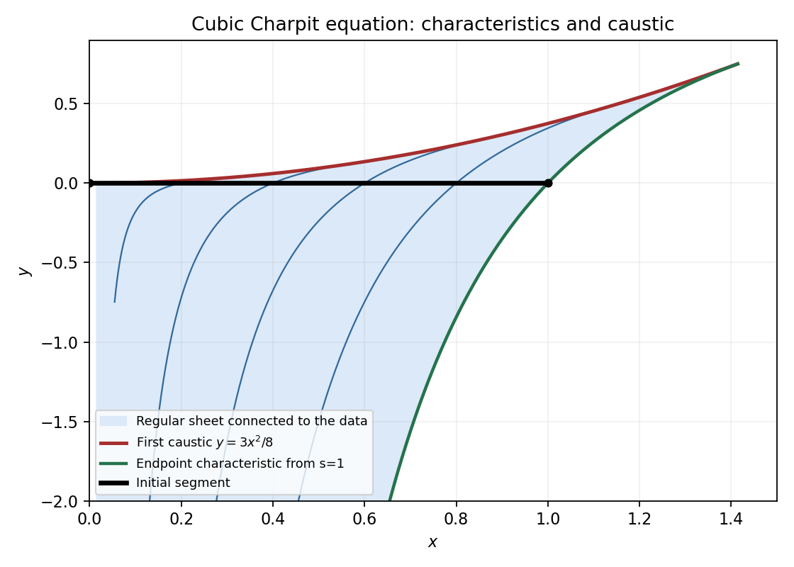

<h1 id="b/5/solution">Solution</h1>

↑ **Parent:** [5](../5.md)

Write the parameter along a [characteristic curve](../../../../characteristic-curve.md) as $r$. [Charpit's equations](../../../../charpit-s-equations.md) are

$$
\boxed{\dot x=F_p,\quad\dot y=F_q,\quad\dot u=pF_p+qF_q,\quad
\dot p=-F_x-pF_u,\quad\dot q=-F_y-qF_u.}
$$

At $r=0$, prescribe $x=x_0(s)$, $y=y_0(s)$, $u=u_0(s)$ and choose $p_0,q_0$ satisfying both $F(x_0,y_0,u_0,p_0,q_0)=0$ and the compatibility relation $p_0x_0'+q_0y_0'=u_0'$. Direct differentiation gives

$$
\frac{dF}{dr}=F_xF_p+F_yF_q+F_u(pF_p+qF_q)
-F_p(F_x+pF_u)-F_q(F_y+qF_u)=0.
$$

Thus the initial constraint propagates. A chosen initial-gradient branch is locally unique when

$$
\boxed{x_0'F_q-y_0'F_p\ne0.}
$$

This is simultaneously the implicit-function [determinant](../../../../determinant.md) for the initial gradients and the [projection map](../../../../projection-map.md) [determinant](../../../../determinant.md) for the surface generated by the [method of characteristics](../../../../method-of-characteristics.md). Uniqueness continues while that [projection map](../../../../projection-map.md) is invertible, the flow remains regular, and distinct [characteristic curves](../../../../characteristic-curve.md) do not give competing values at the same point. Multiple initial-gradient branches, [characteristic curve](../../../../characteristic-curve.md) initial points or a [caustic](../../../../wave-caustic.md) require separate analysis.

Here the initial coordinate is $s=x$, so $p_0=3s^2/4$ and the equation forces $q_0^3=-s^3$, hence $q_0=-s$. The [projection map](../../../../projection-map.md) [determinant](../../../../determinant.md) on the initial line is $3s^2$, nonzero for $0<s\leq1$. Solving the [characteristic curve](../../../../characteristic-curve.md) [ordinary differential equations](../../../../ordinary-differential-equation.md) gives

$$
\boxed{x=se^r,\quad y=\frac32s^2(1-e^{-2r}),\quad
u=1+s^3(e^{-3r}-\tfrac34e^{-r}),\quad0<s\leq1,}
$$

with $p=3s^2e^{-2r}/4$ and $q=-se^{-r}$. These satisfy both the equation and all the noncharacteristic initial values.

The [projection map](../../../../projection-map.md) [determinant](../../../../determinant.md) is $J=3s^2e^r(2e^{-2r}-1)$. Starting from $r=0$, the first [caustic](../../../../wave-caustic.md) occurs at $r_c=\tfrac12\log2$. At the initial endpoint $s=0$ the [non-characteristic](../../../../non-characteristic-hypersurface.md) condition fails, and its entire [characteristic curve](../../../../characteristic-curve.md) remains the single point $(0,0)$; it does not generate an open region of determination.

The maximal regular sheet connected to the initial line uses $r<r_c$. Its interior image is exactly

$$
\boxed{0<x<\sqrt2,\qquad\frac32(1-x^{-2})<y<\frac38x^2.}
$$

Indeed the inverse on this sheet is

$$
s^2=\frac{x^2+\sqrt{x^4-\tfrac83x^2y}}2,\qquad r=\log(x/s),
$$

and the inequalities say $0<s<1$ and $s>x/\sqrt2$. The upper boundary is the [caustic](../../../../wave-caustic.md); the lower boundary is the [characteristic curve](../../../../characteristic-curve.md) from $s=1$. Endpoints of that latter boundary can be retained as one-sided data. For forward [characteristic curves](../../../../characteristic-curve.md) alone, also impose $r\geq0$: this retains $y\geq0$, with lower boundary zero for $x\leq1$ and the displayed endpoint [characteristic curve](../../../../characteristic-curve.md) for $1<x<\sqrt2$. The other square-root branch belongs to the folded sheet after the [caustic](../../../../wave-caustic.md) and does not provide a unique regular continuation from the [initial data](../../../../initial-data-in-general-relativity.md).

**[Figure 2](#b/5/image-the-regular-characteristic-sheet-issued-from-the-initial-segment-its-endpoint-characteristic-and-the-first-caustic). The regular characteristic sheet issued from the initial segment, its endpoint characteristic and the first caustic**.

## ↑ Ancestors (12)

1. [5](../5.md)
2. [B](../../b.md)
3. [2007](../../../2007-split.md)
4. [Past exam of the differential equations and applications course of the University of Oxford](../../../split.md)
5. [Differential equations and applications course of the University of Oxford](../../../../differential-equations-and-applications-course-of-the-university-of-oxford.md)
6. [Year 3 of the mathematics course of the University of Oxford](../../../../year-3-of-the-mathematics-course-of-the-university-of-oxford.md)
7. [Mathematics course of the University of Oxford](../../../../mathematics-course-of-the-university-of-oxford.md)
8. [Undergraduate course of the University of Oxford](../../../../undergraduate-course-of-the-university-of-oxford.md)
9. [Course of the University of Oxford](../../../../course-of-the-university-of-oxford.md)
10. [University of Oxford](../../../../university-of-oxford-split.md)
11. [List of universities](../../../../list-of-universities.md)
12. [Codex Wiki](../../../../split.md)
