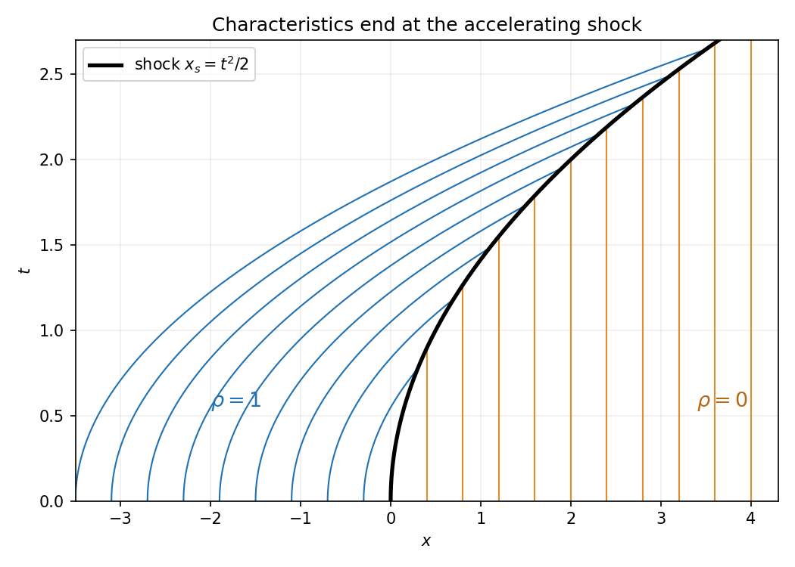
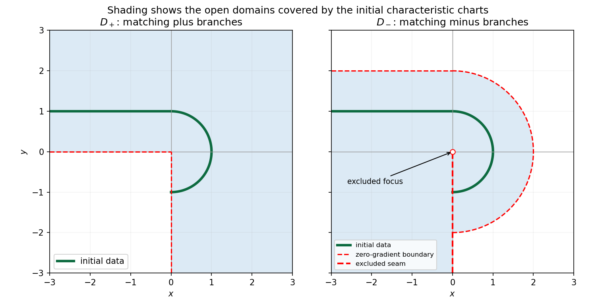
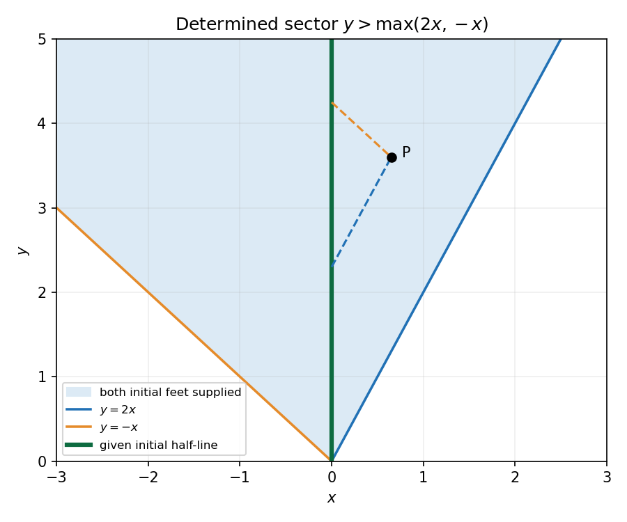

# 2008

↑ **Parent:** [Past exam of the differential equations and applications course of the University of Oxford](../past-exam-of-the-differential-equations-and-applications-course-of-the-university-of-oxford.md)

Original solutions to the paper released at [the source request](https://www.whatdotheyknow.com/request/maths_past_papers_3). The complete editable transcription is retained in the private examination archive.

**Table of contents**

- [A](#a)
  - [1](#a/1)
    - [a](#a/1/a)
      - [Solution](#a/1/a/solution)
    - [b](#a/1/b)
      - [Solution](#a/1/b/solution)
    - [c](#a/1/c)
      - [Solution](#a/1/c/solution)
  - [2](#a/2)
    - [a](#a/2/a)
      - [Solution](#a/2/a/solution)
      - [i](#a/2/a/i)
        - [Solution](#a/2/a/i/solution)
      - [ii](#a/2/a/ii)
        - [Solution](#a/2/a/ii/solution)
    - [b](#a/2/b)
      - [Solution](#a/2/b/solution)
    - [c](#a/2/c)
      - [Solution](#a/2/c/solution)
    - [d](#a/2/d)
      - [Solution](#a/2/d/solution)
    - [e](#a/2/e)
      - [Solution](#a/2/e/solution)
  - [3](#a/3)
    - [a](#a/3/a)
      - [Solution](#a/3/a/solution)
    - [b](#a/3/b)
      - [Solution](#a/3/b/solution)
    - [c](#a/3/c)
      - [Solution](#a/3/c/solution)
    - [d](#a/3/d)
      - [Solution](#a/3/d/solution)
  - [4](#a/4)
    - [a](#a/4/a)
      - [i](#a/4/a/i)
        - [Solution](#a/4/a/i/solution)
      - [ii](#a/4/a/ii)
        - [Solution](#a/4/a/ii/solution)
      - [iii](#a/4/a/iii)
        - [Solution](#a/4/a/iii/solution)
      - [iv](#a/4/a/iv)
        - [Solution](#a/4/a/iv/solution)
    - [b](#a/4/b)
      - [Solution](#a/4/b/solution)
- [B](#b)
  - [5](#b/5)
    - [Solution](#b/5/solution)
  - [6](#b/6)
    - [Solution](#b/6/solution)
  - [7](#b/7)
    - [Solution](#b/7/solution)
  - [8](#b/8)
    - [Solution](#b/8/solution)

## A

↑ **Parent:** [2008](2008.md)

<h3 id="a/1">1</h3>

↑ **Parent:** [A](#a)

<h4 id="a/1/a">a</h4>

↑ **Parent:** [1](#a/1)

<h5 id="a/1/a/solution">Solution</h5>

↑ **Parent:** [A](#a/1/a)

Set $y=\dot x$. The [phase](../wave.md#phase-waves)-plane system is $\dot x=y$, $\dot y=-9x+\epsilon(1-4x^2)y$. The origin is its only [equilibrium](../dynamical-systems.md#equilibrium-point-of-a-dynamical-system), and its [Jacobian matrix](../multivariable-calculus.md#jacobian-matrix) is $\begin{pmatrix}0&1\\-9&\epsilon\end{pmatrix}$. Thus

$$
\boxed{\lambda_\pm=\frac\epsilon2\pm i\sqrt{9-\epsilon^2/4}.}
$$

For the stated small positive $\epsilon$, the [eigenvalues](../linear-operator-theory.md#eigenvalue) have positive real part and nonzero imaginary part: the origin is an **[unstable focus](../dynamical-systems.md#unstable-spiral)**.

<h4 id="a/1/b">b</h4>

↑ **Parent:** [1](#a/1)

<h5 id="a/1/b/solution">Solution</h5>

↑ **Parent:** [B](#a/1/b)

Use the [Poincaré-Lindstedt method](../singular-perturbation.md#poincare-lindstedt-method). Introduce $\theta=\Omega t$ and $x=x_0(\theta)+\epsilon x_1(\theta)+\cdots$. The leading equation gives $\omega_0=3$ and $x_0=A_0\cos\theta$, after fixing the arbitrary [phase](../wave.md#phase-waves). At order $\epsilon$,

$$
9(x_1''+x_1)=6\omega_1A_0\cos\theta+3A_0(A_0^2-1)\sin\theta+3A_0^3\sin3\theta.
$$

Here $4\cos^2\theta\sin\theta=\sin\theta+\sin3\theta$. Periodicity requires the two resonant coefficients to vanish. With $A_0>0$, this gives

$$
\boxed{A_0=1,\qquad\omega_0=3,\qquad\omega_1=0.}
$$

Therefore the leading [limit cycle](../dynamical-systems.md#limit-cycle) is $x(t)=\cos(3t)+O(\epsilon)$, with frequency $3+O(\epsilon^2)$. For example the nonresonant first correction contains $-\epsilon\sin(9t)/24$; its homogeneous [sine](../geometry-and-topology.md#sine)/[cosine](../geometry-and-topology.md#cosine) pieces depend on [phase](../wave.md#phase-waves) and [amplitude](../wave.md#wave-amplitude) conventions. The absence of a first-order frequency shift is a solvability condition, not an assumption.

<h4 id="a/1/c">c</h4>

↑ **Parent:** [1](#a/1)

<h5 id="a/1/c/solution">Solution</h5>

↑ **Parent:** [C](#a/1/c)

Use the [method of multiple scales](../singular-perturbation.md#method-of-multiple-scales) with independent fast and slow variables $t$ and $\tau=\epsilon t$, and write $x_0=R(\tau)\cos\Theta$, $\Theta=3t+\Phi(\tau)$. At the next order, $x_{1,tt}+9x_1=-2x_{0,t\tau}-(4x_0^2-1)x_{0,t}$. Its resonant terms are

$$
[6R'+3R(R^2-1)]\sin\Theta+6R\Phi'\cos\Theta.
$$

Suppressing [secular terms](../singular-perturbation.md#secular-term) yields

$$
\boxed{\frac{dR_0}{d\tau}=\frac12R_0(1-R_0^2),\qquad\frac{d\Phi_0}{d\tau}=0.}
$$

The leading initial data are $\boxed{R_0(0)=4,\ \Phi_0(0)=0}$, up to adding an integer multiple of $2\pi$ to the [phase](../wave.md#phase-waves). Thus $x(t)=R_0(\epsilon t)\cos[3t+\Phi_0(\epsilon t)]+O(\epsilon)$. The [amplitude](../wave.md#wave-amplitude) decreases from four towards the stable value one, consistent with the selected [limit cycle](../dynamical-systems.md#limit-cycle); the zero-[amplitude](../wave.md#wave-amplitude) state is unstable. Order-$\epsilon$ corrections enforce the exact initial [derivative](../calculus.md#derivative) after differentiating the slow [amplitude](../wave.md#wave-amplitude) term.

<h3 id="a/2">2</h3>

↑ **Parent:** [A](#a)

<h4 id="a/2/a">a</h4>

↑ **Parent:** [2](#a/2)

<h5 id="a/2/a/solution">Solution</h5>

↑ **Parent:** [A](#a/2/a)

Let $L=D^2+1$ on the mixed endpoint domain $y(0)=0$, $y'(1)=0$ in $L^2(0,1)$. [Integration by parts](../calculus.md#integration-by-parts) gives the boundary form

$$
\langle z,Ly\rangle-\langle Lz,y\rangle=[\overline z y'-\overline{z'}y]_0^1.
$$

At zero, $y'(0)$ is free, forcing $z(0)=0$; at one, $y(1)$ is free, forcing $z'(1)=0$. Therefore the [formal adjoint](../hilbert-space.md#formal-adjoint) expression and full adjoint endpoint conditions coincide with the original ones:

$$
\boxed{L^*=D^2+1,\qquad z(0)=0,\quad z'(1)=0.}
$$

With the usual second-order operator domain this is a [self-adjoint](../linear-operator-theory.md#self-adjoint-operator) problem. The consequences for its [eigenvalues](../linear-operator-theory.md#eigenvalue) and [eigenfunctions](../linear-operator-theory.md#eigenfunction) follow below.

<h5 id="a/2/a/i">i</h5>

↑ **Parent:** [A](#a/2/a)

<h6 id="a/2/a/i/solution">Solution</h6>

↑ **Parent:** [I](#a/2/a/i)

For $Ly=-\lambda y$, [self-adjointness](../linear-operator-theory.md#self-adjoint-operator) gives $-\lambda\|y\|^2=\langle y,Ly\rangle=\overline{\langle y,Ly\rangle}$. Since an [eigenfunction](../linear-operator-theory.md#eigenfunction) is nonzero, $\boxed{\lambda\in\mathbb R}$. One may also see reality directly from $\lambda\int|y|^2=\int|y'|^2-\int|y|^2$, whose boundary term vanishes under the mixed conditions.

<h5 id="a/2/a/ii">ii</h5>

↑ **Parent:** [A](#a/2/a)

<h6 id="a/2/a/ii/solution">Solution</h6>

↑ **Parent:** [Ii](#a/2/a/ii)

If $Ly_j=-\lambda_jy_j$, then $\langle y_1,Ly_2\rangle=\langle Ly_1,y_2\rangle$ gives $(\lambda_1-\lambda_2)\langle y_1,y_2\rangle=0$. Thus [eigenfunctions](../linear-operator-theory.md#eigenfunction) belonging to distinct [eigenvalues](../linear-operator-theory.md#eigenvalue) are **[orthogonal](../inner-product.md#orthogonal-vectors)**. [Normalization](../mathematics.md#normalization) can make them [orthonormal](../inner-product.md#orthonormal-set). Equality of [eigenvalues](../linear-operator-theory.md#eigenvalue) alone would not force arbitrary [eigenvectors](../linear-operator-theory.md#eigenvector) to be [orthogonal](../inner-product.md#orthogonal-vectors), although in this particular scalar separated problem each [eigenspace](../linear-operator-theory.md#eigenspace) is one-dimensional.

<h4 id="a/2/b">b</h4>

↑ **Parent:** [2](#a/2)

<h5 id="a/2/b/solution">Solution</h5>

↑ **Parent:** [B](#a/2/b)

The equation is $y''+(1+\lambda)y=0$. If $1+\lambda\leq0$, the [linear](../vector-space.md#linearity) or [hyperbolic](../dynamical-systems.md#hyperbolic-equilibrium-point) branches cannot meet both homogeneous endpoint conditions nontrivially. Otherwise $y=C\sin(kx)$, $k=\sqrt{1+\lambda}$, and $y'(1)=Ck\cos k=0$ gives $k_n=(n+1/2)\pi$. Therefore

$$
\boxed{\lambda_n=(n+\tfrac12)^2\pi^2-1,\qquad\phi_n(x)=\sqrt2\sin[(n+\tfrac12)\pi x],\quad n=0,1,\ldots.}
$$

The factor $\sqrt2$ makes the [eigenfunctions](../linear-operator-theory.md#eigenfunction) unit normalized. All the [eigenvalues](../linear-operator-theory.md#eigenvalue) are positive, in particular none is zero.

<h4 id="a/2/c">c</h4>

↑ **Parent:** [2](#a/2)

<h5 id="a/2/c/solution">Solution</h5>

↑ **Parent:** [C](#a/2/c)

The difference of two solutions would satisfy $Ly=0$ with $y(0)=0$, $y'(1)=0$. This would be a zero [eigenvalue](../linear-operator-theory.md#eigenvalue) of the homogeneous problem, but part (b) shows there is none. Hence **at most one solution exists**. For continuous forcing the standard second-order existence construction also works: the free initial slope is fixed by an equation with coefficient $\cos1\ne0$. Thus for the stated regular boundary-value problem the solution is unique even with nonzero endpoint data.

<h4 id="a/2/d">d</h4>

↑ **Parent:** [2](#a/2)

<h5 id="a/2/d/solution">Solution</h5>

↑ **Parent:** [D](#a/2/d)

Expand a forcing in the complete [orthonormal](../inner-product.md#orthonormal-set) [basis](../vector-space.md#basis) $\phi_n$. Since $L\phi_n=-\lambda_n\phi_n$, its inverse multiplies the $n$th coefficient by $-1/\lambda_n$. Consequently

$$
\boxed{g(x,t)=-\sum_{n=0}^\infty\frac{\phi_n(x)\phi_n(t)}{\lambda_n}=-2\sum_{n=0}^\infty\frac{\sin(k_nx)\sin(k_nt)}{k_n^2-1}.}
$$

The negative sign follows from the [eigenvalue](../linear-operator-theory.md#eigenvalue) convention $Ly=-\lambda y$. This [kernel](../kernel-of-a-linear-map.md) satisfies the mixed endpoint conditions in its first argument and $L_xg=\delta(x-t)$.

<h4 id="a/2/e">e</h4>

↑ **Parent:** [2](#a/2)

<h5 id="a/2/e/solution">Solution</h5>

↑ **Parent:** [E](#a/2/e)

The [integral equation](../analysis.md#integral-equation) says precisely $h=L^{-1}z$ with the homogeneous mixed endpoint conditions. Since the supplied $h$ satisfies those conditions, apply $L$ directly:

$$
\boxed{z(x)=Lh=h''+h=x^2-2x+2.}
$$

No [integration](../integral.md) is required. The absence of a zero [eigenvalue](../linear-operator-theory.md#eigenvalue) established in (b)–(c) also proves uniqueness of this recovered forcing.

<h3 id="a/3">3</h3>

↑ **Parent:** [A](#a)

<h4 id="a/3/a">a</h4>

↑ **Parent:** [3](#a/3)

<h5 id="a/3/a/solution">Solution</h5>

↑ **Parent:** [A](#a/3/a)

Write the integral part as $Ky=12b\langle a,y\rangle-30a\langle b,y\rangle$, where $a(x)=e^{-x}$ and $b(x)=e^{-2x}$. The [kernel](../kernel-of-a-linear-map.md) is real, so its adjoint transposes the two arguments. Hence

$$
\boxed{L^*z(x)=z(x)+\int_0^\infty[12e^{-x-2t}-30e^{-2x-t}]z(t)\,dt.}
$$

This follows by exchanging the two [integrations](../integral.md) in the $L^2(0,\infty)$ [inner product](../inner-product.md); the exponential factors make the [finite-rank operators](../compact-operator.md#finite-rank-operator) bounded.

<h4 id="a/3/b">b</h4>

↑ **Parent:** [3](#a/3)

<h5 id="a/3/b/solution">Solution</h5>

↑ **Parent:** [B](#a/3/b)

Every [eigenvector](../linear-operator-theory.md#eigenvector) with [eigenvalue](../linear-operator-theory.md#eigenvalue) different from one lies in $E=\operatorname{span}\{a,b\}$, because $(\lambda-1)y=Ky\in E$. The elementary overlaps are $\langle a,a\rangle=1/2$, $\langle a,b\rangle=1/3$, $\langle b,b\rangle=1/4$. Thus

$$
La=-9a+6b,\quad Lb=-\tfrac{15}2a+5b,\quad
[L]_E=\begin{pmatrix}-9&-15/2\\6&5\end{pmatrix}.
$$

Its [characteristic polynomial](../linear-operator-theory.md#characteristic-polynomial) is $\lambda(\lambda+4)$, so the finite-[multiplicity](../polynomial.md#multiplicity-mathematics) eigenpairs are

$$
\boxed{\lambda=0:\ y_0=5e^{-x}-6e^{-2x};\qquad\lambda=-4:\ y_{-4}=3e^{-x}-2e^{-2x}.}
$$

Each [eigenspace](../linear-operator-theory.md#eigenspace) has [dimension](../vector-space.md#dimension-vector-space) one. On $E^\perp$, both integrals defining $K$ vanish, so $Ly=y$. Thus $\boxed{\lambda=1}$ is also an [eigenvalue](../linear-operator-theory.md#eigenvalue), of infinite [multiplicity](../polynomial.md#multiplicity-mathematics), and there are no others.

<h4 id="a/3/c">c</h4>

↑ **Parent:** [3](#a/3)

<h5 id="a/3/c/solution">Solution</h5>

↑ **Parent:** [C](#a/3/c)

The adjoint also leaves $E$ invariant, with $L^*a=5a-15b$ and $L^*b=3a-9b$. By [adjoint in weighted coordinates](../hilbert-space.md#adjoint-in-weighted-coordinates), its [matrix](../vector-space.md#matrix) in the same [basis](../vector-space.md#basis) is $\begin{pmatrix}5&3\\-15&-9\end{pmatrix}$. Solving the two [eigenvector](../linear-operator-theory.md#eigenvector) equations gives

$$
\boxed{\lambda=0:\ z_0=3e^{-x}-5e^{-2x};\qquad\lambda=-4:\ z_{-4}=e^{-x}-3e^{-2x}.}
$$

The [basis](../vector-space.md#basis) $a,b$ is not [orthonormal](../inner-product.md#orthonormal-set), so one must not simply transpose the previous numerical [matrix](../vector-space.md#matrix) without accounting for its [Gram matrix](../inner-product.md#gram-matrix). Directly transposing the integral [kernel](../kernel-of-a-linear-map.md) avoids that error.

<h4 id="a/3/d">d</h4>

↑ **Parent:** [3](#a/3)

<h5 id="a/3/d/solution">Solution</h5>

↑ **Parent:** [D](#a/3/d)

The nonzero [kernel](../kernel-of-a-linear-map.md) of $L$ rules out a unique solution for every value of $c$. By the [Fredholm alternative](../compact-operator.md#fredholm-alternative), solvability requires [orthogonality](../inner-product.md#orthogonal-vectors) of the forcing to $\ker L^*=\operatorname{span}\{3a-5b\}$. Its pairing with $6a+cb$ is

$$
\langle3a-5b,6a+cb\rangle=9+c-10-\frac{5c}4=-1-\frac c4.
$$

Thus only $c=-4$ is compatible. In that case $6a-4b=2y_{-4}$ and a particular solution is $-y_{-4}/2$. All solutions are

$$
\boxed{y(x)=-\frac32e^{-x}+e^{-2x}+C(5e^{-x}-6e^{-2x}),\qquad c=-4.}
$$

Therefore **infinitely many solutions exist for $c=-4$, no solution exists for $c\ne-4$, and no parameter value gives a unique solution**.

<h3 id="a/4">4</h3>

↑ **Parent:** [A](#a)

<h4 id="a/4/a">a</h4>

↑ **Parent:** [4](#a/4)

<h5 id="a/4/a/i">i</h5>

↑ **Parent:** [A](#a/4/a)

<h6 id="a/4/a/i/solution">Solution</h6>

↑ **Parent:** [I](#a/4/a/i)

Integrate the [conservation law](../mathematical-physics.md#conservation-law) over $[-R,R]$: $d\int_{-R}^R\rho\,dx/dt=-t[\rho^2]_{-R}^R$. The Gaussian data and their finite-time [characteristic](../algebra.md#characteristic-of-a-field)/entropy evolution have vanishing far-field flux. Taking $R\to\infty$ yields $\boxed{M'(t)=0}$ and hence $\boxed{M(t)=\sqrt{2\pi}}$. After a [shock](../transport-equation.md#shock-wave) forms, its [Rankine-Hugoniot condition](../transport-equation.md#rankine-hugoniot-conditions) preserves the same integral [mass](../classical-mechanics.md#mass); the formal multivalued [characteristic](../algebra.md#characteristic-of-a-field) surface itself must be replaced by the conservative [entropy solution](../transport-equation.md#entropy-solution).

<h5 id="a/4/a/ii">ii</h5>

↑ **Parent:** [A](#a/4/a)

<h6 id="a/4/a/ii/solution">Solution</h6>

↑ **Parent:** [Ii](#a/4/a/ii)

Expanding the flux gives $\rho_t+2t\rho\rho_x=0$. Along [characteristics](../algebra.md#characteristic-of-a-field), $\dot\rho=0$ and $\dot x=2t\rho$. Labeling the initial point by $\xi$ gives

$$
\boxed{\rho=e^{-\xi^2/2},\qquad x=\xi+t^2e^{-\xi^2/2}.}
$$

Equivalently, [time reparametrization for a separable conservation-law flux](../transport-equation.md#time-reparametrization-for-a-separable-conservation-law-flux) uses $T=t^2/2$. The projection [derivative](../calculus.md#derivative) is $x_\xi=1-t^2\xi e^{-\xi^2/2}$. For large enough $t$ it becomes negative on an interval of positive $\xi$, although it tends to one at both far ends. The projection then folds and assigns several density values to one position. This establishes multivaluedness of the formal [characteristic](../algebra.md#characteristic-of-a-field) continuation, not of the admissible [shock](../transport-equation.md#shock-wave) solution.

<h5 id="a/4/a/iii">iii</h5>

↑ **Parent:** [A](#a/4/a)

<h6 id="a/4/a/iii/solution">Solution</h6>

↑ **Parent:** [Iii](#a/4/a/iii)

The first fold occurs when $t^2\max_{\xi>0}\xi e^{-\xi^2/2}=1$. [Differentiation](../calculus.md#differentiation) gives $(\xi e^{-\xi^2/2})'=e^{-\xi^2/2}(1-\xi^2)$, so the [maximum](../set.md#maximum-of-a-subset-of-a-total-order) is $e^{-1/2}$ at $\xi=1$. Therefore

$$
\boxed{t_c=e^{1/4}.}
$$

At that point the first singular projection is at $x_c=1+t_c^2e^{-1/2}=2$, with density $e^{-1/2}$.

<h5 id="a/4/a/iv">iv</h5>

↑ **Parent:** [A](#a/4/a)

<h6 id="a/4/a/iv/solution">Solution</h6>

↑ **Parent:** [Iv](#a/4/a/iv)

The two [characteristic](../algebra.md#characteristic-of-a-field) families are $x=\xi+t^2$, $\rho=1$ for left-state labels, and $x=\xi$, $\rho=0$ for right-state labels. The explicit time-dependent flux is $q=t\rho^2$, so the [shock](../transport-equation.md#shock-wave) speed is

$$
\dot x_s=\frac{t(1^2-0^2)}{1-0}=t.
$$

Starting at zero gives

$$
\boxed{x_s(t)=t^2/2,\qquad\rho=1\text{ for }x<t^2/2,\quad\rho=0\text{ for }x>t^2/2.}
$$

The [characteristic speeds](../transport-equation.md#characteristic-speed) are $2t$ behind and zero ahead, with [shock](../transport-equation.md#shock-wave) speed $t$ between them. The left parabolas and right vertical lines terminate at the compressive [shock](../transport-equation.md#shock-wave).

**[Figure 1](#a/4/a/iv/image-parabolic-characteristics-entering-a-shock-whose-speed-grows-linearly-in-time). Parabolic characteristics entering a shock whose speed grows linearly in time**.

<h4 id="a/4/b">b</h4>

↑ **Parent:** [4](#a/4)

<h5 id="a/4/b/solution">Solution</h5>

↑ **Parent:** [B](#a/4/b)

Try $\rho=t^af(\eta)$, $\eta=x/t^b$. The boundary data force $a=3$ and $f(0)=1$. The time [derivative](../calculus.md#derivative) scales as $t^{a-1}$, advection as $t^{2a-b}$ and the source as $t^{a+c}$. Balancing all three gives $c=-1$ and $b=a+1=4$. Substitution then yields

$$
3f-4\eta f'+ff'=f,\qquad
\boxed{c=-1,\quad\eta=x/t^4,\quad(f-4\eta)f'+2f=0,\quad f(0)=1.}
$$

For the pointwise initial trace at any fixed $x>0$, the far-profile requirement is $f(\eta)=o(\eta^{3/4})$ as $\eta\to\infty$ on any smooth branch extending that far; a compact-support continuation also meets it. Solving or selecting a [shock](../transport-equation.md#shock-wave) continuation was not required. The time-dependent source is singular at $t=0$, so the similarity reduction is stated on $t>0$.

<h2 id="b">B</h2>

↑ **Parent:** [2008](2008.md)

<h3 id="b/5">5</h3>

↑ **Parent:** [B](#b)

<h4 id="b/5/solution">Solution</h4>

↑ **Parent:** [5](#b/5)

The [square-root reduction of a quadratic eikonal equation](../elasticity-physics.md#square-root-reduction-of-a-quadratic-eikonal-equation) explains why two initial normal derivatives are possible. Set $F=p^2+q^2-4u$. [Charpit's equations](../transport-equation.md#charpit-s-equations) are $\dot x=2p$, $\dot y=2q$, $\dot u=2p^2+2q^2=8u$, $\dot p=4p$, $\dot q=4q$. Parametrize the initial semicircle by $(x_0,y_0)=(\cos s,\sin s)$, $-\pi/2<s<\pi/2$. Tangential compatibility gives $-p_0\sin s+q_0\cos s=0$, and $F=0$ gives $p_0^2+q_0^2=4$. Thus there are two normal-gradient choices, $p_0=2\varepsilon\cos s$, $q_0=2\varepsilon\sin s$, $\varepsilon=\pm1$.

[Integration](../integral.md) gives the requested parametric solutions

$$
\boxed{\begin{aligned}x&=[1+\varepsilon(e^{4t}-1)]\cos s,\\y&=[1+\varepsilon(e^{4t}-1)]\sin s,\\u&=e^{8t},\quad p=2\varepsilon e^{4t}\cos s,\quad q=2\varepsilon e^{4t}\sin s.\end{aligned}}
$$

For $\varepsilon=+1$, $r=\sqrt{x^2+y^2}=e^{4t}$, so $u_+=r^2$ on the whole right half-plane. For $\varepsilon=-1$, before focusing at the origin, $r=2-e^{4t}$, so $u_-=(2-r)^2$ on $x>0$, $0<r<2$. The origin is a [caustic](../geometrical-optics.md#wave-caustic) for this inward family. The circle $r=2$ is approached only as [characteristic](../algebra.md#characteristic-of-a-field) time tends to negative infinity, where $u$ and its gradient vanish. It cannot be crossed by this initial [characteristic](../algebra.md#characteristic-of-a-field) chart. Thus the initial data alone permit two branches; each is locally unique only after its normal-gradient sign is chosen.

On the added half-line write $x_0=a\leq0$, $y_0=1$, $u_0=1$. Tangential [differentiation](../calculus.md#differentiation) gives $p_0=0$ and $q_0=2\delta$, $\delta=\pm1$. Its [characteristics](../algebra.md#characteristic-of-a-field) give

$$
\boxed{x=a,\qquad y=1+\delta(e^{4t}-1),\qquad u=e^{8t}.}
$$

The plus branch is $u=y^2$ on $x\leq0,y>0$; the minus branch is $u=(2-y)^2$ on $x\leq0,y<2$. On the positive $y$-axis, the semicircle traces are $y^2$ and $(2-y)^2$, respectively. Therefore **only matching sign choices are continuous throughout their common positive-axis coverage**. Mixed choices agree merely at the initial junction $y=1$.

For the matching-plus branch the data-covered open domain is

$$
\boxed{D_+=\{x>0\}\cup\{y>0\},\qquad
u_+=\begin{cases}x^2+y^2,&x>0,\\y^2,&x\leq0,\ y>0.\end{cases}}
$$

For the matching-minus branch it is

$$
\boxed{D_-=\{x>0,\ x^2+y^2<4\}\cup\{x<0,\ y<2\}\cup\{x=0,\ 0<y<2\}.}
$$

Its formula is $(2-\sqrt{x^2+y^2})^2$ in the right portion and $(2-y)^2$ in the left portion. The origin is excluded. The negative $y$-axis must also be a cut: the two formulas have different traces there, so including it would destroy continuity. Both matching solutions are $C^1$ across the included positive-axis seam; generally their second transverse [derivatives](../calculus.md#derivative) differ, which is compatible with this first-order problem. Values beyond these [characteristic](../algebra.md#characteristic-of-a-field) charts can sometimes be continued, but are not selected by the initial data through a nonsingular [characteristic](../algebra.md#characteristic-of-a-field) graph.

**[Figure 2](#b/5/image-data-covered-domains-for-the-two-matching-sign-characteristic-solutions). Data-covered domains for the two matching-sign characteristic solutions**.

<h3 id="b/6">6</h3>

↑ **Parent:** [B](#b)

<h4 id="b/6/solution">Solution</h4>

↑ **Parent:** [6](#b/6)

With $A$ invertible, write the system as $\mathbf u_x+M\mathbf u_y=\mathbf d$, $M=A^{-1}B$. Real distinct [eigenvalues](../linear-operator-theory.md#eigenvalue) of $M$ give strict [hyperbolicity](../partial-differential-equation.md#hyperbolicity); a real complete [eigenbasis](../linear-operator-theory.md#eigenbasis) gives the usual diagonalizable [hyperbolic](../dynamical-systems.md#hyperbolic-equilibrium-point) form. The [characteristic curves](../transport-equation.md#characteristic-curve) satisfy $dy/dx=\lambda_i$. Left [eigenvectors](../linear-operator-theory.md#eigenvector) form [characteristic](../algebra.md#characteristic-of-a-field) dependent combinations $w_i=\ell_i\mathbf u$; for constant coefficients they obey separate [transport equations](../transport-equation.md). [Characteristic](../algebra.md#characteristic-of-a-field) coordinates are functions constant on those curves, such as $y-\lambda_i x$ in the constant case. For variable coefficients extra [derivatives](../calculus.md#derivative) of the [eigenvectors](../linear-operator-theory.md#eigenvector) can couple the combinations; local [characteristic](../algebra.md#characteristic-of-a-field) directions still follow the real [matrix](../vector-space.md#matrix) pencil. If $A$ is singular one first chooses a noncharacteristic coordinate direction with an invertible coefficient combination.

For the specified constants,

$$
M=\begin{pmatrix}5&3\\-6&-4\end{pmatrix},\qquad\mathbf d=\begin{pmatrix}3\\-2\end{pmatrix}.
$$

Its speeds are $2$ and $-1$, with left [eigenvectors](../linear-operator-theory.md#eigenvector) $(2,1)$ and $(1,1)$. Hence

$$
w_+=2u+v,\quad (w_+)_x+2(w_+)_y=4,\qquad
w_-=u+v,\quad (w_-)_x-(w_-)_y=1.
$$

The transported [Riemann invariants](../compressible-flow.md#riemann-invariant) are $\boxed{R_+=2u+v-4x,\quad R_-=u+v-x}$, constant on $y-2x=\text{constant}$ and $y+x=\text{constant}$, respectively. Initial data give $w_+(0,s)=s-\sin(s/2)$ and $w_-(0,s)=-e^s$, so

$$
w_+=y+2x-\sin(y/2-x),\qquad w_-=-e^{y+x}+x.
$$

Invert these two combinations:

$$
\boxed{u=e^{y+x}+y+x-\sin(y/2-x),\qquad v=-2e^{y+x}-y+\sin(y/2-x).}
$$

Both [characteristic](../algebra.md#characteristic-of-a-field) feet must lie on the supplied positive initial half-line. Thus

$$
\boxed{y-2x>0,\qquad y+x>0,\quad\text{equivalently }y>\max(2x,-x).}
$$

Outside this sector at least one invariant needs unsupplied initial data. The closed expressions give one possible extension there but are not uniquely forced by the question's initial half-line.

**[Figure 3](#b/6/image-sector-where-both-backward-characteristic-families-meet-the-given-initial-half-line). Sector where both backward characteristic families meet the given initial half-line**.

<h3 id="b/7">7</h3>

↑ **Parent:** [B](#b)

<h4 id="b/7/solution">Solution</h4>

↑ **Parent:** [7](#b/7)

For fixed source $(\xi,\eta)\in D$, define the [Dirichlet Green function](../green-s-function.md#dirichlet-green-function) by $-\Delta_{x,y}G=\delta_{(\xi,\eta)}$ in $D$, $G=0$ on $\partial D$. It is [harmonic](../partial-differential-equation.md#harmonic-function) away from the source and has [singularity](../complex-analysis.md#complex-singularity) $-(2\pi)^{-1}\log\sqrt{(x-\xi)^2+(y-\eta)^2}$. The outward [normal vector](../differential-geometry.md#normal-vector) [derivative](../calculus.md#derivative) is $\partial_nG=\mathbf n\cdot\nabla_{x,y}G$ at a boundary point of arc-length parameter $s$.

[Green's second identity](../partial-differential-equation.md#green-second-identity) gives $\int_D(u\Delta G-G\Delta u)=\int_{\partial D}(u\partial_nG-G\partial_nu)\,ds$. Substituting the two PDEs and the boundary data yields

$$
-u(\xi,\eta)+\int_DfG=\int_{\partial D}g\partial_nG,\qquad
\boxed{u(\xi,\eta)=-\int_{\partial D}g\partial_nG\,ds+\int_DfG\,dx\,dy.}
$$

The singular version follows by excising a small source disk and taking its radius to zero, or directly by the distributional identity.

For the upper half-plane use the opposite-sign image source at $(\xi,-\eta)$:

$$
\boxed{G=\frac1{4\pi}\log\frac{(x-\xi)^2+(y+\eta)^2}{(x-\xi)^2+(y-\eta)^2}.}
$$

The image lies outside the domain, so it is [harmonic](../partial-differential-equation.md#harmonic-function) inside; the true source has the required unit [singularity](../complex-analysis.md#complex-singularity), and the two distances agree at $y=0$, giving zero boundary value. On that boundary $\mathbf n=-\mathbf e_y$, so

$$
\partial_nG=-\frac\eta{\pi[(s-\xi)^2+\eta^2]}.
$$

The assumed far-field decay makes the large semicircle contribution vanish. With $f=0$, the representation becomes

$$
\boxed{u(\xi,\eta)=\frac\eta\pi\int_{-\infty}^\infty\frac{g(s)}{(\xi-s)^2+\eta^2}\,ds.}
$$

Finally set $s=\xi+\eta\tan\theta$, $ds=\eta\sec^2\theta\,d\theta$. The [Jacobian matrix](../multivariable-calculus.md#jacobian-matrix) cancels the denominator, giving

$$
\boxed{u(\xi,\eta)=\frac1\pi\int_{-\pi/2}^{\pi/2}g(\xi+\eta\tan\theta)\,d\theta.}
$$

If $g$ is even, the substitution $s\mapsto-s$ in the [Poisson integral](../partial-differential-equation.md#poisson-integral) gives $u(-\xi,\eta)=u(\xi,\eta)$. At $\eta=0$ this agrees with the continuous even boundary trace.

<h3 id="b/8">8</h3>

↑ **Parent:** [B](#b)

<h4 id="b/8/solution">Solution</h4>

↑ **Parent:** [8](#b/8)

At a positive interior [maximum](../set.md#maximum-of-a-subset-of-a-total-order), $u_x=0$, $u_{xx}\leq0$, and $u_t\geq0$ if the point is compared with its past. The PDE instead gives $u_t\leq-u^3<0$, a contradiction. Thus a positive global/past-strip [maximum](../set.md#maximum-of-a-subset-of-a-total-order) must come from the spatial boundary or initial-time limit. The far value is positive, so any attained global [maximum](../set.md#maximum-of-a-subset-of-a-total-order) is positive; the argument does not prohibit a negative local [maximum](../set.md#maximum-of-a-subset-of-a-total-order) in isolation.

For uniqueness put $w=u_1-u_2$. It satisfies

$$
w_t=w_{xx}-\frac{x}{2t}w_x-aw,\qquad a=u_1^2+u_1u_2+u_2^2\geq0.
$$

The [parabolic comparison principle](../partial-differential-equation.md#parabolic-comparison-principle) with zero difference data gives $w\leq0$ and then $-w\leq0$, hence $w=0$. As usual on this noncompact singular-time domain, this uses an admissible comparison class in which the initial and far-field limits justify truncation; for example bounded/subquadratic differences on finite past strips with the corresponding uniform zero traces suffice. A barrier $\delta(1+x^2+2t)$ controls spatial infinity, since $\partial_t-\partial_x^2+[x/(2t)]\partial_x+a$ applied to it is nonnegative. The printed fixed-point limits alone should not silently be substituted for all uniform/growth hypotheses of this comparison argument.

Use [drift cancellation in a parabolic similarity reduction](../partial-differential-equation.md#drift-cancellation-in-a-parabolic-similarity-reduction). For the [similarity ansatz](../partial-differential-equation.md#similarity-ansatz), [derivative](../calculus.md#derivative) scaling gives

$$
u_t=t^{-3/2}(-f/2-\beta\eta f'),\quad u_{xx}=t^{-1/2-2\beta}f'',\quad-\frac{x}{2t}u_x=-t^{-3/2}\eta f'/2.
$$

Thus $\boxed{\beta=1/2}$, the drift terms cancel, and $f''=f^3-f/2$ with $f(\infty)=1/\sqrt2$. Use the [positive-equilibrium separatrix for a cubic profile equation](../differential-equation.md#positive-equilibrium-separatrix-for-a-cubic-profile-equation). Multiply by $f'$ and use the limiting [equilibrium](../dynamical-systems.md#equilibrium-point-of-a-dynamical-system) to determine the [integration](../integral.md) constant:

$$
\frac12(f')^2=\frac14f^4-\frac14f^2+\frac1{16},\qquad(f')^2=\frac12(f^2-1/2)^2.
$$

The branch approaching the positive far [equilibrium](../dynamical-systems.md#equilibrium-point-of-a-dynamical-system) satisfies $f'=(1/2-f^2)/\sqrt2$; the constant [equilibrium](../dynamical-systems.md#equilibrium-point-of-a-dynamical-system) is included as well. Separation gives

$$
\boxed{f(\eta)=\frac1{\sqrt2}\frac{1-Ae^{-\eta}}{1+Ae^{-\eta}},\qquad
u(x,t)=\frac1{\sqrt{2t}}\frac{1-Ae^{-x/\sqrt t}}{1+Ae^{-x/\sqrt t}}.}
$$

For a finite boundary value at $x=0$ and no interior pole, take $A>-1$. Values $-1<A<0$ describe the corresponding coth-type approach from above; $A=0$ is constant, and positive $A$ gives the tanh-type branch. The other first-integral sign cannot approach the positive [equilibrium](../dynamical-systems.md#equilibrium-point-of-a-dynamical-system) nontrivially as $\eta\to\infty$.

The requested deficit integral is, after $x=\sqrt t\eta$,

$$
\int_0^\infty(1/\sqrt{2t}-u)\,dx=\sqrt2\int_0^\infty\frac{Ae^{-\eta}}{1+Ae^{-\eta}}\,d\eta=\sqrt2\log(1+A).
$$

Therefore $\boxed{A=1}$, and the selected solution is $\boxed{u(x,t)=(2t)^{-1/2}\tanh[x/(2\sqrt t)]}$.

## ↑ Ancestors (9)

1. [Past exam of the differential equations and applications course of the University of Oxford](../past-exam-of-the-differential-equations-and-applications-course-of-the-university-of-oxford.md)
2. [Differential equations and applications course of the University of Oxford](../university-of-oxford.md#differential-equations-and-applications-course-of-the-university-of-oxford)
3. [Year 3 of the mathematics course of the University of Oxford](../university-of-oxford.md#year-3-of-the-mathematics-course-of-the-university-of-oxford)
4. [Mathematics course of the University of Oxford](../university-of-oxford.md#mathematics-course-of-the-university-of-oxford)
5. [Undergraduate course of the University of Oxford](../university-of-oxford.md#undergraduate-course-of-the-university-of-oxford)
6. [Course of the University of Oxford](../university-of-oxford.md#course-of-the-university-of-oxford)
7. [University of Oxford](../university-of-oxford.md)
8. [List of universities](../README.md#list-of-universities)
9. [Codex Wiki](../README.md)
