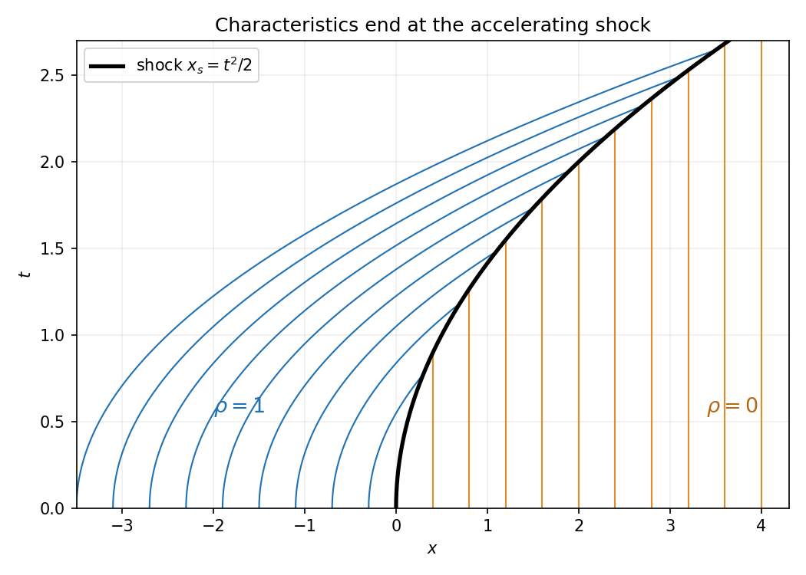

<h1 id="a/4/a/iv/solution">Solution</h1>

↑ **Parent:** [Iv](../iv.md)

The two [characteristic](../../../../../../characteristic-of-a-field.md) families are $x=\xi+t^2$, $\rho=1$ for left-state labels, and $x=\xi$, $\rho=0$ for right-state labels. The explicit time-dependent flux is $q=t\rho^2$, so the [shock](../../../../../../shock-wave.md) speed is

$$
\dot x_s=\frac{t(1^2-0^2)}{1-0}=t.
$$

Starting at zero gives

$$
\boxed{x_s(t)=t^2/2,\qquad\rho=1\text{ for }x<t^2/2,\quad\rho=0\text{ for }x>t^2/2.}
$$

The [characteristic speeds](../../../../../../characteristic-speed.md) are $2t$ behind and zero ahead, with [shock](../../../../../../shock-wave.md) speed $t$ between them. The left parabolas and right vertical lines terminate at the compressive [shock](../../../../../../shock-wave.md).

**[Figure 1](#a/4/a/iv/image-parabolic-characteristics-entering-a-shock-whose-speed-grows-linearly-in-time). Parabolic characteristics entering a shock whose speed grows linearly in time**.

## ↑ Ancestors (14)

1. [Iv](../iv.md)
2. [A](../../a.md)
3. [4](../../../4.md)
4. [A](../../../../a.md)
5. [2008](../../../../../2008-split.md)
6. [Past exam of the differential equations and applications course of the University of Oxford](../../../../../split.md)
7. [Differential equations and applications course of the University of Oxford](../../../../../../differential-equations-and-applications-course-of-the-university-of-oxford.md)
8. [Year 3 of the mathematics course of the University of Oxford](../../../../../../year-3-of-the-mathematics-course-of-the-university-of-oxford.md)
9. [Mathematics course of the University of Oxford](../../../../../../mathematics-course-of-the-university-of-oxford.md)
10. [Undergraduate course of the University of Oxford](../../../../../../undergraduate-course-of-the-university-of-oxford.md)
11. [Course of the University of Oxford](../../../../../../course-of-the-university-of-oxford.md)
12. [University of Oxford](../../../../../../university-of-oxford-split.md)
13. [List of universities](../../../../../../list-of-universities.md)
14. [Codex Wiki](../../../../../../split.md)
