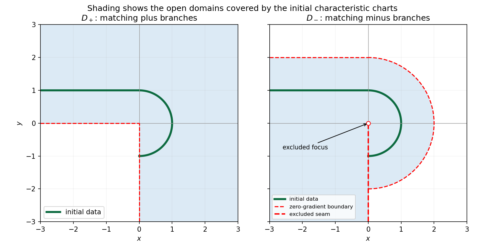

<h1 id="b/5/solution">Solution</h1>

↑ **Parent:** [5](../5.md)

The [square-root reduction of a quadratic eikonal equation](../../../../square-root-reduction-of-a-quadratic-eikonal-equation.md) explains why two initial normal derivatives are possible. Set $F=p^2+q^2-4u$. [Charpit's equations](../../../../charpit-s-equations.md) are $\dot x=2p$, $\dot y=2q$, $\dot u=2p^2+2q^2=8u$, $\dot p=4p$, $\dot q=4q$. Parametrize the initial semicircle by $(x_0,y_0)=(\cos s,\sin s)$, $-\pi/2<s<\pi/2$. Tangential compatibility gives $-p_0\sin s+q_0\cos s=0$, and $F=0$ gives $p_0^2+q_0^2=4$. Thus there are two normal-gradient choices, $p_0=2\varepsilon\cos s$, $q_0=2\varepsilon\sin s$, $\varepsilon=\pm1$.

[Integration](../../../../integral-split.md) gives the requested parametric solutions

$$
\boxed{\begin{aligned}x&=[1+\varepsilon(e^{4t}-1)]\cos s,\\y&=[1+\varepsilon(e^{4t}-1)]\sin s,\\u&=e^{8t},\quad p=2\varepsilon e^{4t}\cos s,\quad q=2\varepsilon e^{4t}\sin s.\end{aligned}}
$$

For $\varepsilon=+1$, $r=\sqrt{x^2+y^2}=e^{4t}$, so $u_+=r^2$ on the whole right half-plane. For $\varepsilon=-1$, before focusing at the origin, $r=2-e^{4t}$, so $u_-=(2-r)^2$ on $x>0$, $0<r<2$. The origin is a [caustic](../../../../wave-caustic.md) for this inward family. The circle $r=2$ is approached only as [characteristic](../../../../characteristic-of-a-field.md) time tends to negative infinity, where $u$ and its gradient vanish. It cannot be crossed by this initial [characteristic](../../../../characteristic-of-a-field.md) chart. Thus the initial data alone permit two branches; each is locally unique only after its normal-gradient sign is chosen.

On the added half-line write $x_0=a\leq0$, $y_0=1$, $u_0=1$. Tangential [differentiation](../../../../differentiation.md) gives $p_0=0$ and $q_0=2\delta$, $\delta=\pm1$. Its [characteristics](../../../../characteristic-of-a-field.md) give

$$
\boxed{x=a,\qquad y=1+\delta(e^{4t}-1),\qquad u=e^{8t}.}
$$

The plus branch is $u=y^2$ on $x\leq0,y>0$; the minus branch is $u=(2-y)^2$ on $x\leq0,y<2$. On the positive $y$-axis, the semicircle traces are $y^2$ and $(2-y)^2$, respectively. Therefore **only matching sign choices are continuous throughout their common positive-axis coverage**. Mixed choices agree merely at the initial junction $y=1$.

For the matching-plus branch the data-covered open domain is

$$
\boxed{D_+=\{x>0\}\cup\{y>0\},\qquad
u_+=\begin{cases}x^2+y^2,&x>0,\\y^2,&x\leq0,\ y>0.\end{cases}}
$$

For the matching-minus branch it is

$$
\boxed{D_-=\{x>0,\ x^2+y^2<4\}\cup\{x<0,\ y<2\}\cup\{x=0,\ 0<y<2\}.}
$$

Its formula is $(2-\sqrt{x^2+y^2})^2$ in the right portion and $(2-y)^2$ in the left portion. The origin is excluded. The negative $y$-axis must also be a cut: the two formulas have different traces there, so including it would destroy continuity. Both matching solutions are $C^1$ across the included positive-axis seam; generally their second transverse [derivatives](../../../../derivative.md) differ, which is compatible with this first-order problem. Values beyond these [characteristic](../../../../characteristic-of-a-field.md) charts can sometimes be continued, but are not selected by the initial data through a nonsingular [characteristic](../../../../characteristic-of-a-field.md) graph.

**[Figure 2](#b/5/image-data-covered-domains-for-the-two-matching-sign-characteristic-solutions). Data-covered domains for the two matching-sign characteristic solutions**.

## ↑ Ancestors (12)

1. [5](../5.md)
2. [B](../../b.md)
3. [2008](../../../2008-split.md)
4. [Past exam of the differential equations and applications course of the University of Oxford](../../../split.md)
5. [Differential equations and applications course of the University of Oxford](../../../../differential-equations-and-applications-course-of-the-university-of-oxford.md)
6. [Year 3 of the mathematics course of the University of Oxford](../../../../year-3-of-the-mathematics-course-of-the-university-of-oxford.md)
7. [Mathematics course of the University of Oxford](../../../../mathematics-course-of-the-university-of-oxford.md)
8. [Undergraduate course of the University of Oxford](../../../../undergraduate-course-of-the-university-of-oxford.md)
9. [Course of the University of Oxford](../../../../course-of-the-university-of-oxford.md)
10. [University of Oxford](../../../../university-of-oxford-split.md)
11. [List of universities](../../../../list-of-universities.md)
12. [Codex Wiki](../../../../split.md)
