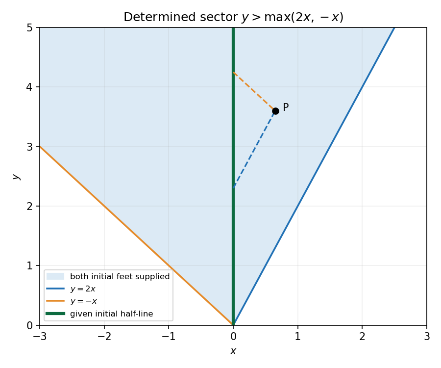

<h1 id="b/6/solution">Solution</h1>

↑ **Parent:** [6](../6.md)

With $A$ invertible, write the system as $\mathbf u_x+M\mathbf u_y=\mathbf d$, $M=A^{-1}B$. Real distinct [eigenvalues](../../../../eigenvalue.md) of $M$ give strict [hyperbolicity](../../../../hyperbolicity.md); a real complete [eigenbasis](../../../../eigenbasis.md) gives the usual diagonalizable [hyperbolic](../../../../hyperbolic-equilibrium-point.md) form. The [characteristic curves](../../../../characteristic-curve.md) satisfy $dy/dx=\lambda_i$. Left [eigenvectors](../../../../eigenvector.md) form [characteristic](../../../../characteristic-of-a-field.md) dependent combinations $w_i=\ell_i\mathbf u$; for constant coefficients they obey separate [transport equations](../../../../transport-equation-split.md). [Characteristic](../../../../characteristic-of-a-field.md) coordinates are functions constant on those curves, such as $y-\lambda_i x$ in the constant case. For variable coefficients extra [derivatives](../../../../derivative.md) of the [eigenvectors](../../../../eigenvector.md) can couple the combinations; local [characteristic](../../../../characteristic-of-a-field.md) directions still follow the real [matrix](../../../../matrix.md) pencil. If $A$ is singular one first chooses a noncharacteristic coordinate direction with an invertible coefficient combination.

For the specified constants,

$$
M=\begin{pmatrix}5&3\\-6&-4\end{pmatrix},\qquad\mathbf d=\begin{pmatrix}3\\-2\end{pmatrix}.
$$

Its speeds are $2$ and $-1$, with left [eigenvectors](../../../../eigenvector.md) $(2,1)$ and $(1,1)$. Hence

$$
w_+=2u+v,\quad (w_+)_x+2(w_+)_y=4,\qquad
w_-=u+v,\quad (w_-)_x-(w_-)_y=1.
$$

The transported [Riemann invariants](../../../../riemann-invariant.md) are $\boxed{R_+=2u+v-4x,\quad R_-=u+v-x}$, constant on $y-2x=\text{constant}$ and $y+x=\text{constant}$, respectively. Initial data give $w_+(0,s)=s-\sin(s/2)$ and $w_-(0,s)=-e^s$, so

$$
w_+=y+2x-\sin(y/2-x),\qquad w_-=-e^{y+x}+x.
$$

Invert these two combinations:

$$
\boxed{u=e^{y+x}+y+x-\sin(y/2-x),\qquad v=-2e^{y+x}-y+\sin(y/2-x).}
$$

Both [characteristic](../../../../characteristic-of-a-field.md) feet must lie on the supplied positive initial half-line. Thus

$$
\boxed{y-2x>0,\qquad y+x>0,\quad\text{equivalently }y>\max(2x,-x).}
$$

Outside this sector at least one invariant needs unsupplied initial data. The closed expressions give one possible extension there but are not uniquely forced by the question's initial half-line.

**[Figure 3](#b/6/image-sector-where-both-backward-characteristic-families-meet-the-given-initial-half-line). Sector where both backward characteristic families meet the given initial half-line**.

## ↑ Ancestors (12)

1. [6](../6.md)
2. [B](../../b.md)
3. [2008](../../../2008-split.md)
4. [Past exam of the differential equations and applications course of the University of Oxford](../../../split.md)
5. [Differential equations and applications course of the University of Oxford](../../../../differential-equations-and-applications-course-of-the-university-of-oxford.md)
6. [Year 3 of the mathematics course of the University of Oxford](../../../../year-3-of-the-mathematics-course-of-the-university-of-oxford.md)
7. [Mathematics course of the University of Oxford](../../../../mathematics-course-of-the-university-of-oxford.md)
8. [Undergraduate course of the University of Oxford](../../../../undergraduate-course-of-the-university-of-oxford.md)
9. [Course of the University of Oxford](../../../../course-of-the-university-of-oxford.md)
10. [University of Oxford](../../../../university-of-oxford-split.md)
11. [List of universities](../../../../list-of-universities.md)
12. [Codex Wiki](../../../../split.md)
