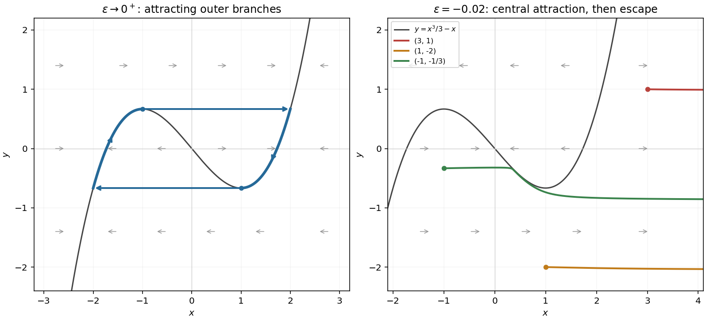

<h1 id="a/1/b/solution">Solution</h1>

↑ **Parent:** [B](../b.md)

The [nullcline](../../../../../nullcline.md) is $\boxed{y=h(x)=x^3/3-x}$. Write $F=x-x^3/3+y$. Away from it at an order-one distance, $F$ is order one on the indicated finite phase-space scales. Thus $\dot x=O(\epsilon^{-1})$ while $\dot y=-x=O(1)$: the [trajectory](../../../../../trajectory.md) changes $x$ on the [fast time in a singular perturbation](../../../../../fast-time-in-a-singular-perturbation.md) $t/\epsilon$, with only an $O(\epsilon)$ change in $y$. Equivalently $dy/dx=-\epsilon x/F=O(\epsilon)$, which explains the nearly horizontal motion.

For positive $\epsilon$, $F_x=1-x^2$ makes the branches $|x|>1$ fast attracting and the middle branch $|x|<1$ fast repelling. The arrows point right where $y>h(x)$ and left where $y<h(x)$, carrying a generic off-[nullcline](../../../../../nullcline.md) point towards an attracting branch. The reduced description changes near a fold, where $F_x=0$; the rapid/slow distinction there needs a separate transition layer.

**[Figure 1](#a/1/b/image-cubic-nullcline-limiting-relaxation-cycle-and-reversed-fast-stability). Cubic nullcline, limiting relaxation cycle, and reversed fast stability**.

The left panel shows positive $\epsilon$; the right panel shows negative $\epsilon$, including the three specified starting points. Horizontal arrows indicate the leading fast motion.

## ↑ Ancestors (13)

1. [B](../b.md)
2. [1](../../1.md)
3. [A](../../../a.md)
4. [2009](../../../../2009-split.md)
5. [Past exam of the differential equations and applications course of the University of Oxford](../../../../split.md)
6. [Differential equations and applications course of the University of Oxford](../../../../../differential-equations-and-applications-course-of-the-university-of-oxford.md)
7. [Year 3 of the mathematics course of the University of Oxford](../../../../../year-3-of-the-mathematics-course-of-the-university-of-oxford.md)
8. [Mathematics course of the University of Oxford](../../../../../mathematics-course-of-the-university-of-oxford.md)
9. [Undergraduate course of the University of Oxford](../../../../../undergraduate-course-of-the-university-of-oxford.md)
10. [Course of the University of Oxford](../../../../../course-of-the-university-of-oxford.md)
11. [University of Oxford](../../../../../university-of-oxford-split.md)
12. [List of universities](../../../../../list-of-universities.md)
13. [Codex Wiki](../../../../../split.md)
