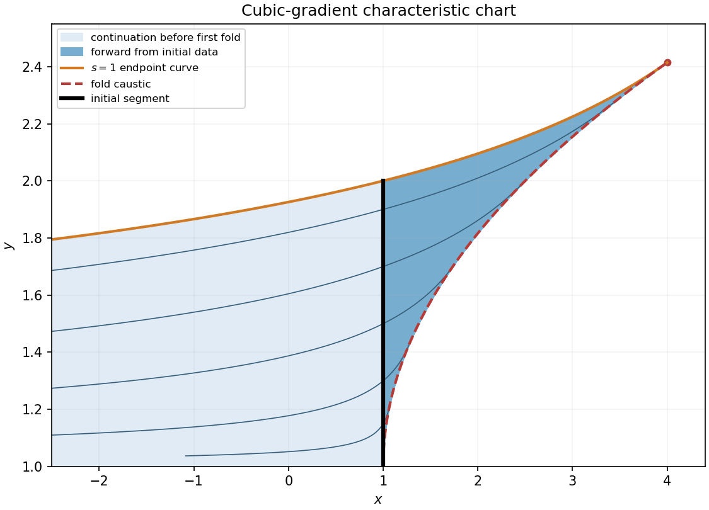

<h1 id="b/4/solution">Solution</h1>

↑ **Parent:** [4](../4.md)

For the general equation the [Charpit's equations](../../../../charpit-s-equations.md) are

$$
\dot x=F_p,\quad\dot y=F_q,\quad\dot u=pF_p+qF_q,\quad\dot p=-F_x-pF_u,\quad\dot q=-F_y-qF_u.
$$

At parameter time zero set $(x,y,u)=(x_0,y_0,u_0)$ and choose $p_0,q_0$ to satisfy $F(x_0,y_0,u_0,p_0,q_0)=0$ and $p_0x_0'+q_0y_0'=u_0'$. The [chain rule](../../../../chain-rule.md) gives

$$
\frac{dF}{dt}=F_xF_p+F_yF_q+F_u(pF_p+qF_q)-F_p(F_x+pF_u)-F_q(F_y+qF_u)=0,
$$

so $F$ remains zero. The [non-characteristic](../../../../non-characteristic-hypersurface.md) condition is $x_0'F_q-y_0'F_p\ne0$, ensuring a local graph.

For the particular equation put $F=p^3+(y-1)q+u-2$ and label the initial curve by $y_0=1+s$, $0<s\leq1$, $x_0=1$, $u_0=2+2s^3$. Compatibility gives $q_0=6s^2$ and $p_0^3=-8s^3$, hence the unique real choice $p_0=-2s$. Integrating the characteristic equations gives

$$
\boxed{\begin{aligned}
x&=1+6s^2(1-e^{-2t}),&y&=1+se^t,\\
p&=-2se^{-t},&q&=6s^2e^{-2t},\\
u&=2+8s^3e^{-3t}-6s^3e^{-t},&&0<s\leq1.
\end{aligned}}
$$

The projection determinant is $J=12s^2e^t(1-2e^{-2t})$. Initially $J=-12s^2\ne0$; its first zero is $t=\tfrac12\log2$. At that fold,

$$
x=1+3s^2,\qquad y=1+\sqrt2s,\qquad\boxed{x=1+\tfrac32(y-1)^2.}
$$

To describe the entire chart attached to the data before the fold, put $Y=y-1>0$ and $w=e^{-2t}>1/2$. Elimination gives $x-1=6Y^2w(1-w)$ and

$$
w=\frac{1+\sqrt{1-2(x-1)/(3Y^2)}}2,\qquad s=Y\sqrt w.
$$

The initial-endpoint constraint $s\leq1$ therefore gives the uniquely determined chart

$$
\boxed{0<Y<\sqrt2,\qquad 7-\frac6{Y^2}\leq x<1+\frac32Y^2.}
$$

The boundary $s=1$ is included as inherited endpoint data; open-domain statements use strict inequality there. The fold is excluded. For forward characteristic times only, $0\leq t<\tfrac12\log2$, impose additionally $x\geq1$. The source excludes $s=0$, so $(1,1)$ is not a [non-characteristic](../../../../non-characteristic-hypersurface.md) initial point. The sheet beyond the fold does not extend this initial graph uniquely.

**[Figure 2](#b/4/image-initial-segment-endpoint-characteristic-and-fold-of-the-cubic-gradient-solution). Initial segment, endpoint characteristic, and fold of the cubic-gradient solution**.

## ↑ Ancestors (12)

1. [4](../4.md)
2. [B](../../b.md)
3. [2009](../../../2009-split.md)
4. [Past exam of the differential equations and applications course of the University of Oxford](../../../split.md)
5. [Differential equations and applications course of the University of Oxford](../../../../differential-equations-and-applications-course-of-the-university-of-oxford.md)
6. [Year 3 of the mathematics course of the University of Oxford](../../../../year-3-of-the-mathematics-course-of-the-university-of-oxford.md)
7. [Mathematics course of the University of Oxford](../../../../mathematics-course-of-the-university-of-oxford.md)
8. [Undergraduate course of the University of Oxford](../../../../undergraduate-course-of-the-university-of-oxford.md)
9. [Course of the University of Oxford](../../../../course-of-the-university-of-oxford.md)
10. [University of Oxford](../../../../university-of-oxford-split.md)
11. [List of universities](../../../../list-of-universities.md)
12. [Codex Wiki](../../../../split.md)
