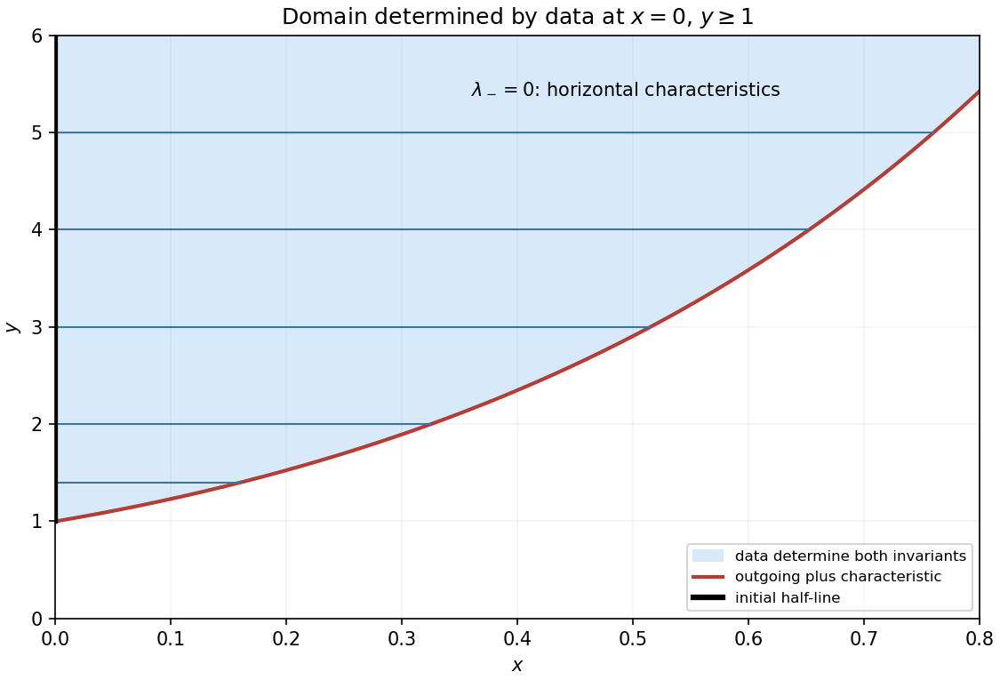

<h1 id="b/5/solution">Solution</h1>

↑ **Parent:** [5](../5.md)

The coefficient matrix of $(u_y,v_y)^T$ is $A=\begin{pmatrix}v&u\\u^{-3}&v\end{pmatrix}$. Its distinct [eigenvalues](../../../../eigenvalue.md) are $\lambda_\pm=v\pm1/u$ for every $u>0$, so the system is strictly hyperbolic. Define $D_\pm=\partial_x+(v\pm1/u)\partial_y$. Then

$$
D_+\left(v-\frac1u\right)=v_x+(v+1/u)v_y+u^{-2}[u_x+(v+1/u)u_y]=0:
$$

the derivative terms cancel, as do the sources $u-u$. Hence $R=v-1/u$ is constant on the plus-family characteristics.

The data give $R=0$, so throughout their [domain of dependence](../../../../domain-of-dependence.md) $v=1/u$. The minus-family speed is then $v-1/u=0$: **the other characteristics are the horizontal lines $y=a$**. Substitution into the second PDE, or its minus-characteristic compatibility relation, gives $v_x=1/v$. Integrate at fixed $y$ using $v(0,y)=y$ and retain the positive branch:

$$
\boxed{v(x,y)=\sqrt{y^2+2x},\qquad u(x,y)=\frac1{\sqrt{y^2+2x}}.}
$$

Indeed $u_x=-u^3$, $u_y=-yu^3$, $v_y=yu$, so $vu_y+uv_y=0$; similarly $u^{-3}u_y+vv_y=-y+y=0$.

For $x\geq0$ the lower edge of the region determined solely by the given data is the plus characteristic from $(0,1)$. Write it $y=b(x)$, where the exact boundary characterization is

$$
\boxed{b'(x)=2\sqrt{b(x)^2+2x},\qquad b(0)=1.}
$$

The determined region is $\boxed{x\geq0,\ y\geq b(x)}$, with strict inequality for its interior. Both backward characteristic families there reach the supplied initial half-line. Below this boundary a backward plus characteristic would require initial data below $y=1$, which were not supplied; extending the displayed formulas there gives a possible continuation but is not forced by the data. An elementary expression for $b$ is unnecessary: its initial-value ODE defines it uniquely and the requested other family already has the explicit form $y=a$. The sketch integrates only this boundary for illustration.

**[Figure 3](#b/5/image-horizontal-minus-characteristics-and-the-outgoing-plus-boundary-of-the-determined-region). Horizontal minus characteristics and the outgoing plus boundary of the determined region**.

## ↑ Ancestors (12)

1. [5](../5.md)
2. [B](../../b.md)
3. [2009](../../../2009-split.md)
4. [Past exam of the differential equations and applications course of the University of Oxford](../../../split.md)
5. [Differential equations and applications course of the University of Oxford](../../../../differential-equations-and-applications-course-of-the-university-of-oxford.md)
6. [Year 3 of the mathematics course of the University of Oxford](../../../../year-3-of-the-mathematics-course-of-the-university-of-oxford.md)
7. [Mathematics course of the University of Oxford](../../../../mathematics-course-of-the-university-of-oxford.md)
8. [Undergraduate course of the University of Oxford](../../../../undergraduate-course-of-the-university-of-oxford.md)
9. [Course of the University of Oxford](../../../../course-of-the-university-of-oxford.md)
10. [University of Oxford](../../../../university-of-oxford-split.md)
11. [List of universities](../../../../list-of-universities.md)
12. [Codex Wiki](../../../../split.md)
