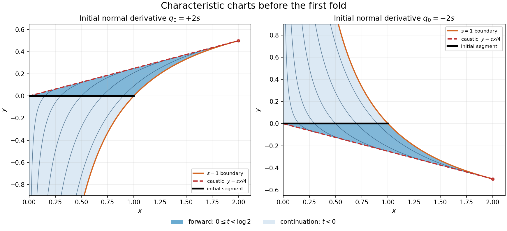

<h1 id="b/4/b/solution">Solution</h1>

↑ **Parent:** [B](../b.md)

Set $F=xp+q^2/4+u-1$. Parametrize the data by $x_0=s$, $y_0=0$, $u_0=1-s^2/3$. Tangential differentiation gives $p_0=-2s/3$; substitution into $F=0$ then gives $q_0^2=4s^2$. Thus the data allow **two normal-[derivative](../../../../../derivative.md) branches**, indexed by $\varepsilon=\pm1$, with $q_0=2\varepsilon s$. For $s>0$ each branch is [non-characteristic](../../../../../non-characteristic-hypersurface.md); the endpoint $s=0$ is degenerate.

The [Charpit's equations](../../../../../charpit-s-equations.md) reduce to $\dot x=x$, $\dot y=q/2$, $\dot p=-2p$, $\dot q=-q$ and $\dot u=xp+q^2/2$. Integrating with these initial values gives

$$
\boxed{\begin{aligned}
x&=se^t,&y&=\varepsilon s(1-e^{-t}),\\
p&=-\tfrac23se^{-2t},&q&=2\varepsilon se^{-t},\\
u&=1+\tfrac23s^2e^{-t}-s^2e^{-2t},&&0<s\leq1.
\end{aligned}}
$$

Direct substitution checks $xp+q^2/4+u-1=0$, and $t=0$ recovers the initial data. The projection onto the $(x,y)$ plane has [Jacobian determinant](../../../../../jacobian-determinant.md)

$$
J=\det\frac{\partial(x,y)}{\partial(s,t)}=\varepsilon s(2-e^t).
$$

It first vanishes at $t=\log2$. These points form the [characteristic caustic](../../../../../characteristic-caustic.md) $y=\varepsilon x/4$, $0<x\leq2$; a single [classical solution](../../../../../classical-solution.md) cannot in general be continued through the fold by treating all projected [characteristic curves](../../../../../characteristic-curve.md) as a graph.

For a precise description put $r=\varepsilon y$. On the chart containing the initial curve and lying before the fold, $t<\log2$, elimination gives

$$
s=\frac{x+\sqrt{x^2-4xr}}2,\qquad e^{-t}=s/x.
$$

The plus square-root is forced by $s/x>1/2$, rather than a free second choice. The conditions $0<s\leq1$ give the complete unfolded chart

$$
\boxed{0<x<2,\qquad 1-\frac1x\leq\varepsilon y<\frac x4.}
$$

Interior points of the domain have strict inequality at the boundary generated by $s=1$ as well. The other boundary is the [characteristic caustic](../../../../../characteristic-caustic.md); the original endpoint $s=0$ contributes no open chart. On the portion obtained by following characteristics forward from the data, $0\leq t<\log2$, the region is more specifically

$$
\boxed{\begin{cases}0\leq\varepsilon y<x/4,&0<x\leq1,\\1-1/x\leq\varepsilon y<x/4,&1<x<2.\end{cases}}
$$

The $s=1$ boundary is $y=\varepsilon(1-1/x)$ and meets the [characteristic caustic](../../../../../characteristic-caustic.md) at $(2,\varepsilon/2)$. Negative characteristic times give the continuation across the initial segment into the opposite half-plane. Each sign branch is a distinct local solution; the initial values alone do not select one of them.

**[Figure 1](#b/4/b/image-two-characteristic-branches-their-forward-regions-and-the-first-caustic). Two characteristic branches, their forward regions, and the first caustic**.

The solid shading follows $t\geq0$; the lighter shading shows the same smooth chart at $t<0$. Reflected panels correspond to the two allowed signs of the initial normal [derivative](../../../../../derivative.md). Beyond the dashed [characteristic caustic](../../../../../characteristic-caustic.md) the characteristic parametrization no longer gives this smooth graph.

## ↑ Ancestors (13)

1. [B](../b.md)
2. [4](../../4.md)
3. [B](../../../b.md)
4. [2010](../../../../2010-split.md)
5. [Past exam of the differential equations and applications course of the University of Oxford](../../../../split.md)
6. [Differential equations and applications course of the University of Oxford](../../../../../differential-equations-and-applications-course-of-the-university-of-oxford.md)
7. [Year 3 of the mathematics course of the University of Oxford](../../../../../year-3-of-the-mathematics-course-of-the-university-of-oxford.md)
8. [Mathematics course of the University of Oxford](../../../../../mathematics-course-of-the-university-of-oxford.md)
9. [Undergraduate course of the University of Oxford](../../../../../undergraduate-course-of-the-university-of-oxford.md)
10. [Course of the University of Oxford](../../../../../course-of-the-university-of-oxford.md)
11. [University of Oxford](../../../../../university-of-oxford-split.md)
12. [List of universities](../../../../../list-of-universities.md)
13. [Codex Wiki](../../../../../split.md)
