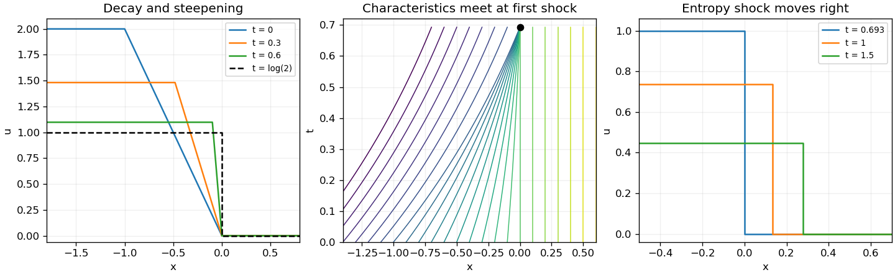

<h1 id="b/4/i/solution">Solution</h1>

↑ **Parent:** [I](../i.md)

For zero viscosity, the [method of characteristics](../../../../../method-of-characteristics.md) gives $u=u_0(a)e^{-t}$ and $x=a+u_0(a)(1-e^{-t})$. On the sloping part of the initial profile, $u_0(a)=-2a$, so $x=a(2e^{-t}-1)$. While this map is increasing, inversion gives

$$
\boxed{u(x,t)=\begin{cases}
2e^{-t},&x\leq1-2e^{-t},\\
-\dfrac{2e^{-t}x}{2e^{-t}-1},&1-2e^{-t}<x\leq0,\\
0,&x>0.
\end{cases}}
$$

The sloping interval shrinks from width one to zero while its height decreases from two to one. Its [spatial derivative](../../../../../spatial-derivative.md) is $-2e^{-t}/(2e^{-t}-1)$ and diverges as $2e^{-t}-1\downarrow0$. Thus the first [shock formation by characteristic intersection](../../../../../shock-formation-by-characteristic-intersection.md) occurs at

$$
\boxed{t_* =\log2,\qquad x_*=0.}
$$

For $0\leq t<t_*$ the profile consists of a left plateau, a straight descending ramp ending at zero, and a right zero plateau. At $t_*$ the ramp becomes a vertical jump. This is a [damped Burgers equation](../../../../../damped-burgers-equation.md); viscosity smooths that jump into a thin transition.

**[Figure 1](#b/4/i/image-decay-and-steepening-of-the-inviscid-ramp-its-characteristic-collapse-and-the-entropy-shock-after-formation). Decay and steepening of the inviscid ramp, its characteristic collapse, and the entropy shock after formation**.

## ↑ Ancestors (13)

1. [I](../i.md)
2. [4](../../4.md)
3. [B](../../../b.md)
4. [2011](../../../../2011-split.md)
5. [Past exam of the differential equations and applications course of the University of Oxford](../../../../split.md)
6. [Differential equations and applications course of the University of Oxford](../../../../../differential-equations-and-applications-course-of-the-university-of-oxford.md)
7. [Year 3 of the mathematics course of the University of Oxford](../../../../../year-3-of-the-mathematics-course-of-the-university-of-oxford.md)
8. [Mathematics course of the University of Oxford](../../../../../mathematics-course-of-the-university-of-oxford.md)
9. [Undergraduate course of the University of Oxford](../../../../../undergraduate-course-of-the-university-of-oxford.md)
10. [Course of the University of Oxford](../../../../../course-of-the-university-of-oxford.md)
11. [University of Oxford](../../../../../university-of-oxford-split.md)
12. [List of universities](../../../../../list-of-universities.md)
13. [Codex Wiki](../../../../../split.md)
