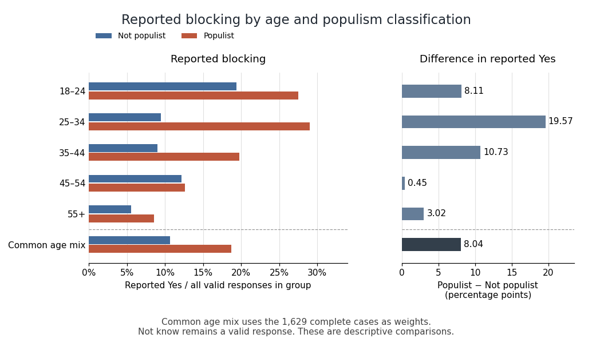

# 2018

↑ **Parent:** [Past exam of the digital social research: statistics core course of the University of Oxford](../past-exam-of-the-digital-social-research-statistics-core-course-of-the-university-of-oxford.md)

Solutions to all six questions of the 6 December 2018 Statistics Core examination. [Oxford examination release ZIP](https://www.whatdotheyknow.com/request/admission_statistics_and_past_pa/response/2722250/attach/2/Exam%20papers.zip?cookie_passthrough=1), member `Digital Social Research Statistics Core/2018 Michaelmas a14564w1.pdf`. The cover heading prints A14564W1, while alternating footers print A14653W1; both are retained as markings on one paper. All nine figures and the unnumbered output for Question 1 are available. Several supplied numerical fields contradict one another. Each solution distinguishes what the printed fields would mean if trusted from calculations supported by the displayed counts or compatible summary fields; no individual dataset or unique correction is invented.

**Table of contents**

- [1](#1)
  - [Solution](#1/solution)
- [2](#2)
  - [Solution](#2/solution)
- [3](#3)
  - [Solution](#3/solution)
- [4](#4)
  - [Solution](#4/solution)
- [5](#5)
  - [Solution](#5/solution)
- [6](#6)
  - [Solution](#6/solution)

## 1

↑ **Parent:** [2018](2018.md)

<h3 id="1/solution">Solution</h3>

↑ **Parent:** [1](#1)

**The printed group means suggest about 13.49 more tweets in the liberal group, but the reported significance cannot be accepted as one coherent test result. The printed $p=0.04288$ would reject equal means at 5%; the printed $t=-1.9436$ with 23.92 [statistical degrees of freedom](../statistical-inference.md#statistical-degrees-of-freedom) instead gives a two-sided [p-value](../statistical-hypothesis-test.md#p-value) about 0.06380 and would not reject at 5%. The confidence-interval fields are also inconsistent.**

There are 14 conservative-coded and 12 liberal-coded observations. The tweet summary has [sample median](../probability-distribution.md#sample-median) 258.5, [quartiles](../probability-and-statistics.md#quartile) 204.5 and 323.2, and range 108 to 441, so the [interquartile range](../probability-and-statistics.md#interquartile-range) is about 118.7 tweets. No measurement period is specified, so these should not be reinterpreted as tweets per day. The displayed overall [sample mean](../variance.md#sample-mean) is 261.5, subject to a further consistency issue below. These are small groups; the summary alone cannot establish normality, lack of outliers or an appropriate sampling design.

Let $\mu_C$ and $\mu_L$ be the two population means for the defined tweet measure. The [null hypothesis](../statistical-hypothesis-test.md#null-hypothesis) is $H_0:\mu_C-\mu_L=0$, against the [two-sided test](../statistical-hypothesis-test.md#two-sided-hypothesis-test) alternative $H_1:\mu_C-\mu_L\ne0$. [Welch's t-test](../statistical-hypothesis-test.md#welch-s-t-test) uses

$$
t=\frac{\overline y_C-\overline y_L}{\sqrt{s_C^2/n_C+s_L^2/n_L}},
$$

allowing unequal group [variances](../variance.md). It requires independent observations and a suitable approximation to the sampling distribution of the mean difference; a large-sample justification cannot simply be assumed with group sizes 14 and 12. Its noninteger [statistical degrees of freedom](../statistical-inference.md#statistical-degrees-of-freedom) comes from the Welch approximation, not a fractional number of respondents.[Arguments and Details: two-sided alternative and unequal-variance Welch calculation](../computer-science-bibliography.md#student-s-t-test-in-the-r-documentation)

The two displayed [sample means](../variance.md#sample-mean) imply

$$
\widehat\Delta=255.4286-268.9167=\boxed{-13.4881\text{ tweets}.}
$$

The negative sign means the liberal-coded group has the larger observed mean. This is a difference in group averages, not a statement about every individual and not evidence that political orientation causes tweeting behaviour. Practical importance concerns this difference and its context; [statistical significance](../statistical-hypothesis-test.md#statistical-significance) does not itself measure its importance.

A [p-value](../statistical-hypothesis-test.md#p-value) is calculated under the [null hypothesis](../statistical-hypothesis-test.md#null-hypothesis) and the assumed sampling model. It is the probability of a result at least as incompatible with that hypothesis as the observed one, not the probability that the hypothesis is true or that this conclusion is mistaken. A prespecified [significance level](../statistical-hypothesis-test.md#significance-level) controls the long-run [Type I error](../information-theory.md#type-i-and-type-ii-errors) rate of rejecting a true null; a [Type II error](../information-theory.md#type-i-and-type-ii-errors) is nonrejection of a false null, and [statistical power](../probability-and-statistics.md#statistical-power) concerns rejection under a specified alternative. Neither a small [p-value](../statistical-hypothesis-test.md#p-value) nor a nonrejection settles the [effect size](../statistical-inference.md#effect-size) or a causal explanation.

Taken on its own, the printed [p-value](../statistical-hypothesis-test.md#p-value) supports a nominal 5% rejection, but not a 1% rejection. Taken instead from the printed t statistic and [statistical degrees of freedom](../statistical-inference.md#statistical-degrees-of-freedom), the two-sided tail is about 0.06380. These different 5% decisions cannot be reconciled by ordinary rounding. Conditional on trusting the group means, t and degrees of freedom, the implied [standard error](../statistical-inference.md#standard-error) is $(-13.4881)/(-1.9436)\approx6.93975$ and the corresponding 95% [confidence interval](../statistical-inference.md#confidence-interval) is

$$
\boxed{[-27.814,\ 0.837]\text{ tweets, conditional on those fields}.}
$$

It includes zero, consistently with that larger [p-value](../statistical-hypothesis-test.md#p-value). This calculation is a conditional consistency check, not recovery of the true raw-data interval.

The source lists its interval endpoints as 0.04582 and $-126.7904$, in that order. They are not ordered, and merely sorting them would still give midpoint about $-63.3723$, rather than the estimated difference $-13.4881$. The [symmetric confidence-interval consistency identities](../statistical-inference.md#symmetric-confidence-interval-consistency-identities) therefore fail for the usual t interval. A frequentist 95% interval describes repeated-sample coverage of its procedure, not a 95% posterior probability for a fixed parameter; neither interpretation justifies silently repairing these endpoints.

The group summaries also imply pooled mean $(14\times255.4286+12\times268.9167)/26\approx261.6539$, which cannot round to the printed 261.5. The [pooled-mean compatibility under rounding](../arithmetic.md#pooled-mean-compatibility-under-rounding) identifies this additional mismatch for summaries of the same complete sample. Thus **the observed direction is conditionally liberal-greater-than-conservative, but the inferential decision and interval require corrected coherent output. Nonrejection under the t/df reading would not establish equal population means.** Random assignment, representativeness and possible [confounding](../causal-inference.md#confounding) are not supplied by this test.

## 2

↑ **Parent:** [2018](2018.md)

<h3 id="2/solution">Solution</h3>

↑ **Parent:** [2](#2)

**Age is available for all 1784 respondents. Blocking responses are available for 1700, and populism classification for 1692. Among valid responses, 15.76% report blocking someone and 71.75% are classified as populist. “Not know” is a recorded substantive response, distinct from the missing observations.**

A [frequency table](../probability-and-statistics.md#frequency-table) gives category counts and [percentages](../arithmetic.md#percentage). A full-sample percentage divides by 1784, whereas a valid percentage divides by the number observed for that variable. A [cumulative percentage](../probability-and-statistics.md#cumulative-percentage) adds categories in the displayed order. Differences between the two percentage columns therefore reflect missing values, while small discrepancies from 100% can arise from [rounding error](../numerical-analysis.md#round-off-error).

The age groups contain 329 respondents aged 18–24, 320 aged 25–34, 371 aged 35–44, 323 aged 45–54 and 441 aged 55+, approximately 18.44%, 17.94%, 20.80%, 18.11% and 24.72%. The oldest category is the largest, but it is open-ended and spans a different width from the younger categories, so its larger count does not establish a higher frequency per single year of age. The ordered cumulative 57.18% means that about that proportion is younger than 45. The displayed final 100.01% is compatible with rounding, not an extra respondent. There are no reported missing ages.

Blocking has valid counts 133 Not know, 1299 No and 268 Yes. Dividing by all respondents gives approximately 7.46%, 72.81% and 15.02%; dividing by the 1700 valid responses gives about 7.82%, 76.41% and 15.76%. The remaining 84 observations, 4.71% of the full sample, are missing. The distinction matters: 15.02% is not the same denominator-based statement as 15.76%. Not knowing that blocking was possible is a supplied answer category, not one of those 84 missing values. It should not be deleted or merged merely because its label contains “know”.

Blocking is a [nominal categorical variable](../statistical-modelling.md#nominal-categorical-variable) in this form. Yes and No identify a binary behaviour, while Not know additionally records awareness. There is no automatic substantive ordinal scale Not know $<$ No $<$ Yes. Consequently its cumulative percentage is tied to the printing order and should not be read as a universal low-to-high blocking scale. This point will limit interpretation of the later ordinal coefficients.

There are 478 observed Not-populist classifications and 1214 Populist classifications. These represent 26.79% and 68.05% of the full sample, or 28.25% and 71.75% of the 1692 classified respondents. The 92 missing classifications account for 5.16%. These percentages describe the particular classification and sample; the output does not supply the instrument used to define populism or establish prevalence in a wider population. Adding missing cases to either substantive group would invent their classifications.

The later table uses only 1629 observations with both blocking and populism observed. It is smaller than either marginal valid total, as expected under [complete-case analysis](../probability-and-statistics.md#complete-case-analysis). The [missingness overlap from marginal and complete-case counts](../probability-and-statistics.md#missingness-overlap-from-marginal-and-complete-case-counts) gives

$$
m_{\mathrm{both}}=84+92-(1784-1629)=\boxed{21}.
$$

Thus 63 have blocking missing but populism observed, 71 have populism missing but blocking observed, and 21 have both missing. These totals reconcile the denominators without reconstructing individual records. They do not establish a [missing-data mechanism](../probability-and-statistics.md#missing-data-mechanism) such as [missing completely at random](../probability-and-statistics.md#missing-completely-at-random); selection into complete cases could affect later associations.

## 3

↑ **Parent:** [2018](2018.md)

<h3 id="3/solution">Solution</h3>

↑ **Parent:** [3](#3)

**Among the 1629 complete cases, reported blocking is more common in the populist group: 18.44% versus 11.19%, a difference of about 7.26 [percentage points](../arithmetic.md#percentage-point). The full three-category response distributions are associated with classification: $X^2\approx24.9671$, 2 [statistical degrees of freedom](../statistical-inference.md#statistical-degrees-of-freedom), $p\approx3.79\times10^{-6}$ and [Cramér's V](../statistical-modelling.md#cramer-s-v) about 0.124. This is an association among observed respondents, not a [causal effect](../causal-inference.md#causal-effect).**

Read the body percentages within the populism rows. There are 50 Yes responses out of 447 Not-populist respondents and 218 out of 1182 Populist respondents. The corresponding No percentages are 76.73% and 75.38%, while Not know falls from 12.08% to 6.18%. The overall distribution therefore changes in more than just the Yes category. The row-total percentages, 27.44% and 72.56%, describe group composition in the complete-case table, not the conditional blocking rates. Their slight difference from Question 2's 28.25% and 71.75% is consistent with different missing-value patterns.

The [Pearson chi-squared test of independence](../statistical-hypothesis-test.md#pearson-chi-squared-test-of-independence) compares the two full response distributions. Under the [null hypothesis](../statistical-hypothesis-test.md#null-hypothesis) of [independence](../random-variable.md#independent-random-variables), each cell has [expected frequency](../probability-and-statistics.md#expected-frequency) $E_{ij}=n_{i+}n_{+j}/N$, and

$$
X^2=\sum_{i,j}\frac{(O_{ij}-E_{ij})^2}{E_{ij}},\qquad \mathrm{df}=(2-1)(3-1)=2.
$$

The minimum expected count is about 34.849, comfortably above the usual sparse-cell concern. With independent observations and a suitable sampling model, the tiny [p-value](../statistical-hypothesis-test.md#p-value) rejects that omnibus null at conventional [significance levels](../statistical-hypothesis-test.md#significance-level). The [likelihood-ratio test of independence in a contingency table](../statistical-hypothesis-test.md#likelihood-ratio-test-of-independence-in-a-contingency-table) gives $G^2\approx24.6044$, also on 2 [statistical degrees of freedom](../statistical-inference.md#statistical-degrees-of-freedom), with calculated $p\approx4.54\times10^{-6}$. Its printed 0.000 is a rounded value, not zero.[Details: the product-marginal null, expected counts and asymptotic chi-squared calibration](../computer-science-bibliography.md#pearson-s-chi-squared-test-for-count-data-in-the-r-documentation)

The [generalized phi coefficient](../statistical-modelling.md#generalized-phi-coefficient) and [Cramér's V](../statistical-modelling.md#cramer-s-v) both equal $\sqrt{X^2/N}\approx0.124$ because the smaller nontrivial table dimension is one. The [contingency coefficient](../statistical-modelling.md#contingency-coefficient) is $\sqrt{X^2/(X^2+N)}\approx0.123$. These are unsigned magnitude measures, not further significance tests or percentages of explained variation. A modest magnitude can be highly significant with a large [sample size](../probability-and-statistics.md#sample-size).

The omnibus test does not, by itself, identify which response contrast differs. To target reported Yes specifically, an explicitly derived binary table combines No and Not know as _non-Yes reports_, producing rows $(50,397)$ and $(218,964)$. An uncorrected two-by-two Pearson test gives $X^2\approx12.4292$ on one [statistical degree of freedom](../statistical-inference.md#statistical-degrees-of-freedom), $p\approx0.000423$. A large-sample [confidence interval](../statistical-inference.md#confidence-interval) for the difference of reported-Yes proportions is approximately $[0.0359,0.1092]$, or 3.59 to 10.92 [percentage points](../arithmetic.md#percentage-point). These are additional count-derived calculations under independent binomial sampling, not values printed in the exam. They address the selected Yes contrast and do not pretend that Not know and No are substantively identical in every respect. As [aggregation can change a contingency-table independence test](../statistical-hypothesis-test.md#aggregation-can-change-a-contingency-table-independence-test) explains, the binary and three-category tests have different null hypotheses.

The printed ordinal coefficients, [Goodman and Kruskal's gamma](../statistical-modelling.md#goodman-and-kruskal-s-gamma) 0.295, [Somers' D](../statistical-modelling.md#somers-d) 0.116, [Kendall's tau-b](../statistical-modelling.md#kendall-s-tau-b) 0.117 and [Stuart's tau-c](../statistical-modelling.md#stuart-s-tau-c) 0.093, are arithmetically consistent with the displayed ordering. For example, 134660 concordant and 73239 discordant pairs give $\gamma=(134660-73239)/(134660+73239)\approx0.295$. The full tie counts also partition all $\binom{1629}{2}=1326006$ unordered pairs correctly. However, the three response labels do not establish an ordinal scale. Their arithmetic sign therefore cannot replace the direct Yes comparison or be called the proportion of variation explained. Changing the arbitrary order of Not know and No could change the ordinal summary without changing the nominal association.[GoodmanKruskalGamma and SomersDelta, Details: ordinal-variable requirement and tied-pair treatment](../computer-science-bibliography.md#desctools-documentation-for-gamma-somers-d-and-lambda)

Both directional values of [Goodman and Kruskal's lambda](../statistical-modelling.md#goodman-and-kruskal-s-lambda) are zero. No is the modal blocking answer in both populism groups, and Populist is the modal classification within each blocking column. Knowing the other variable therefore changes no modal prediction enough to reduce the number of classification errors. This does not contradict the unequal conditional distributions or the chi-squared result. Before generalizing, missing outcomes, missing classifications, the sampling design and possible [confounding](../causal-inference.md#confounding) must be considered; a [p-value](../statistical-hypothesis-test.md#p-value) does not supply those assumptions.

## 4

↑ **Parent:** [2018](2018.md)

<h3 id="4/solution">Solution</h3>

↑ **Parent:** [4](#4)

**Age and observed populism classification are associated, but the overall association is small and not a strictly monotone age trend. Populist classification is most common in the 55+ group, about 77.12%, versus 66.77% at ages 18–24; it also falls back to 66.38% at ages 35–44.**

This table has 1692 observations, all respondents with an observed populism classification, because age has no missing values. The within-age Populist percentages are 66.77%, 73.18%, 66.38%, 74.03% and 77.12%, in ascending age-group order. Their Not-populist complements are 33.23%, 26.82%, 33.62%, 25.97% and 22.88%. Comparing the oldest and youngest Populist percentages gives about 10.35 [percentage points](../arithmetic.md#percentage-point), but the intermediate reversal prevents describing a uniform rise at every age transition. The row totals 310, 302, 348, 308 and 424 are the classified cases; their differences from the age totals in Figure 1 sum to the 92 missing classifications.

The [Pearson chi-squared test of independence](../statistical-hypothesis-test.md#pearson-chi-squared-test-of-independence) gives $X^2\approx15.8680$ on $(5-1)(2-1)=4$ [statistical degrees of freedom](../statistical-inference.md#statistical-degrees-of-freedom), $p\approx0.003201$. The [likelihood-ratio test](../statistical-hypothesis-test.md#likelihood-ratio-test) gives $G^2\approx15.8572$ and $p\approx0.003217$. Both reject [independence](../random-variable.md#independent-random-variables) at 5% and 1% under the usual sampling assumptions. The minimum [expected frequency](../probability-and-statistics.md#expected-frequency) is about 85.317, so the large-sample approximation is not threatened by sparse expected counts here. Neither test is specifically a test of a linear or monotone age trend.

The [generalized phi coefficient](../statistical-modelling.md#generalized-phi-coefficient) and [Cramér's V](../statistical-modelling.md#cramer-s-v) are about 0.097, and the [contingency coefficient](../statistical-modelling.md#contingency-coefficient) about 0.096: small unsigned association magnitudes. If the binary classification is coded Not populist before Populist and age groups are ordered younger to older, the ordinal output has a meaningful conventional direction. The 258482 concordant and 205602 discordant pairs give [Goodman and Kruskal's gamma](../statistical-modelling.md#goodman-and-kruskal-s-gamma) about 0.114; [Somers' D](../statistical-modelling.md#somers-d) for classification given age is about 0.046, [Kendall's tau-b](../statistical-modelling.md#kendall-s-tau-b) 0.065 and [Stuart's tau-c](../statistical-modelling.md#stuart-s-tau-c) 0.074. These small positive summaries describe an overall older–Populist tendency while allowing the middle-age reversal. They use different tie or table-size adjustments and are not percentages of respondents caused to change classification by ageing.

[Goodman and Kruskal's lambda](../statistical-modelling.md#goodman-and-kruskal-s-lambda) for predicting classification from age is zero because Populist remains the modal classification in every age row. In the reverse direction, predicting age group from classification improves modal predictions slightly: without classification the most frequent age group has 424 cases, whereas choosing a separate modal age group for each classification yields $117+327=444$ correct predictions. The error reduction is $(444-424)/(1692-424)\approx0.0158$, matching the displayed 0.016. Direction must therefore be stated, rather than treating both lambda numbers as interchangeable. **Age is a relevant control variable for the later comparison, but these cross-sectional associations do not establish an age-related causal mechanism or remove other confounders.**

## 5

↑ **Parent:** [2018](2018.md)

<h3 id="5/solution">Solution</h3>

↑ **Parent:** [5](#5)

**Every displayed age stratum has a higher reported-Yes proportion among Populist respondents, but the size varies considerably. The largest difference is at ages 25–34 and the smallest at 45–54. The omnibus tests reject within-stratum independence for ages 25–34 and 35–44, but not for the other three groups; comparing those significance labels is not itself a test of [statistical interaction](../statistical-model.md#interaction-statistics).**

The five strata contain 298, 291, 339, 296 and 405 complete cases. They sum to 1629 and reproduce every cell of the overall table, so the comparison is a coherent age stratification. Each body percentage estimates a blocking-response [conditional distribution](../probability-theory.md#conditional-distribution) within a particular age and populism combination. Not know is retained as the third valid response. The ordinal statistics discussed below are numerical summaries of the displayed order only, because that response order has no established behavioural rank.

For ages 18–24, reported blocking is $19/98=19.39\%$ among Not-populist respondents versus $55/200=27.50\%$ among Populist respondents, a difference of about 8.11 [percentage points](../arithmetic.md#percentage-point). No is 71.43% versus 66.00%, and Not know is 9.18% versus 6.50%. The Pearson result is $X^2\approx2.67062$ on 2 [statistical degrees of freedom](../statistical-inference.md#statistical-degrees-of-freedom), $p\approx0.2631$; the [likelihood-ratio test](../statistical-hypothesis-test.md#likelihood-ratio-test) gives $G^2\approx2.72259$, $p\approx0.2563$. Thus neither rejects at 5%. The minimum [expected frequency](../probability-and-statistics.md#expected-frequency) is 7.235, so no cell falls below five. [Cramér's V](../statistical-modelling.md#cramer-s-v) and the [generalized phi coefficient](../statistical-modelling.md#generalized-phi-coefficient) are about 0.095, with [contingency coefficient](../statistical-modelling.md#contingency-coefficient) about 0.094. The ordered-label summaries are gamma 0.203, Somers' D 0.095, tau-b 0.092 and tau-c 0.084. Both lambdas are zero. These figures allow a positive descriptive Yes difference alongside considerable uncertainty; nonrejection does not establish identical response distributions.

For ages 25–34, reported blocking is $7/74=9.46\%$ versus $63/217=29.03\%$, a difference of about 19.57 [percentage points](../arithmetic.md#percentage-point). No falls from 75.68% to 64.06% and Not know from 14.86% to 6.91%. Pearson gives $X^2\approx13.8060$, $p\approx0.001005$ on 2 [statistical degrees of freedom](../statistical-inference.md#statistical-degrees-of-freedom); the likelihood ratio gives $G^2\approx15.21294$, $p\approx0.0004972$. Its printed 0.000 is rounding, not an exact zero. Both indicate nominal evidence against [independence](../random-variable.md#independent-random-variables), although the Pearson value is just above 0.001 rather than below it. The minimum expected count is about 6.612. V and generalized phi are about 0.218, and the contingency coefficient about 0.213. The ordered-label gamma is about 0.500, Somers' D 0.239, tau-b 0.211 and tau-c 0.181. Neither direction of lambda improves modal prediction: No remains the modal response in both rows and Populist the modal group in each column. In particular, gamma 0.500 does not mean that populism explains half the variation in blocking.

For ages 35–44, reported blocking is $10/111=9.01\%$ versus $45/228=19.74\%$, a difference of about 10.73 [percentage points](../arithmetic.md#percentage-point). No is nearly unchanged, 76.58% versus 76.32%, while Not know falls sharply from 14.41% to 3.95%. The full categorical association therefore includes a substantial awareness-category difference. Pearson gives $X^2\approx16.3872$, $p\approx0.0002764$; the likelihood ratio gives $G^2\approx16.06955$, $p\approx0.0003240$, each on 2 [statistical degrees of freedom](../statistical-inference.md#statistical-degrees-of-freedom). The minimum expected count is about 8.186. V and generalized phi are about 0.220 and the contingency coefficient about 0.215. Ordered-label gamma is 0.477, Somers' D 0.187, tau-b 0.200 and tau-c 0.165. Lambda for predicting the blocking category from populism is zero. In the reverse direction it is about 0.063: Not know has more Not-populist than Populist respondents, so allowing the response to change the predicted classification slightly reduces errors. This is a nominal prediction result, not a causal mechanism.

For ages 45–54, reported blocking is $9/74=12.16\%$ versus $28/222=12.61\%$, only about 0.45 [percentage points](../arithmetic.md#percentage-point) apart. No is 71.62% versus 78.38%, and Not know is 16.22% versus 9.01%. Here most of the descriptive distributional difference is between No and Not know rather than between the reported-Yes proportions. Pearson gives $X^2\approx3.00607$, $p\approx0.2225$; the likelihood ratio gives $G^2\approx2.78281$, $p\approx0.2487$, with 2 [statistical degrees of freedom](../statistical-inference.md#statistical-degrees-of-freedom). The minimum expected count is 8. V and generalized phi are about 0.101 and the contingency coefficient about 0.100. Ordered-label gamma is 0.164, Somers' D 0.067, tau-b 0.066 and tau-c 0.050; both lambdas are zero. A positive ordered-label coefficient therefore should not be substituted for a substantial difference in Yes rates.

For ages 55+, reported blocking is $5/90=5.56\%$ versus $27/315=8.57\%$, a difference of about 3.02 [percentage points](../arithmetic.md#percentage-point). No is 87.78% versus 86.35%, and Not know is 6.67% versus 5.08%. Pearson gives $X^2\approx1.14696$, $p\approx0.5636$; the likelihood ratio gives $G^2\approx1.19973$, $p\approx0.5489$, with 2 [statistical degrees of freedom](../statistical-inference.md#statistical-degrees-of-freedom). V and generalized phi are about 0.053, with contingency coefficient about 0.053. One of six expected counts is below five, with minimum about 4.889. This is a mild sparse-cell qualification rather than a missing observation; an exact conditional test or fixed-margin [Monte Carlo test](../statistical-hypothesis-test.md#monte-carlo-test) could check calibration if needed. No simulated p-value is claimed. Ordered-label gamma is 0.184, Somers' D 0.043, tau-b 0.052 and tau-c 0.030, with both lambdas zero.

The [Goodman and Kruskal's gamma](../statistical-modelling.md#goodman-and-kruskal-s-gamma), [Somers' D](../statistical-modelling.md#somers-d), [Kendall's tau-b](../statistical-modelling.md#kendall-s-tau-b) and [Stuart's tau-c](../statistical-modelling.md#stuart-s-tau-c) values differ because their denominators handle ties or table dimensions differently. All the supplied pair partitions and numerical values agree with the counts. Their substantive ordinal interpretation remains limited by Not know. In contrast, [Cramér's V](../statistical-modelling.md#cramer-s-v) and [Goodman and Kruskal's lambda](../statistical-modelling.md#goodman-and-kruskal-s-lambda) permit nominal categories; zero lambda means no improvement in modal classification, not absence of all association.[Details: ordinal-scale assumptions for gamma and Somers' D, versus nominal modal prediction for lambda](../computer-science-bibliography.md#desctools-documentation-for-gamma-somers-d-and-lambda)[KendallTauB and StuartTauC: different tie and table-size conventions](../computer-science-bibliography.md#ordinal-association-measures-in-the-desctools-documentation)

**[Figure 1](#5/image-reported-blocking-within-age-and-populism-groups-with-count-derived-age-specific-and-standardized-percentage-point-contrasts-not-know-remains-a-valid-response). Reported blocking within age and populism groups, with count-derived age-specific and standardized percentage-point contrasts; Not know remains a valid response**.

Holding age fixed does not eliminate the positive descriptive difference in reported Yes rates: none of the five differences reverses sign. Thus the evidence does not show a [Simpson's paradox](../causal-inference.md#simpson-s-paradox) in which every conditional direction opposes the pooled direction. There is also little evidence for a single common magnitude from inspection: differences range from about 0.45 to 19.57 points. The [elaboration model](../causal-inference.md#elaboration-model) provides a useful language of persistence and possible specification, but these tables alone do not establish causal explanation or population effect heterogeneity.

As a clearly defined descriptive adjustment, use the complete-case age shares $298/1629,291/1629,339/1629,296/1629,405/1629$ as common weights for both groups. [Standardization with common weights](../causal-inference.md#standardization-with-common-weights) gives reported-Yes proportions about 10.70% for Not-populist and 18.75% for Populist respondents, a difference of 8.04 [percentage points](../arithmetic.md#percentage-point), compared with the crude 7.26-point difference. Equalizing that age composition therefore does not explain away the observed contrast. It is not a [causal effect](../causal-inference.md#causal-effect), and its target remains the observed complete-case sample.

There is also nominal combined evidence against [conditional independence](../random-variable.md#conditional-independence). The [joint conditional independence test for stratified contingency tables](../statistical-hypothesis-test.md#joint-conditional-independence-test-for-stratified-contingency-tables) sums the five Pearson statistics to about 37.0169; under the usual independent-stratum asymptotic model this has 10 [statistical degrees of freedom](../statistical-inference.md#statistical-degrees-of-freedom) and $p\approx5.62\times10^{-5}$. This derived test addresses whether all five full response distributions are conditionally independent, not whether their effects are equal or whether Yes alone differs in every stratum. A direct [interaction contrast](../normal-linear-model.md#interaction-contrast) or appropriate categorical-response model is needed to test effect differences on a specified scale. Multiple separate tests additionally create a [multiple testing](../statistical-hypothesis-test.md#multiple-hypothesis-testing) issue if used selectively. **The warranted conclusion is a persistent positive descriptive Yes association after age stratification, strongest at 25–34, with formal heterogeneity, missing-data and causal questions still requiring explicit assumptions and targeted analysis.**

## 6

↑ **Parent:** [2018](2018.md)

<h3 id="6/solution">Solution</h3>

↑ **Parent:** [6](#6)

**The supplied coefficient and slope-test fields support a negative linear age association: about $-0.14645$ media-diversity points per year, or $-1.4645$ per decade. However, the reported $R^2$ and intercept uncertainty are inconsistent with other fields. They cannot all be combined into a single verified regression interpretation.**

The descriptive summaries give 1784 observed ages and diversity scores, with no missing values. Age ranges from 18 to 89 years, with mean 43.035 and [sample standard deviation](../statistical-inference.md#sample-standard-deviation) 16.862 years. Diversity ranges from 0 to 48, with mean 19.592 and [sample standard deviation](../statistical-inference.md#sample-standard-deviation) 10.240 points. The scale combines online and offline consumption sources; the output does not say that one point equals one source, so that unit should not be invented. Comparing the numerical standard deviations across these different units does not establish which variable is more variable substantively.

A [simple linear regression](../linear-regression.md#simple-linear-regression) posits $\mathbb E(Y\mid x)=\beta_0+\beta_1x$, where Y is diversity and x is age. [Ordinary least squares](../normal-linear-model.md#ordinary-least-squares) fits that conditional mean by minimizing the [residual sum of squares](../linear-regression.md#residual-sum-of-squares). If the coefficient estimates are trusted, the fitted line is

$$
\boxed{\widehat y=25.89474-0.14645x.}
$$

It predicts about 23.259 diversity points at age 18 and 12.861 at age 89. At the mean age it predicts $25.89474-0.14645(43.035)\approx19.59226$, agreeing with the rounded outcome mean. This is the mean-fitting identity expected of least squares with an intercept. It does not validate every other output field. Individual scores can deviate substantially from these fitted means, and a cross-sectional age contrast is not an estimate of each person's change as they age.

The [intercept](../linear-regression.md#regression-intercept) of about 25.895 is the fitted mean at age zero. Zero lies outside the observed age range, so that direct interpretation is an extrapolation. Its test is not a test of whether age predicts diversity. The source's intercept row is internally inconsistent: $25.89474/6.30222\approx4.10883$, not the displayed 4.13. At 1782 residual [statistical degrees of freedom](../statistical-inference.md#statistical-degrees-of-freedom), these imply two-sided p-values of about $0.0000416$ and $0.0000380$, respectively, neither of which is the printed 0.00012. These differences exceed the displayed rounding precision, although each isolated p-value would still indicate a nonzero intercept at conventional levels. More importantly, its printed [standard error](../statistical-inference.md#standard-error) is incompatible with the supplied predictor summary and residual error scale, as checked below.

The slope row is much more internally coherent: $-0.14645/0.01396\approx-10.4907$, agreeing with the displayed $t=-10.49$. There are $1784-2=1782$ residual [statistical degrees of freedom](../statistical-inference.md#statistical-degrees-of-freedom), matching the output. Under the specified linear-model assumptions, this slope test strongly rejects $H_0:\beta_1=0$; its calculated two-sided [p-value](../statistical-hypothesis-test.md#p-value) is about $5.0\times10^{-25}$, consistent with the displayed upper bound $2\times10^{-16}$. The F test with 1 and 1782 degrees of freedom, $F\approx110$, has about the same tail probability and tests the same zero-slope hypothesis. The significance stars merely encode thresholds; these are not independent pieces of evidence.[Value: coefficient estimate, standard-error, t/p columns and F statistic](../computer-science-bibliography.md#summarizing-linear-model-fits-in-the-r-documentation)

Conditional on the printed slope and its standard error, a 95% [confidence interval](../statistical-inference.md#confidence-interval) is approximately

$$
\boxed{\beta_1\in[-0.17383,-0.11907]\text{ diversity points per year}.}
$$

That interval is a conditional reading of the coherent slope fields, not a raw-data refit. A [p-value](../statistical-hypothesis-test.md#p-value) is not the probability of a causal age effect, and the [confidence interval](../statistical-inference.md#confidence-interval) relies on the sampling and error model. Even a well-estimated observational association does not isolate age from other measured or unmeasured determinants of media use.

The printed [coefficient of determination](../linear-regression.md#coefficient-of-determination), $R^2=0.15816$, would mean that the fitted line accounts for 15.816% of the sample's centred diversity [sum of squares](../arithmetic.md#sum-of-squares), relative to an intercept-only fit. It would not mean that age causes 15.816% of diversity or correctly predicts that proportion of respondents. But the [simple-regression output identities](../linear-regression.md#simple-regression-output-identities) require

$$
F=\frac{(n-2)R^2}{1-R^2}=t_{\mathrm{slope}}^2.
$$

Here the supplied $R^2$ implies $F\approx334.792$, not 110, whereas $F=110$ implies $R^2\approx0.05814$. The printed slope and the two standard deviations independently give correlation $\widehat r=\widehat\beta_1s_x/s_y\approx-0.24116$, whose square is about 0.05816. These mutually compatible fields suggest an explained fraction around 5.8% _if they are trusted_, rather than the printed 15.816%. No unique replacement value is claimed.

The [adjusted coefficient of determination](../linear-regression.md#adjusted-coefficient-of-determination) is also inconsistent. Using the printed $R^2$ and sample size gives $1-(1-0.15816)(1783/1782)\approx0.1576876$, which cannot round to the printed 0.15763. Its conceptual purpose is to penalize the unadjusted fit measure for estimating the extra predictor, not to supply a separate effect estimate or significance test. It cannot repair the more substantial F–$R^2$ conflict.

The [residual standard error](../normal-linear-model.md#residual-standard-error) of 9.94 points estimates unexplained response spread, not uncertainty in the slope and not a guaranteed error bound for every prediction. It approximately agrees with the smaller implied $R^2$: $1-(9.94^2\times1782)/(10.240^2\times1783)\approx0.05826$. The printed $R^2=0.15816$ would instead imply residual standard error about 9.398. Rounding on those fields cannot bridge the difference. Thus uncertainty and fit must be read in internally compatible groups rather than mixed indiscriminately.

In a simple ordinary least-squares model, $S_{xx}=(n-1)s_x^2$ and

$$
\operatorname{SE}(\widehat\beta_1)=\frac{s}{\sqrt{S_{xx}}},\qquad
\operatorname{SE}(\widehat\beta_0)=s\sqrt{\frac1n+\frac{\overline x^2}{S_{xx}}}.
$$

With the printed $s=9.94$ and predictor summary, these give slope standard error about 0.0139605, agreeing with the displayed 0.01396, but intercept standard error about 0.64524, not 6.30222. This is a further diagnostic inconsistency, not authority to guess where a decimal point should have been. The [Student t test for a simple-regression intercept](../linear-regression.md#student-t-test-for-a-simple-regression-intercept) explains the relevant variance formula.

The residual quantiles extend from about $-23.26$ to $30.31$, with median about $-0.447$ and central quartiles about $-6.799$ and $5.509$. An intercept fit has zero residual mean, not necessarily zero residual median. These five quantiles do not establish a normal error distribution, constant conditional spread or absence of influential observations. A [residual-versus-fitted plot](../linear-regression.md#residual-versus-fitted-plot) could assess curvature and changing spread, and a [normal probability plot](../probability-and-statistics.md#normal-q-q-plot) could assess error shape; neither can be reconstructed from the supplied summary. An individual [prediction interval](../statistical-inference.md#prediction-interval) includes residual variation and is wider than a [confidence interval](../statistical-inference.md#confidence-interval) for a mean response.

Conventional t and F calibration assumes an appropriate linear mean, independent mean-zero errors conditional on age, and [homoscedasticity](../statistical-model.md#homoscedasticity); normal errors give the usual exact finite-sample theory. The bounded response scale and observational design call for assessing those assumptions rather than treating significance as model validation. **The coherent coefficient/slope/F fields support a negative association with considerable unexplained individual variation. The printed explanatory-fit and intercept-uncertainty fields require correction before a single definitive numerical summary of the entire model is justified.**

## ↑ Ancestors (8)

1. [Past exam of the digital social research: statistics core course of the University of Oxford](../past-exam-of-the-digital-social-research-statistics-core-course-of-the-university-of-oxford.md)
2. [Digital social research: statistics core course of the University of Oxford](../university-of-oxford.md#digital-social-research-statistics-core-course-of-the-university-of-oxford)
3. [MSc in social science of the internet course of the University of Oxford](../university-of-oxford.md#msc-in-social-science-of-the-internet-course-of-the-university-of-oxford)
4. [Master's course of the University of Oxford](../university-of-oxford.md#master-s-course-of-the-university-of-oxford)
5. [Course of the University of Oxford](../university-of-oxford.md#course-of-the-university-of-oxford)
6. [University of Oxford](../university-of-oxford.md)
7. [List of universities](../README.md#list-of-universities)
8. [Codex Wiki](../README.md)
