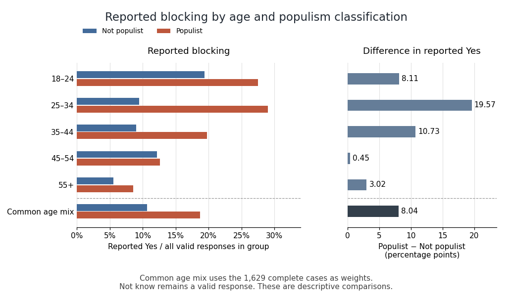

<h1 id="5/solution">Solution</h1>

↑ **Parent:** [5](../5.md)

**Every displayed age stratum has a higher reported-Yes proportion among Populist respondents, but the size varies considerably. The largest difference is at ages 25–34 and the smallest at 45–54. The omnibus tests reject within-stratum independence for ages 25–34 and 35–44, but not for the other three groups; comparing those significance labels is not itself a test of [statistical interaction](../../../interaction-statistics.md).**

The five strata contain 298, 291, 339, 296 and 405 complete cases. They sum to 1629 and reproduce every cell of the overall table, so the comparison is a coherent age stratification. Each body percentage estimates a blocking-response [conditional distribution](../../../conditional-distribution.md) within a particular age and populism combination. Not know is retained as the third valid response. The ordinal statistics discussed below are numerical summaries of the displayed order only, because that response order has no established behavioural rank.

For ages 18–24, reported blocking is $19/98=19.39\%$ among Not-populist respondents versus $55/200=27.50\%$ among Populist respondents, a difference of about 8.11 [percentage points](../../../percentage-point.md). No is 71.43% versus 66.00%, and Not know is 9.18% versus 6.50%. The Pearson result is $X^2\approx2.67062$ on 2 [statistical degrees of freedom](../../../statistical-degrees-of-freedom.md), $p\approx0.2631$; the [likelihood-ratio test](../../../likelihood-ratio-test.md) gives $G^2\approx2.72259$, $p\approx0.2563$. Thus neither rejects at 5%. The minimum [expected frequency](../../../expected-frequency.md) is 7.235, so no cell falls below five. [Cramér's V](../../../cramer-s-v.md) and the [generalized phi coefficient](../../../generalized-phi-coefficient.md) are about 0.095, with [contingency coefficient](../../../contingency-coefficient.md) about 0.094. The ordered-label summaries are gamma 0.203, Somers' D 0.095, tau-b 0.092 and tau-c 0.084. Both lambdas are zero. These figures allow a positive descriptive Yes difference alongside considerable uncertainty; nonrejection does not establish identical response distributions.

For ages 25–34, reported blocking is $7/74=9.46\%$ versus $63/217=29.03\%$, a difference of about 19.57 [percentage points](../../../percentage-point.md). No falls from 75.68% to 64.06% and Not know from 14.86% to 6.91%. Pearson gives $X^2\approx13.8060$, $p\approx0.001005$ on 2 [statistical degrees of freedom](../../../statistical-degrees-of-freedom.md); the likelihood ratio gives $G^2\approx15.21294$, $p\approx0.0004972$. Its printed 0.000 is rounding, not an exact zero. Both indicate nominal evidence against [independence](../../../independent-random-variables.md), although the Pearson value is just above 0.001 rather than below it. The minimum expected count is about 6.612. V and generalized phi are about 0.218, and the contingency coefficient about 0.213. The ordered-label gamma is about 0.500, Somers' D 0.239, tau-b 0.211 and tau-c 0.181. Neither direction of lambda improves modal prediction: No remains the modal response in both rows and Populist the modal group in each column. In particular, gamma 0.500 does not mean that populism explains half the variation in blocking.

For ages 35–44, reported blocking is $10/111=9.01\%$ versus $45/228=19.74\%$, a difference of about 10.73 [percentage points](../../../percentage-point.md). No is nearly unchanged, 76.58% versus 76.32%, while Not know falls sharply from 14.41% to 3.95%. The full categorical association therefore includes a substantial awareness-category difference. Pearson gives $X^2\approx16.3872$, $p\approx0.0002764$; the likelihood ratio gives $G^2\approx16.06955$, $p\approx0.0003240$, each on 2 [statistical degrees of freedom](../../../statistical-degrees-of-freedom.md). The minimum expected count is about 8.186. V and generalized phi are about 0.220 and the contingency coefficient about 0.215. Ordered-label gamma is 0.477, Somers' D 0.187, tau-b 0.200 and tau-c 0.165. Lambda for predicting the blocking category from populism is zero. In the reverse direction it is about 0.063: Not know has more Not-populist than Populist respondents, so allowing the response to change the predicted classification slightly reduces errors. This is a nominal prediction result, not a causal mechanism.

For ages 45–54, reported blocking is $9/74=12.16\%$ versus $28/222=12.61\%$, only about 0.45 [percentage points](../../../percentage-point.md) apart. No is 71.62% versus 78.38%, and Not know is 16.22% versus 9.01%. Here most of the descriptive distributional difference is between No and Not know rather than between the reported-Yes proportions. Pearson gives $X^2\approx3.00607$, $p\approx0.2225$; the likelihood ratio gives $G^2\approx2.78281$, $p\approx0.2487$, with 2 [statistical degrees of freedom](../../../statistical-degrees-of-freedom.md). The minimum expected count is 8. V and generalized phi are about 0.101 and the contingency coefficient about 0.100. Ordered-label gamma is 0.164, Somers' D 0.067, tau-b 0.066 and tau-c 0.050; both lambdas are zero. A positive ordered-label coefficient therefore should not be substituted for a substantial difference in Yes rates.

For ages 55+, reported blocking is $5/90=5.56\%$ versus $27/315=8.57\%$, a difference of about 3.02 [percentage points](../../../percentage-point.md). No is 87.78% versus 86.35%, and Not know is 6.67% versus 5.08%. Pearson gives $X^2\approx1.14696$, $p\approx0.5636$; the likelihood ratio gives $G^2\approx1.19973$, $p\approx0.5489$, with 2 [statistical degrees of freedom](../../../statistical-degrees-of-freedom.md). V and generalized phi are about 0.053, with contingency coefficient about 0.053. One of six expected counts is below five, with minimum about 4.889. This is a mild sparse-cell qualification rather than a missing observation; an exact conditional test or fixed-margin [Monte Carlo test](../../../monte-carlo-test.md) could check calibration if needed. No simulated p-value is claimed. Ordered-label gamma is 0.184, Somers' D 0.043, tau-b 0.052 and tau-c 0.030, with both lambdas zero.

The [Goodman and Kruskal's gamma](../../../goodman-and-kruskal-s-gamma.md), [Somers' D](../../../somers-d.md), [Kendall's tau-b](../../../kendall-s-tau-b.md) and [Stuart's tau-c](../../../stuart-s-tau-c.md) values differ because their denominators handle ties or table dimensions differently. All the supplied pair partitions and numerical values agree with the counts. Their substantive ordinal interpretation remains limited by Not know. In contrast, [Cramér's V](../../../cramer-s-v.md) and [Goodman and Kruskal's lambda](../../../goodman-and-kruskal-s-lambda.md) permit nominal categories; zero lambda means no improvement in modal classification, not absence of all association.[Details: ordinal-scale assumptions for gamma and Somers' D, versus nominal modal prediction for lambda](../../../desctools-documentation-for-gamma-somers-d-and-lambda.md)[KendallTauB and StuartTauC: different tie and table-size conventions](../../../ordinal-association-measures-in-the-desctools-documentation.md)

**[Figure 1](#5/image-reported-blocking-within-age-and-populism-groups-with-count-derived-age-specific-and-standardized-percentage-point-contrasts-not-know-remains-a-valid-response). Reported blocking within age and populism groups, with count-derived age-specific and standardized percentage-point contrasts; Not know remains a valid response**.

Holding age fixed does not eliminate the positive descriptive difference in reported Yes rates: none of the five differences reverses sign. Thus the evidence does not show a [Simpson's paradox](../../../simpson-s-paradox.md) in which every conditional direction opposes the pooled direction. There is also little evidence for a single common magnitude from inspection: differences range from about 0.45 to 19.57 points. The [elaboration model](../../../elaboration-model.md) provides a useful language of persistence and possible specification, but these tables alone do not establish causal explanation or population effect heterogeneity.

As a clearly defined descriptive adjustment, use the complete-case age shares $298/1629,291/1629,339/1629,296/1629,405/1629$ as common weights for both groups. [Standardization with common weights](../../../standardization-with-common-weights.md) gives reported-Yes proportions about 10.70% for Not-populist and 18.75% for Populist respondents, a difference of 8.04 [percentage points](../../../percentage-point.md), compared with the crude 7.26-point difference. Equalizing that age composition therefore does not explain away the observed contrast. It is not a [causal effect](../../../causal-effect.md), and its target remains the observed complete-case sample.

There is also nominal combined evidence against [conditional independence](../../../conditional-independence.md). The [joint conditional independence test for stratified contingency tables](../../../joint-conditional-independence-test-for-stratified-contingency-tables.md) sums the five Pearson statistics to about 37.0169; under the usual independent-stratum asymptotic model this has 10 [statistical degrees of freedom](../../../statistical-degrees-of-freedom.md) and $p\approx5.62\times10^{-5}$. This derived test addresses whether all five full response distributions are conditionally independent, not whether their effects are equal or whether Yes alone differs in every stratum. A direct [interaction contrast](../../../interaction-contrast.md) or appropriate categorical-response model is needed to test effect differences on a specified scale. Multiple separate tests additionally create a [multiple testing](../../../multiple-hypothesis-testing.md) issue if used selectively. **The warranted conclusion is a persistent positive descriptive Yes association after age stratification, strongest at 25–34, with formal heterogeneity, missing-data and causal questions still requiring explicit assumptions and targeted analysis.**

## ↑ Ancestors (10)

1. [5](../5.md)
2. [2018](../../2018-split.md)
3. [Past exam of the digital social research: statistics core course of the University of Oxford](../../split.md)
4. [Digital social research: statistics core course of the University of Oxford](../../../digital-social-research-statistics-core-course-of-the-university-of-oxford.md)
5. [MSc in social science of the internet course of the University of Oxford](../../../msc-in-social-science-of-the-internet-course-of-the-university-of-oxford.md)
6. [Master's course of the University of Oxford](../../../master-s-course-of-the-university-of-oxford.md)
7. [Course of the University of Oxford](../../../course-of-the-university-of-oxford.md)
8. [University of Oxford](../../../university-of-oxford-split.md)
9. [List of universities](../../../list-of-universities.md)
10. [Codex Wiki](../../../split.md)
