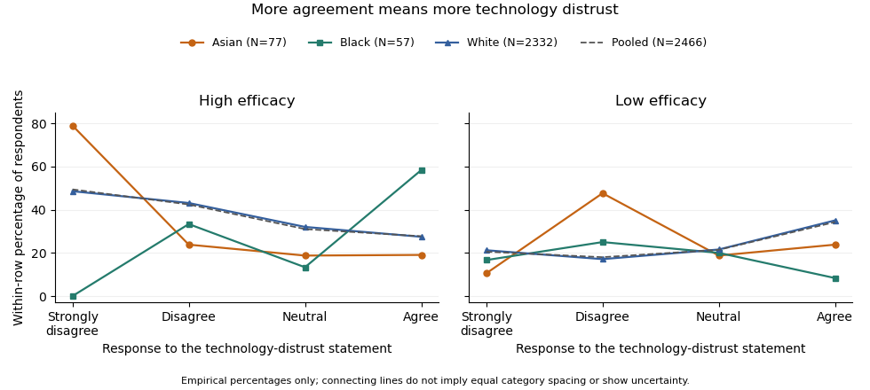

<h1 id="5/solution">Solution</h1>

↑ **Parent:** [5](../5.md)

**The White stratum retains the overall distrust–lower-efficacy pattern, the Asian stratum shows a stronger but irregular version of it, and the Black stratum has an opposite descriptive ordinal direction. This supports replication in the dominant stratum together with possible specification by ethnicity in the [elaboration model](../../../elaboration-model.md). Sparse minority tables and different significance labels do not by themselves establish a population [statistical interaction](../../../interaction-statistics.md).**

Each table fixes ethnicity and compares the efficacy [conditional distributions](../../../conditional-distribution.md) across technology responses. The body [percentages](../../../percentage.md) use the technology-response row total within that stratum. The same labels, coding direction and efficacy order apply as before. The strata contain 77, 57 and 2332 observations; they sum to 2466 and their cells reproduce the overall table exactly. Consequently the comparison is genuinely a stratification of the supplied overall counts, rather than a comparison of unrelated samples.

For Asian respondents, High efficacy is 78.95% among those who strongly disagree with the distrust statement, falling to 23.81% among those who disagree, 18.75% among neutral respondents and 19.05% among those who agree. The strong-disagreement versus agreement contrast is about 59.90 [percentage points](../../../percentage-point.md), based on 15 of 19 versus 4 of 21 respondents. This is a large descriptive contrast, but the rest of the table is not a simple monotone progression: Low efficacy peaks at 47.62% in Disagree, versus 10.53% in Strongly disagree, 18.75% in Neutral and 23.81% in Agree; Medium efficacy exceeds 57% in the last two rows. The striking first row is part of a more irregular categorical pattern.

The Asian [Pearson chi-squared test of independence](../../../pearson-chi-squared-test-of-independence.md) gives $X^2\approx28.41883$, 6 [statistical degrees of freedom](../../../statistical-degrees-of-freedom.md), $p\approx7.83\times10^{-5}$. The [likelihood-ratio test](../../../likelihood-ratio-test.md) gives $G^2\approx27.20973$, $p\approx0.0001323$; its displayed 0.000 is a [rounding](../../../rounding.md) convention. [Cramér's V](../../../cramer-s-v.md) is about 0.430, compared with 0.148 overall. The [generalized phi coefficient](../../../generalized-phi-coefficient.md) is 0.608 and the [contingency coefficient](../../../contingency-coefficient.md) 0.519. Two of twelve [expected frequencies](../../../expected-frequency.md) are below five, with minimum 4.156. This is a modest sparse-cell warning rather than a reason to delete the observed cells, but asymptotic calibration should still be qualified and could be checked by an exact or fixed-margin [Monte Carlo test](../../../monte-carlo-test.md).

The Asian [Goodman and Kruskal's gamma](../../../goodman-and-kruskal-s-gamma.md) is about 0.323, from 1025 concordances and 524 discordances, so its displayed-order direction agrees with the overall association. [Somers' D](../../../somers-d.md) for efficacy given technology is about 0.226, [Kendall's tau-b](../../../kendall-s-tau-b.md) 0.241 and [Stuart's tau-c](../../../stuart-s-tau-c.md) 0.253. These stronger ordinal summaries do not imply that every individual row transition is monotone. [Goodman and Kruskal's lambda](../../../goodman-and-kruskal-s-lambda.md) is about 0.362 for predicting efficacy from technology and 0.286 in the reverse direction: the technology row changes the modal efficacy prediction sufficiently to reduce its errors by about 36.2%. This is a reduction in modal-classification errors, not a fraction of efficacy [variance](../../../variance-split.md) explained.

For Black respondents, High efficacy is 0 of 6, or 0%, in Strongly disagree; 8 of 24, or 33.33%, in Disagree; 2 of 15, or 13.33%, in Neutral; and 7 of 12, or 58.33%, in Agree. Low efficacy is 16.67%, 25.00%, 20.00% and 8.33%, respectively. The strongest-disagreement versus agreement High-efficacy contrast is therefore $-58.33$ [percentage points](../../../percentage-point.md), opposite to the Asian and White contrasts. The zero observed High count in the first row does not prove zero population [probability](../../../probability.md), especially with only six respondents in that row. These [percentages](../../../percentage.md) are compatible with a reversed tendency, but considerable sampling uncertainty is unavoidable.

The Black [Pearson chi-squared test of independence](../../../pearson-chi-squared-test-of-independence.md) gives $X^2\approx10.80719$, 6 [statistical degrees of freedom](../../../statistical-degrees-of-freedom.md) and $p\approx0.09452$. The [likelihood-ratio test](../../../likelihood-ratio-test.md) gives $G^2\approx12.26209$, $p\approx0.05637$, also above 5%. Thus neither nominal test rejects at 5%; this does not establish exact [independence](../../../independent-random-variables.md). Eight of twelve [expected frequencies](../../../expected-frequency.md) are below five, with minimum about 1.158, making the usual large-sample calibration particularly questionable. An exact conditional analysis or [Monte Carlo test](../../../monte-carlo-test.md) would be more defensible for a calibrated inferential claim; no uncomputed simulated [p-value](../../../p-value.md) is asserted.[Details: fixed-margin sampling for simulated contingency-table tests](../../../pearson-s-chi-squared-test-for-count-data-in-the-r-documentation.md)

The Black [Cramér's V](../../../cramer-s-v.md) is about 0.308, the [generalized phi coefficient](../../../generalized-phi-coefficient.md) 0.435 and the [contingency coefficient](../../../contingency-coefficient.md) 0.399. An unsigned magnitude of this size can coexist with a nonsignificant test in a small sample. There are 254 concordances and 457 discordances, giving [Goodman and Kruskal's gamma](../../../goodman-and-kruskal-s-gamma.md) about $-0.286$, [Somers' D](../../../somers-d.md) about $-0.179$, [Kendall's tau-b](../../../kendall-s-tau-b.md) about $-0.191$ and [Stuart's tau-c](../../../stuart-s-tau-c.md) about $-0.187$. Their negative signs agree with the reversed displayed-order direction. [Goodman and Kruskal's lambda](../../../goodman-and-kruskal-s-lambda.md) is about 0.107 for efficacy given technology and zero for technology given efficacy. In the latter direction, Disagree remains a modal technology category within every efficacy column, so modal prediction gains nothing despite the changed conditional [percentages](../../../percentage.md).

For White respondents, High efficacy decreases from 48.55% in Strongly disagree through 43.10% and 32.03% to 27.45% in Agree. The extreme-row contrast is about 21.11 [percentage points](../../../percentage-point.md), from 151 of 311 versus 188 of 685. Low efficacy is 21.22%, 17.10%, 21.57% and 35.04%, respectively. This closely resembles the overall distribution, including the fact that the Low category is not monotone at every step. The White [Pearson chi-squared test of independence](../../../pearson-chi-squared-test-of-independence.md) gives $X^2\approx107.70835$, 6 [statistical degrees of freedom](../../../statistical-degrees-of-freedom.md) and $p\approx6.15\times10^{-21}$; the [likelihood-ratio test](../../../likelihood-ratio-test.md) gives $G^2\approx105.54201$, $p\approx1.75\times10^{-20}$. All [expected frequencies](../../../expected-frequency.md) exceed 74, so sparse cells are not the problem for these nominal tests.

The White [Cramér's V](../../../cramer-s-v.md) is about 0.152, the [generalized phi coefficient](../../../generalized-phi-coefficient.md) 0.215 and the [contingency coefficient](../../../contingency-coefficient.md) 0.210. [Goodman and Kruskal's gamma](../../../goodman-and-kruskal-s-gamma.md) is about 0.236, [Somers' D](../../../somers-d.md) 0.155, [Kendall's tau-b](../../../kendall-s-tau-b.md) 0.162 and [Stuart's tau-c](../../../stuart-s-tau-c.md) 0.167: close to the overall ordinal summaries and in the same direction. The two values of [Goodman and Kruskal's lambda](../../../goodman-and-kruskal-s-lambda.md) are about 0.061 for efficacy given technology and 0.062 for technology given efficacy. They again indicate only a small improvement in modal prediction. The large [sample size](../../../sample-size.md) helps explain why the White test has a much smaller [p-value](../../../p-value.md) than the smaller strata, without implying that its association magnitude is the largest.

The original figure below plots selected empirical [conditional probabilities](../../../conditional-probability.md) from all the cells. It gives the opposite small-stratum pattern and the dominant White pattern a common scale; it is not a reproduction of a source figure, an estimated continuous trend or a display of uncertainty intervals.

**[Figure 1](#5/image-efficacy-distributions-across-technology-distrust-responses-contrasting-ethnic-strata-and-the-pooled-sample-lines-only-connect-the-four-ordered-categories-group-sizes-and-sparse-cells-limit-inference). Efficacy distributions across technology-distrust responses: contrasting ethnic strata and the pooled sample. Lines only connect the four ordered categories; group sizes and sparse cells limit inference.**

The [elaboration model](../../../elaboration-model.md) asks how the original association changes when a third variable is held fixed. If the association disappeared throughout the strata, an explanation by the control variable might be plausible, subject to a credible causal ordering. Here it persists in the White group, which supplies 94.57% of the sample, and is stronger on several descriptive measures in the Asian group. Therefore ethnicity does not simply explain away the relationship. The White result is a replication of the broad pattern; the reversed Black direction and the Asian shape suggest descriptive specification or possible [effect modification](../../../effect-modifier.md). The output supplies no temporal or causal design that would distinguish an actual causal mechanism from other [confounding](../../../confounding.md), measurement differences or sampling variation. It also does not demonstrate a [Simpson's paradox](../../../simpson-s-paradox.md) in which the association reverses in every stratum: that is not what the displayed tables show.

The predominance of White respondents explains why the pooled pattern resembles theirs. By the [law of total probability](../../../law-of-total-probability.md), each technology row's efficacy distribution is a mixture over ethnicity, using the ethnic proportions _within that technology row_. Those weights need not equal the overall ethnic proportions. As an optional descriptive comparison, [standardization with common weights](../../../standardization-with-common-weights.md) using the overall ethnic shares gives High-efficacy proportions of about 48.38% in Strongly disagree and 27.90% in Agree, a 20.48-[percentage point](../../../percentage-point.md) contrast, compared with the crude 21.69-point contrast. This explicitly defined adjustment leaves the broad contrast intact; it is not a causal estimate and does not turn the three different stratum patterns into one common effect.

Finally, a significant test in one group and a nonsignificant test in another is not itself a test that the groups' associations differ. A formal [statistical interaction](../../../interaction-statistics.md) requires a directly specified heterogeneity test or model on a chosen effect scale. The omnibus tests also address whole categorical distributions, whereas gamma and the High-efficacy contrast describe particular ordered features. Multiple stratum tests create a [multiple testing](../../../multiple-hypothesis-testing.md) issue if used to select a discovery. **The defensible result is an association that survives stratification in the dominant group, with important descriptive heterogeneity that merits a direct, sparse-cell-aware investigation rather than an assertion that ethnicity causes the difference.**

## ↑ Ancestors (10)

1. [5](../5.md)
2. [2019](../../2019-split.md)
3. [Past exam of the digital social research: statistics core course of the University of Oxford](../../split.md)
4. [Digital social research: statistics core course of the University of Oxford](../../../digital-social-research-statistics-core-course-of-the-university-of-oxford.md)
5. [MSc in social science of the internet course of the University of Oxford](../../../msc-in-social-science-of-the-internet-course-of-the-university-of-oxford.md)
6. [Master's course of the University of Oxford](../../../master-s-course-of-the-university-of-oxford.md)
7. [Course of the University of Oxford](../../../course-of-the-university-of-oxford.md)
8. [University of Oxford](../../../university-of-oxford-split.md)
9. [List of universities](../../../list-of-universities.md)
10. [Codex Wiki](../../../split.md)
