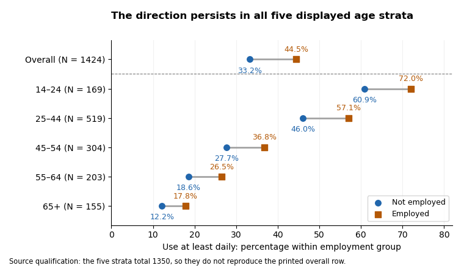

<h1 id="5/solution">Solution</h1>

↑ **Parent:** [5](../5.md)

**Every displayed age stratum has a higher proportion of employed respondents reporting use at least daily, and each has positive ordinal association. The visible counts do not support the printed claim of a conventional significant omnibus result in any one stratum: several test fields are contradictory, and sparse cells further limit the chi-squared approximation. Age-specific significance labels do not establish [interaction](../../../interaction-statistics.md) or causation.**

Conditioning on age means comparing the employment groups _within each displayed age category_. Each within-row [percentage](../../../percentage.md) estimates a use distribution for that age–employment combination. This helps assess a marginal association that could reflect different age compositions, but broad age categories do not remove all residual [confounding](../../../confounding.md). The relevant conditional-independence [null hypothesis](../../../null-hypothesis.md) is that employment and use are [independent](../../../independent-random-variables.md) within every age stratum. It differs both from marginal [independence](../../../independent-random-variables.md) and from a [null hypothesis](../../../null-hypothesis.md) that the strength of association is identical across ages.

For the 14–24 stratum, $N=169$. The non-employed group reports use at least daily in $(27+15)/69=60.87\%$ of cases, versus $(48+24)/100=72.00\%$ of employed cases: an 11.13-percentage-point difference. Daily use alone is $39.13\%$ versus $48.00\%$. This is not a uniform upward shift at every threshold: never-use is also higher among employed respondents, $8.00\%$ versus $4.35\%$, whereas weekly use is lower, $11.00\%$ versus $24.64\%$. The count-based [Cramér's V](../../../cramer-s-v.md) is about $0.199$ and [Goodman and Kruskal's gamma](../../../goodman-and-kruskal-s-gamma.md) about $0.100$. The cells give $X^2=6.721811$ on $5$ [statistical degrees of freedom](../../../statistical-degrees-of-freedom.md), with $p\approx0.24217$, agreeing qualitatively with the likelihood-ratio result $G^2=6.670009$, $p\approx0.246$. The printed Pearson $X^2=9.721811$ and $p=0.0491651$ disagree with the cells _and_ with one another: that printed statistic at $5$ [statistical degrees of freedom](../../../statistical-degrees-of-freedom.md) would give about $0.08351$, not $0.04917$. Four of twelve [expected frequencies](../../../expected-frequency.md) are below five, with minimum about $2.45$, so an exact conditional test or a [Monte Carlo test](../../../monte-carlo-test.md) is preferable for calibrated inference rather than trusting a marginal printed significance label.

For ages 25–44, $N=519$. At-least-daily use is $93/202=46.04\%$ in the non-employed group and $181/317=57.10\%$ in the employed group, a difference of 11.06 [percentage points](../../../percentage-point.md). Never-use is $17.82\%$ versus $15.46\%$, daily use $35.15\%$ versus $39.75\%$, and more-than-daily use $10.89\%$ versus $17.35\%$. The count-based [Cramér's V](../../../cramer-s-v.md) is about $0.142$ and [Goodman and Kruskal's gamma](../../../goodman-and-kruskal-s-gamma.md) about $0.174$. The visible cells give $X^2=10.475487$, $p\approx0.06283$, and $G^2=10.451334$, $p\approx0.06341$, each with $5$ [statistical degrees of freedom](../../../statistical-degrees-of-freedom.md). These differ materially from the printed Pearson $12.47549$, $p=0.04283048$, and printed likelihood-ratio $12.451$, $p=0.043$. Even the printed Pearson statistic at its stated [statistical degrees of freedom](../../../statistical-degrees-of-freedom.md) gives $p\approx0.02882$, not the stated [p-value](../../../p-value.md). The minimum [expected frequency](../../../expected-frequency.md) is about $5.06$, so the principal difficulty here is corrupted numerical output rather than a listed sparse-cell warning. The recomputed 5% test fails to reject [independence](../../../independent-random-variables.md), although its [p-value](../../../p-value.md) is not evidence that the positive descriptive contrast is exactly zero.

For ages 45–54, $N=304$. At-least-daily use is $33/119=27.73\%$ versus $68/185=36.76\%$, a difference of 9.03 [percentage points](../../../percentage-point.md). Never-use is $37.82\%$ versus $31.89\%$, and daily use $19.33\%$ versus $27.03\%$. The count-based [Cramér's V](../../../cramer-s-v.md) is about $0.105$ and [Goodman and Kruskal's gamma](../../../goodman-and-kruskal-s-gamma.md) about $0.133$. The cells give $X^2=3.350752$, $p\approx0.64608$, consistent with the likelihood-ratio $G^2=3.382693$, $p\approx0.641$. The printed Pearson $9.350752$ and $p=0.046081$ are incompatible with the cells and with one another: using that statistic at $5$ [statistical degrees of freedom](../../../statistical-degrees-of-freedom.md) gives $p\approx0.09587$. The smallest [expected frequency](../../../expected-frequency.md) is about $6.26$. Thus this is another positive descriptive contrast without a count-supported significant omnibus result at 5%.

For ages 55–64, $N=203$. At-least-daily use is $16/86=18.60\%$ versus $31/117=26.50\%$, a difference of 7.89 [percentage points](../../../percentage-point.md). Never-use is $54.65\%$ versus $48.72\%$, and daily use $11.63\%$ versus $17.95\%$. [Cramér's V](../../../cramer-s-v.md) is about $0.125$ and [Goodman and Kruskal's gamma](../../../goodman-and-kruskal-s-gamma.md) about $0.133$. The printed and count-based Pearson result agrees: $X^2=3.190901$, $5$ [statistical degrees of freedom](../../../statistical-degrees-of-freedom.md), $p\approx0.67058$. The likelihood-ratio [p-value](../../../p-value.md) is about $0.668$. Two of twelve [expected frequencies](../../../expected-frequency.md) are below five, with minimum about $3.39$; the nominal result does not indicate rejection, but a simulation-based check would be prudent if formal calibration mattered. Neither a large [p-value](../../../p-value.md) nor the smaller sample establishes an absence of association.

For the oldest stratum, labelled 65+ in Figure 8, $N=155$. At-least-daily use is $10/82=12.20\%$ versus $13/73=17.81\%$, a difference of 5.61 [percentage points](../../../percentage-point.md). Never-use is $70.73\%$ versus $56.16\%$. [Cramér's V](../../../cramer-s-v.md) is about $0.217$ and [Goodman and Kruskal's gamma](../../../goodman-and-kruskal-s-gamma.md) about $0.269$, the largest of the five displayed strata. Yet $X^2=7.269606$ on $5$ [statistical degrees of freedom](../../../statistical-degrees-of-freedom.md) gives $p\approx0.20135$, while the likelihood-ratio [p-value](../../../p-value.md) is about $0.117$. There are four [expected frequencies](../../../expected-frequency.md) below five, with minimum about $0.471$. Sampling uncertainty and a sparse distribution therefore matter greatly; the larger descriptive ordinal magnitude is not evidence for a significant age [interaction](../../../interaction-statistics.md). The zero observed entries do not establish zero population [probabilities](../../../probability.md). An exact conditional test or a [Monte Carlo test](../../../monte-carlo-test.md) can retain the six categories without relying on a doubtful asymptotic approximation. Collapsing categories should have a substantive justification; searching for a grouping that produces significance changes the inferential problem.[Details: asymptotic versus simulated fixed-margin tests and the role of positive margins](../../../pearson-s-chi-squared-test-for-count-data-in-the-r-documentation.md)

The following original analytical plot summarizes a common threshold rather than reproducing any source table. Its overall reference is deliberately separated: the five age strata total $1350$, not the $1424$ in Figure 3, so their [percentages](../../../percentage.md) cannot be pooled and called the reported overall result.

**[Figure 1](#5/image-at-least-daily-use-is-more-common-among-employed-respondents-in-each-displayed-age-stratum-the-printed-overall-row-is-a-separate-non-reconciling-input). At-least-daily use is more common among employed respondents in each displayed age stratum; the printed overall row is a separate, non-reconciling input**.

Across the visible strata, frequent use declines strongly with age in both employment groups, while the at-least-daily employment difference remains positive. This is compatible with age being important to the use distribution and with a positive employment association persisting after age stratification. It is not a demonstrated [Simpson's paradox](../../../simpson-s-paradox.md): none of these displayed threshold differences reverses direction. The evidence also does not establish how much age confounds the overall result, because the strata do not reproduce its sample and the oldest age labels disagree across figures. Among young respondents the positive ordinal association coexists with a reversed never-use contrast, so the threshold summary should not be described as [stochastic domination](../../../stochastic-domination-of-probability-measures.md) of every [conditional distribution](../../../conditional-distribution.md).

Ordinal measures summarize a different aspect from the omnibus tests. Counting pairs from each visible table gives [Goodman and Kruskal's gamma](../../../goodman-and-kruskal-s-gamma.md) approximately $0.100,0.174,0.133,0.133,0.269$ in age order. For use as response, the corresponding [Somers' D](../../../somers-d.md) values are about $0.072,0.132,0.102,0.090,0.152$; [Kendall's tau-b](../../../kendall-s-tau-b.md) values are $0.059,0.105,0.081,0.076,0.144$; and [Stuart's tau-c](../../../stuart-s-tau-c.md) values are $0.070,0.125,0.097,0.088,0.152$. They are all positive and modest, but not interchangeable. Gamma discards pairs tied on either variable; [Somers' D](../../../somers-d.md) includes response ties separated by employment; [Kendall's tau-b](../../../kendall-s-tau-b.md) adjusts for ties in both variables; [Stuart's tau-c](../../../stuart-s-tau-c.md) adjusts for table dimensions. The printed second-variable tie counts violate the [unordered-pair partition for ordinal data](../../../unordered-pair-partition-for-ordinal-data.md) in all five strata, so the printed Somers and tau-b values should not be accepted as independently verified numbers.[KendallTauB and StuartTauC: distinct tie/table-size adjustments](../../../ordinal-association-measures-in-the-desctools-documentation.md)

[Goodman and Kruskal's lambda](../../../goodman-and-kruskal-s-lambda.md) for predicting the _use category from employment_ is zero in all five visible strata: each employment row has the same modal use category as its stratum overall. This does not contradict their nonzero gamma or V, because the rest of each category distribution can change without its [mode](../../../mode-statistics.md) changing. Reversing the prediction target gives about $0.087,0.025,0,0.023,0.123$ for predicting _employment from use_. In the original display these are the second lambda values; identify the target directly rather than relying on ambiguous row/column-dependent labels. The [contingency coefficient](../../../contingency-coefficient.md), another unsigned transformation of the Pearson statistic, adds no new direction and cannot repair a corrupted [test statistic](../../../test-statistic.md).

Even if all printed [p-values](../../../p-value.md) were trusted, a significant result in one age group and a nonsignificant result in another would not prove that their effects differ. A [statistical interaction](../../../interaction-statistics.md) needs a direct comparison of effects on a specified scale, not a comparison of significance labels. Five separate tests also create a multiple-testing issue if the aim is to claim at least one association; choosing categories or a threshold after inspection adds further selection. A [joint conditional independence test for stratified contingency tables](../../../joint-conditional-independence-test-for-stratified-contingency-tables.md) or an appropriate categorical-response model can target a clear combined hypothesis, with exact or simulation-based calibration where needed. Such a model would require coherent input tables before it could resolve the source discrepancies. **The sound conclusion is a consistent positive descriptive tendency within the five shown strata, with no count-supported nominal 5% omnibus rejection in an individual stratum, and insufficient coherent output for a claimed causal or precisely quantified age-adjusted effect.**

## ↑ Ancestors (10)

1. [5](../5.md)
2. [2020](../../2020-split.md)
3. [Past exam of the digital social research: statistics core course of the University of Oxford](../../split.md)
4. [Digital social research: statistics core course of the University of Oxford](../../../digital-social-research-statistics-core-course-of-the-university-of-oxford.md)
5. [MSc in social science of the internet course of the University of Oxford](../../../msc-in-social-science-of-the-internet-course-of-the-university-of-oxford.md)
6. [Master's course of the University of Oxford](../../../master-s-course-of-the-university-of-oxford.md)
7. [Course of the University of Oxford](../../../course-of-the-university-of-oxford.md)
8. [University of Oxford](../../../university-of-oxford-split.md)
9. [List of universities](../../../list-of-universities.md)
10. [Codex Wiki](../../../split.md)
