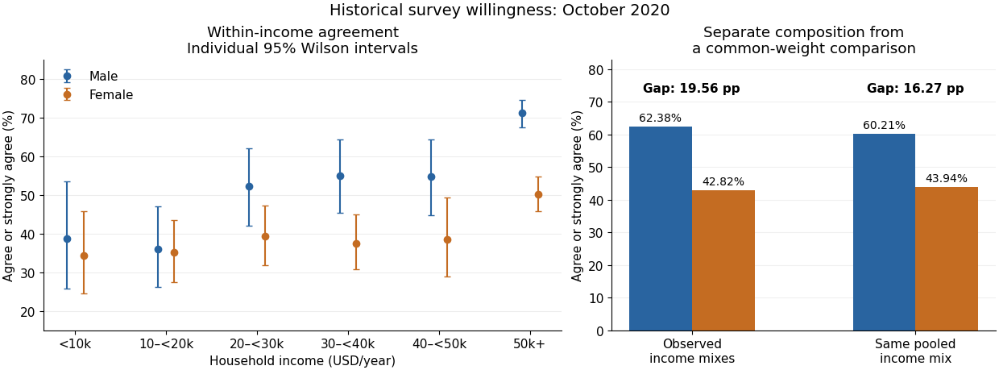

<h1 id="4/solution">Solution</h1>

↑ **Parent:** [4](../4.md)

For each income band, compare the response distribution within the two gender groups. The table below combines agree and strongly agree only to make one comparable contrast visible. The [Pearson chi-squared statistic](../../../pearson-chi-squared-statistic.md) and its [p-value](../../../p-value.md) still use all five original response categories, with four [statistical degrees of freedom](../../../statistical-degrees-of-freedom.md) in every band. Income labels are thousands of USD per year; finite upper bounds are excluded.

| Income band | $n$ | Male agreement | Female agreement | Difference in percentage points | $X^2_4$ | $p$ | [Cramér's V](../../../cramer-s-v.md) |
| --- | --- | --- | --- | --- | --- | --- | --- |
| Under 10k | 117 | 38.64% | 34.25% | 4.39 | 3.433 | 0.4881 | 0.171 |
| 10k–20k | 212 | 35.90% | 35.07% | 0.82 | 5.457 | 0.2435 | 0.160 |
| 20k–30k | 245 | 52.17% | 39.22% | 12.96 | 5.893 | 0.2073 | 0.155 |
| 30k–40k | 278 | 54.90% | 37.50% | 17.40 | 10.117 | 0.03851 | 0.191 |
| 40k–50k | 178 | 54.74% | 38.55% | 16.18 | 6.687 | 0.1534 | 0.194 |
| 50k and above | 1105 | 71.16% | 50.21% | 20.95 | 63.765 | $4.68\times10^{-13}$ | 0.240 |

In the lowest-income band, combined agreement differs by only about $4.39$ [percentage points](../../../percentage-point.md). The full distributions still differ descriptively: strong disagreement is $13.64\%$ in the male group and $27.40\%$ in the female group. The omnibus [Pearson chi-squared test](../../../pearson-s-chi-squared-test.md) does not reject [independence](../../../independent-random-variables.md) at 5%, but that decision does not prove equal distributions.

In the 10k–20k band, combined agreement is almost the same. Nevertheless, strong agreement is higher in the female group, $18.66\%$ versus $11.54\%$, while the less intense agreement category is higher in the male group, $24.36\%$ versus $16.42\%$. Collapsing the categories hides that distinction. The full-distribution [p-value](../../../p-value.md) is approximately $0.2435$.

In the 20k–30k band, combined agreement is higher in the male group by about $12.96$ [percentage points](../../../percentage-point.md). Strong agreement alone is $27.17\%$ versus $18.30\%$. The observed difference is therefore larger than in the two lowest bands, despite its full-table [p-value](../../../p-value.md) remaining above 5%.

In the 30k–40k band, combined agreement differs by about $17.40$ [percentage points](../../../percentage-point.md), with fewer male neutral responses, $15.69\%$ versus $26.14\%$. The full-table [p-value](../../../p-value.md) of $0.03851$ is nominally significant at 5%. In the 40k–50k band, the combined agreement gap is a similar $16.18$ [percentage points](../../../percentage-point.md), but the full-table [p-value](../../../p-value.md) is $0.1534$. These labels are not a direct comparison between the two effects: [significant and nonsignificant results need not differ significantly](../../../significant-and-nonsignificant-results-need-not-differ-significantly.md).

In the highest-income band, strong agreement is $41.84\%$ in the male group and $22.15\%$ in the female group. Combined agreement differs by about $20.95$ [percentage points](../../../percentage-point.md). This band has both the largest [sample size](../../../sample-size.md) and the largest [Cramér's V](../../../cramer-s-v.md) of the six tables, with a very small [p-value](../../../p-value.md). Its particularly strong evidence reflects both precision and an observed difference in the distribution.

All six minimum [expected frequencies](../../../expected-frequency.md) exceed five: approximately $7.15$, $9.57$, $12.02$, $15.04$, $7.93$ and $36.03$. Thus sparse expected counts do not provide a reason to reject the usual [chi-squared distribution](../../../chi-squared-distribution.md) approximation here. If the six [hypothesis tests](../../../statistical-hypothesis-test-split.md) form one exploratory family, a [Bonferroni correction](../../../bonferroni-correction.md) would use $0.05/6\approx0.00833$ for each test; only the highest-income result crosses that threshold. This qualifies the unadjusted 30k–40k result without turning its observed contrast into zero.

In the [elaboration model](../../../elaboration-model.md), the larger agreement gaps in the middle and upper bands provide a descriptive pattern of specification: the conditional contrast varies with income. This is not a [Simpson's paradox](../../../simpson-s-paradox.md) reversal, because the combined agreement difference has the same sign in every band. Nor is the larger high-income [effect size](../../../effect-size.md) established simply by comparing its [p-value](../../../p-value.md) with the other [p-values](../../../p-value.md). A formal claim of [effect modification](../../../effect-modifier.md) requires a stated scale and an appropriate comparison of the effects.

The pooled comparison also mixes different income compositions. The highest-income band contains $631/1042\approx60.56\%$ of the male group but $474/1093\approx43.37\%$ of the female group. Average each group's six agreement proportions over the same pooled income weights using [standardization with common weights](../../../standardization-with-common-weights.md). This gives

$$
\boxed{\widehat p_M^{(w)}\approx60.21\%,\qquad
\widehat p_F^{(w)}\approx43.94\%,\qquad
\widehat p_M^{(w)}-\widehat p_F^{(w)}\approx16.27\text{ percentage points}.}
$$

The crude difference was $19.56$ [percentage points](../../../percentage-point.md), so common weighting attenuates it by about $3.30$ [percentage points](../../../percentage-point.md) but leaves a substantial descriptive contrast. With average-group rather than pooled-person weights, the [symmetric decomposition of a stratified mean difference](../../../symmetric-decomposition-of-a-stratified-mean-difference.md) instead gives an exact split into approximately $16.29$ [percentage points](../../../percentage-point.md) from conditional contrasts and $3.27$ [percentage points](../../../percentage-point.md) from composition. These are different explicitly defined descriptive summaries, not estimates of a causally mediated share.

**[Figure 1](#4/image-vaccination-intention-by-income-and-a-comparison-using-standardization-with-common-weights). Vaccination intention by income and a comparison using standardization with common weights**. Original calculations from the printed aggregate counts. The outcome combines agree and strongly agree; the two gender labels are those recorded in the paper. Error bars are individual approximate 95% [Wilson intervals](../../../wilson-score-interval.md), not simultaneous intervals or a formal test of between-band [effect modification](../../../effect-modifier.md). The right panel uses the same pooled income frequencies for both groups. No individual observations were reconstructed.

An antecedent income variable could be considered in a [confounding](../../../confounding.md) explanation, whereas an income variable on an assumed causal pathway would enter an interpretation through [causal mediation](../../../causal-mediation.md). The conditional tables do not distinguish these causal structures. They also do not identify whether any adjustment introduces [collider bias](../../../collider-bias.md). **The supported conclusion is income-dependent descriptive association plus a measurable composition difference, with causal interpretation left conditional on additional assumptions.**

## ↑ Ancestors (10)

1. [4](../4.md)
2. [2021](../../2021-split.md)
3. [Past exam of the digital social research: statistics core course of the University of Oxford](../../split.md)
4. [Digital social research: statistics core course of the University of Oxford](../../../digital-social-research-statistics-core-course-of-the-university-of-oxford.md)
5. [MSc in social science of the internet course of the University of Oxford](../../../msc-in-social-science-of-the-internet-course-of-the-university-of-oxford.md)
6. [Master's course of the University of Oxford](../../../master-s-course-of-the-university-of-oxford.md)
7. [Course of the University of Oxford](../../../course-of-the-university-of-oxford.md)
8. [University of Oxford](../../../university-of-oxford-split.md)
9. [List of universities](../../../list-of-universities.md)
10. [Codex Wiki](../../../split.md)
