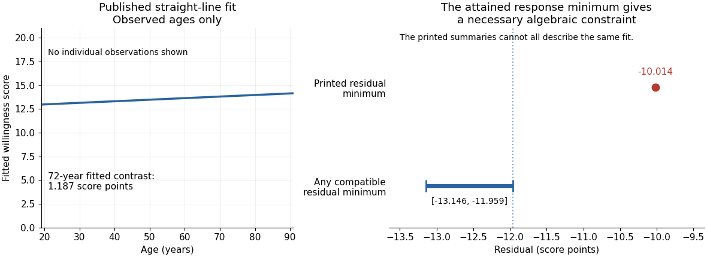

<h1 id="5/solution">Solution</h1>

↑ **Parent:** [5](../5.md)

The fitted [simple linear regression](../../../simple-linear-regression.md) for the numerical [vaccination intention](../../../vaccination-intention.md) scale is

$$
\widehat{\mathbb E}[Y\mid A=a]=12.645291+0.016489a.
$$

Here age is measured in years. **The fitted mean increases by about 0.01649 score points per year, or 0.16489 points per decade.** The [regression coefficient](../../../regression-coefficient.md) is an association across respondents, not an estimate of how an individual would change on ageing or of a [causal effect](../../../causal-effect.md) of age.

The [standard error](../../../standard-error.md) of the age [regression coefficient](../../../regression-coefficient.md) is $0.006806$. Dividing gives $t\approx2.423$, with 2,133 residual [statistical degrees of freedom](../../../statistical-degrees-of-freedom.md), corresponding to $2135-2$ fitted residual degrees. The reported two-sided [p-value](../../../p-value.md) is $0.0155$, so the zero-slope [null hypothesis](../../../null-hypothesis.md) is rejected at a prespecified 5% level, but not at 1%. An approximate 95% [confidence interval](../../../confidence-interval.md) is

$$
\boxed{0.016489\pm t_{2133,0.975}(0.006806)
\approx[0.003142,\ 0.029836]\text{ score points per year}.}
$$

Its positive endpoints are consistent with the test decision; they do not make the slope large.

The [coefficient of determination](../../../coefficient-of-determination.md) is $R^2=0.002744$, so the fitted age trend accounts for only **0.2744% of the observed score variation**, compared with an intercept-only prediction. Its adjusted value is $0.002276$. In an intercept-containing [simple linear regression](../../../simple-linear-regression.md), the positive slope implies a positive [Pearson correlation coefficient](../../../pearson-correlation-coefficient.md) $r=\sqrt{R^2}\approx0.05238$. The reported overall $F$ statistic, $5.869$ on one and 2,133 degrees of freedom, agrees with the squared slope [test statistic](../../../test-statistic.md) up to printed rounding.

The residual [standard deviation](../../../standard-deviation.md) estimate is $5.618$ score points, much larger than the fitted decade contrast. At age 50 the fitted value is about $13.4697$, and at 60 it is about $13.6346$. Across the observed ages 19 to 91, the fitted mean changes by only $1.1872$ points. Statistical detection with 2,135 observations therefore coexists with weak individual prediction.

The intercept predicts $12.645291$ at age zero, outside the observed age range; it should not be given a substantive infant interpretation. Centring age at its observed [sample mean](../../../sample-mean.md), $50.174$, gives

$$
\widehat{\mathbb E}[Y\mid A=a]\approx13.47261+0.016489(a-50.174),
$$

which agrees with the reported score [sample mean](../../../sample-mean.md) of $13.473$ after rounding. The bounded scale and upper quartile at its maximum motivate attention to a possible [ceiling effect](../../../ceiling-effect-statistics.md); they do not establish [homoskedasticity](../../../homoskedasticity.md), a normal error distribution or a satisfactory linear conditional mean. Five residual quantiles cannot replace a [residual plot](../../../residual-plot.md) or checks of the sampling assumptions.

There is also a source consistency problem. The output reports that all 2,135 records have age and score present, that the attained minimum score is one, and that ages lie between 19 and 91. The positive fitted slope therefore places every fitted value between $12.958582$ and $14.145790$. By [residual extrema when response extrema are attained](../../../residual-extrema-when-response-extrema-are-attained.md), the minimum [regression residual](../../../regression-residual.md) must satisfy

$$
-13.145790\le e_{\min}\le-11.958582.
$$

At the observation with score one, its residual is already at most $1-12.958582=-11.958582$. The printed minimum residual, $-10.014$, lies outside this necessary interval. **Those summaries cannot all describe the same complete sample and fitted model.** The discrepancy is too large to be explained by the displayed rounding. It is present in the original PDF; the individual records would be needed to establish which printed item is wrong.

**[Figure 2](#5/image-the-age-regression-function-and-residual-extrema-when-response-extrema-are-attained). The age regression function and residual extrema when response extrema are attained**. The left panel uses the reported fitted coefficients over the observed age range, with the numerical response scale shown for context. It contains no reconstructed individual observations. The right panel compares the printed minimum [regression residual](../../../regression-residual.md) with necessary algebraic bounds derived from the attained response minimum. That interval is a consistency constraint, not a [confidence interval](../../../confidence-interval.md).

## ↑ Ancestors (10)

1. [5](../5.md)
2. [2021](../../2021-split.md)
3. [Past exam of the digital social research: statistics core course of the University of Oxford](../../split.md)
4. [Digital social research: statistics core course of the University of Oxford](../../../digital-social-research-statistics-core-course-of-the-university-of-oxford.md)
5. [MSc in social science of the internet course of the University of Oxford](../../../msc-in-social-science-of-the-internet-course-of-the-university-of-oxford.md)
6. [Master's course of the University of Oxford](../../../master-s-course-of-the-university-of-oxford.md)
7. [Course of the University of Oxford](../../../course-of-the-university-of-oxford.md)
8. [University of Oxford](../../../university-of-oxford-split.md)
9. [List of universities](../../../list-of-universities.md)
10. [Codex Wiki](../../../split.md)
