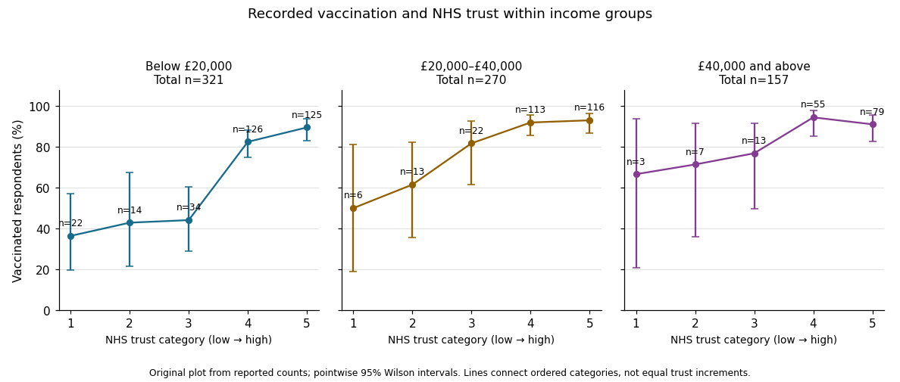

<h1 id="3/solution">Solution</h1>

↑ **Parent:** [3](../3.md)

The association remains positive within each income group, although its estimated size is smaller in the higher-income groups. The two extreme trust categories give the following conditional vaccination percentages and differences:

| Annual household income | Lowest trust | Highest trust | Difference in percentage points |
| --- | --- | --- | --- |
| Below £20,000 | 36.36% | 89.60% | 53.24 |
| £20,000–£40,000 | 50.00% | 93.10% | 43.10 |
| £40,000 and above | 66.67% | 91.14% | 24.47 |

In the lowest-income group, the intervening percentages are 42.86%, 44.12% and 82.54%, so the increase is monotone. Its [Pearson chi-squared statistic](../../../pearson-chi-squared-statistic.md) is approximately 62.520 on four [statistical degrees of freedom](../../../statistical-degrees-of-freedom.md), with the printed asymptotic $p\approx8.56\times10^{-13}$. [Cramér's V](../../../cramer-s-v.md) is approximately 0.441, [Goodman and Kruskal's gamma](../../../goodman-and-kruskal-s-gamma.md) is approximately 0.626 and the column-dependent [Somers' D](../../../somers-d.md) is approximately 0.259. The column-dependent [Goodman and Kruskal's lambda](../../../goodman-and-kruskal-s-lambda.md) is approximately 0.158: trust improves the modal prediction more here than in the pooled table.

In the middle-income group, the intervening vaccination percentages are 61.54%, 81.82% and 92.04%. The printed [Pearson chi-squared statistic](../../../pearson-chi-squared-statistic.md) is approximately 24.033 on four [statistical degrees of freedom](../../../statistical-degrees-of-freedom.md), with asymptotic $p\approx7.87\times10^{-5}$. [Cramér's V](../../../cramer-s-v.md) is approximately 0.298, [Goodman and Kruskal's gamma](../../../goodman-and-kruskal-s-gamma.md) approximately 0.454 and column-dependent [Somers' D](../../../somers-d.md) approximately 0.100. Column-dependent [Goodman and Kruskal's lambda](../../../goodman-and-kruskal-s-lambda.md) is zero: vaccinated respondents are the majority in every row, so the modal prediction never changes. A zero lambda does not mean [independence](../../../independent-random-variables.md).

In the highest-income group, the intermediate vaccination percentages are 71.43%, 76.92% and 94.55%; the final category falls slightly to 91.14%. Thus the observed pattern is broadly positive rather than strictly monotone. The printed [Pearson chi-squared statistic](../../../pearson-chi-squared-statistic.md) is approximately 8.199 on four [statistical degrees of freedom](../../../statistical-degrees-of-freedom.md), with asymptotic $p\approx0.0846$. It does not reject [independence](../../../independent-random-variables.md) at 5%. The corresponding [Cramér's V](../../../cramer-s-v.md) is approximately 0.229, [Goodman and Kruskal's gamma](../../../goodman-and-kruskal-s-gamma.md) approximately 0.281 and column-dependent [Somers' D](../../../somers-d.md) approximately 0.058. The column-dependent [Goodman and Kruskal's lambda](../../../goodman-and-kruskal-s-lambda.md) is again zero.

Small counts limit the asymptotic tests, especially in the middle- and highest-income tables. Their minimum expected counts are approximately 0.644 and 0.306, with respectively 30% and 40% of cells below five. The lowest-income table has one expected count below five, with minimum approximately 3.315. These diagnostics concern expected counts under [independence](../../../independent-random-variables.md), not just the observed row sizes.

The supplied counts are sufficient to make an [exact conditional Pearson test for a binary contingency table](../../../exact-conditional-pearson-test-for-a-binary-contingency-table.md), without needing individual records or assuming a [chi-squared distribution](../../../chi-squared-distribution.md) approximation. Conditioning on the row totals and total unvaccinated count removes the common unknown [binomial probability](../../../binomial-probability.md). For each admissible table, sum its [multivariate hypergeometric distribution](../../../multivariate-hypergeometric-distribution.md) probability when its [Pearson chi-squared statistic](../../../pearson-chi-squared-statistic.md) is at least the observed one. Complete enumeration gives:

| Income group | Enumerated tables | Exact conditional p-value |
| --- | --- | --- |
| Lowest | 507150 | $7.6870\times10^{-12}$ |
| Middle | 22379 | $0.00059975$ |
| Highest | 2585 | $0.085324$ |

These are **new exact conditional calculations**, rather than the paper's printed asymptotic [p-values](../../../p-value.md). They confirm evidence of association in the first two groups and nonrejection at 5% in the third, while showing the numerical effect of sparse cells. The tail is ordered by the [Pearson chi-squared statistic](../../../pearson-chi-squared-statistic.md); an exact test with a different ordering need not have the same [p-value](../../../p-value.md). Fixed-margin [Monte Carlo tests](../../../monte-carlo-test.md) approximate this same Pearson-ordered tail when enumeration is impractical.[Details: fixed-marginal simulation for contingency-table Pearson tests](../../../pearson-s-chi-squared-test-for-count-data-in-the-r-documentation.md)

The original count-based figure below includes pointwise approximate 95% [Wilson intervals](../../../wilson-score-interval.md). The very wide intervals for sparsely populated trust categories make the uncertainty visible; they are not simultaneous intervals or a formal test of differences between income groups.

**[Figure 1](#3/image-recorded-vaccination-by-nhs-trust-within-household-income-groups-with-pointwise-wilson-intervals). Recorded vaccination by NHS trust within household-income groups, with pointwise Wilson intervals**. Original plot from the supplied table counts. Connected categories show their order without assuming equal numerical trust increments. The intervals concern conditional proportions, and the figure does not identify causal effects.

In the [elaboration model](../../../elaboration-model.md), the positive direction is replicated after conditioning on income: **income does not fully explain away the observed trust–vaccination relationship**. The decreasing estimated contrasts and ordered coefficients suggest possible specification by income, or [effect modification](../../../effect-modifier.md) on an explicitly chosen scale. They do not establish it. Different [p-values](../../../p-value.md) can arise from different sample sizes and [standard errors](../../../standard-error.md); [significant and nonsignificant results need not differ significantly](../../../significant-and-nonsignificant-results-need-not-differ-significantly.md). A formal [statistical interaction](../../../interaction-statistics.md) test or a [confidence interval](../../../confidence-interval.md) for differences between comparable contrasts would address that question.[Chapter 15, Table 15-5: replication, specification and the causal ordering needed for explanation or interpretation](../../../the-practice-of-social-research-13th-edition-by-earl-babbie.md)

Nor do these conditional tables prove that income is a causal [confounder](../../../confounder.md) or [causal mediator](../../../causal-mediator.md). Those labels require assumptions about causal order, relevant [confounding](../../../confounding.md) and how variables were measured. This is an [observational study](../../../observational-study.md) of recorded [vaccination status](../../../vaccination-status.md), not a randomized change in trust or a test of vaccine effectiveness.

## ↑ Ancestors (10)

1. [3](../3.md)
2. [2022](../../2022-split.md)
3. [Past exam of the digital social research: statistics core course of the University of Oxford](../../split.md)
4. [Digital social research: statistics core course of the University of Oxford](../../../digital-social-research-statistics-core-course-of-the-university-of-oxford.md)
5. [MSc in social science of the internet course of the University of Oxford](../../../msc-in-social-science-of-the-internet-course-of-the-university-of-oxford.md)
6. [Master's course of the University of Oxford](../../../master-s-course-of-the-university-of-oxford.md)
7. [Course of the University of Oxford](../../../course-of-the-university-of-oxford.md)
8. [University of Oxford](../../../university-of-oxford-split.md)
9. [List of universities](../../../list-of-universities.md)
10. [Codex Wiki](../../../split.md)
