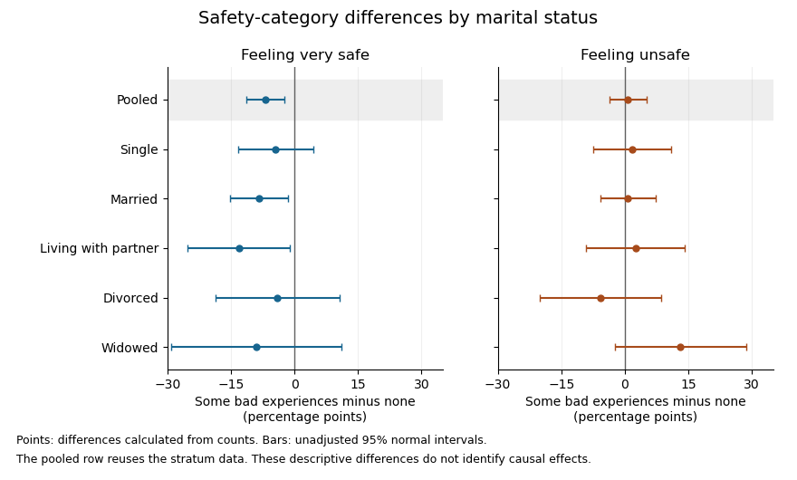

# 2023

↑ **Parent:** [Past exam of the digital social research: statistics core course of the University of Oxford](../past-exam-of-the-digital-social-research-statistics-core-course-of-the-university-of-oxford.md)

Source release: [https://www.whatdotheyknow.com/request/admission_statistics_and_past_pa/response/2722250/attach/2/Exam%20papers.zip?cookie_passthrough=1](https://www.whatdotheyknow.com/request/admission_statistics_and_past_pa/response/2722250/attach/2/Exam%20papers.zip?cookie_passthrough=1)

**Table of contents**

- [1](#1)
  - [Solution](#1/solution)
- [2](#2)
  - [Solution](#2/solution)
- [3](#3)
  - [Solution](#3/solution)
- [4](#4)
  - [Solution](#4/solution)

## 1

↑ **Parent:** [2023](2023.md)

<h3 id="1/solution">Solution</h3>

↑ **Parent:** [1](#1)

A [null hypothesis](../statistical-hypothesis-test.md#null-hypothesis) specifies the population comparison to be tested, for example equality of the population [means](../expected-value.md) for women and their complement. The [alternative hypothesis](../statistical-hypothesis-test.md#alternative-hypothesis) for a [two-sided test](../statistical-hypothesis-test.md#two-sided-hypothesis-test) is a nonzero difference. A [Student's t-test](../statistical-hypothesis-test.md#student-s-t-test) measures an estimated difference in units of its estimated [standard error](../statistical-inference.md#standard-error):

$$
t=\frac{\widehat\Delta-0}{\widehat{\operatorname{SE}}(\widehat\Delta)}.
$$

On the reported calibration, the [sampling distribution](../statistical-modelling.md#sampling-distribution) under the [null hypothesis](../statistical-hypothesis-test.md#null-hypothesis) is [Student's t-distribution](../continuous-probability-distribution.md#student-s-t-distribution) with $1225$ [statistical degrees of freedom](../statistical-inference.md#statistical-degrees-of-freedom). Consequently the [two-sided test](../statistical-hypothesis-test.md#two-sided-hypothesis-test) has [p-value](../statistical-hypothesis-test.md#p-value)

$$
\boxed{p=\Pr\{|T_{1225}|\geq2.5\}\simeq0.01255.}
$$

With this many [statistical degrees of freedom](../statistical-inference.md#statistical-degrees-of-freedom), the [Student t-distribution](../continuous-probability-distribution.md#student-s-t-distribution) is close to the [standard normal distribution](../probability-distribution.md#standard-normal-distribution): $|t|=2.5$ exceeds the approximate $5\%$ two-sided critical value $1.96$, but falls short of the $1\%$ value $2.576$. **Using the supplied calibration, reject at the $5\%$ significance level, but not at $1\%$.** The large [statistical degrees of freedom](../statistical-inference.md#statistical-degrees-of-freedom) justify this comparison; a value $2.5$ need not be significant for an arbitrary very small number of [statistical degrees of freedom](../statistical-inference.md#statistical-degrees-of-freedom).

The [p-value](../statistical-hypothesis-test.md#p-value) is the [probability](../probability-theory.md#probability), under the specified [null hypothesis](../statistical-hypothesis-test.md#null-hypothesis) and sampling assumptions, of a [test statistic](../statistical-hypothesis-test.md#test-statistic) at least as discrepant as the observed one. It is not the [probability](../probability-theory.md#probability) that the [null hypothesis](../statistical-hypothesis-test.md#null-hypothesis) is true, nor the [probability](../probability-theory.md#probability) that the observed difference happened “by chance”. A [significance level](../statistical-hypothesis-test.md#significance-level) of $5\%$ controls the long-run [type I error](../information-theory.md#type-i-and-type-ii-errors) rate of the testing procedure when its assumptions hold. Failing to reject at $1\%$ does not prove equality. [Statistical significance](../statistical-hypothesis-test.md#statistical-significance) also does not measure the substantive size or importance of a difference.

The reported [sample means](../variance.md#sample-mean) place the women's [mean](../expected-value.md) $1.4$ scale units above the overall [mean](../expected-value.md). The negative [test statistic](../statistical-hypothesis-test.md#test-statistic) can reflect the order of subtraction; it does not reverse that observed ordering. An appropriate pre-specified directional [one-sided test](../statistical-hypothesis-test.md#one-sided-hypothesis-test) would have a tail [p-value](../statistical-hypothesis-test.md#p-value) approximately $0.00627$ on the supplied calibration, but one cannot choose that direction after inspecting the results simply to halve a [p-value](../statistical-hypothesis-test.md#p-value).

There is a design issue behind the numerical calculation: the women are included in the overall sample. [Comparing a subgroup mean with its containing sample mean](../variance.md#comparing-a-subgroup-mean-with-its-containing-sample-mean) requires accounting for shared observations. If $w$ is the women's sample fraction and $\overline x_O$ the [mean](../expected-value.md) for the remaining respondents, then

$$
\overline x=w\overline x_F+(1-w)\overline x_O,\qquad
\overline x_F-\overline x=(1-w)(\overline x_F-\overline x_O).
$$

These two estimates are not [independent](../random-variable.md#independent-random-variables). An ordinary independent-two-sample [Student's t-test](../statistical-hypothesis-test.md#student-s-t-test) of women against the entire respondent sample would therefore use an inappropriate [standard error](../statistical-inference.md#standard-error). The interpretation above accepts the supplied [test statistic](../statistical-hypothesis-test.md#test-statistic) and its stated null calibration; a valid analysis of the underlying data should compare disjoint groups, or calculate the shared-sample [covariance](../variance.md#covariance) correctly. The summary alone cannot establish which calculation was used. [Simple random sampling](../statistical-inference.md#simple-random-sampling) supports sampling inference under the stated design, but an observed gender association does not establish a [causal effect](../causal-inference.md#causal-effect).

## 2

↑ **Parent:** [2023](2023.md)

<h3 id="2/solution">Solution</h3>

↑ **Parent:** [2](#2)

Each row of the [contingency table](../statistical-modelling.md#contingency-table) is a [conditional distribution](../probability-theory.md#conditional-distribution) of the safety category among respondents with that experience status. Thus the relevant comparison uses row [percentages](../arithmetic.md#percentage), rather than interpreting the larger number of respondents with some bad experiences as itself an effect on safety.

The [sample proportions](../discrete-probability-distribution.md#sample-proportion) reporting feeling very safe are $39.59\%$ without bad experiences and $32.78\%$ with some bad experiences: the latter is lower by about $6.81$ [percentage points](../arithmetic.md#percentage-point). Feeling fairly safe rises from $28.49\%$ to $34.63\%$, a difference of about $6.14$ [percentage points](../arithmetic.md#percentage-point). Feeling unsafe changes only from $31.92\%$ to $32.59\%$, about $0.67$ [percentage points](../arithmetic.md#percentage-point). The main descriptive shift is therefore from **very safe toward fairly safe**, rather than a large increase in the unsafe category.

[Pearson's chi-squared test](../statistical-hypothesis-test.md#pearson-s-chi-squared-test) tests the [null hypothesis](../statistical-hypothesis-test.md#null-hypothesis) that experience status and safety category are [independent](../random-variable.md#independent-random-variables). If that were true, the expected cell count would be its row total times column total divided by $n$. The [Pearson chi-squared statistic](../generalized-linear-model.md#pearson-chi-squared-statistic) sums squared observed-minus-expected count differences divided by their expected counts. Here

$$
\boxed{X^2=10.84662,\qquad \mathrm{df}=(2-1)(3-1)=2,\qquad p=0.004412523.}
$$

The expected counts are comfortably large, with minimum approximately $234.7$, so the ordinary large-sample [chi-squared distribution](../probability-distribution.md#chi-squared-distribution) approximation is appropriate under the sampling assumptions. There is evidence against [independence](../random-variable.md#independent-random-variables) even at the $1\%$ [significance level](../statistical-hypothesis-test.md#significance-level). The reported likelihood-ratio result gives the same conclusion.

Magnitude is a separate question. [Cramér's V](../statistical-modelling.md#cramer-s-v) gives

$$
V=\sqrt{\frac{10.84662}{1807}}\simeq0.07748,
$$

which describes a weak [statistical association](../causal-inference.md#statistical-association). It does not [mean](../expected-value.md) that $7.7\%$ of safety is explained. Nor does the [p-value](../statistical-hypothesis-test.md#p-value) measure the size of that association.

For ordinal direction, order the experience categories as none, some, and the safety categories from very safe toward unsafe. [Goodman and Kruskal's gamma](../statistical-modelling.md#goodman-and-kruskal-s-gamma) compares [concordant pairs](../statistical-modelling.md#concordant-pair) with [discordant pairs](../statistical-modelling.md#discordant-pair) after excluding tied pairs:

$$
\gamma=\frac{282244-242582}{282244+242582}\simeq0.07557.
$$

Its small positive sign then corresponds to a weak tendency toward less safety among respondents with bad experiences. The sign would reverse if exactly one category ordering were reversed. Because this [contingency table](../statistical-modelling.md#contingency-table) has many ties, the response-direction [Somers' D](../statistical-modelling.md#somers-d), which retains response ties among pairs with different predictor values, is smaller:

$$
D_{Y\mid X}=\frac{39662}{524826+261384}\simeq0.05045.
$$

These coefficients describe ordered association; the omnibus [Pearson's chi-squared test](../statistical-hypothesis-test.md#pearson-s-chi-squared-test) tests any departure from [independence](../random-variable.md#independent-random-variables) and does not supply a separate [p-value](../statistical-hypothesis-test.md#p-value) for gamma.

The column-dependent [Goodman and Kruskal's lambda](../statistical-modelling.md#goodman-and-kruskal-s-lambda) makes the weak predictive improvement tangible. Predicting the overall most frequent safety category makes $1165$ errors in this table. Using a separate most frequent category within each experience row makes $1145$, giving $\lambda=20/1165\simeq0.0172$, only about a $1.7\%$ reduction in those classification errors.

**The sample supports a statistically detectable but weak association, chiefly a reduced [sample proportion](../discrete-probability-distribution.md#sample-proportion) feeling very safe.** This [observational study](../causal-inference.md#observational-study) does not establish that bad experiences cause the change: reverse direction, reporting differences or [confounding](../causal-inference.md#confounding) could also contribute. The numerical [p-value](../statistical-hypothesis-test.md#p-value) also presumes the sampling and complete-case assumptions appropriate to the observations used.

## 3

↑ **Parent:** [2023](2023.md)

<h3 id="3/solution">Solution</h3>

↑ **Parent:** [3](#3)

Conditioning on marital status produces five [contingency tables](../statistical-modelling.md#contingency-table). In each, compare the conditional row [percentages](../arithmetic.md#percentage). The following differences are the [sample proportion](../discrete-probability-distribution.md#sample-proportion) with some bad experiences minus the [sample proportion](../discrete-probability-distribution.md#sample-proportion) without them, in [percentage points](../arithmetic.md#percentage-point); negative very-safe differences [mean](../expected-value.md) fewer respondents feeling very safe in the former group.

| Marital-status stratum | Difference: very safe | Difference: unsafe | Reported [Pearson's chi-squared test](../statistical-hypothesis-test.md#pearson-s-chi-squared-test) [p-value](../statistical-hypothesis-test.md#p-value) | [Cramér's V](../statistical-modelling.md#cramer-s-v) | [Goodman and Kruskal's gamma](../statistical-modelling.md#goodman-and-kruskal-s-gamma) |
| --- | --- | --- | --- | --- | --- |
| Single | $-4.43$ | $+1.82$ | $0.6114$ | $0.048$ | $0.060$ |
| Married | $-8.43$ | $+0.72$ | $0.0257$ | $0.092$ | $0.093$ |
| Living with a partner | $-13.14$ | $+2.52$ | $0.04885$ (inconsistent; see below) | $0.144$ | $0.162$ |
| Divorced | $-4.01$ | $-5.79$ | $0.3583$ | $0.106$ | $-0.013$ |
| Widowed | $-8.96$ | $+13.11$ | $0.3158$ | $0.146$ | $0.220$ |

The [p-values](../statistical-hypothesis-test.md#p-value) test [independence](../random-variable.md#independent-random-variables) within the respective strata; the magnitudes and directions come from the conditional [percentages](../arithmetic.md#percentage) and association measures. Differences in the table are calculated from the counts before rounding.

Among **single** respondents, the very-safe [sample proportion](../discrete-probability-distribution.md#sample-proportion) changes from $33.95\%$ to $29.52\%$, while the unsafe [sample proportion](../discrete-probability-distribution.md#sample-proportion) changes from $36.28\%$ to $38.10\%$. The direction resembles the weak pooled pattern, but $p=0.6114$ supplies little evidence against [independence](../random-variable.md#independent-random-variables) in this stratum. This is not evidence that the population association is exactly zero.

Among **married** respondents, the very-safe [sample proportion](../discrete-probability-distribution.md#sample-proportion) changes from $41.18\%$ to $32.75\%$ and the fairly-safe [sample proportion](../discrete-probability-distribution.md#sample-proportion) rises from $27.68\%$ to $35.39\%$. Unsafe remains almost unchanged, $31.14\%$ versus $31.87\%$. Thus the within-stratum association again chiefly shifts very safe toward fairly safe. Its $p=0.0257$ is below the $5\%$ [significance level](../statistical-hypothesis-test.md#significance-level), while $V=0.092$ still indicates a small association.

For respondents **living with a partner**, very safe changes from $41.46\%$ to $28.32\%$, fairly safe from $30.08\%$ to $40.71\%$, and unsafe from $28.46\%$ to $30.97\%$. The very-safe difference is larger than in the married stratum. The printed [p-value](../statistical-hypothesis-test.md#p-value) $0.04885$ would be just below the conventional $5\%$ [significance level](../statistical-hypothesis-test.md#significance-level). However, this particular output is internally inconsistent: recalculating [Pearson's chi-squared test](../statistical-hypothesis-test.md#pearson-s-chi-squared-test) from its six displayed counts gives $X^2=4.910389$, $p=0.08585$, and $V=0.14425$. The reported $V=0.144$ agrees with the counts, whereas the printed $X^2=6.900389$ would itself imply $p=0.03174$ for two [statistical degrees of freedom](../statistical-inference.md#statistical-degrees-of-freedom), rather than the printed $0.04885$. **Using the displayed counts, this stratum does not reject independence at $5\%$.** The source PDF itself contains these incompatible figures; this is not resolved by rounding.

Among **divorced** respondents, very safe changes from $41.18\%$ to $37.17\%$, but unsafe also decreases, from $36.76\%$ to $30.97\%$, as fairly safe increases from $22.06\%$ to $31.86\%$. This is a redistribution toward the middle category, not a simple shift toward greater unsafety. The near-zero gamma, $-0.013$, reflects the lack of a consistent ordinal direction, while $V=0.106$ can still register distributional differences without a direction. The [p-value](../statistical-hypothesis-test.md#p-value) $0.3583$ does not reject [independence](../random-variable.md#independent-random-variables).

Among **widowed** respondents, very safe changes from $51.43\%$ to $42.47\%$, and unsafe from $14.29\%$ to $27.40\%$. The ordinal association is positive on the chosen ordering, with gamma $0.220$. Its lack of conventional [statistical significance](../statistical-hypothesis-test.md#statistical-significance), $p=0.3158$, does not imply a smaller estimated association than in the married group: the widowed stratum has only $108$ complete observations, versus $857$ in the married stratum, and therefore less precision. All five tables have sufficiently large expected counts for the reported approximations; even the smallest expected count is about $8.10$.

**[Figure 1](#3/image-derived-safety-category-differences-and-unadjusted-uncertainty-by-marital-status-stratum). Derived safety-category differences and unadjusted uncertainty by marital-status stratum**.

The plot uses large-sample [Wald confidence intervals](../statistical-inference.md#wald-confidence-interval) for the [difference of independent sample proportions](../discrete-probability-distribution.md#difference-of-independent-sample-proportions) within each stratum. They concern the individual category contrasts, whereas the tabulated [Pearson's chi-squared tests](../statistical-hypothesis-test.md#pearson-s-chi-squared-test) compare the full three-category distributions. The intervals are unadjusted for [multiple hypothesis testing](../statistical-hypothesis-test.md#multiple-hypothesis-testing); the pooled row reuses the stratum observations, so it is not a sixth independent sample.

In the [elaboration model](../causal-inference.md#elaboration-model), the persistence of a generally weak positive ordinal pattern within four strata is closer to **partial replication** than to a complete explanation of the pooled association by marital status. The differences in estimated patterns suggest **possible specification**: the divorced group's shift toward the middle category differs from the widowed group's shift toward unsafe. They do not by themselves establish population [effect modification](../causal-inference.md#effect-modifier). In particular, [significant and nonsignificant results need not differ significantly](../statistical-hypothesis-test.md#significant-and-nonsignificant-results-need-not-differ-significantly); compare the effects using an [interaction contrast](../normal-linear-model.md#interaction-contrast) or a fitted model with the appropriate [interaction terms](../statistical-model.md#interaction-term), rather than comparing their separate [p-values](../statistical-hypothesis-test.md#p-value).[Printed p. 328, Introduction: comparing significance labels does not test the difference between estimates](../mathematics-bibliography.md#the-difference-between-significant-and-not-significant-is-not-itself-statistically-significant-by-andrew-gelman-and-hal-stern)

One additional omnibus check can be derived from the supplied tables without assuming a common effect. Recalculating the five statistics from the counts, including the corrected living-with-partner statistic, the [joint conditional independence test for stratified contingency tables](../statistical-hypothesis-test.md#joint-conditional-independence-test-for-stratified-contingency-tables) gives

$$
\sum_{k=1}^5 X_k^2=17.5776085,\qquad \mathrm{df}=5(2-1)(3-1)=10,\qquad p\simeq0.06252.
$$

Under independent-stratum sampling this tests [independence](../random-variable.md#independent-random-variables) within every stratum jointly; it does not test whether the association is homogeneous across strata. It does not reject at $5\%$, but this alone does not establish that stratification removed the population association: its ten-degree-of-freedom alternative is less focused than the pooled two-degree-of-freedom test, and nonrejection is not proof of equality.

The [elaboration model](../causal-inference.md#elaboration-model) also distinguishes an antecedent [confounder](../causal-inference.md#confounder) from an intervening [causal mediator](../causal-inference.md#causal-mediator). These cross-sectional tables do not establish the relevant time ordering or identify either role for marital status. Five separate stratum tests further require caution about [multiple hypothesis testing](../statistical-hypothesis-test.md#multiple-hypothesis-testing): for example a [Bonferroni correction](../statistical-hypothesis-test.md#bonferroni-correction) at familywise $5\%$ would use $0.01$ per test, below all five individual [p-values](../statistical-hypothesis-test.md#p-value). That caution changes the interpretation of selected significance labels, not the observed conditional [percentages](../arithmetic.md#percentage).

**The estimated patterns vary across strata, but the tables neither establish a population interaction nor prove that marital status explains away the association.**

## 4

↑ **Parent:** [2023](2023.md)

<h3 id="4/solution">Solution</h3>

↑ **Parent:** [4](#4)

The [ordinary least squares](../normal-linear-model.md#ordinary-least-squares) fit estimates the conditional [mean](../expected-value.md) of the continuous safety response as a [linear function](../vector-space.md#linear-function) of the income coding:

$$
\boxed{\widehat{\mathrm{feelsafe}}=6.5933+0.2369\,\mathrm{income}.}
$$

The [regression coefficient](../linear-regression.md#regression-coefficient) for income is positive. Since larger response values [mean](../expected-value.md) greater safety, one additional coded income unit corresponds to an estimated increase of $0.2369$ safety-scale units in the fitted [mean](../expected-value.md). Following the question's stated units, a unit is a £10,000 income step. The observed coding also uses income bands with open end categories, so this is a linear trend per coded band step; it is not evidence of a known constant effect for every extra pound, especially within the open top band. The output's abbreviated variable label does not override the stated units.

The [intercept](../linear-regression.md#regression-intercept) is the fitted [mean](../expected-value.md) at income code zero. It is estimated as $6.5933$, but zero is outside the observed income codes, so that value is an extrapolated model baseline, not an observed estimate for a particular income category. Its small [p-value](../statistical-hypothesis-test.md#p-value) tests a zero intercept; it is not the main test of the income association.

For the income coefficient, the [standard error](../statistical-inference.md#standard-error) is $0.0604$. The reported [test statistic](../statistical-hypothesis-test.md#test-statistic) and [two-sided test](../statistical-hypothesis-test.md#two-sided-hypothesis-test) give

$$
t\simeq3.922,\qquad p=9.13\times10^{-5},
$$

providing strong evidence against the [null hypothesis](../statistical-hypothesis-test.md#null-hypothesis) of zero linear slope under the stated model assumptions. A $95\%$ [Student t confidence interval](../statistical-inference.md#student-t-confidence-interval), using $1727$ residual [statistical degrees of freedom](../statistical-inference.md#statistical-degrees-of-freedom), is

$$
\boxed{0.2369\pm t_{1727,0.975}(0.0604)\simeq[0.1184,\,0.3554].}
$$

This is an interval for the population linear coefficient under the model, not an interval containing $95\%$ of individual safety scores. The large-sample estimate is precise enough to detect a positive association, but that does not establish substantial individual predictive power.

The [coefficient of determination](../linear-regression.md#coefficient-of-determination) is $R^2=0.008828$: the fitted line accounts for about $0.883\%$ of the in-sample variation about the response [sample mean](../variance.md#sample-mean). The [adjusted coefficient of determination](../linear-regression.md#adjusted-coefficient-of-determination) is about $0.825\%$. Thus **income alone explains very little of the observed variation**, despite the small slope [p-value](../statistical-hypothesis-test.md#p-value). The [residual standard error](../normal-linear-model.md#residual-standard-error) of $3.997$ response units describes substantial scatter about the fitted line. This is an estimated residual [standard deviation](../variance.md#standard-deviation), rather than the [standard error](../statistical-inference.md#standard-error) of the slope or a complete individual prediction interval.

The overall [F-test](../probability-and-statistics.md#f-test) has $F=15.38$ on $1,1727$ [statistical degrees of freedom](../statistical-inference.md#statistical-degrees-of-freedom) and $p=9.129\times10^{-5}$. With one predictor and an [intercept](../linear-regression.md#regression-intercept), it tests the same zero-slope hypothesis as the coefficient [Student's t-test](../statistical-hypothesis-test.md#student-s-t-test); $F=t^2$, up to rounding. It is not an additional independent confirmation. In this [simple linear regression](../linear-regression.md#simple-linear-regression), the [Pearson correlation coefficient](../variance.md#pearson-correlation-coefficient) has the slope's sign and magnitude $\sqrt{R^2}\simeq0.0940$, another description of the weak linear association.

The regression uses $1729$ complete observations and estimates two coefficients, giving $1729-2=1727$ residual [statistical degrees of freedom](../statistical-inference.md#statistical-degrees-of-freedom). The deletion of $88$ observations is [complete-case analysis](../probability-and-statistics.md#complete-case-analysis); extending its conclusions to the full target population requires suitable assumptions about the [missing-data mechanism](../probability-and-statistics.md#missing-data-mechanism). Classical reported [standard errors](../statistical-inference.md#standard-error) also rely on an adequate linear conditional [mean](../expected-value.md), independent errors and [homoscedasticity](../statistical-model.md#homoscedasticity); a [normal linear model](../normal-linear-model.md) gives the finite-sample [Student t-distribution](../continuous-probability-distribution.md#student-s-t-distribution) and [F-test](../probability-and-statistics.md#f-test) calibration, while large-sample approximations can justify similar tests under weaker distributional assumptions. The printed summary alone does not establish these assumptions. [Regression diagnostics](../linear-regression.md#regression-diagnostics) and, where appropriate, [heteroskedasticity-consistent standard errors](../statistical-inference.md#heteroskedasticity-consistent-standard-errors) address different parts of that assessment.

Finally, this unadjusted [observational study](../causal-inference.md#observational-study) estimates an association. Other [covariates](../statistical-model.md#covariate), such as age or experience status, may be related to both income and reported safety. Without additional design or [causal identification](../causal-inference.md#causal-identification) assumptions, the positive fitted slope does not establish that increasing income would cause an increase in safety.

## ↑ Ancestors (8)

1. [Past exam of the digital social research: statistics core course of the University of Oxford](../past-exam-of-the-digital-social-research-statistics-core-course-of-the-university-of-oxford.md)
2. [Digital social research: statistics core course of the University of Oxford](../university-of-oxford.md#digital-social-research-statistics-core-course-of-the-university-of-oxford)
3. [MSc in social science of the internet course of the University of Oxford](../university-of-oxford.md#msc-in-social-science-of-the-internet-course-of-the-university-of-oxford)
4. [Master's course of the University of Oxford](../university-of-oxford.md#master-s-course-of-the-university-of-oxford)
5. [Course of the University of Oxford](../university-of-oxford.md#course-of-the-university-of-oxford)
6. [University of Oxford](../university-of-oxford.md)
7. [List of universities](../README.md#list-of-universities)
8. [Codex Wiki](../README.md)
