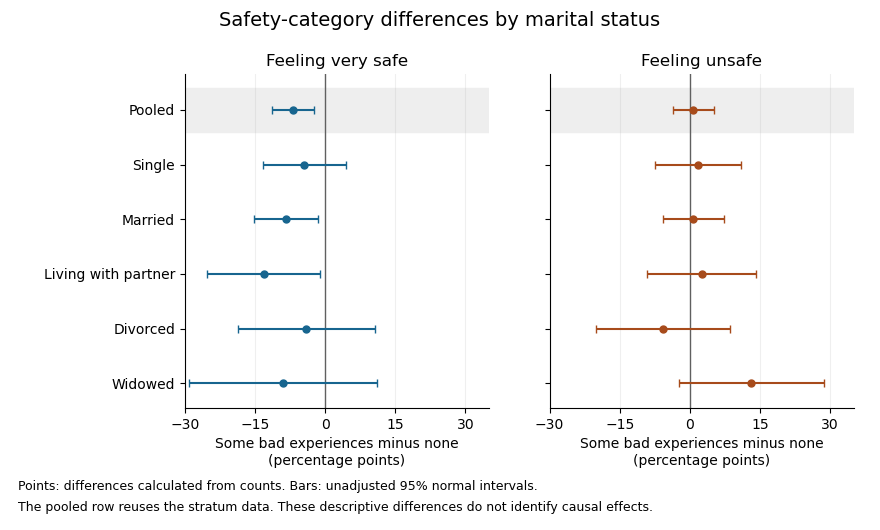

<h1 id="3/solution">Solution</h1>

↑ **Parent:** [3](../3.md)

Conditioning on marital status produces five [contingency tables](../../../contingency-table.md). In each, compare the conditional row [percentages](../../../percentage.md). The following differences are the [sample proportion](../../../sample-proportion.md) with some bad experiences minus the [sample proportion](../../../sample-proportion.md) without them, in [percentage points](../../../percentage-point.md); negative very-safe differences [mean](../../../expected-value-split.md) fewer respondents feeling very safe in the former group.

| Marital-status stratum | Difference: very safe | Difference: unsafe | Reported [Pearson's chi-squared test](../../../pearson-s-chi-squared-test.md) [p-value](../../../p-value.md) | [Cramér's V](../../../cramer-s-v.md) | [Goodman and Kruskal's gamma](../../../goodman-and-kruskal-s-gamma.md) |
| --- | --- | --- | --- | --- | --- |
| Single | $-4.43$ | $+1.82$ | $0.6114$ | $0.048$ | $0.060$ |
| Married | $-8.43$ | $+0.72$ | $0.0257$ | $0.092$ | $0.093$ |
| Living with a partner | $-13.14$ | $+2.52$ | $0.04885$ (inconsistent; see below) | $0.144$ | $0.162$ |
| Divorced | $-4.01$ | $-5.79$ | $0.3583$ | $0.106$ | $-0.013$ |
| Widowed | $-8.96$ | $+13.11$ | $0.3158$ | $0.146$ | $0.220$ |

The [p-values](../../../p-value.md) test [independence](../../../independent-random-variables.md) within the respective strata; the magnitudes and directions come from the conditional [percentages](../../../percentage.md) and association measures. Differences in the table are calculated from the counts before rounding.

Among **single** respondents, the very-safe [sample proportion](../../../sample-proportion.md) changes from $33.95\%$ to $29.52\%$, while the unsafe [sample proportion](../../../sample-proportion.md) changes from $36.28\%$ to $38.10\%$. The direction resembles the weak pooled pattern, but $p=0.6114$ supplies little evidence against [independence](../../../independent-random-variables.md) in this stratum. This is not evidence that the population association is exactly zero.

Among **married** respondents, the very-safe [sample proportion](../../../sample-proportion.md) changes from $41.18\%$ to $32.75\%$ and the fairly-safe [sample proportion](../../../sample-proportion.md) rises from $27.68\%$ to $35.39\%$. Unsafe remains almost unchanged, $31.14\%$ versus $31.87\%$. Thus the within-stratum association again chiefly shifts very safe toward fairly safe. Its $p=0.0257$ is below the $5\%$ [significance level](../../../significance-level.md), while $V=0.092$ still indicates a small association.

For respondents **living with a partner**, very safe changes from $41.46\%$ to $28.32\%$, fairly safe from $30.08\%$ to $40.71\%$, and unsafe from $28.46\%$ to $30.97\%$. The very-safe difference is larger than in the married stratum. The printed [p-value](../../../p-value.md) $0.04885$ would be just below the conventional $5\%$ [significance level](../../../significance-level.md). However, this particular output is internally inconsistent: recalculating [Pearson's chi-squared test](../../../pearson-s-chi-squared-test.md) from its six displayed counts gives $X^2=4.910389$, $p=0.08585$, and $V=0.14425$. The reported $V=0.144$ agrees with the counts, whereas the printed $X^2=6.900389$ would itself imply $p=0.03174$ for two [statistical degrees of freedom](../../../statistical-degrees-of-freedom.md), rather than the printed $0.04885$. **Using the displayed counts, this stratum does not reject independence at $5\%$.** The source PDF itself contains these incompatible figures; this is not resolved by rounding.

Among **divorced** respondents, very safe changes from $41.18\%$ to $37.17\%$, but unsafe also decreases, from $36.76\%$ to $30.97\%$, as fairly safe increases from $22.06\%$ to $31.86\%$. This is a redistribution toward the middle category, not a simple shift toward greater unsafety. The near-zero gamma, $-0.013$, reflects the lack of a consistent ordinal direction, while $V=0.106$ can still register distributional differences without a direction. The [p-value](../../../p-value.md) $0.3583$ does not reject [independence](../../../independent-random-variables.md).

Among **widowed** respondents, very safe changes from $51.43\%$ to $42.47\%$, and unsafe from $14.29\%$ to $27.40\%$. The ordinal association is positive on the chosen ordering, with gamma $0.220$. Its lack of conventional [statistical significance](../../../statistical-significance.md), $p=0.3158$, does not imply a smaller estimated association than in the married group: the widowed stratum has only $108$ complete observations, versus $857$ in the married stratum, and therefore less precision. All five tables have sufficiently large expected counts for the reported approximations; even the smallest expected count is about $8.10$.

**[Figure 1](#3/image-derived-safety-category-differences-and-unadjusted-uncertainty-by-marital-status-stratum). Derived safety-category differences and unadjusted uncertainty by marital-status stratum**.

The plot uses large-sample [Wald confidence intervals](../../../wald-confidence-interval.md) for the [difference of independent sample proportions](../../../difference-of-independent-sample-proportions.md) within each stratum. They concern the individual category contrasts, whereas the tabulated [Pearson's chi-squared tests](../../../pearson-s-chi-squared-test.md) compare the full three-category distributions. The intervals are unadjusted for [multiple hypothesis testing](../../../multiple-hypothesis-testing.md); the pooled row reuses the stratum observations, so it is not a sixth independent sample.

In the [elaboration model](../../../elaboration-model.md), the persistence of a generally weak positive ordinal pattern within four strata is closer to **partial replication** than to a complete explanation of the pooled association by marital status. The differences in estimated patterns suggest **possible specification**: the divorced group's shift toward the middle category differs from the widowed group's shift toward unsafe. They do not by themselves establish population [effect modification](../../../effect-modifier.md). In particular, [significant and nonsignificant results need not differ significantly](../../../significant-and-nonsignificant-results-need-not-differ-significantly.md); compare the effects using an [interaction contrast](../../../interaction-contrast.md) or a fitted model with the appropriate [interaction terms](../../../interaction-term.md), rather than comparing their separate [p-values](../../../p-value.md).[Printed p. 328, Introduction: comparing significance labels does not test the difference between estimates](../../../the-difference-between-significant-and-not-significant-is-not-itself-statistically-significant-by-andrew-gelman-and-hal-stern.md)

One additional omnibus check can be derived from the supplied tables without assuming a common effect. Recalculating the five statistics from the counts, including the corrected living-with-partner statistic, the [joint conditional independence test for stratified contingency tables](../../../joint-conditional-independence-test-for-stratified-contingency-tables.md) gives

$$
\sum_{k=1}^5 X_k^2=17.5776085,\qquad \mathrm{df}=5(2-1)(3-1)=10,\qquad p\simeq0.06252.
$$

Under independent-stratum sampling this tests [independence](../../../independent-random-variables.md) within every stratum jointly; it does not test whether the association is homogeneous across strata. It does not reject at $5\%$, but this alone does not establish that stratification removed the population association: its ten-degree-of-freedom alternative is less focused than the pooled two-degree-of-freedom test, and nonrejection is not proof of equality.

The [elaboration model](../../../elaboration-model.md) also distinguishes an antecedent [confounder](../../../confounder.md) from an intervening [causal mediator](../../../causal-mediator.md). These cross-sectional tables do not establish the relevant time ordering or identify either role for marital status. Five separate stratum tests further require caution about [multiple hypothesis testing](../../../multiple-hypothesis-testing.md): for example a [Bonferroni correction](../../../bonferroni-correction.md) at familywise $5\%$ would use $0.01$ per test, below all five individual [p-values](../../../p-value.md). That caution changes the interpretation of selected significance labels, not the observed conditional [percentages](../../../percentage.md).

**The estimated patterns vary across strata, but the tables neither establish a population interaction nor prove that marital status explains away the association.**

## ↑ Ancestors (10)

1. [3](../3.md)
2. [2023](../../2023-split.md)
3. [Past exam of the digital social research: statistics core course of the University of Oxford](../../split.md)
4. [Digital social research: statistics core course of the University of Oxford](../../../digital-social-research-statistics-core-course-of-the-university-of-oxford.md)
5. [MSc in social science of the internet course of the University of Oxford](../../../msc-in-social-science-of-the-internet-course-of-the-university-of-oxford.md)
6. [Master's course of the University of Oxford](../../../master-s-course-of-the-university-of-oxford.md)
7. [Course of the University of Oxford](../../../course-of-the-university-of-oxford.md)
8. [University of Oxford](../../../university-of-oxford-split.md)
9. [List of universities](../../../list-of-universities.md)
10. [Codex Wiki](../../../split.md)
