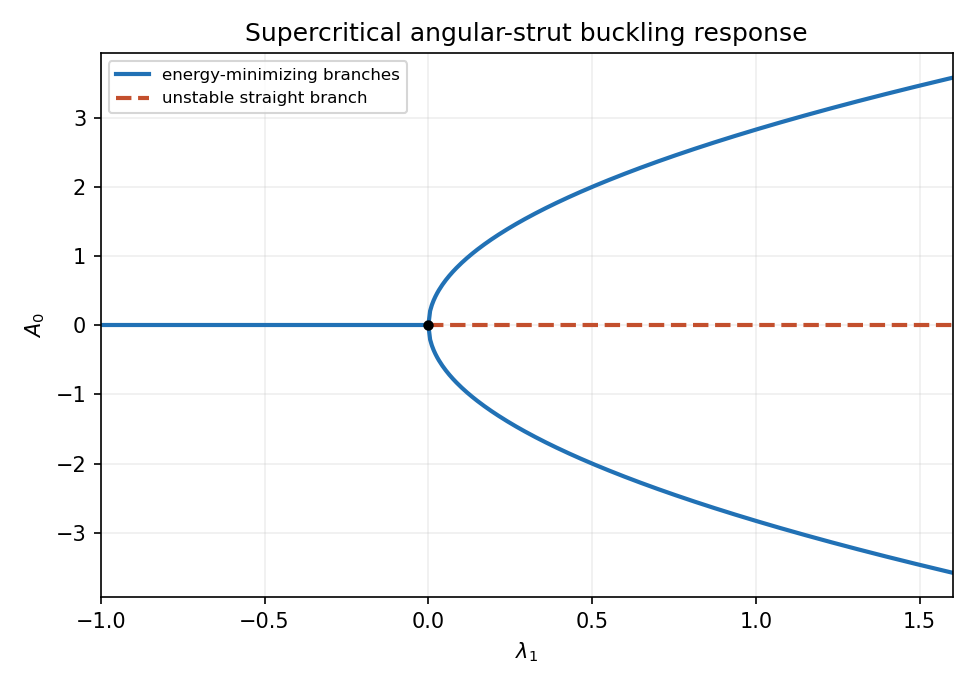
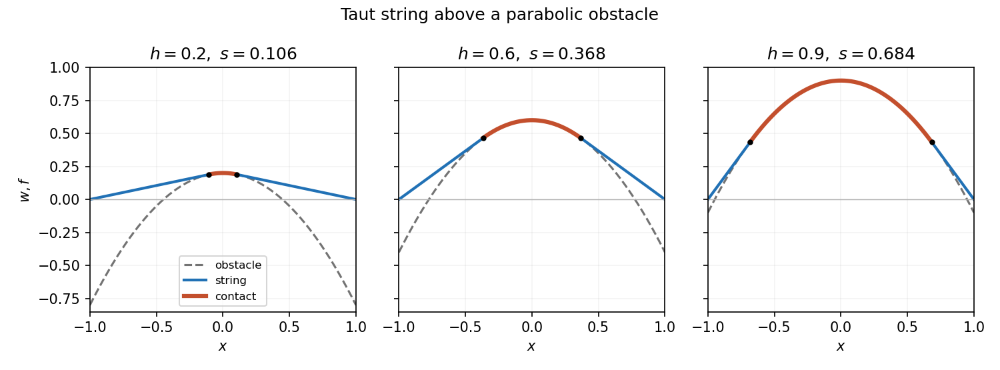

# 2008

↑ **Parent:** [Past exam of the elasticity and plasticity course of the University of Oxford](../past-exam-of-the-elasticity-and-plasticity-course-of-the-university-of-oxford.md)

Original solutions to the paper released at [the source request](https://www.whatdotheyknow.com/request/maths_past_papers_3). The complete editable transcription is retained in the private examination archive.

**Table of contents**

- [1](#1)
  - [a](#1/a)
    - [Solution](#1/a/solution)
  - [b](#1/b)
    - [Solution](#1/b/solution)
  - [c](#1/c)
    - [Solution](#1/c/solution)
  - [d](#1/d)
    - [Solution](#1/d/solution)
- [2](#2)
  - [Solution](#2/solution)
- [3](#3)
  - [a](#3/a)
    - [Solution](#3/a/solution)
  - [b](#3/b)
    - [Solution](#3/b/solution)
  - [c](#3/c)
    - [Solution](#3/c/solution)
  - [d](#3/d)
    - [Solution](#3/d/solution)
- [4](#4)
  - [a](#4/a)
    - [Solution](#4/a/solution)
  - [b](#4/b)
    - [Solution](#4/b/solution)
  - [c](#4/c)
    - [Solution](#4/c/solution)
  - [d](#4/d)
    - [Solution](#4/d/solution)

## 1

↑ **Parent:** [2008](2008.md)

<h3 id="1/a">a</h3>

↑ **Parent:** [1](#1)

<h4 id="1/a/solution">Solution</h4>

↑ **Parent:** [A](#1/a)

The [infinitesimal strain](../continuum-mechanics.md#infinitesimal-strain-tensor) is $e_{ij}=(u_{i,j}+u_{j,i})/2$. A constant [translation](../geometry-and-topology.md#translation-geometry) has zero [gradient](../multivariable-calculus.md#gradient). For the remaining term, $u_i=\epsilon_{ikl}\omega_kx_l$ has $u_{i,j}=\epsilon_{ikj}\omega_k$, a [skew-symmetric matrix](../linear-algebra.md#skew-symmetric-matrix). Therefore

$$
\boxed{e_{ij}=0.}
$$

Physically $\mathbf a$ is a [translation](../geometry-and-topology.md#translation-geometry) and $\boldsymbol\omega\times\mathbf x$ is an infinitesimal [rigid rotation](../euclidean-geometry.md#rigid-transformation), with axis along $\boldsymbol\omega$ and [rotation](../riemannian-geometry.md#rotation-mathematics) angle $|\boldsymbol\omega|$. It is the linearized [rotation](../riemannian-geometry.md#rotation-mathematics) [displacement](../classical-mechanics.md#displacement), not the exact [displacement](../classical-mechanics.md#displacement) of a general finite [rotation](../riemannian-geometry.md#rotation-mathematics). This distinction matters because the [infinitesimal strain](../continuum-mechanics.md#infinitesimal-strain-tensor) omits quadratic [displacement](../classical-mechanics.md#displacement)-[gradient](../multivariable-calculus.md#gradient) terms.

<h3 id="1/b">b</h3>

↑ **Parent:** [1](#1)

<h4 id="1/b/solution">Solution</h4>

↑ **Parent:** [B](#1/b)

Choose zero energy in the unstrained state. The required [strain energy density](../elasticity-physics.md#strain-energy-density) is

$$
\boxed{W(e)=\frac\lambda2(\operatorname{tr}e)^2+\mu e:e.}
$$

Its [variation](../calculus-of-variations.md#variation) is $\delta W=(\lambda\operatorname{tr}(e)I+2\mu e):\delta e$, giving the prescribed [stress](../continuum-mechanics.md#stress) as the [tensor](../multilinear-algebra.md#tensor) [gradient](../multivariable-calculus.md#gradient). This variational notation handles the symmetric off-diagonal components without a spurious factor of two.

Decompose $e=e^{\rm dev}+(\operatorname{tr}e)I/3$ into [orthogonal](../inner-product.md#orthogonal-vectors) deviatoric and spherical parts. Then

$$
\boxed{W=\mu\,e^{\rm dev}:e^{\rm dev}+\frac{3\lambda+2\mu}{6}(\operatorname{tr}e)^2.}
$$

The two squares vanish together only for $e=0$. Thus $\mu>0$ and $3\lambda+2\mu>0$ are sufficient for [positive definiteness](../bilinear-form.md#positive-definiteness). They are necessary by testing a nonzero [trace](../linear-algebra.md#matrix-trace)-free [strain](../continuum-mechanics.md#strain) and a pure [dilation](../vector-space.md#uniform-dilation) separately. Equivalently both [shear modulus](../elasticity-physics.md#shear-modulus) $\mu$ and [bulk modulus](../elasticity-physics.md#bulk-modulus) $K=\lambda+2\mu/3$ must be positive.

<h3 id="1/c">c</h3>

↑ **Parent:** [1](#1)

<h4 id="1/c/solution">Solution</h4>

↑ **Parent:** [C](#1/c)

Multiply [equilibrium](../dynamical-systems.md#equilibrium-point-of-a-dynamical-system) by the [displacement](../classical-mechanics.md#displacement) and integrate. [Integration by parts](../calculus.md#integration-by-parts) and the [traction](../continuum-mechanics.md#traction) condition give

$$
0=\int_B\mathbf u\cdot(\nabla\cdot T+\rho\mathbf g)\,dV
=\int_{\partial B}\mathbf u\cdot\boldsymbol\sigma\,dS-\int_BT:\nabla\mathbf u\,dV+\int_B\rho\mathbf u\cdot\mathbf g\,dV.
$$

The [stress](../continuum-mechanics.md#stress) is symmetric, so it contracts only with the symmetric part of $\nabla\mathbf u$, namely $e$. [Hooke's law](../elasticity-physics.md#hooke-s-law) then gives $T:e=\lambda(\operatorname{tr}e)^2+2\mu e:e=2W$. Hence

$$
\boxed{\int_B\rho\mathbf u\cdot\mathbf g\,dV=\int_B2W\,dV-\int_{\partial B}\mathbf u\cdot\boldsymbol\sigma\,dS.}
$$

The identity is the linear-elastic work balance: twice the stored quadratic energy equals the body-force and boundary-[traction](../continuum-mechanics.md#traction) work paired with the final [displacement](../classical-mechanics.md#displacement).

<h3 id="1/d">d</h3>

↑ **Parent:** [1](#1)

<h4 id="1/d/solution">Solution</h4>

↑ **Parent:** [D](#1/d)

Apply [energy uniqueness for a linear elastic traction problem](../elasticity-physics.md#energy-uniqueness-for-a-linear-elastic-traction-problem). Subtract two solutions with the same loading, writing their [displacement](../classical-mechanics.md#displacement) difference as $\mathbf v$. Linearity makes its [body force](../fluid-mechanics.md#body-force) and [boundary traction](../continuum-mechanics.md#traction) zero. The preceding energy identity therefore yields $\int_B2W(e(\mathbf v))\,dV=0$. [Positive definiteness](../bilinear-form.md#positive-definiteness) and continuity imply $e(\mathbf v)=0$ everywhere. By the permitted zero-strain characterization,

$$
\boxed{\mathbf v=\mathbf a+\boldsymbol\omega\times\mathbf x.}
$$

Thus the solution is unique modulo infinitesimal rigid [translations](../geometry-and-topology.md#translation-geometry) and [rotations](../riemannian-geometry.md#rotation-mathematics), on each connected body. Conversely adding such a [displacement](../classical-mechanics.md#displacement) changes neither [strain](../continuum-mechanics.md#strain) nor [stress](../continuum-mechanics.md#stress), so these are exactly the unconstrained modes. This is conditional [uniqueness](../mathematical-logic.md#uniqueness); existence of a pure-[traction](../continuum-mechanics.md#traction) solution additionally requires balanced resultant force and [torque](../momentum.md#torque).

## 2

↑ **Parent:** [2008](2008.md)

<h3 id="2/solution">Solution</h3>

↑ **Parent:** [2](#2)

Use the [torsion stress function for a simply connected bar](../elasticity-physics.md#torsion-stress-function-for-a-simply-connected-bar). The only nonzero [strain](../continuum-mechanics.md#strain) components are $e_{xz}=(w_x-\Omega y)/2$ and $e_{yz}=(w_y+\Omega x)/2$. Thus

$$
\tau_{xz}=\mu(w_x-\Omega y),\qquad\tau_{yz}=\mu(w_y+\Omega x).
$$

The axial [equilibrium](../dynamical-systems.md#equilibrium-point-of-a-dynamical-system) equation is $\partial_x\tau_{xz}+\partial_y\tau_{yz}=0$. Since the section is [simply connected](../algebraic-topology.md#simply-connected-space), the planar [divergence-free](../multivariable-calculus.md#solenoidal-vector-field) [stress](../continuum-mechanics.md#stress) field has a [stream function](../fluid-mechanics.md#stream-function):

$$
\boxed{\tau_{xz}=\phi_y,\quad\tau_{yz}=-\phi_x,\quad w_x=\Omega y+\phi_y/\mu,\quad w_y=-\Omega x-\phi_x/\mu.}
$$

Equality of the mixed [warping](../elasticity-physics.md#torsional-warping) derivatives gives $\boxed{\Delta\phi=-2\mu\Omega}$. On the lateral boundary the axial [traction](../continuum-mechanics.md#traction) is $\phi_y n_x-\phi_xn_y$, the tangential derivative of $\phi$. [Traction](../continuum-mechanics.md#traction)-free walls therefore make $\phi$ constant on the connected boundary, and its arbitrary additive constant can be chosen so $\boxed{\phi=0\text{ on }\partial D}$.

The axial [torque](../momentum.md#torque) is

$$
M=\int_D(x\tau_{yz}-y\tau_{xz})\,dA=-\int_D(x\phi_x+y\phi_y)\,dA=\boxed{2\int_D\phi\,dA}.
$$

The [divergence theorem](../multivariable-calculus.md#divergence-theorem) removes the boundary term because $\phi=0$.

Tresca's yield criterion requires the maximum [shear stress](../viscous-fluid-flow.md#shear-stress), half the largest principal-[stress](../continuum-mechanics.md#stress) difference, not to exceed the material's shear [yield stress](../rheology.md#yield-stress) $\tau_Y$. The [stress](../continuum-mechanics.md#stress) [eigenvalues](../linear-operator-theory.md#eigenvalue) here are $0,\pm\sqrt{\tau_{xz}^2+\tau_{yz}^2}$, so the maximum shear is $|\nabla\phi|$ and

$$
\boxed{|\nabla\phi|\leq\tau_Y.}
$$

If yield is instead quoted as a uniaxial tensile [stress](../continuum-mechanics.md#stress), that parameter is $2\tau_Y$; the present convention is the source's shear parameter.

For the [ellipse](../euclidean-geometry.md#ellipse), the proposed quadratic vanishes on its boundary. Its Laplacian fixes

$$
\boxed{C=\frac{\mu\Omega a^2b^2}{a^2+b^2},\qquad\phi=C(1-x^2/a^2-y^2/b^2).}
$$

The corresponding [warping](../elasticity-physics.md#torsional-warping) is $w=\Omega(b^2-a^2)xy/(a^2+b^2)+\text{constant}$. Elliptic polar coordinates $x=ar\cos\vartheta$, $y=br\sin\vartheta$ give $\int_D\phi=C\pi ab/2$, hence

$$
\boxed{M=\frac{\pi\mu\Omega a^3b^3}{a^2+b^2},\qquad R=M/\Omega=\frac{\pi\mu a^3b^3}{a^2+b^2}.}
$$

To locate first yield, maximize $|\nabla\phi|=2|C|\sqrt{x^2/a^4+y^2/b^4}$. It increases radially to the boundary. For $a>b$, the maximum there occurs at $(0,\pm b)$ and equals $2|C|/b$. Therefore

$$
\boxed{|\Omega|_Y=\frac{(a^2+b^2)\tau_Y}{2a^2b\mu}.}
$$

The positive-twist value is the requested expression. The ends of the minor axis yield first, not the ends of the longer axis. This is [elliptical-bar torsion and first yield](../elasticity-physics.md#elliptical-bar-torsion-and-first-yield).

## 3

↑ **Parent:** [2008](2008.md)

<h3 id="3/a">a</h3>

↑ **Parent:** [3](#3)

<h4 id="3/a/solution">Solution</h4>

↑ **Parent:** [A](#3/a)

For an admissible [variation](../calculus-of-variations.md#variation) $\eta$ with $\eta(0)=\eta(L)=0$,

$$
\delta U=\int_0^L(EI\theta'\eta'-P\sin\theta\,\eta)\,ds=-\int_0^L(EI\theta''+P\sin\theta)\eta\,ds.
$$

Stationarity for every [variation](../calculus-of-variations.md#variation) therefore gives the [Euler-Lagrange equation](../analysis.md#euler-lagrange-equation)

$$
\boxed{EI\theta''+P\sin\theta=0.}
$$

The first energy term is [bending energy](../elasticity-physics.md#bending-energy): the [curvature](../differential-geometry.md#curvature) of an inextensible planar beam is $\theta_s$. The shortening relative to the straight reference is $\int(1-\cos\theta)\,ds$. A prescribed compressive [dead load](../elasticity-physics.md#dead-loading) does positive work on that shortening, so its potential-energy contribution is minus $P$ times that integral. A [minimizer](../analysis.md#global-minimizer) must satisfy the stationary equation, but a stationary solution need not be a [minimizer](../analysis.md#global-minimizer).

<h3 id="3/b">b</h3>

↑ **Parent:** [3](#3)

<h4 id="3/b/solution">Solution</h4>

↑ **Parent:** [B](#3/b)

Set $\boxed{\xi=s/L,\quad\lambda=PL^2/(\pi^2EI)}$. The endpoint interval becomes $[0,1]$, and multiplication of the dimensional equation by $L^2/EI$ gives

$$
\boxed{\theta_{\xi\xi}+\pi^2\lambda\sin\theta=0,\qquad\theta(0)=\theta(1)=0.}
$$

The energy in these variables is $U=(EI/L)\int_0^1[\theta_\xi^2/2-\pi^2\lambda(1-\cos\theta)]\,d\xi$. Thus $\lambda$ measures load relative to the first linearized [eigenvalue](../linear-operator-theory.md#eigenvalue) for the angular endpoint conditions actually imposed.

<h3 id="3/c">c</h3>

↑ **Parent:** [3](#3)

<h4 id="3/c/solution">Solution</h4>

↑ **Parent:** [C](#3/c)

[Linearization](../algebra.md#linearization) gives $\theta''+\pi^2\lambda\theta=0$. The two homogeneous Dirichlet conditions select $\boxed{\lambda=n^2,\quad\theta=A\sin(n\pi\xi),\quad n=1,2,\ldots}$. For any small trial [amplitude](../wave.md#wave-amplitude) in this mode, $\int_0^1\sin^2(n\pi\xi)=\int_0^1\cos^2(n\pi\xi)=1/2$, so

$$
\boxed{U[A\sin(n\pi\xi)]=\frac{\pi^2EIA^2}{4L}(n^2-\lambda)+O(A^4).}
$$

For $\lambda<1$ every nonzero quadratic [variation](../calculus-of-variations.md#variation) is positive by the sharp [Poincaré inequality](../sobolev-space.md#poincare-inequality). For $\lambda>1$, the first mode gives negative energy at sufficiently small [amplitude](../wave.md#wave-amplitude), so zero cannot be a [local minimum](../analysis.md#local-minimum).

**The printed strict “only if” conclusion omits the critical case.** At $\lambda=1$ the quadratic test is degenerate, not negative. In fact zero is still the unique minimum of the full displayed [functional](../calculus-of-variations.md#functional): use $1-\cos\theta\leq\theta^2/2$ and $\int\theta'^2\geq\pi^2\int\theta^2$ to get $U\geq0$, with strict inequality for a nonzero continuous function because $1-\cos t<t^2/2$ when $t\ne0$. In particular on the critical first mode,

$$
\boxed{U[A\sin\pi\xi]=\frac{\pi^2EI}{64L}A^4+O(A^6)>0\quad\text{for small }A\ne0.}
$$

Thus strict positivity of the [second variation](../calculus-of-variations.md#second-variation) holds for $\lambda<1$, while local minimality of the full energy holds also at $\lambda=1$. This is the distinction captured by [critical-load minimality of the angular Euler strut](../elasticity-physics.md#critical-load-minimality-of-the-angular-euler-strut).

<h3 id="3/d">d</h3>

↑ **Parent:** [3](#3)

<h4 id="3/d/solution">Solution</h4>

↑ **Parent:** [D](#3/d)

Near the first [eigenvalue](../linear-operator-theory.md#eigenvalue), load detuning supplies a term $\epsilon\lambda_1\theta$, while the first nonlinearity in $\sin\theta=\theta-\theta^3/6+\cdots$ is cubic. Balancing them gives $\theta^2=O(\epsilon)$, so $\boxed{\theta=O(\sqrt\epsilon)}$.

Put $\theta=\sqrt\epsilon[A_0\sin\pi\xi+\epsilon\Theta_1+\cdots]$. At order $\epsilon^{3/2}$,

$$
(\partial_\xi^2+\pi^2)\Theta_1=-\pi^2\lambda_1A_0\sin\pi\xi+\frac{\pi^2A_0^3}{6}\sin^3\pi\xi.
$$

The operator has [kernel](../kernel-of-a-linear-map.md) $\sin\pi\xi$, so Fredholm solvability requires its forcing to be [orthogonal](../inner-product.md#orthogonal-vectors) to that function. Since $\int\sin^2\pi\xi=1/2$ and $\int\sin^4\pi\xi=3/8$,

$$
-\lambda_1A_0/2+A_0^3/16=0,\qquad\boxed{A_0(A_0^2-8\lambda_1)=0.}
$$

When this holds the nonresonant forcing is $-\pi^2A_0^3\sin3\pi\xi/24$; for instance $\Theta_1=A_0^3\sin3\pi\xi/192$ is a solution after absorbing its arbitrary first-mode component into the [amplitude](../wave.md#wave-amplitude) convention.

The branches are $\boxed{A_0=0\text{ for all }\lambda_1,\qquad A_0=\pm\sqrt{8\lambda_1}\text{ for }\lambda_1\geq0}$. This is a [supercritical pitchfork bifurcation](../bifurcation-theory.md#supercritical-pitchfork-bifurcation). The leading reduced energy is proportional to $A_0^4-16\lambda_1A_0^2$: the nonzero branches are minima for $\lambda_1>0$, while zero loses minimality on that side. At the origin the quartic term still stabilizes the critical state.

**[Figure 1](#3/d/image-supercritical-strut-response-stable-nonzero-branches-emerge-above-the-critical-load-dashed-zero-branch-is-unstable). Supercritical strut response: stable nonzero branches emerge above the critical load; dashed zero branch is unstable**.

## 4

↑ **Parent:** [2008](2008.md)

<h3 id="4/a">a</h3>

↑ **Parent:** [4](#4)

<h4 id="4/a/solution">Solution</h4>

↑ **Parent:** [A](#4/a)

Take $z$ positive upwards, so the source's sign convention makes $p$ a downward applied load. The small-[slope](../euclidean-geometry.md#slope) [tension](../force.md#tension) contribution on a short interval is $Tw''$. Let $r\geq0$ be the upward contact reaction. Force balance gives $Tw''-p+r=0$. [Nonpenetration](../continuum-mechanics.md#nonpenetration-constraint) is $w\geq f$, and reaction is absent where $w>f$. Therefore

$$
\boxed{w-f\geq0,\qquad Tw''-p=-r\leq0,\qquad(w-f)(Tw''-p)=0.}
$$

The contact boundary must have continuous $w$ to avoid a broken string, and continuous [slope](../euclidean-geometry.md#slope) in this smooth-contact model with no concentrated point force. Integrating force balance over a vanishing interval around a contact endpoint gives $T[w']=0$ when the load and reaction are locally bounded. This is the one-dimensional [obstacle problem](../partial-differential-equation.md#obstacle-problem), with its reaction acting as a nonnegative [constraint](../classical-mechanics.md#constraint-mechanics) force.

<h3 id="4/b">b</h3>

↑ **Parent:** [4](#4)

<h4 id="4/b/solution">Solution</h4>

↑ **Parent:** [B](#4/b)

For any admissible $v$, put $q=v-w$. At endpoints $q=0$. On the [contact set](../partial-differential-equation.md#contact-set-of-an-obstacle-problem), $w=f$ and $v\geq f$ imply $q\geq0$, while away from contact the reaction $r=p-Tw''$ is zero. Hence $rq\geq0$ everywhere. [Integration by parts](../calculus.md#integration-by-parts) gives

$$
\begin{aligned}
T\int_{-1}^1w'(v'-w')\,dx+\int_{-1}^1p(v-w)\,dx
&=\int_{-1}^1(p-Tw'')(v-w)\,dx\\
&=\int_{-1}^1r(v-w)\,dx\geq0.
\end{aligned}
$$

Rearranging proves the requested [variational inequality](../mathematical-optimization.md#variational-inequality). Piecewise integration is legitimate because the [slope](../euclidean-geometry.md#slope) is continuous at the contact boundary, so there are no omitted point-force terms.

<h3 id="4/c">c</h3>

↑ **Parent:** [4](#4)

<h4 id="4/c/solution">Solution</h4>

↑ **Parent:** [C](#4/c)

The small-[slope](../euclidean-geometry.md#slope) excess length is $\int(w')^2/2$, so the first term is the work needed against uniform [tension](../force.md#tension). The second is the [potential energy](../energy.md#potential-energy) of the downward distributed load. Their sum is total [potential energy](../energy.md#potential-energy) subject to the obstacle [constraint](../classical-mechanics.md#constraint-mechanics).

Expand the difference exactly:

$$
U[v]-U[w]=T\int w'(v'-w')\,dx+\int p(v-w)\,dx+\frac T2\int(v'-w')^2\,dx.
$$

The first two integrals together are nonnegative by part (b), and the square is nonnegative. Thus

$$
\boxed{U[w]\leq U[v]\quad\text{for every admissible }v.}
$$

For $T>0$ this also proves [uniqueness](../mathematical-logic.md#uniqueness): equality for two [minimizers](../analysis.md#global-minimizer) forces identical derivatives, and the fixed endpoints remove their additive constant. The [convex](../real-analysis.md#convex-function) admissible set and strictly [convex](../real-analysis.md#convex-function) energy make the [variational inequality](../mathematical-optimization.md#variational-inequality) a global minimization condition.

<h3 id="4/d">d</h3>

↑ **Parent:** [4](#4)

<h4 id="4/d/solution">Solution</h4>

↑ **Parent:** [D](#4/d)

With no applied load the free string segments are straight, while in contact $w=f=h-x^2$. By symmetry use contact $[-s,s]$ and a right-hand line through $(1,0)$ tangent at $s$. The [tangency](../geometry-and-topology.md#tangency) conditions are $w(s)=h-s^2$ and $w'(s)=-2s$, giving $w=2s(1-x)$ on $[s,1]$ and $h-s^2=2s(1-s)$. Therefore

$$
\boxed{s=1-\sqrt{1-h},\qquad w(x)=\begin{cases}h-x^2,&|x|\leq s,\\2s(1-|x|),&s\leq|x|\leq1.\end{cases}}
$$

The other algebraic root $1+\sqrt{1-h}$ is outside the admissible contact interval except at the coincident endpoint $h=1$.

Verification makes the construction complete: the values and [slopes](../euclidean-geometry.md#slope) match at $\pm s$, the endpoints are zero, and outside contact $w-f=(|x|-s)^2\geq0$. Inside contact $Tw''=-2T\leq0$; outside it $w''=0$, so [complementarity](../continuum-mechanics.md#unilateral-contact-complementarity) holds. The minimization argument proves this verified solution is the unique [equilibrium](../dynamical-systems.md#equilibrium-point-of-a-dynamical-system). At $h=0$ the [contact set](../partial-differential-equation.md#contact-set-of-an-obstacle-problem) is the single point $\{0\}$ and $w=0$; at $h=1$ contact fills the whole interval. This is the [parabolic obstacle under a taut string](../partial-differential-equation.md#parabolic-obstacle-under-a-taut-string).

**[Figure 2](#4/d/image-the-equilibrium-follows-the-parabolic-obstacle-in-contact-and-leaves-along-tangent-straight-segments). The equilibrium follows the parabolic obstacle in contact and leaves along tangent straight segments**.

## ↑ Ancestors (9)

1. [Past exam of the elasticity and plasticity course of the University of Oxford](../past-exam-of-the-elasticity-and-plasticity-course-of-the-university-of-oxford.md)
2. [Elasticity and plasticity course of the University of Oxford](../university-of-oxford.md#elasticity-and-plasticity-course-of-the-university-of-oxford)
3. [Year 4 of the mathematics course of the University of Oxford](../university-of-oxford.md#year-4-of-the-mathematics-course-of-the-university-of-oxford)
4. [Mathematics course of the University of Oxford](../university-of-oxford.md#mathematics-course-of-the-university-of-oxford)
5. [Undergraduate course of the University of Oxford](../university-of-oxford.md#undergraduate-course-of-the-university-of-oxford)
6. [Course of the University of Oxford](../university-of-oxford.md#course-of-the-university-of-oxford)
7. [University of Oxford](../university-of-oxford.md)
8. [List of universities](../README.md#list-of-universities)
9. [Codex Wiki](../README.md)
