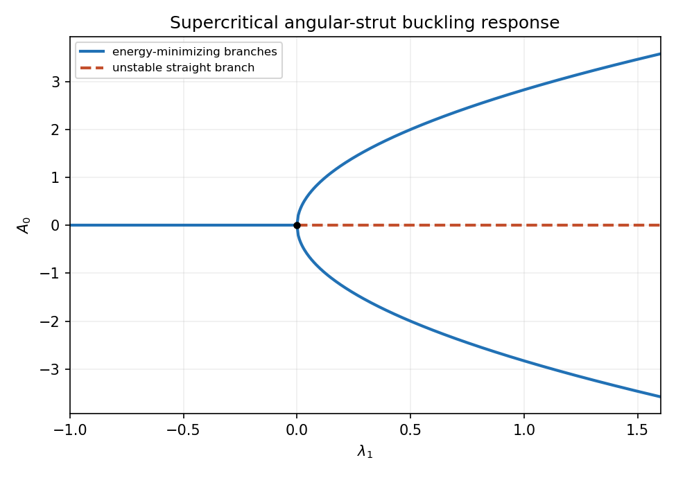

<h1 id="3/d/solution">Solution</h1>

↑ **Parent:** [D](../d.md)

Near the first [eigenvalue](../../../../eigenvalue.md), load detuning supplies a term $\epsilon\lambda_1\theta$, while the first nonlinearity in $\sin\theta=\theta-\theta^3/6+\cdots$ is cubic. Balancing them gives $\theta^2=O(\epsilon)$, so $\boxed{\theta=O(\sqrt\epsilon)}$.

Put $\theta=\sqrt\epsilon[A_0\sin\pi\xi+\epsilon\Theta_1+\cdots]$. At order $\epsilon^{3/2}$,

$$
(\partial_\xi^2+\pi^2)\Theta_1=-\pi^2\lambda_1A_0\sin\pi\xi+\frac{\pi^2A_0^3}{6}\sin^3\pi\xi.
$$

The operator has [kernel](../../../../kernel-of-a-linear-map-split.md) $\sin\pi\xi$, so Fredholm solvability requires its forcing to be [orthogonal](../../../../orthogonal-vectors.md) to that function. Since $\int\sin^2\pi\xi=1/2$ and $\int\sin^4\pi\xi=3/8$,

$$
-\lambda_1A_0/2+A_0^3/16=0,\qquad\boxed{A_0(A_0^2-8\lambda_1)=0.}
$$

When this holds the nonresonant forcing is $-\pi^2A_0^3\sin3\pi\xi/24$; for instance $\Theta_1=A_0^3\sin3\pi\xi/192$ is a solution after absorbing its arbitrary first-mode component into the [amplitude](../../../../wave-amplitude.md) convention.

The branches are $\boxed{A_0=0\text{ for all }\lambda_1,\qquad A_0=\pm\sqrt{8\lambda_1}\text{ for }\lambda_1\geq0}$. This is a [supercritical pitchfork bifurcation](../../../../supercritical-pitchfork-bifurcation.md). The leading reduced energy is proportional to $A_0^4-16\lambda_1A_0^2$: the nonzero branches are minima for $\lambda_1>0$, while zero loses minimality on that side. At the origin the quartic term still stabilizes the critical state.

**[Figure 1](#3/d/image-supercritical-strut-response-stable-nonzero-branches-emerge-above-the-critical-load-dashed-zero-branch-is-unstable). Supercritical strut response: stable nonzero branches emerge above the critical load; dashed zero branch is unstable**.

## ↑ Ancestors (12)

1. [D](../d.md)
2. [3](../../3.md)
3. [2008](../../../2008-split.md)
4. [Past exam of the elasticity and plasticity course of the University of Oxford](../../../split.md)
5. [Elasticity and plasticity course of the University of Oxford](../../../../elasticity-and-plasticity-course-of-the-university-of-oxford.md)
6. [Year 4 of the mathematics course of the University of Oxford](../../../../year-4-of-the-mathematics-course-of-the-university-of-oxford.md)
7. [Mathematics course of the University of Oxford](../../../../mathematics-course-of-the-university-of-oxford.md)
8. [Undergraduate course of the University of Oxford](../../../../undergraduate-course-of-the-university-of-oxford.md)
9. [Course of the University of Oxford](../../../../course-of-the-university-of-oxford.md)
10. [University of Oxford](../../../../university-of-oxford-split.md)
11. [List of universities](../../../../list-of-universities.md)
12. [Codex Wiki](../../../../split.md)
