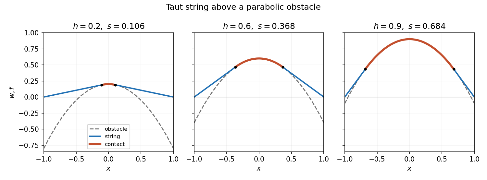

<h1 id="4/d/solution">Solution</h1>

↑ **Parent:** [D](../d.md)

With no applied load the free string segments are straight, while in contact $w=f=h-x^2$. By symmetry use contact $[-s,s]$ and a right-hand line through $(1,0)$ tangent at $s$. The [tangency](../../../../tangency.md) conditions are $w(s)=h-s^2$ and $w'(s)=-2s$, giving $w=2s(1-x)$ on $[s,1]$ and $h-s^2=2s(1-s)$. Therefore

$$
\boxed{s=1-\sqrt{1-h},\qquad w(x)=\begin{cases}h-x^2,&|x|\leq s,\\2s(1-|x|),&s\leq|x|\leq1.\end{cases}}
$$

The other algebraic root $1+\sqrt{1-h}$ is outside the admissible contact interval except at the coincident endpoint $h=1$.

Verification makes the construction complete: the values and [slopes](../../../../slope.md) match at $\pm s$, the endpoints are zero, and outside contact $w-f=(|x|-s)^2\geq0$. Inside contact $Tw''=-2T\leq0$; outside it $w''=0$, so [complementarity](../../../../unilateral-contact-complementarity.md) holds. The minimization argument proves this verified solution is the unique [equilibrium](../../../../equilibrium-point-of-a-dynamical-system.md). At $h=0$ the [contact set](../../../../contact-set-of-an-obstacle-problem.md) is the single point $\{0\}$ and $w=0$; at $h=1$ contact fills the whole interval. This is the [parabolic obstacle under a taut string](../../../../parabolic-obstacle-under-a-taut-string.md).

**[Figure 2](#4/d/image-the-equilibrium-follows-the-parabolic-obstacle-in-contact-and-leaves-along-tangent-straight-segments). The equilibrium follows the parabolic obstacle in contact and leaves along tangent straight segments**.

## ↑ Ancestors (12)

1. [D](../d.md)
2. [4](../../4.md)
3. [2008](../../../2008-split.md)
4. [Past exam of the elasticity and plasticity course of the University of Oxford](../../../split.md)
5. [Elasticity and plasticity course of the University of Oxford](../../../../elasticity-and-plasticity-course-of-the-university-of-oxford.md)
6. [Year 4 of the mathematics course of the University of Oxford](../../../../year-4-of-the-mathematics-course-of-the-university-of-oxford.md)
7. [Mathematics course of the University of Oxford](../../../../mathematics-course-of-the-university-of-oxford.md)
8. [Undergraduate course of the University of Oxford](../../../../undergraduate-course-of-the-university-of-oxford.md)
9. [Course of the University of Oxford](../../../../course-of-the-university-of-oxford.md)
10. [University of Oxford](../../../../university-of-oxford-split.md)
11. [List of universities](../../../../list-of-universities.md)
12. [Codex Wiki](../../../../split.md)
